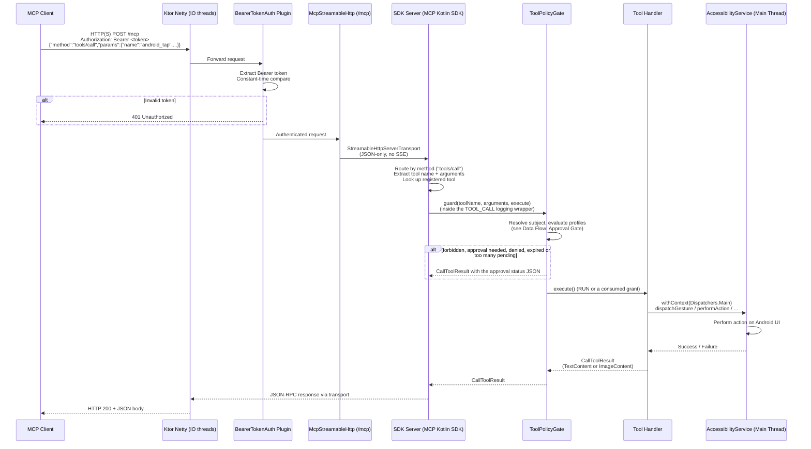
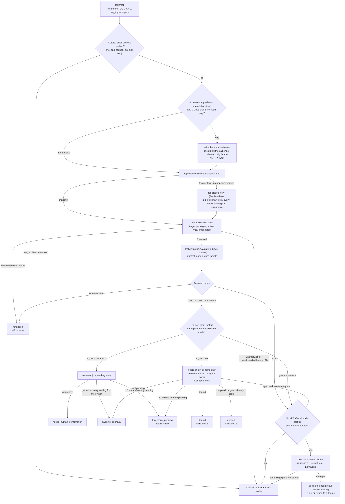
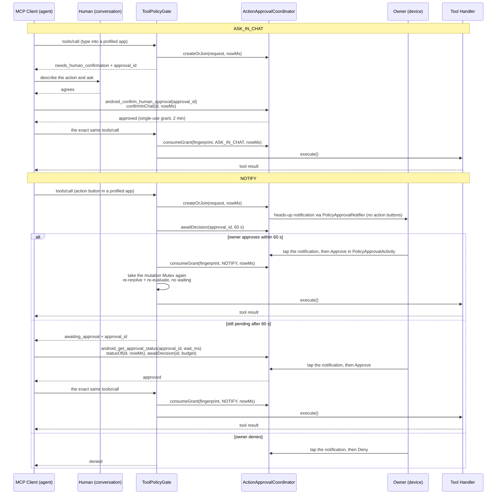

```mermaid
graph TB
    Client["MCP Client (AI)"]
    Client -->|"HTTP or HTTPS/TLS 1.2+"| McpServerSvc

    subgraph Device["Android Device"]
        subgraph MainAct["MainActivity (Compose UI)"]
            VM["MainViewModel"]
            VM --- Settings["Settings"]
            VM --- Status["Status"]
            Settings --- ProfEditor["ApprovalProfilesScreen / ApprovalProfileEditorScreen<br/>(Settings → Approval profiles)"]
            Status --- PendingCard["PendingPolicyApprovalsCard<br/>(Server screen, while requests are pending)"]
        end

        ApprovalAct["PolicyApprovalActivity<br/>(not exported)"]
        Notifier["PolicyApprovalNotifier<br/>(heads-up for NOTIFY requests, no action buttons)"]

        subgraph AccSvc["McpAccessibilityService (System-managed)"]
            TreeParser["AccessibilityTreeParser"]
            ElemFinder["ElementFinder"]
            ActionExec["ActionExecutor"]
            ScreenEnc["ScreenshotEncoder"]
            TypeInputCtrl["TypeInputController"]
        end

        subgraph StorageSvc["Storage & App Services"]
            StorageProv["StorageLocationProvider"]
            FileOps["FileOperationProvider"]
            AppMgr["AppManager"]
            IntentDisp["IntentDispatcher"]
            LocationProv["LocationProvider"]
        end

        subgraph NotifSvc["McpNotificationListenerService (System-managed)"]
            NotifProv["NotificationProvider"]
        end

        subgraph CameraSvc["Camera Services"]
            CamProv["CameraProvider\n(CameraX)"]
            SvcLifecycle["ServiceLifecycleOwner"]
            CamProv --> SvcLifecycle
        end

        subgraph McpServerSvc["McpServerService (Foreground Service)"]
            subgraph Ktor["McpServer (Ktor)"]
                HTTP["HTTP :8080 (HTTPS optional)"]
                StreamHTTP["Streamable HTTP /mcp\n(POST, DELETE; JSON-only, no SSE)"]
                Auth["BearerTokenAuth (global)"]
                SDK["SDK Server → Server.addTool()"]
                HTTP --> StreamHTTP --> Auth --> SDK
            end
            subgraph Policy["Approval policy (policy/)"]
                Gate["ToolPolicyGate<br/>(every tool call)"]
                Subject["ToolSubjectResolver<br/>(ToolPolicyCatalog + resolvers)"]
                Engine["PolicyEngine"]
                Coord["ActionApprovalCoordinator<br/>(in-memory)"]
                Reeval["PendingReevaluator"]
                ProfRepo["ApprovalProfileRepository<br/>(approval_profiles DataStore)"]
                Logger["ApprovalEventLogger<br/>(APPROVAL server log)"]
                Gate --> Subject
                Gate --> Engine
                Gate --> Coord
                Gate --> ProfRepo
                Reeval --> ProfRepo
                Reeval --> Engine
                Reeval --> Coord
                Gate --> Logger
                Reeval --> Logger
            end
            Handlers["Tool handlers<br/>(registered via LoggedToolRegistrar)"]
            subgraph Tunnel["TunnelManager (optional)"]
                CF["CloudflareTunnelProvider\n(process-based)"]
                Ngrok["NgrokTunnelProvider\n(in-process JNI)"]
                Relay["RelayTunnelProvider\n(outbound WebSocket)"]
                PubURL["Public HTTPS URL\n(*.trycloudflare.com / ngrok / relay)"]
                CF --> PubURL
                Ngrok --> PubURL
                Relay --> PubURL
            end
        end

        MainAct -->|"StateFlow (status)"| McpServerSvc
        ProfEditor -->|"edit profiles"| ProfRepo
        ProfEditor -->|"profile events"| Logger
        SDK -->|"every tools/call"| Gate
        Gate -->|"execute()"| Handlers
        Subject -->|"getWindows(), node lookup"| AccSvc
        Subject -->|"notification package"| NotifProv
        Coord -->|"observePending()"| Notifier
        Coord -->|"observePending() (count)"| PendingCard
        Notifier -->|"tap"| ApprovalAct
        PendingCard -->|"tap"| ApprovalAct
        ApprovalAct -->|"approve / deny"| Coord
        ApprovalAct -->|"add exception"| Reeval
        ApprovalAct -->|"owner events"| Logger
        Handlers -->|"Singleton\n(companion object)"| AccSvc
        Handlers --> StorageSvc
        Handlers --> LocationProv
        Handlers --> CameraSvc
        Handlers --> NotifSvc
    end
```

<!-- SACRED DOCUMENT — DO NOT MODIFY except for checkmarks ([ ] → [x]) and review findings. -->
<!-- You MUST NEVER alter, revert, or delete files outside the scope of this plan. -->
<!-- Plans in docs/plans/ are PERMANENT artifacts. There are ZERO exceptions. -->

# Plan 70 — Per-app approval profiles: the agent asks before it acts in the apps you protect

**Scope**: `docs/PENDIENTES.md` point 4, phase 70. Per-app profiles (templates `MONEY_APP` / `COMMON_APP`), four
action types (`READ`, `NAVIGATE`, `TYPE`, `ACTION_BUTTON`), four modes (`RUN`, `ASK_IN_CHAT`, `NOTIFY`, `FORBIDDEN`),
maximum amount with tiers plus removable exceptions, an own-package guard, a gate on every tool call, a notification
with NO action buttons that opens an in-app approval screen, the settings editor, and one detekt config that replaces 30 `FunctionNaming` suppressions. Out of scope (plan 70b):
fingerprint/biometric approval, a "Stop" control, and any other extra approval channel.

**Branch**: `feat/approval-profiles`, stacked on `feat/kotlin-warnings-zero` (PR base = that branch; nothing is merged).

**Paths**: `M/` = `app/src/main/kotlin/com/danielealbano/androidremotecontrolmcp/`,
`T/` = `app/src/test/kotlin/com/danielealbano/androidremotecontrolmcp/`,
`R/` = `app/src/main/res/`.

**Constraints for every action**

- Working-tree files are CRLF (`core.autocrlf=true`); edit line-ending-aware.
- The build fails on any Kotlin compiler warning (`allWarningsAsErrors`, plan 69): no deprecated API, no redundant
  null check, no unused parameter.
- ktlint_official at 140 columns, detekt defaults at 120: every new line ≤ 120.
- Import order is ktlint_official lexicographic. Remove every import a change leaves unused.
- Every user-visible text lives in `R/values/strings.xml`, grouped per story under `<!-- Plan 70 · US<n> -->`
  (texts ready for a later language switch).
- `@Suppress`: none, anywhere. detekt `FunctionNaming` vs PascalCase `@Composable` is solved once in US6 by a detekt
  config (user decision, 2026-10-13: option B inside this plan), which also removes the 30 existing file-level
  `FunctionNaming` suppressions.
- Shared files (`McpServerService.kt`, `strings.xml`, `AndroidManifest.xml`, Hilt modules) are changed by several
  stories: each action's diff applies on top of the earlier stories' diffs.
- US5 replaces US3's `M/policy/approval/PendingReevaluator.kt` (Action 5.3.6) to add `ExceptionReevaluation`; that is
  the only file one story rewrites from an earlier one.
- No tests or linters during implementation; one pass at the end (US10).

**Review budget**: one `plan-reviewer` round before implementation, one `code-reviewer` compliance round after.
Findings that break an acceptance criterion are fixed; anything else is reported to the user in one line, with no new
round.

**Phone-dependent facts not measurable here** (the phone is offline): window hit-test order, whether shade buttons
belong to `com.android.systemui`, package-less windows, and whether the approval screen's amount is readable by the
agent. Each is a Manual QA row in its story.

---

## US1 — Policy model, amount parser, rule engine and their Hilt bindings

Every later story (storage, subject resolution, gate, approval UI) needs one decision core with no Android
dependency, so the risky rules — own-package guard, fail-closed unreadable profiles, "every number is an amount",
unknown target = action button, keyword beats exception — are proven by plain JVM tests before anything is wired.

**Acceptance criteria**
- [x] `M/policy/model/*`, `M/policy/amount/*`, `M/policy/engine/*` compile with no Android framework import (only `kotlinx.serialization`, `java.*`, `javax.inject`).
- [x] Single definitions for the whole plan live here: `ProfilesSnapshot`, `PolicyLimits`, `ProfileTemplates` (`rulesFor`, `newProfile`) and the ONE exception-kind enum `PolicyExceptionKind { NOT_AMOUNT_FIELD, NOT_ACTION_BUTTON }`, all in `policy.model`.
- [x] `ApprovalProfile` and its parts round-trip through `kotlinx.serialization` JSON; an unknown enum value fails the decode (storage relies on that to fail closed).
- [x] `ApprovalProfileValidator.validate` returns distinct `ProfileValidationError`s in declaration order; a `MONEY_APP` without `maxAmount` cannot validate.
- [x] `AmountLimits.parse` accepts only plain ASCII decimals `> 0` with at most `AmountLimits.MAX_DECIMALS` (8) decimals: no sign, no exponent, no grouping, no comma.
- [x] `AmountParser.scan` is regex-free and linear; inputs over `MAX_INPUT_LENGTH`, NFKC expansions over the cap and exponents over `MAX_EXPONENT` return `exceedsLimits = true` (never a hang, never a silent pass).
- [x] `PolicyEngineImpl`: own package + non-READ → FORBIDDEN even with zero profiles; unreadable or invalid stored profile → non-READ FORBIDDEN; strictest decision across targets; amount tiers and `maxAmount` combine with the rule by "strictest wins"; action keyword beats a `notActionButtons` exception; unclassifiable target → ACTION_BUTTON.
- [x] `toString()` of `PolicySubject`, `PolicyTarget`, `PolicySelector`, `AmountTier`, `ApprovalProfile`, `AmountScan`, `RawNumber` and `AmountReading` never contains amount text or values, labels, selector values, `maxAmount` or tier limits.
- [x] `M/policy/di/PolicyModule.kt` binds `PolicyEngine` → `PolicyEngineImpl` (`@Singleton`) and provides `@OwnPackageName String` = `BuildConfig.APPLICATION_ID`; `M/di/AppModule.kt` is not touched by US1.
- [x] No `res/values/strings.xml` change: US1 has no user-visible text (`ProfileValidationError` → string mapping belongs to the profile-editor story). `ActionKeywords` are matching data and stay in code.

### Task 1.1 — Model

**Action 1.1.1** — create `M/policy/model/PolicyActionType.kt`:

```kotlin
package com.danielealbano.androidremotecontrolmcp.policy.model

import kotlinx.serialization.Serializable

/** The four action types a profile rules. Persisted by name: never rename an entry. */
@Serializable
enum class PolicyActionType {
    READ,
    NAVIGATE,
    TYPE,
    ACTION_BUTTON,
}
```

**Action 1.1.2** — create `M/policy/model/RuleMode.kt`:

```kotlin
package com.danielealbano.androidremotecontrolmcp.policy.model

import kotlinx.serialization.Serializable

private const val SEVERITY_RUN = 0
private const val SEVERITY_ASK_IN_CHAT = 1
private const val SEVERITY_NOTIFY = 2
private const val SEVERITY_FORBIDDEN = 9

/**
 * What a rule does with a matching call, ordered by [severity]: the strictest mode wins. Persisted by name;
 * [severity] is never persisted. The gap between [NOTIFY] and [FORBIDDEN] is reserved so later modes are added
 * without touching stored profiles.
 */
@Serializable
enum class RuleMode(
    val severity: Int,
) {
    RUN(SEVERITY_RUN),
    ASK_IN_CHAT(SEVERITY_ASK_IN_CHAT),
    NOTIFY(SEVERITY_NOTIFY),
    FORBIDDEN(SEVERITY_FORBIDDEN),
    ;

    fun isStricterThan(other: RuleMode): Boolean = severity > other.severity
}
```

**Action 1.1.3** — create `M/policy/model/ProfileTemplate.kt`:

```kotlin
package com.danielealbano.androidremotecontrolmcp.policy.model

import kotlinx.serialization.Serializable

/** Starting values chosen when a profile is created (see `ProfileTemplates`). Persisted by name. */
@Serializable
enum class ProfileTemplate {
    MONEY_APP,
    COMMON_APP,
}
```

**Action 1.1.4** — create `M/policy/model/SelectorKind.kt`:

```kotlin
package com.danielealbano.androidremotecontrolmcp.policy.model

import kotlinx.serialization.Serializable

/**
 * How a [PolicySelector] identifies a node: [RESOURCE_ID] holds `viewIdResourceName`; [LABEL] holds
 * `<className>|<normalized label>` built by `PolicyLabels.labelSelector`.
 */
@Serializable
enum class SelectorKind {
    RESOURCE_ID,
    LABEL,
}
```

**Action 1.1.5** — create `M/policy/model/PolicySelector.kt`:

```kotlin
package com.danielealbano.androidremotecontrolmcp.policy.model

import kotlinx.serialization.Serializable

/**
 * Stable identity of a node inside one app. [value] is device-derived: display-only, never an instruction, never
 * logged — [toString] omits it.
 */
@Serializable
data class PolicySelector(
    val kind: SelectorKind,
    val value: String,
) {
    override fun toString(): String = "PolicySelector(kind=$kind, valueLength=${value.length})"
}
```

**Action 1.1.6** — create `M/policy/model/AmountTier.kt`:

```kotlin
package com.danielealbano.androidremotecontrolmcp.policy.model

import kotlinx.serialization.Serializable

/**
 * Amounts up to and including [upTo] get [mode]. [upTo] is a plain decimal string (`AmountLimits.canonical`):
 * no currency, at most `AmountLimits.MAX_DECIMALS` decimals. [toString] omits [upTo] (an amount limit).
 */
@Serializable
data class AmountTier(
    val upTo: String,
    val mode: RuleMode,
) {
    override fun toString(): String = "AmountTier(mode=$mode)"
}
```

**Action 1.1.7** — create `M/policy/model/PolicyException.kt`:

```kotlin
package com.danielealbano.androidremotecontrolmcp.policy.model

import kotlinx.serialization.Serializable

/** An owner-confirmed exception that weakens a profile for one [selector] until the owner removes it. */
@Serializable
data class PolicyException(
    val selector: PolicySelector,
    val createdAtMs: Long,
)
```

**Action 1.1.8** — create `M/policy/model/ApprovalProfile.kt`:

```kotlin
package com.danielealbano.androidremotecontrolmcp.policy.model

import kotlinx.serialization.Serializable

/**
 * Per-app approval profile. [maxAmount] null = no amount limit; when set, every number in a typed field's final
 * value counts as an amount (except password fields and [notAmountFields]). [toString] omits [maxAmount] and
 * selector values so a stray log line cannot leak them.
 */
@Serializable
data class ApprovalProfile(
    val packageName: String,
    val template: ProfileTemplate,
    val rules: Map<PolicyActionType, RuleMode>,
    val maxAmount: String?,
    val amountTiers: List<AmountTier>,
    val notAmountFields: List<PolicyException>,
    val notActionButtons: List<PolicyException>,
    val updatedAtMs: Long,
) {
    override fun toString(): String =
        "ApprovalProfile(packageName=$packageName, template=$template, rules=$rules, " +
            "hasMaxAmount=${maxAmount != null}, amountTiers=${amountTiers.size}, " +
            "notAmountFields=${notAmountFields.size}, notActionButtons=${notActionButtons.size}, " +
            "updatedAtMs=$updatedAtMs)"
}
```

**Action 1.1.9** — create `M/policy/model/PolicyExceptionKind.kt`.
Context: the ONLY exception-kind enum of the plan; storage, approvals, gate and both UIs use it directly (no mapping layer). Not `@Serializable`: it is never a stored field, only a selector of which list to change.

```kotlin
package com.danielealbano.androidremotecontrolmcp.policy.model

/** Which exception list of an [ApprovalProfile] an exception belongs to. */
enum class PolicyExceptionKind {
    /** "This field is not an amount": [ApprovalProfile.notAmountFields]. */
    NOT_AMOUNT_FIELD,

    /** "This is not an action button": [ApprovalProfile.notActionButtons]. */
    NOT_ACTION_BUTTON,
}
```

**Action 1.1.10** — create `M/policy/model/ProfilesSnapshot.kt`:

```kotlin
package com.danielealbano.androidremotecontrolmcp.policy.model

/**
 * Immutable view of every stored approval profile, keyed by package. [unreadable] holds the packages whose stored
 * profile failed to decode or validate; the engine treats them fail-closed (every non-READ action is FORBIDDEN).
 */
data class ProfilesSnapshot(
    val profiles: Map<String, ApprovalProfile>,
    val unreadable: Set<String>,
) {
    /** Number of stored profile keys, readable or not: what the storage cap counts. */
    val storedCount: Int get() = profiles.size + unreadable.size

    /** True when at least one profile key exists, readable or not. */
    val hasAnyProfile: Boolean get() = storedCount > 0

    companion object {
        /** No profile stored. */
        val EMPTY = ProfilesSnapshot(profiles = emptyMap(), unreadable = emptySet())
    }
}
```

**Action 1.1.11** — create `M/policy/model/PolicyLimits.kt`:

```kotlin
package com.danielealbano.androidremotecontrolmcp.policy.model

/** Caps shared by the validator, the storage and the selector builders. */
object PolicyLimits {
    /** Maximum stored profile keys, readable and unreadable together. */
    const val MAX_PROFILES = 100

    /** Maximum amount tiers in one profile. */
    const val MAX_AMOUNT_TIERS = 5

    /** Maximum entries in each exception list of one profile. */
    const val MAX_EXCEPTIONS_PER_LIST = 100

    /** Maximum length of a [PolicySelector.value]. */
    const val MAX_SELECTOR_VALUE_LENGTH = 256

    /** Maximum length of a stored amount limit (`maxAmount`, `AmountTier.upTo`). */
    const val MAX_AMOUNT_TEXT_LENGTH = 30

    /** Maximum length of an Android package name. */
    const val MAX_PACKAGE_NAME_LENGTH = 255
}
```

**Action 1.1.12** — create `M/policy/model/AmountLimits.kt`.
Context: the ONE parser for owner-entered amount limits; the profile editor validates its inputs with `parse` (plain decimal, `.` as the only decimal mark, up to 8 decimals, no grouping, no sign, no exponent, `> 0`) and stores `canonical(parse(text))`.

```kotlin
package com.danielealbano.androidremotecontrolmcp.policy.model

import java.math.BigDecimal

/**
 * Parses and formats the amount limits stored in a profile. Only plain ASCII decimals (`1500`, `1500.5`,
 * `0.00000001`) are accepted: `.` as the only decimal mark, at most [MAX_DECIMALS] decimals, no exponent, no
 * grouping, no sign, so a stored limit can never be expensive to compare or print.
 */
object AmountLimits {
    /** Most decimals a limit may carry (covers 8-decimal currencies). */
    const val MAX_DECIMALS = 8

    /** Returns the value of a valid, strictly positive plain decimal, or null. */
    fun parse(text: String): BigDecimal? {
        val plain = text.length <= PolicyLimits.MAX_AMOUNT_TEXT_LENGTH && isPlainDecimal(text)
        val value = if (plain) BigDecimal(text) else null
        return value?.takeIf { it.signum() > 0 }
    }

    /** Canonical stored form: `1500.50` → `1500.5`, `1E+3` → `1000`. */
    fun canonical(value: BigDecimal): String = value.stripTrailingZeros().toPlainString()

    private fun isPlainDecimal(text: String): Boolean {
        val dot = text.indexOf('.')
        val integerPart = if (dot < 0) text else text.substring(0, dot)
        val fraction = if (dot < 0) "" else text.substring(dot + 1)
        val integerValid = integerPart.isNotEmpty() && integerPart.all(::isAsciiDigit)
        val fractionValid = dot < 0 || (fraction.length in 1..MAX_DECIMALS && fraction.all(::isAsciiDigit))
        return integerValid && fractionValid
    }

    private fun isAsciiDigit(char: Char): Boolean = char in '0'..'9'
}
```

**Action 1.1.13** — create `M/policy/model/ProfileTemplates.kt`:

```kotlin
package com.danielealbano.androidremotecontrolmcp.policy.model

/** Values a new profile starts with; everything stays editable afterwards. */
object ProfileTemplates {
    fun rulesFor(template: ProfileTemplate): Map<PolicyActionType, RuleMode> =
        when (template) {
            ProfileTemplate.MONEY_APP -> {
                mapOf(
                    PolicyActionType.READ to RuleMode.RUN,
                    PolicyActionType.NAVIGATE to RuleMode.RUN,
                    PolicyActionType.TYPE to RuleMode.ASK_IN_CHAT,
                    PolicyActionType.ACTION_BUTTON to RuleMode.NOTIFY,
                )
            }

            ProfileTemplate.COMMON_APP -> {
                mapOf(
                    PolicyActionType.READ to RuleMode.RUN,
                    PolicyActionType.NAVIGATE to RuleMode.RUN,
                    PolicyActionType.TYPE to RuleMode.RUN,
                    PolicyActionType.ACTION_BUTTON to RuleMode.ASK_IN_CHAT,
                )
            }
        }

    /**
     * A new profile from [template]. A [ProfileTemplate.MONEY_APP] profile starts without `maxAmount`, so it does
     * not validate (`MAX_AMOUNT_REQUIRED`) until the owner enters one.
     */
    fun newProfile(
        packageName: String,
        template: ProfileTemplate,
        nowMs: Long,
    ): ApprovalProfile =
        ApprovalProfile(
            packageName = packageName,
            template = template,
            rules = rulesFor(template),
            maxAmount = null,
            amountTiers = emptyList(),
            notAmountFields = emptyList(),
            notActionButtons = emptyList(),
            updatedAtMs = nowMs,
        )
}
```

**Action 1.1.14** — create `M/policy/model/ProfileValidationError.kt`:

```kotlin
package com.danielealbano.androidremotecontrolmcp.policy.model

/** Why a profile cannot be saved. Declaration order is the order the validator reports them in. */
enum class ProfileValidationError {
    PACKAGE_NAME_INVALID,
    RULES_INCOMPLETE,
    MAX_AMOUNT_REQUIRED,
    MAX_AMOUNT_INVALID,
    TIERS_REQUIRE_MAX_AMOUNT,
    TOO_MANY_TIERS,
    TIER_AMOUNT_INVALID,
    TIERS_NOT_ASCENDING,
    TIER_ABOVE_MAX_AMOUNT,
    TIER_MODES_DECREASING,
    TOO_MANY_EXCEPTIONS,
    EXCEPTION_SELECTOR_INVALID,
}
```

**Action 1.1.15** — create `M/policy/model/ApprovalProfileValidator.kt`:

```kotlin
package com.danielealbano.androidremotecontrolmcp.policy.model

import java.math.BigDecimal

/** Pure validation of an [ApprovalProfile]. An empty result means the profile can be saved and enforced. */
object ApprovalProfileValidator {
    fun validate(profile: ApprovalProfile): List<ProfileValidationError> {
        val errors = mutableSetOf<ProfileValidationError>()
        if (!isValidPackageName(profile.packageName)) errors += ProfileValidationError.PACKAGE_NAME_INVALID
        if (!PolicyActionType.entries.all { it in profile.rules }) errors += ProfileValidationError.RULES_INCOMPLETE
        errors += amountErrors(profile)
        errors += exceptionErrors(profile)
        return errors.sorted()
    }

    private fun amountErrors(profile: ApprovalProfile): Set<ProfileValidationError> {
        val maxText = profile.maxAmount
        val max = maxText?.let(AmountLimits::parse)
        val errors = mutableSetOf<ProfileValidationError>()
        if (maxText == null && profile.template == ProfileTemplate.MONEY_APP) {
            errors += ProfileValidationError.MAX_AMOUNT_REQUIRED
        }
        if (maxText != null && max == null) errors += ProfileValidationError.MAX_AMOUNT_INVALID
        if (profile.amountTiers.isNotEmpty()) errors += tierErrors(profile.amountTiers, maxText != null, max)
        return errors
    }

    private fun tierErrors(
        tiers: List<AmountTier>,
        maxConfigured: Boolean,
        max: BigDecimal?,
    ): Set<ProfileValidationError> {
        val errors = mutableSetOf<ProfileValidationError>()
        if (!maxConfigured) errors += ProfileValidationError.TIERS_REQUIRE_MAX_AMOUNT
        if (tiers.size > PolicyLimits.MAX_AMOUNT_TIERS) errors += ProfileValidationError.TOO_MANY_TIERS
        val limits = tiers.map { AmountLimits.parse(it.upTo) }
        if (limits.any { it == null }) errors += ProfileValidationError.TIER_AMOUNT_INVALID
        val parsed = limits.filterNotNull()
        if (parsed.zipWithNext().any { (lower, upper) -> lower >= upper }) {
            errors += ProfileValidationError.TIERS_NOT_ASCENDING
        }
        if (max != null && parsed.any { it > max }) errors += ProfileValidationError.TIER_ABOVE_MAX_AMOUNT
        if (tiers.zipWithNext().any { (lower, upper) -> lower.mode.isStricterThan(upper.mode) }) {
            errors += ProfileValidationError.TIER_MODES_DECREASING
        }
        return errors
    }

    private fun exceptionErrors(profile: ApprovalProfile): Set<ProfileValidationError> {
        val lists = listOf(profile.notAmountFields, profile.notActionButtons)
        val errors = mutableSetOf<ProfileValidationError>()
        if (lists.any { it.size > PolicyLimits.MAX_EXCEPTIONS_PER_LIST }) {
            errors += ProfileValidationError.TOO_MANY_EXCEPTIONS
        }
        if (lists.flatten().any { !isValidSelector(it.selector) }) {
            errors += ProfileValidationError.EXCEPTION_SELECTOR_INVALID
        }
        return errors
    }

    private fun isValidSelector(selector: PolicySelector): Boolean =
        selector.value.isNotBlank() && selector.value.length <= PolicyLimits.MAX_SELECTOR_VALUE_LENGTH

    private fun isValidPackageName(packageName: String): Boolean {
        val segments = packageName.split('.')
        return packageName.length <= PolicyLimits.MAX_PACKAGE_NAME_LENGTH &&
            segments.size > 1 &&
            segments.all(::isValidPackageSegment)
    }

    private fun isValidPackageSegment(segment: String): Boolean =
        segment.isNotEmpty() &&
            isAsciiLetter(segment.first()) &&
            segment.all { isAsciiLetter(it) || it in '0'..'9' || it == '_' }

    private fun isAsciiLetter(char: Char): Boolean = char in 'a'..'z' || char in 'A'..'Z'
}
```

**Action 1.1.16** — create model tests.

**File**: `T/policy/model/RuleModeTest.kt`

| Test | Verifies |
|------|----------|
| `severity is strictly ascending in declaration order` | `RuleMode.entries` severities strictly increase: RUN < ASK_IN_CHAT < NOTIFY < FORBIDDEN |
| `isStricterThan compares severity` | `FORBIDDEN.isStricterThan(NOTIFY)` true; `RUN.isStricterThan(RUN)` false; `ASK_IN_CHAT.isStricterThan(NOTIFY)` false |

**File**: `T/policy/model/ProfileTemplatesTest.kt`

| Test | Verifies |
|------|----------|
| `money app rules match the owner template` | READ RUN, NAVIGATE RUN, TYPE ASK_IN_CHAT, ACTION_BUTTON NOTIFY |
| `common app rules match the owner template` | READ RUN, NAVIGATE RUN, TYPE RUN, ACTION_BUTTON ASK_IN_CHAT |
| `newProfile starts without limits or exceptions` | `maxAmount` null, tiers and both exception lists empty, `updatedAtMs` = nowMs, rules cover every `PolicyActionType` |
| `new money profile does not validate until maxAmount is set` | `validate(newProfile(MONEY_APP))` == `[MAX_AMOUNT_REQUIRED]`; with `maxAmount = "5000"` → empty |
| `new common profile validates` | `validate(newProfile(COMMON_APP))` empty |

**File**: `T/policy/model/AmountLimitsTest.kt` (`@ParameterizedTest` + `@MethodSource`; compare with `compareTo`)

| Input | `parse` result |
|------|----------|
| `"1500"` | 1500 |
| `"1500.50"` | 1500.50 |
| `"0.01"` | 0.01 |
| `"0.00000001"` (8 decimals) | 0.00000001 |
| `"1500.12345678"` (8 decimals) | 1500.12345678 |
| `"0.000000001"`, `"1500.123456789"` (9 decimals) | null |
| `"007"` | 7 |
| `"0"`, `"0.00"` | null (not positive) |
| `"-5"`, `"+5"` | null |
| `"1e3"`, `"1E+3"` | null (no exponent) |
| `"1,5"`, `"1.500,00"`, `"1,500"`, `"1 500"`, `"1'500"` | null (no grouping, `,` is never a decimal mark) |
| `"1.2.3"`, `".5"`, `"5."`, `""`, `"abc"` | null |
| `"１２３"` (full-width), `"١٢٣"` (Arabic-Indic) | null (ASCII only) |
| `" 1500"`, `"1500 "` | null (no trimming: the caller trims) |
| 30-digit string / 31-digit string | value / null |

| Test | Verifies |
|------|----------|
| `canonical strips trailing zeros without exponent` | `canonical(BigDecimal("1500.50"))` = `"1500.5"`; `canonical(BigDecimal("1E+3"))` = `"1000"`; `canonical(BigDecimal("0.00000001"))` = `"0.00000001"` |
| `canonical output parses back to the same value` | for `"1500.50"`, `"0.10000000"`, `"10000"`: `parse(canonical(parse(it)!!))` compares equal to `parse(it)` |

**File**: `T/policy/model/ApprovalProfileValidatorTest.kt` (**Setup**: `money` = `ProfileTemplates.newProfile("com.example.bank", MONEY_APP, 0L).copy(maxAmount = "10000")`; `common` = `ProfileTemplates.newProfile("com.example.notes", COMMON_APP, 0L)`; variants via `copy(...)`)

| Test | Verifies |
|------|----------|
| `valid money profile has no errors` | `money` → empty |
| `valid common profile without limit has no errors` | `common` → empty |
| `money profile without maxAmount` | `money.copy(maxAmount = null)` → `[MAX_AMOUNT_REQUIRED]` |
| `common profile without maxAmount` | empty |
| `eight-decimal limits are valid` | `money.copy(maxAmount = "0.5", amountTiers = [AmountTier("0.00000001", ASK_IN_CHAT)])` → empty |
| `invalid package names` | each of `"bank"`, `"com..bank"`, `"1com.bank"`, `"com.bank-x"`, `"com.bank."`, `""`, 256-char name → contains `PACKAGE_NAME_INVALID` |
| `valid package names` | `"com.example.bank_2"`, `"a.b"` → no `PACKAGE_NAME_INVALID` |
| `missing rule` | rules without `TYPE` → `RULES_INCOMPLETE` |
| `invalid maxAmount` | each of `"abc"`, `"-5"`, `"0"`, `"1e3"`, `"1,5"`, `"1.123456789"`, `""` → `MAX_AMOUNT_INVALID` (and not `MAX_AMOUNT_REQUIRED`) |
| `tiers without maxAmount` | common profile, `maxAmount = null`, one tier → `TIERS_REQUIRE_MAX_AMOUNT` |
| `too many tiers` | 6 ascending tiers ≤ max → `[TOO_MANY_TIERS]` |
| `unparseable tier amount` | tier `upTo = "x"` → `TIER_AMOUNT_INVALID` |
| `tiers must be strictly ascending` | `[500, 500]` and `[1000, 500]` → `TIERS_NOT_ASCENDING` |
| `tier above maxAmount` | max 10000, tier 20000 → `TIER_ABOVE_MAX_AMOUNT`; tier exactly 10000 → no error |
| `tier modes must not decrease` | `[1000 NOTIFY, 5000 ASK_IN_CHAT]` → `TIER_MODES_DECREASING`; equal modes → no error |
| `too many exceptions` | 101 `notAmountFields` → `TOO_MANY_EXCEPTIONS`; 100 → no error; same for `notActionButtons` |
| `invalid exception selector` | blank value and 257-char value → `EXCEPTION_SELECTOR_INVALID` |
| `errors are distinct and in declaration order` | package `"x"`, `maxAmount = "abc"`, tiers `[x NOTIFY, 5 RUN]` → exactly `[PACKAGE_NAME_INVALID, MAX_AMOUNT_INVALID, TIER_AMOUNT_INVALID, TIER_MODES_DECREASING]` |

**File**: `T/policy/model/ApprovalProfileSerializationTest.kt` (**Setup**: `Json` default instance; `profile` = `ProfileTemplates.newProfile("com.example.bank", MONEY_APP, 0L)` copied with `maxAmount = "10000"`, two tiers, one `RESOURCE_ID` exception in `notAmountFields` and one `LABEL` exception in `notActionButtons`)

| Test | Verifies |
|------|----------|
| `profile round-trips through JSON` | `profile` encodes and decodes to an equal object |
| `enums are stored by name` | encoded JSON contains `"ASK_IN_CHAT"`, `"ACTION_BUTTON"`, `"RESOURCE_ID"`; no severity number |
| `unknown rule mode fails the decode` | JSON with `"TYPE":"SOMETHING_NEW"` → `SerializationException` |
| `missing field fails the decode` | JSON without `rules` → `SerializationException` |

**File**: `T/policy/model/ProfilesSnapshotTest.kt`

| Test | Verifies |
|------|----------|
| `EMPTY has no profile` | `storedCount` 0, `hasAnyProfile` false |
| `unreadable counts as a stored profile` | `ProfilesSnapshot(emptyMap(), setOf("com.bank"))` → `storedCount` 1, `hasAnyProfile` true |

**File**: `T/policy/model/PolicyExceptionKindTest.kt`

| Test | Verifies |
|------|----------|
| `exception kinds are exactly the two profile lists` | `PolicyExceptionKind.entries` == `[NOT_AMOUNT_FIELD, NOT_ACTION_BUTTON]` |

**Definition of Done**
- [x] 15 model files created exactly as above; no Android import under `policy/model`.
- [x] Model tests above implemented.

### Task 1.2 — Amount parser

**Action 1.2.1** — create `M/policy/amount/AmountScan.kt`:

```kotlin
package com.danielealbano.androidremotecontrolmcp.policy.amount

import java.math.BigDecimal

/**
 * Result of [AmountParser.scan]. Amount values are sensitive: never log them.
 *
 * @property max the largest number found; null when the text holds no number.
 * @property ambiguous true when [max] can only be read as the larger of two readings (`1.500` → 1500, not 1.5).
 * @property exceedsLimits true when the input or an exponent exceeded the parser caps; callers MUST treat it as an
 *   amount above every limit.
 */
data class AmountScan(
    val max: BigDecimal?,
    val ambiguous: Boolean,
    val exceedsLimits: Boolean = false,
) {
    override fun toString(): String =
        "AmountScan(hasMax=${max != null}, ambiguous=$ambiguous, " +
            "exceedsLimits=$exceedsLimits)"
}
```

**Action 1.2.2** — create `M/policy/amount/AmountTokenizer.kt`:

```kotlin
package com.danielealbano.androidremotecontrolmcp.policy.amount

/**
 * One number candidate: ASCII digit groups, the canonical separators between them, and its clamped exponent.
 * [toString] omits the digits (amounts are sensitive).
 */
internal data class RawNumber(
    val groups: List<String>,
    val separators: List<Char>,
    val exponent: Int,
) {
    override fun toString(): String =
        "RawNumber(groups=${groups.size}, separators=${separators.size}, " +
            "hasExponent=${exponent != 0})"
}

/**
 * Single-pass, regex-free tokenizer over code points, linear in the input: a space look-ahead reads at most
 * [GROUP_SIZE] + 1 code points and every other code point is consumed once. Signs, parentheses, currency symbols
 * and letters are skipped, so `-200` and `(500)` read as their absolute value and `5k` reads as 5.
 */
internal class AmountTokenizer(
    text: String,
) {
    private val codePoints: IntArray = text.codePoints().toArray()
    private var pos = 0

    fun tokenize(): List<RawNumber> {
        val numbers = mutableListOf<RawNumber>()
        while (pos < codePoints.size) {
            if (digitAt(pos) >= 0) {
                numbers += readNumber()
            } else {
                pos++
            }
        }
        return numbers
    }

    private fun readNumber(): RawNumber {
        val groups = mutableListOf(readDigits())
        val separators = mutableListOf<Char>()
        var separator = separatorAhead(groups.last().length, firstGroup = true)
        while (separator != null) {
            separators += separator
            pos++
            groups += readDigits()
            separator = separatorAhead(groups.last().length, firstGroup = false)
        }
        return RawNumber(groups, separators, readExponent())
    }

    private fun readDigits(): String {
        val builder = StringBuilder()
        var digit = digitAt(pos)
        while (digit >= 0) {
            builder.append('0' + digit)
            pos++
            digit = digitAt(pos)
        }
        return builder.toString()
    }

    /** The canonical separator at [pos] when it continues the current number, else null. */
    private fun separatorAhead(
        groupLength: Int,
        firstGroup: Boolean,
    ): Char? {
        if (digitAt(pos + 1) < 0) return null
        return when (val kind = canonicalSeparator(codePoints[pos])) {
            SPACE -> if (spaceJoins(groupLength, firstGroup)) SPACE else null
            else -> kind
        }
    }

    /** Spaces join only thousands groups: `1 500` joins, `4111 1111` (card groups of 4) does not. */
    private fun spaceJoins(
        groupLength: Int,
        firstGroup: Boolean,
    ): Boolean {
        val currentGroupFits = groupLength == GROUP_SIZE || (firstGroup && groupLength < GROUP_SIZE)
        return currentGroupFits && digitRunLength(pos + 1) == GROUP_SIZE
    }

    private fun digitRunLength(start: Int): Int {
        var end = start
        while (end - start <= GROUP_SIZE && digitAt(end) >= 0) {
            end++
        }
        return end - start
    }

    /** Reads `e`/`E`, an optional sign and digits; the magnitude saturates at `MAX_EXPONENT + 1`. */
    private fun readExponent(): Int {
        val signAt = pos + 1
        val digitsAt = if (codePointAt(signAt) in SIGNS) signAt + 1 else signAt
        if (codePointAt(pos) !in EXPONENT_MARKERS || digitAt(digitsAt) < 0) return 0
        val sign = if (codePointAt(signAt) in MINUS_SIGNS) -1 else 1
        pos = digitsAt
        var magnitude = 0
        var digit = digitAt(pos)
        while (digit >= 0) {
            magnitude = minOf(magnitude * RADIX + digit, AmountParser.MAX_EXPONENT + 1)
            pos++
            digit = digitAt(pos)
        }
        return sign * magnitude
    }

    private fun codePointAt(index: Int): Int = if (index < codePoints.size) codePoints[index] else NO_CODE_POINT

    private fun digitAt(index: Int): Int {
        if (index >= codePoints.size) return NO_DIGIT
        return Character.digit(codePoints[index], RADIX)
    }

    companion object {
        const val DOT = '.'
        const val COMMA = ','
        const val APOSTROPHE = '\''
        const val SPACE = ' '
        const val GROUP_SIZE = 3
        private const val RADIX = 10
        private const val NO_DIGIT = -1
        private const val NO_CODE_POINT = -1
        private const val NBSP = 0x00A0
        private const val NARROW_NBSP = 0x202F
        private const val RIGHT_SINGLE_QUOTE = 0x2019
        private const val ARABIC_DECIMAL_SEPARATOR = 0x066B
        private const val ARABIC_THOUSANDS_SEPARATOR = 0x066C
        private const val MINUS_SIGN = 0x2212
        private val EXPONENT_MARKERS = setOf('e'.code, 'E'.code)
        private val MINUS_SIGNS = setOf('-'.code, MINUS_SIGN)
        private val SIGNS = MINUS_SIGNS + '+'.code

        private fun canonicalSeparator(codePoint: Int): Char? =
            when (codePoint) {
                DOT.code, ARABIC_DECIMAL_SEPARATOR -> DOT
                COMMA.code, ARABIC_THOUSANDS_SEPARATOR -> COMMA
                APOSTROPHE.code, RIGHT_SINGLE_QUOTE -> APOSTROPHE
                SPACE.code, NBSP, NARROW_NBSP -> SPACE
                else -> null
            }
    }
}
```

**Action 1.2.3** — create `M/policy/amount/AmountReader.kt`:

```kotlin
package com.danielealbano.androidremotecontrolmcp.policy.amount

import java.math.BigDecimal

/**
 * Value of one [RawNumber]; [overflow] = exponent above [AmountParser.MAX_EXPONENT] ([value] unscaled).
 * [toString] omits [value].
 */
internal data class AmountReading(
    val value: BigDecimal,
    val ambiguous: Boolean,
    val overflow: Boolean,
) {
    override fun toString(): String = "AmountReading(ambiguous=$ambiguous, overflow=$overflow)"
}

/**
 * Locale-independent reading: spaces and apostrophes always group; with both `.` and `,` the rightmost is the
 * decimal mark; a repeated mark groups; a single mark followed by exactly 3 digits is ambiguous and reads as the
 * larger value (grouping); any other single mark is the decimal mark.
 */
internal object AmountReader {
    fun read(raw: RawNumber): AmountReading {
        val mark = decimalMark(raw.separators, raw.groups.last().length)
        val base =
            if (mark == null || mark.ambiguous) {
                BigDecimal(raw.groups.joinToString(separator = ""))
            } else {
                decimalValue(raw.groups, mark.index)
            }
        val overflow = raw.exponent > AmountParser.MAX_EXPONENT
        val value = if (overflow) base else base.scaleByPowerOfTen(raw.exponent)
        return AmountReading(value, ambiguous = mark?.ambiguous == true, overflow = overflow)
    }

    private data class DecimalMark(
        val index: Int,
        val ambiguous: Boolean,
    )

    private fun decimalMark(
        separators: List<Char>,
        lastGroupLength: Int,
    ): DecimalMark? {
        val last = separators.lastOrNull()
        val decimalKind = last == AmountTokenizer.DOT || last == AmountTokenizer.COMMA
        if (!decimalKind || separators.count { it == last } > 1) return null
        val otherKind = if (last == AmountTokenizer.DOT) AmountTokenizer.COMMA else AmountTokenizer.DOT
        val ambiguous = otherKind !in separators && lastGroupLength == AmountTokenizer.GROUP_SIZE
        return DecimalMark(separators.lastIndex, ambiguous)
    }

    private fun decimalValue(
        groups: List<String>,
        separatorIndex: Int,
    ): BigDecimal {
        val integerPart = groups.subList(0, separatorIndex + 1).joinToString(separator = "")
        val fraction = groups.subList(separatorIndex + 1, groups.size).joinToString(separator = "")
        return BigDecimal("$integerPart.$fraction")
    }
}
```

**Action 1.2.4** — create `M/policy/amount/AmountParser.kt`:

```kotlin
package com.danielealbano.androidremotecontrolmcp.policy.amount

import java.math.BigDecimal
import java.text.Normalizer

/**
 * Finds the largest number in a text (decision "A": every number typed in a profiled app counts as an amount).
 * Pure and JVM-testable. The text is NFKC-normalized first (full-width digits and punctuation, superscripts), then
 * any Unicode decimal digit counts (`Character.digit`). Words (`mil`, `5k`) are not numbers.
 */
object AmountParser {
    /** Longest text scanned; longer input returns `exceedsLimits = true`. */
    const val MAX_INPUT_LENGTH = 10_000

    /** Largest exponent accepted in scientific notation; larger returns `exceedsLimits = true`. */
    const val MAX_EXPONENT = 30

    private const val NORMALIZED_LENGTH_FACTOR = 4
    private const val MAX_NORMALIZED_LENGTH = MAX_INPUT_LENGTH * NORMALIZED_LENGTH_FACTOR
    private val EXCEEDED = AmountScan(max = null, ambiguous = false, exceedsLimits = true)

    fun scan(text: String): AmountScan {
        val normalized =
            if (text.length <= MAX_INPUT_LENGTH) Normalizer.normalize(text, Normalizer.Form.NFKC) else null
        if (normalized == null || normalized.length > MAX_NORMALIZED_LENGTH) return EXCEEDED
        return summarize(AmountTokenizer(normalized).tokenize().map(AmountReader::read))
    }

    private fun summarize(readings: List<AmountReading>): AmountScan {
        var max: BigDecimal? = null
        var ambiguous = false
        for (reading in readings.filterNot { it.overflow }) {
            val current = max
            if (current == null || reading.value > current) {
                max = reading.value
                ambiguous = reading.ambiguous
            } else if (reading.value.compareTo(current) == 0) {
                ambiguous = ambiguous && reading.ambiguous
            }
        }
        return AmountScan(max, ambiguous, exceedsLimits = readings.any { it.overflow })
    }
}
```

**Action 1.2.5** — create `T/policy/amount/AmountParserTest.kt`.

**Setup**: one `@ParameterizedTest` + `@MethodSource("rows")`, each row `(input, expectedMax: String?, ambiguous, exceedsLimits)`; `max` compared with `compareTo` (scale-insensitive), `null` expected → `max == null`. Escapes shown as Kotlin literals.

| Input | max | ambiguous | exceedsLimits |
|------|------|------|------|
| `""` | null | false | false |
| `"Pagar ahora"` | null | false | false |
| `"mil"`, `"cien mil"` | null | false | false |
| `"1500"` | 1500 | false | false |
| `"1.500,50"` | 1500.50 | false | false |
| `"1,500.50"` | 1500.50 | false | false |
| `"1.500"` | 1500 | true | false |
| `"1,500"` | 1500 | true | false |
| `"0.500"` | 500 | true | false |
| `"1.5"` | 1.5 | false | false |
| `"1,50"` | 1.50 | false | false |
| `"1.5000"` | 1.5000 | false | false |
| `"1.500.000"` | 1500000 | false | false |
| `"1,500,000"` | 1500000 | false | false |
| `"1,50,000"` (Indian) | 150000 | false | false |
| `"1.234.567,89"` | 1234567.89 | false | false |
| `"1,234,567.89"` | 1234567.89 | false | false |
| `"1.234,567.89"` (rightmost mark repeated) | 123456789 | false | false |
| `"1'000.50"` | 1000.50 | false | false |
| `"1’000"` | 1000 | false | false |
| `"1 500"` | 1500 | false | false |
| `"1 500"` (NBSP) | 1500 | false | false |
| `"1 500"` (narrow NBSP) | 1500 | false | false |
| `"12 345 678"` | 12345678 | false | false |
| `"1 50"` | 50 | false | false |
| `"1234 567"` | 1234 | false | false |
| `"4111 1111 1111 1111"` (card, groups of 4) | 4111 | false | false |
| `"4111111111111111"` | 4111111111111111 | false | false |
| `"0170099220000067797370"` (CBU, 22 digits) | 170099220000067797370 | false | false |
| `"-200"` | 200 | false | false |
| `"−200"` (minus sign) | 200 | false | false |
| `"(500)"` | 500 | false | false |
| `"$ 1.234,56"` | 1234.56 | false | false |
| `"USD 99"` | 99 | false | false |
| `"€1.000"` | 1000 | true | false |
| `"5k"` | 5 | false | false |
| `"Pagar 100 y luego 2.500"` | 2500 | true | false |
| `"2.500 y 3000"` | 3000 | false | false |
| `"3.000 y 3000"` (tie with an unambiguous reading) | 3000 | false | false |
| `"1.500-2.000"` | 2000 | true | false |
| `"1..5"` | 5 | false | false |
| `"1.500."` | 1500 | true | false |
| `"1.e5"` | 5 | false | false |
| `"١٬٥٠٠"` (Arabic-Indic, Arabic thousands mark) | 1500 | true | false |
| `"٣٫٥"` (Arabic decimal mark) | 3.5 | false | false |
| `"१२३"` (Devanagari) | 123 | false | false |
| `"１２３"` (full-width) | 123 | false | false |
| `"１，５００"` (full-width comma, NFKC) | 1500 | true | false |
| `"²"` (superscript two, NFKC) | 2 | false | false |
| `"1e6"` | 1000000 | false | false |
| `"2.5E3"` | 2500 | false | false |
| `"1.500e3"` | 1500000 | true | false |
| `"2e-5"` | 0.00002 | false | false |
| `"1e-999"` (negative exponent saturates) | 1E-31 | false | false |
| `"1e30"` | 1E+30 | false | false |
| `"1e31"` | null | false | true |
| `"1e999999999"` | null | false | true |
| `"7 y 1e31"` | 7 | false | true |
| `"1e"`, `"1e-"`, `"3em"` | 1 / 1 / 3 | false | false |
| `"9".repeat(10_000)` | 10^10000 − 1 | false | false |
| `"9".repeat(10_001)` | null | false | true |
| `"ﷺ".repeat(3_000)` (NFKC expands ×18) | null | false | true |

| Test | Verifies |
|------|----------|
| `hostile input finishes quickly` | `assertTimeoutPreemptively(Duration.ofSeconds(2))` on `"1.".repeat(4_999)`, `"1 ".repeat(4_999)` and `"1e" + "9".repeat(9_000)` — no backtracking, exponent saturates |

**Definition of Done**
- [x] 4 files under `M/policy/amount/` created exactly as above; no `Regex` anywhere in the package.
- [x] `AmountScan`, `RawNumber`, `AmountReading` override `toString()` without digits or values.
- [x] `AmountParserTest` implemented with every row above.

### Task 1.3 — Labels and action keywords

**Action 1.3.1** — create `M/policy/engine/PolicyLabels.kt`:

```kotlin
package com.danielealbano.androidremotecontrolmcp.policy.engine

import com.danielealbano.androidremotecontrolmcp.policy.model.PolicyLimits
import com.danielealbano.androidremotecontrolmcp.policy.model.PolicySelector
import com.danielealbano.androidremotecontrolmcp.policy.model.SelectorKind
import java.text.Normalizer
import java.util.Locale

/**
 * Locale-independent label folding (NFKD, combining marks removed, `Locale.ROOT` lowercase) and the selector
 * builders used for exceptions. Labels are device-derived: display-only, never instructions, never logged.
 */
object PolicyLabels {
    /** Only this many leading characters of a label are considered. */
    const val MAX_LABEL_INPUT_LENGTH = 2_000

    private const val CLASS_LABEL_SEPARATOR = '|'
    private val NUMBER_PUNCTUATION = setOf('.', ',', '\'', '’')

    /**
     * Folded label without digits and number punctuation, whitespace collapsed: `"Pagar $1.500"` and
     * `"PAGÁR  $2.000,50"` both give `"pagar $"`, so an amount inside a label does not change its identity.
     */
    fun normalize(label: String): String {
        val withoutNumbers = fold(label).filterNot { it.isDigit() || it in NUMBER_PUNCTUATION }
        return collapseWhitespace(withoutNumbers)
    }

    /** Maximal runs of letters of the folded label: `"Transferí-ahora 2x"` → `[transferi, ahora, x]`. */
    fun words(label: String): List<String> {
        val words = mutableListOf<String>()
        val current = StringBuilder()
        for (char in fold(label)) {
            if (char.isLetter()) {
                current.append(char)
            } else if (current.isNotEmpty()) {
                words += current.toString()
                current.clear()
            }
        }
        if (current.isNotEmpty()) words += current.toString()
        return words
    }

    /** `RESOURCE_ID` selector, or null when the id is blank or longer than the selector cap. */
    fun resourceIdSelector(resourceId: String?): PolicySelector? =
        resourceId
            ?.takeIf { it.isNotBlank() && it.length <= PolicyLimits.MAX_SELECTOR_VALUE_LENGTH }
            ?.let { PolicySelector(SelectorKind.RESOURCE_ID, it) }

    /** `LABEL` selector `<className>|<normalized label>`, or null when the label has no letter. */
    fun labelSelector(
        className: String?,
        label: String?,
    ): PolicySelector? =
        label
            ?.takeIf { words(it).isNotEmpty() }
            ?.let { "${className.orEmpty()}$CLASS_LABEL_SEPARATOR${normalize(it)}" }
            ?.let { PolicySelector(SelectorKind.LABEL, it.take(PolicyLimits.MAX_SELECTOR_VALUE_LENGTH)) }

    /** The resource id when usable, else the class + label selector, else null (the node cannot be excepted). */
    fun preferredSelector(
        resourceId: String?,
        className: String?,
        label: String?,
    ): PolicySelector? = resourceIdSelector(resourceId) ?: labelSelector(className, label)

    private fun fold(text: String): String =
        Normalizer
            .normalize(text.take(MAX_LABEL_INPUT_LENGTH), Normalizer.Form.NFKD)
            .filterNot { it.category == CharCategory.NON_SPACING_MARK }
            .lowercase(Locale.ROOT)

    private fun collapseWhitespace(text: String): String {
        val builder = StringBuilder(text.length)
        var pendingSpace = false
        for (char in text) {
            if (char.isWhitespace()) {
                pendingSpace = builder.isNotEmpty()
            } else {
                if (pendingSpace) builder.append(' ')
                builder.append(char)
                pendingSpace = false
            }
        }
        return builder.toString()
    }
}
```

**Action 1.3.2** — create `M/policy/engine/ActionKeywords.kt`.
Context: these lists are matching DATA, not UI text — they MUST NOT go to `strings.xml`: Android resolves resources by the phone's locale, while the target app may use another language, so both languages must always be active.

```kotlin
package com.danielealbano.androidremotecontrolmcp.policy.engine

/**
 * Words that force ACTION_BUTTON on a tapped or clicked target, even over a "not an action button" exception.
 * Matching DATA, not UI text: never moved to `strings.xml`, because Android resolves resources by the phone's
 * locale while the target app may use another language — Spanish and English are always both active.
 * Matched as whole words (or contiguous word sequences) after [PolicyLabels.words] folding, so `apagar` does not
 * match `pagar` and `sender` does not match `send`. Entries are written already folded (lowercase, no accents).
 */
object ActionKeywords {
    val SPANISH: List<String> =
        listOf(
            "pagar",
            "paga",
            "pague",
            "abonar",
            "abona",
            "abone",
            "enviar",
            "envia",
            "envie",
            "transferir",
            "transferi",
            "transfiera",
            "comprar",
            "compra",
            "compre",
            "vender",
            "vende",
            "venda",
            "confirmar",
            "confirma",
            "confirme",
            "invertir",
            "inverti",
            "invierta",
            "retirar",
            "retira",
            "retire",
            "extraer",
            "extrae",
            "extraiga",
            "rescatar",
            "rescata",
            "rescate",
            "suscribir",
            "suscribi",
            "suscriba",
            "autorizar",
            "autoriza",
            "autorice",
            "firmar",
            "firma",
            "firme",
            "aceptar",
            "acepta",
            "acepte",
            "depositar",
            "deposita",
            "deposite",
            "recargar",
            "recarga",
            "recargue",
            "donar",
            "dona",
            "done",
        )

    val ENGLISH: List<String> =
        listOf(
            "pay",
            "send",
            "transfer",
            "buy",
            "sell",
            "confirm",
            "checkout",
            "check out",
            "withdraw",
            "invest",
            "trade",
            "authorize",
            "authorise",
            "submit",
            "place order",
            "accept",
            "approve",
            "purchase",
            "deposit",
            "donate",
            "top up",
            "sign",
        )

    private val phrases: List<List<String>> =
        (SPANISH + ENGLISH).map(PolicyLabels::words).filter { it.isNotEmpty() }.distinct()
    private val singleWords: Set<String> = phrases.filter { it.size == 1 }.map { it.single() }.toSet()
    private val multiWordPhrases: List<List<String>> = phrases.filter { it.size > 1 }

    fun matches(label: String): Boolean {
        val words = PolicyLabels.words(label)
        return words.any { it in singleWords } || multiWordPhrases.any { containsPhrase(words, it) }
    }

    private fun containsPhrase(
        words: List<String>,
        phrase: List<String>,
    ): Boolean =
        (0..words.size - phrase.size).any { start ->
            phrase.indices.all { offset -> words[start + offset] == phrase[offset] }
        }
}
```

**Action 1.3.3** — create label and keyword tests.

**File**: `T/policy/engine/PolicyLabelsTest.kt`

| Test | Verifies |
|------|----------|
| `normalize folds case accents digits and number punctuation` | `"  Pagár   $1.500 "` → `"pagar $"`; `"PAGAR $2.000,50"` → `"pagar $"` |
| `normalize folds full-width letters` | `"ＴＲＡＮＳＦＥＲＩＲ"` → `"transferir"` |
| `normalize uses root locale` | `"TITULO"` → `"titulo"` regardless of `Locale.setDefault(Locale.forLanguageTag("tr"))` (restore in `finally`) |
| `words splits on every non-letter` | `"Transferí-ahora 2x"` → `[transferi, ahora, x]`; `""` → `[]` |
| `only the first MAX_LABEL_INPUT_LENGTH chars count` | `"a".repeat(2_000) + " pagar"` → `words` has no `pagar` |
| `resourceIdSelector` | `null`/`""`/`"  "` → null; `"com.bank:id/amount"` → `RESOURCE_ID` same value; 257-char id → null |
| `labelSelector builds class and normalized label` | `("android.widget.EditText", "Monto $")` → `LABEL "android.widget.EditText|monto $"`; `(null, "Monto")` → `"|monto"` |
| `labelSelector needs a letter` | `"$ 1.500"`, `"123"`, `null` → null |
| `labelSelector caps the value` | 600-letter label → value length 256 |
| `preferredSelector prefers the resource id` | id + label → `RESOURCE_ID`; blank id + label → `LABEL`; neither → null |

**File**: `T/policy/engine/ActionKeywordsTest.kt` (`@ParameterizedTest` + `@CsvSource`)

| Label | matches |
|------|----------|
| `"Pagar"`, `"PAGÁ AHORA"`, `"Transferí $1.500"`, `"Confirmar transferencia"` | true |
| `"Place order"`, `"CHECK OUT"`, `"Top up"`, `"pay"`, `"Ｐａｙ"` (full-width) | true |
| `"Pagar1500"` (digits split words) | true |
| `"Apagar"`, `"Sender"`, `"Payment history"`, `"Place"`, `"Order"`, `"Top"` | false |
| `"Movimientos"`, `"Inicio"`, `""` | false |

| Test | Verifies |
|------|----------|
| `keyword entries are stored folded` | every entry of `SPANISH` + `ENGLISH` equals `PolicyLabels.words(it).joinToString(" ")` |

**Definition of Done**
- [x] `PolicyLabels.kt`, `ActionKeywords.kt` created exactly as above.
- [x] Label and keyword tests implemented.

### Task 1.4 — Rule engine

**Action 1.4.1** — create `M/policy/engine/PolicyTarget.kt`:

```kotlin
package com.danielealbano.androidremotecontrolmcp.policy.engine

import com.danielealbano.androidremotecontrolmcp.policy.model.PolicySelector

/**
 * One app a call lands in. [nodeLabel] is device-derived (display-only, never logged); [identifiable] is false
 * when the hit-test found no node (canvas, WebView, unlabeled Compose). [toString] omits label and selector value.
 */
data class PolicyTarget(
    val packageName: String,
    val nodeLabel: String?,
    val selector: PolicySelector?,
    val isPassword: Boolean,
    val identifiable: Boolean,
) {
    override fun toString(): String =
        "PolicyTarget(packageName=$packageName, hasLabel=${nodeLabel != null}, " +
            "selectorKind=${selector?.kind}, isPassword=$isPassword, identifiable=$identifiable)"
}
```

**Action 1.4.2** — create `M/policy/engine/PolicySubject.kt`.
Context: `classifyTarget` is an additive field over the contract. Subject resolvers set `actionType = ACTION_BUTTON, classifyTarget = true` for tap, long_press, double_tap, custom_gesture, pinch, click_node, long_click_node and tap_node; every other resolver leaves it false (swipe, ENTER, notification action stay ACTION_BUTTON unconditionally). Omitting it is fail-safe (stricter).

```kotlin
package com.danielealbano.androidremotecontrolmcp.policy.engine

import com.danielealbano.androidremotecontrolmcp.policy.model.PolicyActionType

/**
 * What a tool call does, independent of MCP. [amountText] is the final text whose numbers count as amounts
 * (sensitive: never logged; [toString] omits it). When [classifyTarget] is true, [actionType] must be
 * ACTION_BUTTON and the engine may downgrade each target to NAVIGATE (see `TargetClassifier`).
 */
data class PolicySubject(
    val actionType: PolicyActionType,
    val targets: List<PolicyTarget>,
    val amountText: String?,
    val classifyTarget: Boolean = false,
) {
    override fun toString(): String =
        "PolicySubject(actionType=$actionType, targets=$targets, hasAmountText=${amountText != null}, " +
            "classifyTarget=$classifyTarget)"
}
```

**Action 1.4.3** — create `M/policy/engine/DecisionReason.kt`:

```kotlin
package com.danielealbano.androidremotecontrolmcp.policy.engine

/** Why the engine chose a mode. Codes are logged and returned to the agent; they never carry values. */
enum class DecisionReason {
    NO_PROFILE,
    OWN_PACKAGE,
    RULE,
    AMOUNT_TIER,
    AMOUNT_ABOVE_MAX,
    UNKNOWN_TARGET,
    ACTION_KEYWORD,
    PROFILE_UNREADABLE,
}
```

**Action 1.4.4** — create `M/policy/engine/PolicyDecision.kt`:

```kotlin
package com.danielealbano.androidremotecontrolmcp.policy.engine

import com.danielealbano.androidremotecontrolmcp.policy.model.PolicyActionType
import com.danielealbano.androidremotecontrolmcp.policy.model.RuleMode

/**
 * The strictest outcome for a [PolicySubject]. [packageName] is the deciding target's package (null when the
 * subject had no target); [actionType] is that target's classified type.
 */
data class PolicyDecision(
    val mode: RuleMode,
    val reason: DecisionReason,
    val packageName: String?,
    val actionType: PolicyActionType,
)
```

**Action 1.4.5** — create `M/policy/engine/PolicyEngine.kt`:

```kotlin
package com.danielealbano.androidremotecontrolmcp.policy.engine

import com.danielealbano.androidremotecontrolmcp.policy.model.ProfilesSnapshot

/** Pure, synchronous rule resolution. Never logs, never suspends, never touches Android. */
interface PolicyEngine {
    fun evaluate(
        subject: PolicySubject,
        snapshot: ProfilesSnapshot,
    ): PolicyDecision
}
```

**Action 1.4.6** — create `M/policy/engine/OwnPackageName.kt`:

```kotlin
package com.danielealbano.androidremotecontrolmcp.policy.engine

import javax.inject.Qualifier

/** Qualifier for this app's own `applicationId` (`BuildConfig.APPLICATION_ID`), provided by `PolicyModule`. */
@Qualifier
@Retention(AnnotationRetention.BINARY)
annotation class OwnPackageName
```

**Action 1.4.7** — create `M/policy/engine/TargetClassifier.kt`:

```kotlin
package com.danielealbano.androidremotecontrolmcp.policy.engine

import com.danielealbano.androidremotecontrolmcp.policy.model.ApprovalProfile
import com.danielealbano.androidremotecontrolmcp.policy.model.PolicyActionType
import com.danielealbano.androidremotecontrolmcp.policy.model.PolicyException
import com.danielealbano.androidremotecontrolmcp.policy.model.PolicySelector

internal data class TargetClassification(
    val actionType: PolicyActionType,
    val reason: DecisionReason,
)

/**
 * Classifies a tapped/clicked target in a profiled app: an action keyword → ACTION_BUTTON (beats exceptions);
 * identifiable with a label that has a letter → NAVIGATE; excepted by `notActionButtons` → NAVIGATE; anything
 * else (icon, canvas, WebView, no hit) → ACTION_BUTTON.
 */
internal object TargetClassifier {
    private val KEYWORD = TargetClassification(PolicyActionType.ACTION_BUTTON, DecisionReason.ACTION_KEYWORD)
    private val NAVIGATION = TargetClassification(PolicyActionType.NAVIGATE, DecisionReason.RULE)
    private val UNKNOWN = TargetClassification(PolicyActionType.ACTION_BUTTON, DecisionReason.UNKNOWN_TARGET)

    fun classify(
        subject: PolicySubject,
        target: PolicyTarget,
        profile: ApprovalProfile,
    ): TargetClassification {
        val label = target.nodeLabel
        return when {
            !subject.classifyTarget -> TargetClassification(subject.actionType, DecisionReason.RULE)
            label != null && ActionKeywords.matches(label) -> KEYWORD
            target.identifiable && label != null && PolicyLabels.words(label).isNotEmpty() -> NAVIGATION
            isExcepted(target.selector, profile.notActionButtons) -> NAVIGATION
            else -> UNKNOWN
        }
    }

    fun isExcepted(
        selector: PolicySelector?,
        exceptions: List<PolicyException>,
    ): Boolean = selector != null && exceptions.any { it.selector == selector }
}
```

**Action 1.4.8** — create `M/policy/engine/AmountRule.kt`:

```kotlin
package com.danielealbano.androidremotecontrolmcp.policy.engine

import com.danielealbano.androidremotecontrolmcp.policy.amount.AmountParser
import com.danielealbano.androidremotecontrolmcp.policy.amount.AmountScan
import com.danielealbano.androidremotecontrolmcp.policy.model.AmountLimits
import com.danielealbano.androidremotecontrolmcp.policy.model.AmountTier
import com.danielealbano.androidremotecontrolmcp.policy.model.ApprovalProfile
import com.danielealbano.androidremotecontrolmcp.policy.model.RuleMode
import java.math.BigDecimal

internal data class AmountOutcome(
    val mode: RuleMode,
    val reason: DecisionReason,
)

/**
 * Amount check of a profiled target: applies only when the profile has `maxAmount`, the subject carries
 * `amountText`, the target is not a password field and its selector is not in `notAmountFields`. Above
 * `maxAmount` (or past the parser caps) → FORBIDDEN; otherwise the first tier whose `upTo` covers the amount, and
 * an amount above the last tier keeps the last tier's mode (tiers never get weaker as the amount rises).
 */
internal object AmountRule {
    fun evaluate(
        amountText: String?,
        target: PolicyTarget,
        profile: ApprovalProfile,
    ): AmountOutcome? {
        val max = profile.maxAmount?.let(AmountLimits::parse)
        if (amountText == null || max == null || !counts(target, profile)) return null
        return outcomeFor(AmountParser.scan(amountText), max, profile.amountTiers)
    }

    private fun counts(
        target: PolicyTarget,
        profile: ApprovalProfile,
    ): Boolean = !target.isPassword && !TargetClassifier.isExcepted(target.selector, profile.notAmountFields)

    private fun outcomeFor(
        scan: AmountScan,
        max: BigDecimal,
        tiers: List<AmountTier>,
    ): AmountOutcome? {
        val amount = scan.max
        return when {
            scan.exceedsLimits || (amount != null && amount > max) -> {
                AmountOutcome(RuleMode.FORBIDDEN, DecisionReason.AMOUNT_ABOVE_MAX)
            }

            amount == null -> {
                null
            }

            else -> {
                tierFor(amount, tiers)?.let { AmountOutcome(it.mode, DecisionReason.AMOUNT_TIER) }
            }
        }
    }

    private fun tierFor(
        amount: BigDecimal,
        tiers: List<AmountTier>,
    ): AmountTier? =
        tiers.firstOrNull { tier -> AmountLimits.parse(tier.upTo)?.let { amount <= it } == true }
            ?: tiers.lastOrNull()
}
```

**Action 1.4.9** — create `M/policy/engine/PolicyEngineImpl.kt`:

```kotlin
package com.danielealbano.androidremotecontrolmcp.policy.engine

import com.danielealbano.androidremotecontrolmcp.policy.model.ApprovalProfile
import com.danielealbano.androidremotecontrolmcp.policy.model.ApprovalProfileValidator
import com.danielealbano.androidremotecontrolmcp.policy.model.PolicyActionType
import com.danielealbano.androidremotecontrolmcp.policy.model.ProfilesSnapshot
import com.danielealbano.androidremotecontrolmcp.policy.model.RuleMode
import javax.inject.Inject
import javax.inject.Singleton

/**
 * [PolicyEngine] over a [ProfilesSnapshot]. Per target: own package + non-READ → FORBIDDEN (always, even with
 * zero profiles); unreadable or invalid stored profile → non-READ FORBIDDEN; no profile → RUN; otherwise the
 * classified rule combined with the amount check, strictest wins. Across targets the strictest decision wins.
 * A subject without targets is FORBIDDEN for non-READ actions whenever any profile exists (cannot attribute it).
 */
@Singleton
class PolicyEngineImpl
    @Inject
    constructor(
        @param:OwnPackageName private val ownPackageName: String,
    ) : PolicyEngine {
        override fun evaluate(
            subject: PolicySubject,
            snapshot: ProfilesSnapshot,
        ): PolicyDecision {
            if (subject.targets.isEmpty()) return untargetedDecision(subject, snapshot)
            return subject.targets
                .map { target -> evaluateTarget(subject, target, snapshot) }
                .reduce { current, candidate -> stricterOf(current, candidate) }
        }

        private fun untargetedDecision(
            subject: PolicySubject,
            snapshot: ProfilesSnapshot,
        ): PolicyDecision {
            val failClosed = subject.actionType != PolicyActionType.READ && snapshot.hasAnyProfile
            return if (failClosed) {
                PolicyDecision(RuleMode.FORBIDDEN, DecisionReason.UNKNOWN_TARGET, null, subject.actionType)
            } else {
                PolicyDecision(RuleMode.RUN, DecisionReason.NO_PROFILE, null, subject.actionType)
            }
        }

        private fun evaluateTarget(
            subject: PolicySubject,
            target: PolicyTarget,
            snapshot: ProfilesSnapshot,
        ): PolicyDecision {
            val packageName = target.packageName
            val profile = snapshot.profiles[packageName]
            val isRead = subject.actionType == PolicyActionType.READ
            return when {
                packageName == ownPackageName && !isRead -> {
                    PolicyDecision(RuleMode.FORBIDDEN, DecisionReason.OWN_PACKAGE, packageName, subject.actionType)
                }

                isUnreadable(packageName, profile, snapshot) -> {
                    PolicyDecision(
                        if (isRead) RuleMode.RUN else RuleMode.FORBIDDEN,
                        DecisionReason.PROFILE_UNREADABLE,
                        packageName,
                        subject.actionType,
                    )
                }

                profile == null -> {
                    PolicyDecision(RuleMode.RUN, DecisionReason.NO_PROFILE, packageName, subject.actionType)
                }

                else -> {
                    profiledDecision(subject, target, profile)
                }
            }
        }

        private fun isUnreadable(
            packageName: String,
            profile: ApprovalProfile?,
            snapshot: ProfilesSnapshot,
        ): Boolean =
            packageName in snapshot.unreadable ||
                (profile != null && ApprovalProfileValidator.validate(profile).isNotEmpty())

        private fun profiledDecision(
            subject: PolicySubject,
            target: PolicyTarget,
            profile: ApprovalProfile,
        ): PolicyDecision {
            val classification = TargetClassifier.classify(subject, target, profile)
            val ruleMode = profile.rules[classification.actionType] ?: RuleMode.FORBIDDEN
            val base = PolicyDecision(ruleMode, classification.reason, target.packageName, classification.actionType)
            val amount = AmountRule.evaluate(subject.amountText, target, profile)
            return if (amount != null && amount.mode.isStricterThan(base.mode)) {
                base.copy(mode = amount.mode, reason = amount.reason)
            } else {
                base
            }
        }

        private fun stricterOf(
            current: PolicyDecision,
            candidate: PolicyDecision,
        ): PolicyDecision {
            val replacesUnprofiled =
                candidate.mode == current.mode &&
                    current.reason == DecisionReason.NO_PROFILE &&
                    candidate.reason != DecisionReason.NO_PROFILE
            return if (candidate.mode.isStricterThan(current.mode) || replacesUnprofiled) candidate else current
        }
    }
```

**Action 1.4.10** — create `T/policy/PolicyFixtures.kt` (shared test infrastructure for US1 and every later policy test):

```kotlin
package com.danielealbano.androidremotecontrolmcp.policy

import com.danielealbano.androidremotecontrolmcp.policy.engine.PolicyEngine
import com.danielealbano.androidremotecontrolmcp.policy.engine.PolicyEngineImpl
import com.danielealbano.androidremotecontrolmcp.policy.engine.PolicySubject
import com.danielealbano.androidremotecontrolmcp.policy.engine.PolicyTarget
import com.danielealbano.androidremotecontrolmcp.policy.model.AmountTier
import com.danielealbano.androidremotecontrolmcp.policy.model.ApprovalProfile
import com.danielealbano.androidremotecontrolmcp.policy.model.PolicyActionType
import com.danielealbano.androidremotecontrolmcp.policy.model.PolicyException
import com.danielealbano.androidremotecontrolmcp.policy.model.PolicySelector
import com.danielealbano.androidremotecontrolmcp.policy.model.ProfileTemplate
import com.danielealbano.androidremotecontrolmcp.policy.model.ProfileTemplates
import com.danielealbano.androidremotecontrolmcp.policy.model.ProfilesSnapshot
import com.danielealbano.androidremotecontrolmcp.policy.model.RuleMode
import com.danielealbano.androidremotecontrolmcp.policy.model.SelectorKind

/** Pure builders shared by the policy tests (engine, storage, subject resolution, gate, approvals). No mocks. */
object PolicyFixtures {
    const val OWN_PACKAGE = "com.danielealbano.androidremotecontrolmcp.gms.debug"
    const val BANK_PACKAGE = "com.example.bank"
    const val NOTES_PACKAGE = "com.example.notes"
    const val UNPROFILED_PACKAGE = "com.example.weather"
    const val BANK_MAX_AMOUNT = "10000"
    const val NOW_MS = 1_760_000_000_000L

    fun moneyProfile(
        packageName: String = BANK_PACKAGE,
        maxAmount: String? = BANK_MAX_AMOUNT,
        amountTiers: List<AmountTier> = emptyList(),
        notAmountFields: List<PolicySelector> = emptyList(),
        notActionButtons: List<PolicySelector> = emptyList(),
    ): ApprovalProfile =
        ProfileTemplates
            .newProfile(packageName, ProfileTemplate.MONEY_APP, NOW_MS)
            .copy(
                maxAmount = maxAmount,
                amountTiers = amountTiers,
                notAmountFields = notAmountFields.map { PolicyException(it, NOW_MS) },
                notActionButtons = notActionButtons.map { PolicyException(it, NOW_MS) },
            )

    fun commonProfile(
        packageName: String = NOTES_PACKAGE,
        maxAmount: String? = null,
        amountTiers: List<AmountTier> = emptyList(),
    ): ApprovalProfile =
        ProfileTemplates
            .newProfile(packageName, ProfileTemplate.COMMON_APP, NOW_MS)
            .copy(maxAmount = maxAmount, amountTiers = amountTiers)

    fun snapshotOf(
        vararg profiles: ApprovalProfile,
        unreadable: Set<String> = emptySet(),
    ): ProfilesSnapshot = ProfilesSnapshot(profiles.associateBy { it.packageName }, unreadable)

    fun target(
        packageName: String = BANK_PACKAGE,
        label: String? = null,
        selector: PolicySelector? = null,
        isPassword: Boolean = false,
        identifiable: Boolean = true,
    ): PolicyTarget = PolicyTarget(packageName, label, selector, isPassword, identifiable)

    fun subject(
        actionType: PolicyActionType,
        targets: List<PolicyTarget> = listOf(target()),
        amountText: String? = null,
        classifyTarget: Boolean = false,
    ): PolicySubject = PolicySubject(actionType, targets, amountText, classifyTarget)

    fun resourceId(id: String): PolicySelector = PolicySelector(SelectorKind.RESOURCE_ID, id)

    fun tier(
        upTo: String,
        mode: RuleMode,
    ): AmountTier = AmountTier(upTo, mode)

    fun engine(): PolicyEngine = PolicyEngineImpl(OWN_PACKAGE)
}
```

**Action 1.4.11** — create engine tests.

**File**: `T/policy/engine/PolicyEngineImplTest.kt`

**Setup**: `engine = PolicyFixtures.engine()` (own package `PolicyFixtures.OWN_PACKAGE`); profiles / targets / subjects from `PolicyFixtures`. `bank` = `moneyProfile()` (max 10000, TYPE ASK_IN_CHAT, ACTION_BUTTON NOTIFY). `tiered` = `commonProfile(maxAmount = "10000", amountTiers = [tier("1000", ASK_IN_CHAT), tier("5000", NOTIFY)])` (TYPE RUN). Each row asserts `mode`, `reason`, `packageName`, `actionType`.

| Test | Verifies |
|------|----------|
| `no profile runs` | TYPE on `UNPROFILED_PACKAGE`, `snapshotOf()` → RUN NO_PROFILE |
| `own package is forbidden with zero profiles` | TYPE / NAVIGATE / ACTION_BUTTON on `OWN_PACKAGE`, `ProfilesSnapshot.EMPTY` → FORBIDDEN OWN_PACKAGE |
| `own package tap is forbidden even with a keyword-free label` | `classifyTarget = true`, label `"Ajustes"`, `OWN_PACKAGE` → FORBIDDEN OWN_PACKAGE |
| `own package read runs` | READ on `OWN_PACKAGE` → RUN NO_PROFILE |
| `own package wins among several targets` | ACTION_BUTTON targets `[UNPROFILED_PACKAGE, OWN_PACKAGE]` → FORBIDDEN OWN_PACKAGE, packageName OWN_PACKAGE |
| `unreadable profile forbids non-read` | `snapshotOf(unreadable = {BANK})`: TYPE → FORBIDDEN PROFILE_UNREADABLE; READ → RUN PROFILE_UNREADABLE |
| `invalid stored profile is treated as unreadable` | `bank.copy(rules = bank.rules - TYPE)` in snapshot, NAVIGATE → FORBIDDEN PROFILE_UNREADABLE |
| `money app rules apply` | `bank`: READ → RUN RULE; NAVIGATE → RUN RULE; TYPE `"hola"` → ASK_IN_CHAT RULE; ACTION_BUTTON → NOTIFY RULE |
| `forbidden rule` | `bank.copy(rules = bank.rules + (TYPE to FORBIDDEN))`, TYPE → FORBIDDEN RULE |
| `strictest wins across targets` | ACTION_BUTTON on `[UNPROFILED, BANK]` → NOTIFY RULE, packageName BANK |
| `profiled reason wins a tie with an unprofiled target` | READ on `[UNPROFILED, BANK]` → RUN RULE, packageName BANK |
| `first target keeps its reason on equal severity` | TYPE `"20000"` on `[BANK, NOTES]` with `bank` and `commonProfile().copy(rules = rules + (TYPE to FORBIDDEN))` → FORBIDDEN AMOUNT_ABOVE_MAX, packageName BANK |
| `amount tiers` | `tiered`, TYPE: `"500"` → ASK_IN_CHAT AMOUNT_TIER; `"1000"` → ASK_IN_CHAT (inclusive); `"1001"` → NOTIFY AMOUNT_TIER; `"7000"` → NOTIFY AMOUNT_TIER (above last tier keeps it); `"10000"` → NOTIFY; `"10000.01"` → FORBIDDEN AMOUNT_ABOVE_MAX |
| `largest number in the final value decides` | `tiered`, `"ref 12 monto 4.999"` → NOTIFY AMOUNT_TIER |
| `ambiguous amount reads as the larger value` | `moneyProfile(maxAmount = "1000")`, `"1.500"` → FORBIDDEN AMOUNT_ABOVE_MAX |
| `stricter type rule beats a weaker tier` | `bank.copy(amountTiers = [tier("1000", RUN)])`, `"500"` → ASK_IN_CHAT RULE |
| `amount above max is forbidden` | `bank`, `"20000"` → FORBIDDEN AMOUNT_ABOVE_MAX |
| `amount past parser caps is forbidden` | `bank`, `"1e99"` and a 10 001-char text → FORBIDDEN AMOUNT_ABOVE_MAX |
| `CBU typed in a money app is above max` | `bank`, `"0170099220000067797370"` → FORBIDDEN AMOUNT_ABOVE_MAX |
| `text without digits keeps the rule` | `bank`, `"Juan Perez"` → ASK_IN_CHAT RULE |
| `password field never counts` | `bank`, target `isPassword = true`, `"999999"` → ASK_IN_CHAT RULE |
| `not-an-amount exception skips the amount check` | `moneyProfile(notAmountFields = [resourceId("acct")])`, target selector `resourceId("acct")`, `"99999999"` → ASK_IN_CHAT RULE; selector `resourceId("amount")` → FORBIDDEN AMOUNT_ABOVE_MAX |
| `no amount limit ignores numbers` | `commonProfile()`, TYPE `"99999999"` → RUN RULE |
| `amount applies to non-type actions` | `bank`, ACTION_BUTTON (`classifyTarget = false`) with `"20000"` → FORBIDDEN AMOUNT_ABOVE_MAX; NAVIGATE with `"500"` → RUN RULE |
| `keyword makes a tap an action button` | `bank`, `classifyTarget = true`, label `"Pagar"` → NOTIFY ACTION_KEYWORD, actionType ACTION_BUTTON |
| `keyword beats a not-an-action-button exception` | `moneyProfile(notActionButtons = [resourceId("btn")])`, label `"Confirmar"`, selector `resourceId("btn")` → NOTIFY ACTION_KEYWORD |
| `labeled non-keyword tap is navigation` | `bank`, `classifyTarget = true`, label `"Movimientos"` → RUN RULE, actionType NAVIGATE |
| `unidentifiable tap is an action button` | `bank`, `classifyTarget = true`, `identifiable = false`, label `"Movimientos"` → NOTIFY UNKNOWN_TARGET |
| `unlabeled tap is an action button` | `bank`, label null, selector `resourceId("icon")` → NOTIFY UNKNOWN_TARGET |
| `label without letters is unknown` | `bank`, label `"$ 1.500"` → NOTIFY UNKNOWN_TARGET |
| `not-an-action-button exception downgrades an unlabeled target` | `moneyProfile(notActionButtons = [resourceId("icon")])`, label null, selector `resourceId("icon")` → RUN RULE, actionType NAVIGATE |
| `unclassified action button stays an action button` | `bank`, ACTION_BUTTON, `classifyTarget = false`, label `"Movimientos"` → NOTIFY RULE |
| `subject without targets` | TYPE + `snapshotOf(bank)` → FORBIDDEN UNKNOWN_TARGET, packageName null; TYPE + `EMPTY` → RUN NO_PROFILE; READ + `snapshotOf(bank)` → RUN NO_PROFILE |
| `unreadable-only snapshot still fails closed without targets` | NAVIGATE, no targets, `snapshotOf(unreadable = {BANK})` → FORBIDDEN UNKNOWN_TARGET |

**File**: `T/policy/PolicyRedactionTest.kt` (package `com.danielealbano.androidremotecontrolmcp.policy`; builders from `PolicyFixtures`; the internal `RawNumber` / `AmountReading` are reachable from the same module's tests)

| Test | Verifies |
|------|----------|
| `subject toString hides amount text and labels` | `subject(TYPE, [target(label = "Pagar a Juan", selector = resourceId("secret-id"))], amountText = "98765").toString()` contains none of `98765`, `Juan`, `secret-id`; contains `hasAmountText=true` |
| `target toString hides label and selector value` | `target(label = "Cuenta Juan", selector = resourceId("secret-id")).toString()` contains neither `Juan` nor `secret-id`; contains `hasLabel=true` and `selectorKind=RESOURCE_ID` |
| `selector toString hides its value` | `PolicySelector(LABEL, "x|monto").toString()` has no `monto`; contains `valueLength=7` |
| `tier toString hides its limit` | `tier("98765", NOTIFY).toString()` has no `98765`; contains `NOTIFY` |
| `profile toString hides maxAmount, tier limits and selector values` | `moneyProfile(maxAmount = "98765", amountTiers = [tier("4321", ASK_IN_CHAT)], notAmountFields = [resourceId("secret-id")]).toString()` contains none of `98765`, `4321`, `secret-id`; contains `hasMaxAmount=true` |
| `snapshot toString inherits the profile redaction` | `snapshotOf(moneyProfile(maxAmount = "98765")).toString()` has no `98765` |
| `amount scan toString hides the value` | `AmountParser.scan("pagar 98765").toString()` has no `98765`; contains `hasMax=true` |
| `raw number and reading toString hide digits` | `RawNumber(listOf("98", "765"), listOf('.'), 0)` and `AmountReading(BigDecimal("98765"), ambiguous = true, overflow = false)`: neither `toString()` contains `98` |

**Definition of Done**
- [x] 9 files under `M/policy/engine/` created exactly as above (plus the 2 of Task 1.3); `PolicyFixtures.kt` created exactly as above.
- [x] Engine and redaction tests implemented.

### Task 1.5 — Hilt bindings

**Action 1.5.1** — create `M/policy/di/PolicyModule.kt`.
Context: the policy core gets its own module (not `M/di/AppModule.kt`) so each later story adds its bindings without touching this one. `BuildConfig.APPLICATION_ID` carries the per-flavor debug suffix set through the variant API in `app/build.gradle.kts` (`…mcp.gms.debug` / `…mcp.foss.debug`); Action 1.5.2 proves it, because the own-package guard must match the installed package.

```kotlin
package com.danielealbano.androidremotecontrolmcp.policy.di

import com.danielealbano.androidremotecontrolmcp.BuildConfig
import com.danielealbano.androidremotecontrolmcp.policy.engine.OwnPackageName
import com.danielealbano.androidremotecontrolmcp.policy.engine.PolicyEngine
import com.danielealbano.androidremotecontrolmcp.policy.engine.PolicyEngineImpl
import dagger.Binds
import dagger.Module
import dagger.Provides
import dagger.hilt.InstallIn
import dagger.hilt.components.SingletonComponent
import javax.inject.Singleton

/** Hilt bindings of the per-app approval policy core (plan 70): the rule engine and this app's own package. */
@Module
@InstallIn(SingletonComponent::class)
abstract class PolicyModule {
    /** Binds the pure, stateless rule engine. */
    @Binds
    @Singleton
    abstract fun bindPolicyEngine(impl: PolicyEngineImpl): PolicyEngine

    companion object {
        /** This app's own `applicationId` (debug builds include the flavor suffix) for the own-package guard. */
        @Provides
        @OwnPackageName
        fun provideOwnPackageName(): String = BuildConfig.APPLICATION_ID
    }
}
```

**Action 1.5.2** — create `T/policy/di/PolicyModuleTest.kt`.

**Setup**: plain JUnit 5; calls `PolicyModule.provideOwnPackageName()` directly (no Hilt test runtime).

| Test | Verifies |
|------|----------|
| `own package name is the build applicationId` | `provideOwnPackageName()` == `BuildConfig.APPLICATION_ID` |
| `own package name matches the installed package id` | expected = `"com.danielealbano.androidremotecontrolmcp.${BuildConfig.FLAVOR}.debug"` when `BuildConfig.BUILD_TYPE == "debug"`, else `"com.danielealbano.androidremotecontrolmcp"`; `provideOwnPackageName()` equals it (the variant-API debug suffix reaches `BuildConfig`) |

**Definition of Done**
- [x] `PolicyModule.kt` created exactly as above; `M/di/AppModule.kt` unchanged by US1.
- [x] `PolicyModuleTest` implemented.
- [x] No `res/values/strings.xml` change and no `@Suppress` anywhere in US1.

---

## US2 — Approval profile storage

Profiles must outlive restarts, be readable on every tool call without a disk decode, and fail CLOSED: the OAuth
pattern this copies turns a bad JSON into "nothing stored" (`OAuthClientRepositoryImpl.kt:49-52`), which for profiles
would silently drop the bank's limits; a store that cannot be read at all must be visible as such, never as "no profiles".

**Symbols this story uses from earlier stories (must exist exactly like this):**

| Symbol | Package | Shape used here |
|---|---|---|
| `ApprovalProfile`, `AmountTier`, `PolicyException`, `PolicySelector`, `SelectorKind`, `PolicyActionType`, `RuleMode`, `ProfileTemplate` | `policy.model` | US1 (contracts data model) |
| `PolicyExceptionKind` (`NOT_AMOUNT_FIELD`, `NOT_ACTION_BUTTON`) | `policy.model` | US1 |
| `ProfilesSnapshot` (`profiles`, `unreadable`, `storedCount`, `hasAnyProfile`, `EMPTY`) | `policy.model` | US1 |
| `PolicyLimits` (`MAX_PROFILES` = 100, `MAX_EXCEPTIONS_PER_LIST` = 100) | `policy.model` | US1 |
| `ApprovalProfileValidator.validate(profile): List<ProfileValidationError>`, `ProfileValidationError` | `policy.model` | US1 |
| `PolicyFixtures` (`moneyProfile`, `commonProfile`, `resourceId`, `BANK_PACKAGE`, `NOTES_PACKAGE`, `NOW_MS`) | `T/policy/` | US1 (tests only) |

`M/di/AppModule.kt` diffs below are against base `bbc5d94` (US1 does not touch that file).

**Acceptance criteria**
- [x] A dedicated Preferences DataStore `approval_profiles` (qualifier `@ApprovalProfilesDataStore`) is provided in `M/di/AppModule.kt`; `ApprovalProfileRepository` → `ApprovalProfileRepositoryImpl` is bound with `@Binds @Singleton` in `RepositoryModule`.
- [x] One key per package, `profile:<packageName>`, holding the `ApprovalProfile` as JSON with the strict default `Json` (unknown keys and unknown enum values fail the decode).
- [x] A stored value that is not a string, does not decode, has a `packageName` different from its key, or fails `ApprovalProfileValidator` puts the package in `ProfilesSnapshot.unreadable`; the log line carries the package only, never the stored content or the exception.
- [x] A store that cannot be read at all: `current()` throws `ProfileStoreUnreadableException`, `storeStatus` is `UNREADABLE`, nothing is published as "no profiles", and the next call retries the read (US5 maps the throw to FORBIDDEN / `PROFILE_UNREADABLE` for every non-READ action). `observeProfiles()` never throws for it: it keeps emitting the last snapshot.
- [x] Every write is validated with `ApprovalProfileValidator` first; errors come back as `ProfileSaveResult.Invalid(errors)` and nothing is written.
- [x] At most `PolicyLimits.MAX_PROFILES` stored keys, readable + unreadable; a NEW package beyond it gets `ProfileLimitReached`; replacing an existing or unreadable package is always allowed.
- [x] `upsert(profile)` creates or replaces everything except the exception lists (an existing profile keeps its stored ones; a new or unreadable one starts with none). `updateSettings(packageName, template, rules, maxAmount, amountTiers)` changes those five settings of an existing readable profile atomically under the repository `Mutex`, keeping the stored exceptions (`NotFound` otherwise; never creates).
- [x] `addException` / `removeException(packageName, kind, selector)` are idempotent, capped at `PolicyLimits.MAX_EXCEPTIONS_PER_LIST` per list, and return `NotFound` for a package without a readable profile.
- [x] Disk is written before the in-memory snapshot; a failed read or write returns `StoreUnavailable` (`ProfileDeleteResult.STORE_UNAVAILABLE` for `delete`), leaves the snapshot unchanged and writes nothing.
- [x] The repository owns NO `CoroutineScope`: loading runs in the caller's coroutine under the `Mutex`; after the first successful load `current()` is lock-free. Timestamps come from an internal clock seam (`clockMs`), not from callers.
- [x] No user-visible strings in this story (result → string mapping belongs to the UI stories).

### Task 2.1 — Repository contract

**Action 2.1.1** — create `M/data/repository/ApprovalProfileResults.kt`:

```kotlin
package com.danielealbano.androidremotecontrolmcp.data.repository

import com.danielealbano.androidremotecontrolmcp.policy.model.ApprovalProfile
import com.danielealbano.androidremotecontrolmcp.policy.model.ProfileValidationError

/** Outcome of a profile write. Nothing is written unless the result is [Saved]. */
sealed interface ProfileSaveResult {
    /**
     * [profile] is exactly what is stored now. [created] is true when no key existed for the package before this
     * call (an idempotent no-op returns the stored profile with [created] false).
     */
    data class Saved(
        val profile: ApprovalProfile,
        val created: Boolean,
    ) : ProfileSaveResult

    /** Rejected by `ApprovalProfileValidator`. */
    data class Invalid(
        val errors: List<ProfileValidationError>,
    ) : ProfileSaveResult

    /** A new package was refused because `PolicyLimits.MAX_PROFILES` keys are stored. */
    data object ProfileLimitReached : ProfileSaveResult

    /** An exception was refused because its list holds `PolicyLimits.MAX_EXCEPTIONS_PER_LIST` entries. */
    data object ExceptionLimitReached : ProfileSaveResult

    /** The package has no readable profile. */
    data object NotFound : ProfileSaveResult

    /** The store could not be read or written; nothing changed. */
    data object StoreUnavailable : ProfileSaveResult
}

/** Outcome of [ApprovalProfileRepository.delete]. */
enum class ProfileDeleteResult {
    /** The key (readable or unreadable profile) was removed. */
    DELETED,

    /** No key was stored for the package. */
    NOT_FOUND,

    /** The store could not be read or written; nothing changed. */
    STORE_UNAVAILABLE,
}
```

**Action 2.1.2** — create `M/data/repository/ProfileStoreStatus.kt`:

```kotlin
package com.danielealbano.androidremotecontrolmcp.data.repository

import java.io.IOException

/** Whether [ApprovalProfileRepository] could read its store. */
enum class ProfileStoreStatus {
    /** No read attempted yet. */
    NOT_LOADED,

    /** The store was read; the snapshot reflects it. */
    LOADED,

    /** The last read failed: [ApprovalProfileRepository.current] throws and retries on the next call. */
    UNREADABLE,
}

/**
 * Thrown by [ApprovalProfileRepository.current] while the approval-profile store cannot be read at all. Fail-closed
 * callers treat it as "every non-READ action is forbidden"; it never means "no profiles".
 */
class ProfileStoreUnreadableException(
    cause: IOException,
) : IOException("The approval profile store cannot be read", cause)
```

**Action 2.1.3** — create `M/data/repository/ApprovalProfileRepository.kt`:

```kotlin
package com.danielealbano.androidremotecontrolmcp.data.repository

import com.danielealbano.androidremotecontrolmcp.policy.model.AmountTier
import com.danielealbano.androidremotecontrolmcp.policy.model.ApprovalProfile
import com.danielealbano.androidremotecontrolmcp.policy.model.PolicyActionType
import com.danielealbano.androidremotecontrolmcp.policy.model.PolicyExceptionKind
import com.danielealbano.androidremotecontrolmcp.policy.model.PolicySelector
import com.danielealbano.androidremotecontrolmcp.policy.model.ProfileTemplate
import com.danielealbano.androidremotecontrolmcp.policy.model.ProfilesSnapshot
import com.danielealbano.androidremotecontrolmcp.policy.model.RuleMode
import kotlinx.coroutines.flow.Flow
import kotlinx.coroutines.flow.StateFlow

/**
 * Per-app approval profiles on a DEDICATED Preferences DataStore (`approval_profiles`), one JSON value per package
 * under the key `profile:<packageName>`. Undecodable or invalid values are reported in [ProfilesSnapshot.unreadable]
 * (fail-closed), never dropped. Exception lists change only through [addException] / [removeException]. Only the
 * policy gate and the owner's UI use this; no MCP tool writes it.
 */
interface ApprovalProfileRepository {
    /**
     * In-memory snapshot for display. It is [ProfilesSnapshot.EMPTY] until the first successful load and STAYS empty
     * while the store is unreadable: enforcement MUST use [current], which throws in that case.
     */
    val profiles: StateFlow<ProfilesSnapshot>

    /** Read state of the store; [ProfileStoreStatus.UNREADABLE] while the last read failed. */
    val storeStatus: StateFlow<ProfileStoreStatus>

    /** Loads on collection, then emits the snapshot and every later change. Never throws on a read failure. */
    fun observeProfiles(): Flow<ProfilesSnapshot>

    /**
     * Returns the snapshot, loading it from disk on the first call (under a mutex); later calls are lock-free.
     *
     * @throws ProfileStoreUnreadableException when the store cannot be read; the next call retries.
     */
    suspend fun current(): ProfilesSnapshot

    /**
     * Creates or replaces the profile of [ApprovalProfile.packageName], stamped with the current time. The incoming
     * exception lists are ignored: an existing profile keeps its stored ones, a new or unreadable one starts empty.
     */
    suspend fun upsert(profile: ApprovalProfile): ProfileSaveResult

    /**
     * Replaces the five owner settings of an existing readable profile in one locked step, keeping its stored
     * exception lists. Returns [ProfileSaveResult.NotFound] when the package has no readable profile.
     */
    suspend fun updateSettings(
        packageName: String,
        template: ProfileTemplate,
        rules: Map<PolicyActionType, RuleMode>,
        maxAmount: String?,
        amountTiers: List<AmountTier>,
    ): ProfileSaveResult

    /** Removes the profile key, readable or unreadable. */
    suspend fun delete(packageName: String): ProfileDeleteResult

    /** Adds [selector] to the [kind] list; an already-present selector returns [ProfileSaveResult.Saved] unchanged. */
    suspend fun addException(
        packageName: String,
        kind: PolicyExceptionKind,
        selector: PolicySelector,
    ): ProfileSaveResult

    /** Removes [selector] from the [kind] list; an absent selector returns [ProfileSaveResult.Saved] unchanged. */
    suspend fun removeException(
        packageName: String,
        kind: PolicyExceptionKind,
        selector: PolicySelector,
    ): ProfileSaveResult
}
```

**Definition of Done**
- [x] Three files created in `M/data/repository/`; no Android import in them.

### Task 2.2 — Implementation and Hilt binding

**Action 2.2.1** — create `M/data/repository/ApprovalProfileRepositoryImpl.kt`:

```kotlin
package com.danielealbano.androidremotecontrolmcp.data.repository

import androidx.datastore.core.DataStore
import androidx.datastore.preferences.core.Preferences
import androidx.datastore.preferences.core.edit
import androidx.datastore.preferences.core.stringPreferencesKey
import com.danielealbano.androidremotecontrolmcp.di.ApprovalProfilesDataStore
import com.danielealbano.androidremotecontrolmcp.policy.model.AmountTier
import com.danielealbano.androidremotecontrolmcp.policy.model.ApprovalProfile
import com.danielealbano.androidremotecontrolmcp.policy.model.ApprovalProfileValidator
import com.danielealbano.androidremotecontrolmcp.policy.model.PolicyActionType
import com.danielealbano.androidremotecontrolmcp.policy.model.PolicyException
import com.danielealbano.androidremotecontrolmcp.policy.model.PolicyExceptionKind
import com.danielealbano.androidremotecontrolmcp.policy.model.PolicyLimits
import com.danielealbano.androidremotecontrolmcp.policy.model.PolicySelector
import com.danielealbano.androidremotecontrolmcp.policy.model.ProfileTemplate
import com.danielealbano.androidremotecontrolmcp.policy.model.ProfilesSnapshot
import com.danielealbano.androidremotecontrolmcp.policy.model.RuleMode
import com.danielealbano.androidremotecontrolmcp.utils.Logger
import kotlinx.coroutines.flow.Flow
import kotlinx.coroutines.flow.MutableStateFlow
import kotlinx.coroutines.flow.StateFlow
import kotlinx.coroutines.flow.asStateFlow
import kotlinx.coroutines.flow.emitAll
import kotlinx.coroutines.flow.first
import kotlinx.coroutines.flow.flow
import kotlinx.coroutines.sync.Mutex
import kotlinx.coroutines.sync.withLock
import kotlinx.serialization.json.Json
import java.io.IOException
import javax.inject.Inject
import javax.inject.Singleton

private const val TAG = "MCP:ApprovalProfiles"
private const val KEY_PREFIX = "profile:"

/**
 * [ApprovalProfileRepository] on the dedicated `approval_profiles` DataStore. No own scope: the first [current],
 * [observeProfiles] collection or mutation loads the store in the caller's coroutine under [mutex]; every mutation
 * writes disk first, then the snapshot.
 */
@Singleton
class ApprovalProfileRepositoryImpl
    @Inject
    constructor(
        @param:ApprovalProfilesDataStore private val dataStore: DataStore<Preferences>,
    ) : ApprovalProfileRepository {
        /** Test seam for the clock; defaults to the wall clock. */
        internal var clockMs: () -> Long = { System.currentTimeMillis() }

        private val state = MutableStateFlow(ProfilesSnapshot.EMPTY)
        private val status = MutableStateFlow(ProfileStoreStatus.NOT_LOADED)
        private val mutex = Mutex()

        @Volatile
        private var loaded = false

        override val profiles: StateFlow<ProfilesSnapshot> = state.asStateFlow()

        override val storeStatus: StateFlow<ProfileStoreStatus> = status.asStateFlow()

        override fun observeProfiles(): Flow<ProfilesSnapshot> =
            flow {
                try {
                    current()
                } catch (_: ProfileStoreUnreadableException) {
                    // storeStatus reads UNREADABLE; the flow keeps emitting so the owner's UI can show it.
                }
                emitAll(state)
            }

        override suspend fun current(): ProfilesSnapshot {
            if (!loaded) mutex.withLock { loadLocked() }
            return state.value
        }

        override suspend fun upsert(profile: ApprovalProfile): ProfileSaveResult =
            mutate<ProfileSaveResult>(ProfileSaveResult.StoreUnavailable) { snapshot ->
                val existing = snapshot.profiles[profile.packageName]
                val isNew = existing == null && profile.packageName !in snapshot.unreadable
                if (isNew && snapshot.storedCount >= PolicyLimits.MAX_PROFILES) {
                    ProfileSaveResult.ProfileLimitReached
                } else {
                    saveLocked(
                        candidate =
                            profile.copy(
                                notAmountFields = existing?.notAmountFields.orEmpty(),
                                notActionButtons = existing?.notActionButtons.orEmpty(),
                                updatedAtMs = clockMs(),
                            ),
                        created = isNew,
                    )
                }
            }

        override suspend fun updateSettings(
            packageName: String,
            template: ProfileTemplate,
            rules: Map<PolicyActionType, RuleMode>,
            maxAmount: String?,
            amountTiers: List<AmountTier>,
        ): ProfileSaveResult =
            mutate<ProfileSaveResult>(ProfileSaveResult.StoreUnavailable) { snapshot ->
                val existing = snapshot.profiles[packageName]
                if (existing == null) {
                    ProfileSaveResult.NotFound
                } else {
                    saveLocked(
                        candidate =
                            existing.copy(
                                template = template,
                                rules = rules,
                                maxAmount = maxAmount,
                                amountTiers = amountTiers,
                                updatedAtMs = clockMs(),
                            ),
                        created = false,
                    )
                }
            }

        override suspend fun delete(packageName: String): ProfileDeleteResult =
            mutate(ProfileDeleteResult.STORE_UNAVAILABLE) { snapshot ->
                if (packageName in snapshot.profiles || packageName in snapshot.unreadable) {
                    dataStore.edit { it.remove(profileKey(packageName)) }
                    state.value =
                        ProfilesSnapshot(
                            profiles = snapshot.profiles - packageName,
                            unreadable = snapshot.unreadable - packageName,
                        )
                    ProfileDeleteResult.DELETED
                } else {
                    ProfileDeleteResult.NOT_FOUND
                }
            }

        override suspend fun addException(
            packageName: String,
            kind: PolicyExceptionKind,
            selector: PolicySelector,
        ): ProfileSaveResult =
            mutate<ProfileSaveResult>(ProfileSaveResult.StoreUnavailable) { snapshot ->
                val existing = snapshot.profiles[packageName]
                val list = existing?.exceptionsOf(kind).orEmpty()
                when {
                    existing == null -> {
                        ProfileSaveResult.NotFound
                    }

                    list.any { it.selector == selector } -> {
                        ProfileSaveResult.Saved(existing, created = false)
                    }

                    list.size >= PolicyLimits.MAX_EXCEPTIONS_PER_LIST -> {
                        ProfileSaveResult.ExceptionLimitReached
                    }

                    else -> {
                        val nowMs = clockMs()
                        val added = list + PolicyException(selector, nowMs)
                        saveLocked(existing.withExceptions(kind, added, nowMs), created = false)
                    }
                }
            }

        override suspend fun removeException(
            packageName: String,
            kind: PolicyExceptionKind,
            selector: PolicySelector,
        ): ProfileSaveResult =
            mutate<ProfileSaveResult>(ProfileSaveResult.StoreUnavailable) { snapshot ->
                val existing = snapshot.profiles[packageName]
                val list = existing?.exceptionsOf(kind).orEmpty()
                when {
                    existing == null -> {
                        ProfileSaveResult.NotFound
                    }

                    list.none { it.selector == selector } -> {
                        ProfileSaveResult.Saved(existing, created = false)
                    }

                    else -> {
                        val remaining = list.filterNot { it.selector == selector }
                        saveLocked(existing.withExceptions(kind, remaining, clockMs()), created = false)
                    }
                }
            }

        /**
         * Runs [change] under [mutex] after loading. A store that cannot be read or written yields [unavailable];
         * DataStore writes are atomic, so nothing was written and the snapshot is unchanged.
         */
        private suspend fun <T> mutate(
            unavailable: T,
            change: suspend (ProfilesSnapshot) -> T,
        ): T =
            mutex.withLock {
                try {
                    loadLocked()
                    change(state.value)
                } catch (_: IOException) {
                    Logger.w(TAG, "Approval profile store unavailable; nothing was written")
                    unavailable
                }
            }

        /** Decodes every `profile:` key once. MUST be called with [mutex] held. */
        private suspend fun loadLocked() {
            if (loaded) return
            val stored =
                try {
                    dataStore.data.first()
                } catch (e: IOException) {
                    status.value = ProfileStoreStatus.UNREADABLE
                    Logger.w(TAG, "Approval profile store cannot be read")
                    throw ProfileStoreUnreadableException(e)
                }
            val decoded = mutableMapOf<String, ApprovalProfile?>()
            stored.asMap().forEach { (key, value) ->
                packageOfKey(key)?.let { pkg -> decoded[pkg] = decodeProfile(pkg, value) }
            }
            val unreadable = decoded.filterValues { it == null }.keys.toSet()
            unreadable.forEach { Logger.w(TAG, "Approval profile unreadable, package=$it") }
            state.value =
                ProfilesSnapshot(
                    profiles = decoded.mapNotNull { (pkg, profile) -> profile?.let { pkg to it } }.toMap(),
                    unreadable = unreadable,
                )
            status.value = ProfileStoreStatus.LOADED
            loaded = true
        }

        /** Validates [candidate], then writes disk and snapshot. MUST be called with [mutex] held. */
        private suspend fun saveLocked(
            candidate: ApprovalProfile,
            created: Boolean,
        ): ProfileSaveResult {
            val errors = ApprovalProfileValidator.validate(candidate)
            if (errors.isNotEmpty()) return ProfileSaveResult.Invalid(errors)
            dataStore.edit { it[profileKey(candidate.packageName)] = Json.encodeToString(candidate) }
            val snapshot = state.value
            state.value =
                ProfilesSnapshot(
                    profiles = snapshot.profiles + (candidate.packageName to candidate),
                    unreadable = snapshot.unreadable - candidate.packageName,
                )
            return ProfileSaveResult.Saved(candidate, created)
        }
    }

private fun profileKey(packageName: String): Preferences.Key<String> = stringPreferencesKey(KEY_PREFIX + packageName)

private fun packageOfKey(key: Preferences.Key<*>): String? {
    val name = key.name
    return if (name.startsWith(KEY_PREFIX)) name.removePrefix(KEY_PREFIX) else null
}

/** Null (→ unreadable) unless [raw] is a string that decodes strictly, matches its key and passes validation. */
private fun decodeProfile(
    packageName: String,
    raw: Any,
): ApprovalProfile? {
    val decoded =
        (raw as? String)?.let { text ->
            try {
                Json.decodeFromString<ApprovalProfile>(text)
            } catch (_: IllegalArgumentException) {
                null
            }
        }
    return decoded?.takeIf { it.packageName == packageName && ApprovalProfileValidator.validate(it).isEmpty() }
}

private fun ApprovalProfile.exceptionsOf(kind: PolicyExceptionKind): List<PolicyException> =
    when (kind) {
        PolicyExceptionKind.NOT_AMOUNT_FIELD -> notAmountFields
        PolicyExceptionKind.NOT_ACTION_BUTTON -> notActionButtons
    }

private fun ApprovalProfile.withExceptions(
    kind: PolicyExceptionKind,
    list: List<PolicyException>,
    nowMs: Long,
): ApprovalProfile =
    when (kind) {
        PolicyExceptionKind.NOT_AMOUNT_FIELD -> copy(notAmountFields = list, updatedAtMs = nowMs)
        PolicyExceptionKind.NOT_ACTION_BUTTON -> copy(notActionButtons = list, updatedAtMs = nowMs)
    }
```

Constraints not derivable from the code:
- `Json` is the strict default instance on purpose (no `ignoreUnknownKeys`, unlike OAuth): a value written by a newer
  build (e.g. a plan-70b `RuleMode`) must land in `unreadable`, not be partially read. `SerializationException` (every
  decode failure) is an `IllegalArgumentException`.
- No log line gets a throwable or stored text: a `SerializationException` message can quote the stored JSON. Packages
  are the only data logged.
- `ProfileStoreUnreadableException` is an `IOException`, so `mutate` turns an unreadable store into
  `StoreUnavailable`; `loaded` stays false after a failed read, so the next `current()` / mutation retries it.
- `ProfileSaveResult.StoreUnavailable` needs the explicit `mutate<ProfileSaveResult>` type argument so `T` is the
  sealed interface, not the `data object`. Class: 10 functions, file: 5 top-level functions (detekt `TooManyFunctions` 11).

**Action 2.2.2** — modify `M/di/AppModule.kt`:

```diff
 import androidx.datastore.preferences.preferencesDataStore
+import com.danielealbano.androidremotecontrolmcp.data.repository.ApprovalProfileRepository
+import com.danielealbano.androidremotecontrolmcp.data.repository.ApprovalProfileRepositoryImpl
 import com.danielealbano.androidremotecontrolmcp.data.repository.EventChannelSettings
```

```diff
 /** Qualifier for the dedicated OAuth-clients Preferences DataStore. */
 @Qualifier
 @Retention(AnnotationRetention.BINARY)
 annotation class OAuthClientsDataStore
 
+/** Qualifier for the dedicated approval-profiles Preferences DataStore. */
+@Qualifier
+@Retention(AnnotationRetention.BINARY)
+annotation class ApprovalProfilesDataStore
+
 /** Extension property for creating the Preferences DataStore on [Context]. */
```

```diff
 private val Context.oauthClientsDataStore: DataStore<Preferences> by preferencesDataStore(
     name = "oauth_clients",
 )
 
+/** Extension property for the dedicated approval-profiles Preferences DataStore on [Context]. */
+private val Context.approvalProfilesDataStore: DataStore<Preferences> by preferencesDataStore(
+    name = "approval_profiles",
+)
+
 @Module
```

```diff
     fun provideOAuthClientsDataStore(
         @ApplicationContext context: Context,
     ): DataStore<Preferences> = context.oauthClientsDataStore
 
+    /**
+     * Provides the dedicated application-scoped [DataStore] for per-app approval profiles.
+     */
+    @Provides
+    @Singleton
+    @ApprovalProfilesDataStore
+    fun provideApprovalProfilesDataStore(
+        @ApplicationContext context: Context,
+    ): DataStore<Preferences> = context.approvalProfilesDataStore
+
     /**
      * Provides [Dispatchers.IO] for background work.
```

```diff
     abstract fun bindOAuthClientRepository(impl: OAuthClientRepositoryImpl): OAuthClientRepository
 
+    /** Binds the persisted per-app approval profiles. */
+    @Binds
+    @Singleton
+    abstract fun bindApprovalProfileRepository(impl: ApprovalProfileRepositoryImpl): ApprovalProfileRepository
+
     /** Binds the offline IP-geolocation resolver used to annotate connection requests. */
```

(`AppModule` goes from 5 to 6 functions and `RepositoryModule` from 6 to 7: both under detekt `TooManyFunctions` 11.)

**Definition of Done**
- [x] Implementation created; qualifier, DataStore extension, provider and binding added to `AppModule.kt`.
- [x] No `@Suppress`, no compiler warning, no `TODO`; lines ≤ 120.

### Task 2.3 — Repository tests

**File**: `T/data/repository/ApprovalProfileRepositoryImplTest.kt` (create)

**Setup**: mirror `T/mcp/oauth/OAuthClientRepositoryImplTest.kt:22-45` — `@TempDir`, `TestScope(UnconfinedTestDispatcher())`,
`PreferenceDataStoreFactory.create(scope = testScope.backgroundScope, produceFile = { File(tempDir, "approval_profiles_$counter.preferences_pb") })`,
`newRepository()` = `ApprovalProfileRepositoryImpl(dataStore).apply { clockMs = { clock } }` with `var clock = PolicyFixtures.NOW_MS + 1`;
every test in `testScope.runTest`. Profiles from `PolicyFixtures`: `bank` = `moneyProfile()` (`com.example.bank`), `notes` = `commonProfile()`
(`com.example.notes`); `appN` = `commonProfile("com.example.app$n")`; `sel(v)` = `PolicyFixtures.resourceId(v)`;
`seed(key, value)` = `dataStore.edit { it[stringPreferencesKey(key)] = value }` BEFORE the first repository call;
`json(p)` = `Json.encodeToString(p)`. Failure-injection tests use `failing = mockk<DataStore<Preferences>>()` instead of the real store.

| Test | Verifies |
|------|----------|
| `current on empty store returns EMPTY` | `ProfilesSnapshot.EMPTY`; `storeStatus` goes `NOT_LOADED` → `LOADED` |
| `upsert then current round-trips the profile` | `Saved(created = true)`; snapshot holds it with `updatedAtMs = clock` |
| `upsert of an existing package reports created false` | Second `upsert(notes.copy(rules = …))` → `Saved(created = false)`, new rules stored |
| `upsert writes one key per package named profile colon package` | `bank` + `notes` → key names exactly `profile:com.example.bank`, `profile:com.example.notes` |
| `persists across a new instance` | `newRepository()` on the same store sees the saved profile |
| `upsert returns Invalid and writes nothing when the validator rejects` | `moneyProfile(maxAmount = null)` → `Invalid([MAX_AMOUNT_REQUIRED])`; no `profile:com.example.bank` key; snapshot unchanged |
| `upsert ignores incoming exception lists` | New package with `notAmountFields = [sel("a")]` → stored lists empty; existing profile with a stored exception + upsert carrying empty lists → stored exception kept |
| `corrupt JSON goes to unreadable` | **Setup**: `seed("profile:com.example.bank", "{")` → `unreadable == {com.example.bank}`, `profiles` empty, `hasAnyProfile` true, `storeStatus` `LOADED` |
| `unknown enum value goes to unreadable` | **Setup**: seed `json(notes)` with `"ASK_IN_CHAT"` replaced by `"FINGERPRINT"` |
| `unknown JSON field goes to unreadable` | **Setup**: seed `json(notes)` with `{` replaced (first only) by `{"extra":1,` |
| `package mismatch with key goes to unreadable` | **Setup**: seed key `profile:com.example.bank` with `json(notes)` |
| `stored profile failing validation goes to unreadable` | **Setup**: seed `json(moneyProfile(maxAmount = null))` under its own key |
| `one unreadable key does not hide the readable ones` | Seed one corrupt + one valid key → each in its own set |
| `non-profile keys are ignored` | **Setup**: seed key `other` → snapshot EMPTY |
| `upsert on an unreadable package replaces it` | Corrupt seed, then `upsert(bank)` → `Saved(created = false)`, `unreadable` empty, exception lists empty |
| `updateSettings changes the five settings and keeps exceptions` | `bank` + `addException(NOT_AMOUNT_FIELD, sel("a"))`, then `updateSettings(bank, COMMON_APP, commonRules, null, [])` → `Saved(created = false)`; template/rules/max/tiers replaced; `notAmountFields` still `[sel("a")]`; `updatedAtMs = clock` |
| `updateSettings returns Invalid and writes nothing` | `updateSettings(bank, MONEY_APP, moneyRules, null, [])` → `Invalid([MAX_AMOUNT_REQUIRED])`; stored profile unchanged |
| `updateSettings on a missing or unreadable package returns NotFound` | Both cases → `NotFound`; no key written; unreadable key untouched |
| `updateSettings is allowed at the profile cap` | 100 profiles stored → `updateSettings` of one of them → `Saved` |
| `concurrent addException and updateSettings both persist` | `coroutineScope { launch { addException(bank, NOT_ACTION_BUTTON, sel("b")) }; launch { updateSettings(bank, …, maxAmount = "500", …) } }` → a new instance reads both the exception and `maxAmount = "500"` |
| `delete removes a readable profile and its key` | `DELETED`; key gone; snapshot without it |
| `delete removes an unreadable package` | Corrupt seed → `DELETED`, `unreadable` empty, key gone |
| `delete unknown package returns NOT_FOUND` | No write, snapshot unchanged |
| `cap refuses a new package at MAX_PROFILES` | `app1..app100` → `Saved`; `app101` → `ProfileLimitReached`; 100 keys on disk |
| `cap allows replacing an existing package when full` | At 100, `upsert(app1.copy(…))` → `Saved` |
| `unreadable keys count toward the cap` | **Setup**: seed 1 corrupt key, then `app1..app99` → `app100` → `ProfileLimitReached` |
| `addException adds to the requested list only` | `NOT_AMOUNT_FIELD` → `notAmountFields == [PolicyException(sel("a"), clock)]`, `notActionButtons` empty, `updatedAtMs = clock`; persisted across a new instance |
| `addException is idempotent` | Second add of `sel("a")` at a later `clock` → `Saved(created = false)` with one entry, first `createdAtMs` kept |
| `addException refuses beyond MAX_EXCEPTIONS_PER_LIST` | 100 distinct selectors `Saved`; 101st → `ExceptionLimitReached`; list size 100 |
| `addException with an invalid selector returns Invalid` | `sel("")` → `Invalid([EXCEPTION_SELECTOR_INVALID])`; nothing stored |
| `addException on a missing or unreadable package returns NotFound` | Both cases → `NotFound`; no key written |
| `removeException removes only the matching selector and kind` | `sel("a")` in both lists, remove `NOT_ACTION_BUTTON` → `notAmountFields` keeps it, `notActionButtons` empty |
| `removeException of an absent selector returns Saved unchanged` | `updatedAtMs` not bumped (later `clock`) |
| `removeException on a missing package returns NotFound` | — |
| `observeProfiles emits the loaded snapshot then changes` | Turbine: seed a valid key; first item contains it (load on collection); after `upsert(notes)` the next item contains both |
| `profiles StateFlow follows writes` | `profiles.value == current()` after `upsert` and after `delete` |
| `unreadable store throws, reports UNREADABLE and retries` | **Setup**: `every { failing.data } returns flow { throw IOException("disk") }` → `current()` throws `ProfileStoreUnreadableException`, `storeStatus` `UNREADABLE`, `profiles.value` EMPTY; re-stub `data` with `flowOf(emptyPreferences())` → `current()` returns EMPTY, `storeStatus` `LOADED` |
| `mutations on an unreadable store return StoreUnavailable and write nothing` | **Setup**: as above, failing `data` → `upsert`, `updateSettings`, `addException`, `removeException` → `StoreUnavailable`; `delete` → `STORE_UNAVAILABLE`; `coVerify(exactly = 0) { failing.updateData(any()) }` |
| `observeProfiles on an unreadable store emits without throwing` | **Setup**: failing `data` → Turbine first item EMPTY, no error event; `storeStatus` `UNREADABLE` |
| `failed disk write returns StoreUnavailable and leaves the snapshot unchanged` | **Setup**: `every { failing.data } returns flowOf(emptyPreferences())`; `coEvery { failing.updateData(any()) } throws IOException("full")` → `upsert(bank)` → `StoreUnavailable`; `current()` == EMPTY |

**Definition of Done**
- [x] Test file created per the table.
- [x] Manual reversion of each fail-closed guard (workspace CLAUDE.md, "Antes de dar OK"), each restored afterwards: (a) in `loadLocked` pass `unreadable = emptySet()` → the five `goes to unreadable` tests and `unreadable keys count toward the cap` fail; (b) drop `decodeProfile`'s `?.takeIf { ... }` → `package mismatch` and `failing validation` fail; (c) in `loadLocked`'s catch, replace the `throw` with `return` → `unreadable store throws, reports UNREADABLE and retries` fails; (d) in `updateSettings` copy from the incoming arguments into a fresh `ApprovalProfile` with empty exception lists → `updateSettings changes the five settings and keeps exceptions` fails.

---

## US3 — Approval coordinator

ASK_IN_CHAT and NOTIFY decisions need an in-memory, bounded, single-use approval ledger that the gate can create,
join, await and consume, and that the owner surface can approve or deny. Owner-added exceptions never approve: they
re-run the engine through the `PendingReevaluator` port (interface only here; the gate story implements and binds it).

**Symbols used from earlier stories** (must exist exactly like this):

| Symbol | Package | Story |
|---|---|---|
| `RuleMode` (`severity`, `isStricterThan`), `PolicyActionType`, `PolicySelector`, `SelectorKind`, `PolicyExceptionKind` (`NOT_AMOUNT_FIELD`, `NOT_ACTION_BUTTON`) | `policy.model` | US1 |
| `PolicySubject`, `PolicyTarget`, `PolicyDecision`, `DecisionReason` | `policy.engine` | US1 |
| `PolicyFixtures` (`BANK_PACKAGE`, `target`, `subject`, `resourceId`) | `T/policy/` | US1 |
| `ApprovalState` (PENDING, APPROVED, DENIED, EXPIRED) | `mcp.oauth` | existing, reused unchanged |

**Acceptance criteria**
- [x] `ActionApprovalCoordinatorImpl` is a Hilt `@Singleton` bound in `RepositoryModule`; all state behind one `Mutex`; no critical section suspends.
- [x] Identical fingerprints join one PENDING entry; a stricter method upgrades it in place; joins never count toward the cap.
- [x] An 11th distinct PENDING request throws `TooManyPendingActionsException` (code `too_many_pending`) and leaves the existing entries untouched; RUN/FORBIDDEN methods are rejected.
- [x] Expiry wins over late approval/confirmation; an unknown id reads `EXPIRED`; ids are 16 `SecureRandom` bytes as 32 lowercase hex.
- [x] `statusOf(id, nowMs)` reads state and expiry in one critical section and returns `ApprovalStatusView(state, expiresAtMs)`; `expiresAtMs` is non-null exactly when the state is PENDING; `stateOf` returns its `state`.
- [x] A grant is created only on APPROVED, lives 120 000 ms, is consumed at most once, and a chat grant never satisfies a NOTIFY requirement.
- [x] `applyReevaluation` never creates a grant: a still-approvable decision updates the entry, RUN closes it (EXPIRED), anything stricter denies it.
- [x] `clearAll()` (R5) turns every PENDING entry into DENIED (waking awaiters) and drops every grant; `McpServerService.onDestroy` calls it before the server stops and again after it stopped.
- [x] `CallFingerprint` is key-order independent at every depth, keeps array order and number spelling, and length-prefixes every field.
- [x] `ExceptionEligibility` offers NOT_AMOUNT_FIELD only for `AMOUNT_TIER`/`AMOUNT_ABOVE_MAX` on an identifiable, non-password target with a selector, and NOT_ACTION_BUTTON only for `UNKNOWN_TARGET` on an identifiable target with a selector; only the decided package's target is used.
- [x] `toString()` of `PendingAction` and `PendingActionRequest` never contains amount text, labels, selector values, the fingerprint or the approval id (R14).

### Task 3.1 — Approval model, fingerprint, eligibility, re-evaluation port

**Action 3.1.1** — create `M/policy/approval/ActionApprovalPolicy.kt`

```kotlin
package com.danielealbano.androidremotecontrolmcp.policy.approval

import com.danielealbano.androidremotecontrolmcp.policy.model.RuleMode

/** Bounds and timings of the in-memory action-approval ledger. */
object ActionApprovalPolicy {
    /** How long a pending approval stays open. */
    const val APPROVAL_WINDOW_MS = 300_000L

    /** How long an approval grant can be consumed after it is approved. */
    const val GRANT_TTL_MS = 120_000L

    /** Maximum simultaneous PENDING entries; a new distinct request beyond it is refused. */
    const val MAX_PENDING = 10

    /** Maximum entries (any state) kept for status reads; the oldest non-PENDING one is dropped first. */
    const val MAX_TRACKED_ENTRIES = 100

    /** Maximum unconsumed grants; the oldest is dropped first. */
    const val MAX_GRANTS = 100

    /** Error code of a refused request (the gate returns it with isError=true). */
    const val TOO_MANY_PENDING_CODE = "too_many_pending"

    /** Modes that create a pending approval. */
    val APPROVAL_METHODS: Set<RuleMode> = setOf(RuleMode.ASK_IN_CHAT, RuleMode.NOTIFY)

    /** Strength of a grant approved by the owner on the device (satisfies ASK_IN_CHAT and NOTIFY). */
    val OWNER_DEVICE_GRANT_STRENGTH: RuleMode = RuleMode.NOTIFY

    /** Strength of a grant confirmed through the chat tool (satisfies ASK_IN_CHAT only). */
    val CHAT_GRANT_STRENGTH: RuleMode = RuleMode.ASK_IN_CHAT
}
```

**Action 3.1.2** — create `M/policy/approval/PendingAction.kt`

```kotlin
package com.danielealbano.androidremotecontrolmcp.policy.approval

import com.danielealbano.androidremotecontrolmcp.mcp.oauth.ApprovalState
import com.danielealbano.androidremotecontrolmcp.policy.engine.PolicyDecision
import com.danielealbano.androidremotecontrolmcp.policy.engine.PolicySubject
import com.danielealbano.androidremotecontrolmcp.policy.model.RuleMode

/**
 * What the gate asks the coordinator to hold. [subject] carries the amount text and node labels: memory only,
 * never logged ([toString] prints neither the subject nor the [fingerprint]).
 */
data class PendingActionRequest(
    val toolName: String,
    val subject: PolicySubject,
    val decision: PolicyDecision,
    val fingerprint: String,
    val method: RuleMode,
) {
    override fun toString(): String =
        "PendingActionRequest(toolName=$toolName, packageName=${decision.packageName}, " +
            "actionType=${decision.actionType}, method=$method)"
}

/**
 * A pending approval as the owner UI and the gate see it. [id] is the 32-hex approval nonce; [subject] keeps the
 * amount text and field label in memory only, for the approval screen and for re-evaluation. [toString] prints
 * neither the id nor the subject.
 */
data class PendingAction(
    val id: String,
    val toolName: String,
    val subject: PolicySubject,
    val decision: PolicyDecision,
    val method: RuleMode,
    val createdAtMs: Long,
    val expiresAtMs: Long,
) {
    override fun toString(): String =
        "PendingAction(toolName=$toolName, packageName=${decision.packageName}, " +
            "actionType=${decision.actionType}, method=$method, expiresAtMs=$expiresAtMs)"
}

/**
 * State and expiry of one entry, read in a single critical section by [ActionApprovalCoordinator.statusOf].
 * [expiresAtMs] is non-null exactly when [state] is PENDING.
 */
data class ApprovalStatusView(
    val state: ApprovalState,
    val expiresAtMs: Long?,
)

/** Result of `confirm_human_approval` on an entry. */
enum class ChatConfirmResult { CONFIRMED, ALREADY_APPROVED, NOT_CONFIRMABLE, DENIED, EXPIRED }

/** Result of re-evaluating a pending entry after the owner added an exception. Never an approval. */
enum class ReevaluationOutcome { STILL_PENDING, NO_LONGER_NEEDS_APPROVAL, NOW_FORBIDDEN, NOT_PENDING, NOT_ELIGIBLE }

/** Thrown by [ActionApprovalCoordinator.createOrJoin] when [ActionApprovalPolicy.MAX_PENDING] entries are pending. */
class TooManyPendingActionsException : IllegalStateException(ActionApprovalPolicy.TOO_MANY_PENDING_CODE)
```

**Action 3.1.3** — create `M/policy/approval/CallFingerprint.kt`

```kotlin
package com.danielealbano.androidremotecontrolmcp.policy.approval

import com.danielealbano.androidremotecontrolmcp.policy.model.PolicySelector
import kotlinx.serialization.json.JsonArray
import kotlinx.serialization.json.JsonElement
import kotlinx.serialization.json.JsonObject
import kotlinx.serialization.json.JsonPrimitive
import java.security.MessageDigest
import java.util.Locale

/**
 * SHA-256 binding of one tool call: tool name + canonical JSON arguments + target package + selector. Every field is
 * length-prefixed (null has its own marker), so field boundaries cannot be shifted to forge a collision.
 */
object CallFingerprint {
    private const val HASH_ALGORITHM = "SHA-256"
    private const val MAX_CANONICAL_DEPTH = 64
    private const val NULL_FIELD = "-;"

    /** Lowercase 64-hex fingerprint. */
    fun of(
        toolName: String,
        arguments: JsonObject?,
        packageName: String?,
        selector: PolicySelector?,
    ): String {
        val digest = MessageDigest.getInstance(HASH_ALGORITHM)
        listOf(
            toolName,
            arguments?.let { canonicalJson(it) },
            packageName,
            selector?.kind?.name,
            selector?.value,
        ).forEach { field -> digest.update(encodeField(field)) }
        return digest.digest().joinToString("") { "%02x".format(Locale.ROOT, it) }
    }

    /**
     * Object keys sorted at every depth, array order kept, primitives in their JSON form. Beyond
     * [MAX_CANONICAL_DEPTH] the subtree is appended as received (still deterministic for the same input).
     */
    fun canonicalJson(element: JsonElement): String {
        val out = StringBuilder()
        appendCanonical(out, element, 0)
        return out.toString()
    }

    private fun encodeField(field: String?): ByteArray =
        (if (field == null) NULL_FIELD else "${field.length}:$field;").toByteArray(Charsets.UTF_8)

    private fun appendCanonical(
        out: StringBuilder,
        element: JsonElement,
        depth: Int,
    ) {
        when {
            depth >= MAX_CANONICAL_DEPTH -> out.append(element.toString())
            element is JsonObject -> appendObject(out, element, depth)
            element is JsonArray -> appendArray(out, element, depth)
            else -> out.append(element.toString())
        }
    }

    private fun appendObject(
        out: StringBuilder,
        obj: JsonObject,
        depth: Int,
    ) {
        out.append('{')
        obj.entries.sortedBy { it.key }.forEachIndexed { index, (key, value) ->
            if (index > 0) out.append(',')
            out.append(JsonPrimitive(key).toString()).append(':')
            appendCanonical(out, value, depth + 1)
        }
        out.append('}')
    }

    private fun appendArray(
        out: StringBuilder,
        array: JsonArray,
        depth: Int,
    ) {
        out.append('[')
        array.forEachIndexed { index, value ->
            if (index > 0) out.append(',')
            appendCanonical(out, value, depth + 1)
        }
        out.append(']')
    }
}
```

**Action 3.1.4** — create `M/policy/approval/ExceptionEligibility.kt`

Context: shared by the approval screen (button visibility) and the `PendingReevaluator` implementation (server-side
re-check before persisting). The selector is the one the subject resolvers built with
`PolicyLabels.preferredSelector`, so a stored exception compares equal to later live targets (ruling 5).

```kotlin
package com.danielealbano.androidremotecontrolmcp.policy.approval

import com.danielealbano.androidremotecontrolmcp.policy.engine.DecisionReason
import com.danielealbano.androidremotecontrolmcp.policy.engine.PolicyTarget
import com.danielealbano.androidremotecontrolmcp.policy.model.PolicyExceptionKind
import com.danielealbano.androidremotecontrolmcp.policy.model.PolicySelector

/** Which exception a pending entry may offer, and for which selector. */
object ExceptionEligibility {
    private val AMOUNT_REASONS = setOf(DecisionReason.AMOUNT_TIER, DecisionReason.AMOUNT_ABOVE_MAX)

    /** The target that belongs to the decided package; a target of another package is never used. */
    fun target(action: PendingAction): PolicyTarget? {
        val packageName = action.decision.packageName
        return action.subject.targets.firstOrNull { it.packageName == packageName }
    }

    /** The selector the exception would store, or null when [kind] is not offered for [action]. */
    fun selectorFor(
        action: PendingAction,
        kind: PolicyExceptionKind,
    ): PolicySelector? {
        val target = target(action) ?: return null
        val eligible =
            target.identifiable &&
                when (kind) {
                    PolicyExceptionKind.NOT_AMOUNT_FIELD -> {
                        action.decision.reason in AMOUNT_REASONS && !target.isPassword
                    }

                    PolicyExceptionKind.NOT_ACTION_BUTTON -> {
                        action.decision.reason == DecisionReason.UNKNOWN_TARGET
                    }
                }
        return if (eligible) target.selector else null
    }
}
```

**Action 3.1.5** — create `M/policy/approval/PendingReevaluator.kt`

```kotlin
package com.danielealbano.androidremotecontrolmcp.policy.approval

import com.danielealbano.androidremotecontrolmcp.policy.model.PolicyExceptionKind

/**
 * Adds an owner-confirmed exception for the target of a pending entry, then re-runs the engine on the entry's
 * stored subject and applies the result with [ActionApprovalCoordinator.applyReevaluation]. It never approves.
 * Returns [ReevaluationOutcome.NOT_PENDING] when [id] is not pending and [ReevaluationOutcome.NOT_ELIGIBLE] when
 * [ExceptionEligibility.selectorFor] is null for [kind].
 */
interface PendingReevaluator {
    suspend fun addExceptionAndReevaluate(
        id: String,
        kind: PolicyExceptionKind,
    ): ReevaluationOutcome
}
```

**Definition of Done**
- [x] Five files created in `M/policy/approval/`; no `@Suppress`; every number is a named constant.
- [x] No second exception-kind enum exists: every use is `policy.model.PolicyExceptionKind` (ruling 2).
- [x] `PendingReevaluator` has no implementation and no binding in this story.

### Task 3.2 — Coordinator and wiring

**Action 3.2.1** — create `M/policy/approval/ActionApprovalCoordinator.kt`

```kotlin
package com.danielealbano.androidremotecontrolmcp.policy.approval

import com.danielealbano.androidremotecontrolmcp.mcp.oauth.ApprovalState
import com.danielealbano.androidremotecontrolmcp.policy.engine.PolicyDecision
import com.danielealbano.androidremotecontrolmcp.policy.model.RuleMode
import kotlinx.coroutines.flow.StateFlow

/** In-memory ledger of ASK_IN_CHAT / NOTIFY approvals and their single-use grants. */
interface ActionApprovalCoordinator {
    /** PENDING entries in creation order (drives the notification and the approval screen). */
    fun observePending(): StateFlow<List<PendingAction>>

    /**
     * Joins the PENDING entry with the same fingerprint (upgrading it in place when [request] is stricter) or
     * creates one. Throws [TooManyPendingActionsException] when a new entry would exceed the cap and
     * [IllegalArgumentException] when the method is not ASK_IN_CHAT or NOTIFY.
     */
    suspend fun createOrJoin(
        request: PendingActionRequest,
        nowMs: Long,
    ): PendingAction

    /**
     * Suspends until [id] leaves PENDING or [timeoutMs] elapses; unknown id → EXPIRED. A PENDING result is not
     * expiry-checked: callers apply expiry via [stateOf] or [statusOf].
     */
    suspend fun awaitDecision(
        id: String,
        timeoutMs: Long,
    ): ApprovalState

    /** Owner approval on the device. Expiry wins; on APPROVED a device-strength grant is created. */
    suspend fun approve(
        id: String,
        nowMs: Long,
    ): ApprovalState

    /** `confirm_human_approval`: only ASK_IN_CHAT entries; creates a chat-strength grant. */
    suspend fun confirmInChat(
        id: String,
        nowMs: Long,
    ): ChatConfirmResult

    /** Owner denial; a non-PENDING or unknown id is left as it is. */
    suspend fun deny(id: String)

    /** Current state; a lapsed PENDING entry becomes EXPIRED; unknown id → EXPIRED. Same as `statusOf(...).state`. */
    suspend fun stateOf(
        id: String,
        nowMs: Long,
    ): ApprovalState

    /**
     * State and expiry read atomically (one critical section): a lapsed PENDING entry becomes EXPIRED; unknown id →
     * EXPIRED. The expiry is non-null exactly when the returned state is PENDING.
     */
    suspend fun statusOf(
        id: String,
        nowMs: Long,
    ): ApprovalStatusView

    /** Consumes the grant for [fingerprint] once, only if its strength satisfies [requiredMode]. */
    suspend fun consumeGrant(
        fingerprint: String,
        requiredMode: RuleMode,
        nowMs: Long,
    ): Boolean

    /**
     * Applies a re-evaluated [decision] to a PENDING entry: ASK_IN_CHAT/NOTIFY → entry updated in place
     * (STILL_PENDING); RUN → entry closed as EXPIRED without a grant (NO_LONGER_NEEDS_APPROVAL: the agent
     * repeats the call and is evaluated fresh); any other mode → DENIED (NOW_FORBIDDEN); not pending → NOT_PENDING.
     */
    suspend fun applyReevaluation(
        id: String,
        decision: PolicyDecision,
        nowMs: Long,
    ): ReevaluationOutcome

    /** Server stop: every PENDING entry becomes DENIED (waking awaiters) and every grant is dropped. */
    suspend fun clearAll()
}
```

**Action 3.2.2** — create `M/policy/approval/PendingActionTable.kt`

```kotlin
package com.danielealbano.androidremotecontrolmcp.policy.approval

import com.danielealbano.androidremotecontrolmcp.mcp.oauth.ApprovalState
import kotlinx.coroutines.flow.MutableStateFlow
import java.security.SecureRandom
import java.util.Locale

/** One ledger row; [state] is observed by [ActionApprovalCoordinator.awaitDecision]. */
internal class PendingActionEntry(
    var action: PendingAction,
    val fingerprint: String,
) {
    val state = MutableStateFlow(ApprovalState.PENDING)

    fun isPending(): Boolean = state.value == ApprovalState.PENDING

    /** Joins [request] (same fingerprint): a stricter method replaces subject, decision and method in place. */
    fun joinWith(request: PendingActionRequest): PendingAction {
        if (request.method.isStricterThan(action.method)) {
            action = action.copy(subject = request.subject, decision = request.decision, method = request.method)
        }
        return action
    }
}

/** Insertion-ordered rows. Not thread-safe: every call happens under the coordinator's mutex. */
internal class PendingActionTable(
    private val random: SecureRandom = SecureRandom(),
) {
    private val rows = LinkedHashMap<String, PendingActionEntry>()

    fun get(id: String): PendingActionEntry? = rows[id]

    fun findPendingByFingerprint(fingerprint: String): PendingActionEntry? =
        rows.values.firstOrNull { it.fingerprint == fingerprint && it.isPending() }

    fun pendingCount(): Int = rows.values.count { it.isPending() }

    fun pendingSnapshot(): List<PendingAction> = rows.values.filter { it.isPending() }.map { it.action }

    /** Adds a PENDING row for [request]; at [ActionApprovalPolicy.MAX_TRACKED_ENTRIES] the oldest decided row goes. */
    fun create(
        request: PendingActionRequest,
        nowMs: Long,
    ): PendingAction {
        val action =
            PendingAction(
                id = newId(),
                toolName = request.toolName,
                subject = request.subject,
                decision = request.decision,
                method = request.method,
                createdAtMs = nowMs,
                expiresAtMs = nowMs + ActionApprovalPolicy.APPROVAL_WINDOW_MS,
            )
        if (rows.size >= ActionApprovalPolicy.MAX_TRACKED_ENTRIES) {
            rows.values.firstOrNull { !it.isPending() }?.let { rows.remove(it.action.id) }
        }
        rows[action.id] = PendingActionEntry(action, request.fingerprint)
        return action
    }

    /** Lapsed PENDING rows become EXPIRED (waking awaiters); every lapsed row is removed. */
    fun purge(nowMs: Long) {
        val iterator = rows.values.iterator()
        while (iterator.hasNext()) {
            val entry = iterator.next()
            if (nowMs >= entry.action.expiresAtMs) {
                if (entry.isPending()) entry.state.value = ApprovalState.EXPIRED
                iterator.remove()
            }
        }
    }

    /** Every PENDING row becomes DENIED (waking awaiters); decided rows are kept for status reads. */
    fun denyAllPending() {
        rows.values.filter { it.isPending() }.forEach { it.state.value = ApprovalState.DENIED }
    }

    /** 16 SecureRandom bytes as 32 lowercase hex chars, unique among tracked rows. */
    private fun newId(): String {
        var id: String
        do {
            id = ByteArray(ID_BYTES).also(random::nextBytes).joinToString("") { "%02x".format(Locale.ROOT, it) }
        } while (rows.containsKey(id))
        return id
    }

    private companion object {
        const val ID_BYTES = 16
    }
}
```

**Action 3.2.3** — create `M/policy/approval/GrantLedger.kt`

```kotlin
package com.danielealbano.androidremotecontrolmcp.policy.approval

import com.danielealbano.androidremotecontrolmcp.policy.model.RuleMode

/** Single-use, time-bound grants keyed by fingerprint. Not thread-safe: used under the coordinator's mutex. */
internal class GrantLedger {
    private class Grant(
        val strength: RuleMode,
        val expiresAtMs: Long,
    )

    private val grants = LinkedHashMap<String, Grant>()

    /** Records (or refreshes) a grant; a still-valid stronger grant keeps its strength. */
    fun grant(
        fingerprint: String,
        strength: RuleMode,
        nowMs: Long,
    ) {
        purge(nowMs)
        val previous = grants.remove(fingerprint)
        val effective =
            if (previous != null && previous.strength.isStricterThan(strength)) previous.strength else strength
        if (grants.size >= ActionApprovalPolicy.MAX_GRANTS) grants.remove(grants.keys.first())
        grants[fingerprint] = Grant(effective, nowMs + ActionApprovalPolicy.GRANT_TTL_MS)
    }

    /** True at most once per grant, and only when its strength satisfies [requiredMode]. */
    fun consume(
        fingerprint: String,
        requiredMode: RuleMode,
        nowMs: Long,
    ): Boolean {
        purge(nowMs)
        val usable = grants[fingerprint]?.let { !requiredMode.isStricterThan(it.strength) } == true
        if (usable) grants.remove(fingerprint)
        return usable
    }

    /** Drops every grant. */
    fun clear() {
        grants.clear()
    }

    private fun purge(nowMs: Long) {
        grants.values.removeAll { nowMs >= it.expiresAtMs }
    }
}
```

**Action 3.2.4** — create `M/policy/approval/ActionApprovalCoordinatorImpl.kt`

Context: the two state transitions shared by `approve` and `confirmInChat` are private top-level functions so the
class stays at ≤ 11 functions (it has 11; no suppression). `stateOf` delegates to `statusOf`, so both apply expiry
the same way.

```kotlin
package com.danielealbano.androidremotecontrolmcp.policy.approval

import com.danielealbano.androidremotecontrolmcp.mcp.oauth.ApprovalState
import com.danielealbano.androidremotecontrolmcp.policy.engine.PolicyDecision
import com.danielealbano.androidremotecontrolmcp.policy.model.RuleMode
import kotlinx.coroutines.flow.MutableStateFlow
import kotlinx.coroutines.flow.StateFlow
import kotlinx.coroutines.flow.asStateFlow
import kotlinx.coroutines.flow.first
import kotlinx.coroutines.sync.Mutex
import kotlinx.coroutines.sync.withLock
import kotlinx.coroutines.withTimeoutOrNull
import javax.inject.Inject
import javax.inject.Singleton

/**
 * In-memory, thread-safe [ActionApprovalCoordinator] (same shape as `OAuthApprovalCoordinatorImpl`): one [Mutex],
 * insertion-ordered rows, expiry wins, unknown id = EXPIRED. Unlike OAuth, a full ledger refuses the NEW request
 * instead of dropping the oldest, so no waiting money action is cancelled silently. No critical section suspends.
 */
@Singleton
class ActionApprovalCoordinatorImpl
    @Inject
    constructor() : ActionApprovalCoordinator {
        private val mutex = Mutex()
        private val table = PendingActionTable()
        private val grants = GrantLedger()
        private val pending = MutableStateFlow<List<PendingAction>>(emptyList())

        override fun observePending(): StateFlow<List<PendingAction>> = pending.asStateFlow()

        override suspend fun createOrJoin(
            request: PendingActionRequest,
            nowMs: Long,
        ): PendingAction {
            require(request.method in ActionApprovalPolicy.APPROVAL_METHODS) {
                "Only ASK_IN_CHAT and NOTIFY create pending approvals"
            }
            return mutex.withLock {
                table.purge(nowMs)
                val existing = table.findPendingByFingerprint(request.fingerprint)
                val action =
                    when {
                        existing != null -> existing.joinWith(request)
                        table.pendingCount() >= ActionApprovalPolicy.MAX_PENDING -> null
                        else -> table.create(request, nowMs)
                    }
                pending.value = table.pendingSnapshot()
                action ?: throw TooManyPendingActionsException()
            }
        }

        override suspend fun awaitDecision(
            id: String,
            timeoutMs: Long,
        ): ApprovalState {
            val state = mutex.withLock { table.get(id)?.state } ?: return ApprovalState.EXPIRED
            return withTimeoutOrNull(timeoutMs.coerceAtLeast(0L)) {
                state.first { it != ApprovalState.PENDING }
            } ?: state.value
        }

        override suspend fun approve(
            id: String,
            nowMs: Long,
        ): ApprovalState =
            mutex.withLock {
                val entry = table.get(id)
                val state =
                    when {
                        entry == null -> ApprovalState.EXPIRED
                        !entry.isPending() -> entry.state.value
                        else -> entry.approveWithin(grants, ActionApprovalPolicy.OWNER_DEVICE_GRANT_STRENGTH, nowMs)
                    }
                pending.value = table.pendingSnapshot()
                state
            }

        override suspend fun confirmInChat(
            id: String,
            nowMs: Long,
        ): ChatConfirmResult =
            mutex.withLock {
                val entry = table.get(id)
                val result =
                    when {
                        entry == null -> ChatConfirmResult.EXPIRED
                        entry.action.method != RuleMode.ASK_IN_CHAT -> ChatConfirmResult.NOT_CONFIRMABLE
                        else -> entry.confirmFromChat(grants, nowMs)
                    }
                pending.value = table.pendingSnapshot()
                result
            }

        override suspend fun deny(id: String) {
            mutex.withLock {
                table
                    .get(id)
                    ?.takeIf { it.isPending() }
                    ?.let { it.state.value = ApprovalState.DENIED }
                pending.value = table.pendingSnapshot()
            }
        }

        override suspend fun stateOf(
            id: String,
            nowMs: Long,
        ): ApprovalState = statusOf(id, nowMs).state

        override suspend fun statusOf(
            id: String,
            nowMs: Long,
        ): ApprovalStatusView =
            mutex.withLock {
                val entry = table.get(id) ?: return@withLock ApprovalStatusView(ApprovalState.EXPIRED, null)
                if (entry.isPending() && nowMs >= entry.action.expiresAtMs) {
                    entry.state.value = ApprovalState.EXPIRED
                    pending.value = table.pendingSnapshot()
                }
                val state = entry.state.value
                ApprovalStatusView(state, entry.action.expiresAtMs.takeIf { state == ApprovalState.PENDING })
            }

        override suspend fun consumeGrant(
            fingerprint: String,
            requiredMode: RuleMode,
            nowMs: Long,
        ): Boolean = mutex.withLock { grants.consume(fingerprint, requiredMode, nowMs) }

        override suspend fun applyReevaluation(
            id: String,
            decision: PolicyDecision,
            nowMs: Long,
        ): ReevaluationOutcome =
            mutex.withLock {
                table.purge(nowMs)
                val entry = table.get(id)?.takeIf { it.isPending() }
                val outcome =
                    when {
                        entry == null -> {
                            ReevaluationOutcome.NOT_PENDING
                        }

                        decision.mode in ActionApprovalPolicy.APPROVAL_METHODS -> {
                            entry.action = entry.action.copy(decision = decision, method = decision.mode)
                            ReevaluationOutcome.STILL_PENDING
                        }

                        decision.mode == RuleMode.RUN -> {
                            entry.state.value = ApprovalState.EXPIRED
                            ReevaluationOutcome.NO_LONGER_NEEDS_APPROVAL
                        }

                        else -> {
                            entry.state.value = ApprovalState.DENIED
                            ReevaluationOutcome.NOW_FORBIDDEN
                        }
                    }
                pending.value = table.pendingSnapshot()
                outcome
            }

        override suspend fun clearAll() {
            mutex.withLock {
                table.denyAllPending()
                grants.clear()
                pending.value = table.pendingSnapshot()
            }
        }
    }

/** Expiry wins over a late approval: a grant is never handed out past the window. Caller holds the mutex. */
private fun PendingActionEntry.approveWithin(
    grants: GrantLedger,
    strength: RuleMode,
    nowMs: Long,
): ApprovalState {
    val approved = nowMs < action.expiresAtMs
    state.value = if (approved) ApprovalState.APPROVED else ApprovalState.EXPIRED
    if (approved) grants.grant(fingerprint, strength, nowMs)
    return state.value
}

/** Chat confirmation of an ASK_IN_CHAT entry in any state. Caller holds the mutex. */
private fun PendingActionEntry.confirmFromChat(
    grants: GrantLedger,
    nowMs: Long,
): ChatConfirmResult =
    when (state.value) {
        ApprovalState.PENDING -> {
            if (approveWithin(grants, ActionApprovalPolicy.CHAT_GRANT_STRENGTH, nowMs) == ApprovalState.APPROVED) {
                ChatConfirmResult.CONFIRMED
            } else {
                ChatConfirmResult.EXPIRED
            }
        }

        ApprovalState.APPROVED -> {
            ChatConfirmResult.ALREADY_APPROVED
        }

        ApprovalState.DENIED -> {
            ChatConfirmResult.DENIED
        }

        ApprovalState.EXPIRED -> {
            ChatConfirmResult.EXPIRED
        }
    }
```

**Action 3.2.5** — modify `M/di/AppModule.kt` (after US2)

Context: `RepositoryModule` (7 functions after US2 → 8), not `ServiceModule`, which only fits its functions through an
existing `@Suppress("TooManyFunctions")`.

```diff
 import com.danielealbano.androidremotecontrolmcp.mcp.oauth.OAuthApprovalCoordinatorImpl
+import com.danielealbano.androidremotecontrolmcp.policy.approval.ActionApprovalCoordinator
+import com.danielealbano.androidremotecontrolmcp.policy.approval.ActionApprovalCoordinatorImpl
 import com.danielealbano.androidremotecontrolmcp.privacy.PrivacyPipeline
```

```diff
     /** Binds the disk-backed server log used by the in-app logs viewer. */
     @Binds
     @Singleton
     abstract fun bindServerLogRepository(impl: ServerLogRepositoryImpl): ServerLogRepository
+
+    /** Binds the in-memory ledger of per-app action approvals. */
+    @Binds
+    @Singleton
+    abstract fun bindActionApprovalCoordinator(impl: ActionApprovalCoordinatorImpl): ActionApprovalCoordinator
 }
```

**Action 3.2.6** — modify `M/services/mcp/McpServerService.kt`

Context: R5. The first `clearAll()` wakes NOTIFY calls still waiting so they answer `denied` within Ktor's grace
period; the second denies anything a request created while the tunnel and server were stopping. Both are brief
(`runBlocking` is already imported; the coordinator's critical sections never suspend). Later stories reuse the
`actionApprovalCoordinator` field.

```diff
 import com.danielealbano.androidremotecontrolmcp.mcp.tools.registerUtilityTools
+import com.danielealbano.androidremotecontrolmcp.policy.approval.ActionApprovalCoordinator
 import com.danielealbano.androidremotecontrolmcp.privacy.PlaceholderSubstitutor
```

```diff
     @Inject lateinit var approvalCoordinator: OAuthApprovalCoordinator
 
+    @Inject lateinit var actionApprovalCoordinator: ActionApprovalCoordinator
+
     @Inject lateinit var geoIpResolver: GeoIpResolver
```

```diff
         approvalObserverJob?.cancel()
         approvalObserverJob = null
         OAuthApprovalNotifier.cancel(this)
 
+        // Deny every pending action approval (waking calls still waiting) and drop unused grants.
+        runBlocking { actionApprovalCoordinator.clearAll() }
+
         // Stop tunnel first (with ANR-safe timeout).
```

```diff
         mcpServer = null
         serverActive.set(false)
 
+        // Deny any action approval a request created while the server was stopping.
+        runBlocking { actionApprovalCoordinator.clearAll() }
+
         // Cancel coroutine scope
         coroutineScope.cancel()
```

**Definition of Done**
- [x] `ActionApprovalCoordinator` and `ActionApprovalCoordinatorImpl` have 11 functions each (≤ 11); `PendingActionEntry`, `PendingActionTable` and `GrantLedger` are `internal`.
- [x] Binding added at the end of `RepositoryModule`; `ServiceModule` untouched; `McpServerService` gains one field and no function.
- [x] No `@Suppress`; no Kotlin compiler warning; every line ≤ 120 characters; an expression body that does not fit on its signature line is a block body.

### Task 3.3 — Tests

**Action 3.3.1** — create `T/policy/approval/PendingActionFixtures.kt` (shared by the tests below and by the gate tests)

```kotlin
package com.danielealbano.androidremotecontrolmcp.policy.approval

import com.danielealbano.androidremotecontrolmcp.policy.PolicyFixtures
import com.danielealbano.androidremotecontrolmcp.policy.engine.DecisionReason
import com.danielealbano.androidremotecontrolmcp.policy.engine.PolicyDecision
import com.danielealbano.androidremotecontrolmcp.policy.engine.PolicySubject
import com.danielealbano.androidremotecontrolmcp.policy.engine.PolicyTarget
import com.danielealbano.androidremotecontrolmcp.policy.model.PolicyActionType
import com.danielealbano.androidremotecontrolmcp.policy.model.PolicySelector
import com.danielealbano.androidremotecontrolmcp.policy.model.RuleMode

/** Builders for approval-ledger tests; everything targets [PACKAGE] unless a test copies a target. */
object PendingActionFixtures {
    const val PACKAGE = PolicyFixtures.BANK_PACKAGE
    const val TOOL = "click_node"
    val FIELD_SELECTOR: PolicySelector = PolicyFixtures.resourceId("com.example.bank:id/amount")

    fun aTarget(
        selector: PolicySelector? = FIELD_SELECTOR,
        label: String? = "Amount",
        identifiable: Boolean = true,
        isPassword: Boolean = false,
    ): PolicyTarget = PolicyFixtures.target(PACKAGE, label, selector, isPassword, identifiable)

    fun aDecision(
        mode: RuleMode = RuleMode.NOTIFY,
        reason: DecisionReason = DecisionReason.RULE,
        actionType: PolicyActionType = PolicyActionType.ACTION_BUTTON,
    ): PolicyDecision = PolicyDecision(mode, reason, PACKAGE, actionType)

    fun aSubject(
        decision: PolicyDecision = aDecision(),
        targets: List<PolicyTarget> = listOf(aTarget()),
        amountText: String? = null,
    ): PolicySubject = PolicyFixtures.subject(decision.actionType, targets, amountText)

    fun aRequest(
        fingerprint: String = "fp-1",
        method: RuleMode = RuleMode.NOTIFY,
        decision: PolicyDecision = aDecision(mode = method),
        subject: PolicySubject = aSubject(decision),
    ): PendingActionRequest = PendingActionRequest(TOOL, subject, decision, fingerprint, method)

    fun aPendingAction(
        id: String = "id-1",
        decision: PolicyDecision = aDecision(),
        subject: PolicySubject = aSubject(decision),
        expiresAtMs: Long = ActionApprovalPolicy.APPROVAL_WINDOW_MS,
    ): PendingAction = PendingAction(id, TOOL, subject, decision, decision.mode, 0L, expiresAtMs)
}
```

**Action 3.3.2** — create `T/policy/approval/ActionApprovalCoordinatorImplTest.kt`

**Setup**: `coordinator = ActionApprovalCoordinatorImpl()`; explicit `nowMs` (no real clock); `runTest` virtual time for `awaitDecision`; requests from `PendingActionFixtures`. `W` = `APPROVAL_WINDOW_MS`, `G` = `GRANT_TTL_MS`.

| Test | Verifies |
|------|----------|
| `createOrJoin creates a pending entry visible in observePending` | Returned entry is the only item of `observePending().value`; `stateOf` = PENDING |
| `id is 32 lowercase hex and expiry is now plus window` | `id` matches `^[0-9a-f]{32}$`; `expiresAtMs == now + W`; `createdAtMs == now` |
| `identical fingerprint joins the same entry` | Second call returns the same `id`; pending size 1 |
| `stricter method upgrades the joined entry in place` | ASK_IN_CHAT then NOTIFY with same fingerprint → same `id`, `method == NOTIFY`, decision replaced |
| `weaker method keeps the stricter entry` | NOTIFY then ASK_IN_CHAT → same `id`, `method == NOTIFY` |
| `join does not count toward the cap` | 10 distinct pending + a repeat of fingerprint #1 → no exception, still 10 |
| `eleventh distinct request is refused` | Throws `TooManyPendingActionsException` (message `too_many_pending`); the 10 entries unchanged |
| `lapsed entries free cap slots` | 10 pending at t=0; new request at t=W succeeds and the old ten read EXPIRED |
| `RUN and FORBIDDEN methods are rejected` | `IllegalArgumentException` for both; nothing created |
| `approve before deadline approves and leaves pending` | Returns APPROVED; `observePending` empty; `stateOf` APPROVED |
| `approve at deadline expires instead` | `approve(id, createdAt + W)` → EXPIRED; `consumeGrant` false |
| `deny marks denied and later approve is ignored` | DENIED; `approve` afterwards returns DENIED; no grant |
| `unknown id reads expired everywhere` | `stateOf`, `approve`, `awaitDecision` → EXPIRED; `confirmInChat` → EXPIRED; `deny` no-op |
| `stateOf expires a lapsed pending entry` | `stateOf(id, createdAt + W)` → EXPIRED and pending list emptied |
| `statusOf pending returns state and expiry` | Fresh entry at t=1 000 → `ApprovalStatusView(PENDING, 1 000 + W)` |
| `statusOf decided entry has no expiry` | After `approve` → `(APPROVED, null)`; after `deny` of another entry → `(DENIED, null)` |
| `statusOf unknown id is expired without expiry` | `statusOf("unknown", t)` → `(EXPIRED, null)` |
| `statusOf at the deadline expires the entry` | `statusOf(id, createdAt + W)` → `(EXPIRED, null)`; `observePending` emptied; awaiter woken with EXPIRED |
| `awaitDecision returns approved when approved during the wait` | `async { awaitDecision(id, 60_000) }`, `advanceTimeBy(1_000)`, `approve` → APPROVED |
| `awaitDecision returns pending after the timeout` | No decision; virtual time passes 60 000 → PENDING |
| `awaitDecision wakes with expired when a purge lapses the entry` | Awaiting; `createOrJoin` of another fingerprint at t=W → awaiter gets EXPIRED |
| `awaitDecision with zero timeout returns current state` | Already APPROVED → APPROVED; PENDING → PENDING |
| `confirmInChat confirms an ask-in-chat entry and grants it` | CONFIRMED; `consumeGrant(fp, ASK_IN_CHAT, t)` true |
| `confirmInChat refuses notify entries` | NOT_CONFIRMABLE; state still PENDING; no grant |
| `confirmInChat twice returns already approved and one grant` | Second call ALREADY_APPROVED; `consumeGrant` true once, then false |
| `confirmInChat after deadline returns expired` | EXPIRED; no grant |
| `confirmInChat on denied entry returns denied` | DENIED |
| `owner grant is single use` | After `approve`, `consumeGrant(fp, NOTIFY, t)` true, second call false |
| `grant expires after ttl` | `consumeGrant` at `approvedAt + G` → false; at `approvedAt + G - 1` → true |
| `chat grant does not satisfy notify` | After `confirmInChat`, `consumeGrant(fp, NOTIFY, t)` false and the grant is still usable for ASK_IN_CHAT |
| `owner grant satisfies ask-in-chat` | After `approve` of an ASK_IN_CHAT entry, `consumeGrant(fp, ASK_IN_CHAT, t)` true |
| `consumeGrant without grant is false` | Unknown fingerprint → false |
| `applyReevaluation keeps pending with the new decision` | NOTIFY entry + ASK_IN_CHAT decision → STILL_PENDING; same `id`; `method == ASK_IN_CHAT` |
| `applyReevaluation to run closes the entry without a grant` | NO_LONGER_NEEDS_APPROVAL; `stateOf` EXPIRED; `consumeGrant` false; pending emptied |
| `applyReevaluation to forbidden denies` | NOW_FORBIDDEN; `stateOf` DENIED |
| `applyReevaluation on a non-pending entry` | Approved/denied/unknown id → NOT_PENDING; state unchanged |
| `clearAll denies every pending entry` | 3 pending (ASK_IN_CHAT and NOTIFY) → each `stateOf` DENIED; `observePending` empty |
| `clearAll wakes awaiters with denied` | `async { awaitDecision(id, 60_000) }`, `clearAll()` → DENIED before the timeout |
| `clearAll drops every grant` | Approved and chat-confirmed fingerprints → `consumeGrant` false for both |
| `clearAll keeps decided entries and the ledger usable` | An APPROVED entry still reads APPROVED; a new `createOrJoin` afterwards is PENDING with a new `id` |
| `tracked entries are bounded` | 100 approved entries + one more request → oldest approved id reads EXPIRED; new entry PENDING |
| `concurrent identical requests create one entry` | 100 `async` `createOrJoin` with one fingerprint on `Dispatchers.Default` → one distinct `id` |
| `toString never exposes amount, label, fingerprint or id` | `PendingAction`/`PendingActionRequest` built with `amountText = "1500"`, label "Amount", fingerprint "fp-secret": `toString()` contains none of them nor the id |

**Action 3.3.3** — create `T/policy/approval/CallFingerprintTest.kt`

**Setup**: arguments built with `buildJsonObject`.

| Test | Verifies |
|------|----------|
| `fingerprint is 64 lowercase hex` | Matches `^[0-9a-f]{64}$` |
| `top-level key order does not matter` | `{"x":1,"y":2}` and `{"y":2,"x":1}` → same fingerprint |
| `nested key order does not matter` | Reordered keys inside an object inside an array → same fingerprint |
| `array order matters` | `[1,2]` vs `[2,1]` → different |
| `each field changes the fingerprint` | Different tool, package, selector kind, selector value, argument value → five different results |
| `null and empty arguments differ` | `null` vs `{}` → different |
| `field boundaries cannot shift` | (`"ab"`, pkg `"c"`) vs (`"a"`, pkg `"bc"`) → different |
| `number spelling is kept` | `1` vs `1.0` → different (fail-closed: a new approval, never a shared one) |
| `canonicalJson output is exact` | `{"b":[{"d":1,"c":"x"}],"a":null}` → `{"a":null,"b":[{"c":"x","d":1}]}` |
| `keys are JSON-escaped` | Key `a"b` renders as `"a\"b"` |
| `depth beyond the cap does not throw` | 200 nested arrays → returns a fingerprint; same input twice → same value |

**Action 3.3.4** — create `T/policy/approval/ExceptionEligibilityTest.kt`

**Setup**: actions from `PendingActionFixtures.aPendingAction(decision = aDecision(reason = …), subject = aSubject(…, targets = listOf(aTarget(…))))`.

| Test | Verifies |
|------|----------|
| `not an amount offered for amount tier and above max with selector` | reason AMOUNT_TIER and AMOUNT_ABOVE_MAX, identifiable target with selector → `FIELD_SELECTOR` for `NOT_AMOUNT_FIELD` |
| `not an amount refused for password fields` | `isPassword = true` → null |
| `not an amount refused without selector or when not identifiable` | `selector = null` → null; `identifiable = false` → null |
| `not an amount refused for other reasons` | RULE, ACTION_KEYWORD, UNKNOWN_TARGET → null |
| `not an action button offered only for unknown target` | UNKNOWN_TARGET → selector for `NOT_ACTION_BUTTON`; ACTION_KEYWORD, RULE, AMOUNT_TIER → null |
| `not an action button refused without selector or when not identifiable` | UNKNOWN_TARGET with `selector = null` → null; `identifiable = false` → null |
| `target of another package is never used` | Only target is `aTarget().copy(packageName = "other")` → `target` null, both kinds null |
| `target picks the decided package among several` | Targets of `"other"` then `PACKAGE` → `target` is the `PACKAGE` one |

**Definition of Done**
- [x] All tables implemented; `PendingActionFixtures` exactly as above.
- [x] Reversal check: removing the `nowMs < action.expiresAtMs` guard in `approveWithin`, the `isStricterThan` check in `GrantLedger.consume`, the `sortedBy` in `CallFingerprint.appendObject`, `table.denyAllPending()` in `clearAll`, or the `takeIf { state == ApprovalState.PENDING }` in `statusOf` makes at least one test fail.

### Manual QA (owner + phone)

| # | Steps | Expected |
|---|-------|----------|
| 1 | Profiled app with TYPE = ASK_IN_CHAT; agent types an amount (gets `needs_human_confirmation`); stop the server from the app; start it again; agent calls `get_approval_status` with that `approval_id` | `denied`; repeating the original call creates a new approval (new `approval_id`), never runs on an old grant |

---

## US4 — Resolve which app and which action each tool call targets

Why: the gate can apply a profile only if every call is attributed to the package(s) it really touches, read from live
windows (`getWindows()`), never from `getCurrentPackageName()`; a call that cannot be attributed while ≥1 profile
exists must fail closed.

**Acceptance criteria**
- [x] `ToolPolicyCatalog` classifies all 57 registered tools plus `get_approval_status` and `confirm_human_approval` (59 names, none listed twice); `requireClass` throws `IllegalStateException` for an unknown name.
- [x] `ToolSubjectResolver.resolve(toolName, arguments, profiledPackages)` returns exactly one of `NotAppScoped`, `ExemptExit`, `Unattributed`, `Resolved(PolicySubject)`, `Blocked(packageName, actionType, cause)`.
- [x] Unattributable calls (degraded window read, window without package, node/notification/intent target not found where the tool would not fail) are `Unattributed` with zero profiles and `Blocked(TARGET_UNRESOLVED | UNRESOLVED_IMPLICIT_INTENT)` with ≥1 profile.
- [x] Invalid arguments, missing nodes and missing permissions raise an `McpToolException` of the same type the tool would raise (same message wherever the parse is shared with the tool), before anything executes.
- [x] Coordinate gestures hit-test EVERY window containing the point (top layer first), skipping only this app's own (`@OwnPackageName`, US1) touch-through `ACCESSIBILITY_OVERLAY`; target = nearest interactive ancestor-or-self of the deepest visible node.
- [x] `pinch` hit-tests its centre AND both finger start points (centre x ± `ActionExecutorImpl.PINCH_BASE_DISTANCE`, clamped to the screen exactly as `ActionExecutorImpl.pinch` computes them); its targets are the union of the three hit-tests.
- [x] A touch on an `INPUT_METHOD` window while a profiled app or this app (`@OwnPackageName`) holds input focus is `Blocked(IME_INPUT_IN_PROFILED_APP)`, for coordinate AND node tools.
- [x] Nothing in `policy/subject` reads `BuildConfig`: this app's package comes only from the injected `@OwnPackageName` (US1's `PolicyModule`).
- [x] `tap`, `long_press`, `double_tap`, `custom_gesture`, `pinch`, `click_node`, `long_click_node`, `tap_node` resolve to `PolicySubject(actionType = ACTION_BUTTON, classifyTarget = true)`; every other subject has `classifyTarget = false` (`swipe`, `press_key ENTER`, notification dismiss/snooze/action/reply, background intents stay ACTION_BUTTON unconditionally).
- [x] Click-like and field targets carry `nodeLabel`, `selector` = `PolicyLabels.preferredSelector(resourceId, className, label)` (US1), `isPassword`, `identifiable = selector != null`; fixed-action and navigation targets are package-only (`nodeLabel=null`, `selector=null`, `identifiable=false`).
- [x] Type tools carry `amountText` = the field's FINAL value after `PlaceholderSubstitutor.substitute`; `press_key` DEL/TAB/SPACE carry the edited field value; `notification_reply` the substituted reply; `send_intent` activity the data URI plus every extra value; `open_uri` the URI; `set_clipboard` the substituted text.
- [x] READ over several windows (`get_screen_state`, `find_nodes`, `wait_for_node`, `wait_for_idle`, unfiltered `notification_list`) yields one package-only target per window/notifying app, so the engine applies the strictest READ rule among them (R10).
- [x] An implicit broadcast/service `send_intent` while ≥1 profile exists is `Blocked(UNRESOLVED_IMPLICIT_INTENT)` without querying PackageManager (R11).
- [x] `SubjectRequest`, `FocusedField`, `NodeLocation` override `toString()` and never print arguments, node text, labels or selector values (R14).
- [x] Every Android-touching dependency is behind an interface (`PolicyWindowSource`, `IntentTargetResolver`, existing `NotificationProvider`); US4's bindings live in its own Hilt module `M/policy/di/PolicySubjectModule.kt`.
- [x] Nothing in `policy/subject` logs labels, field text, selector values, amount text or intent data.

### Task 4.1 — Catalog and resolution types

**Action 4.1.1** — create `M/policy/subject/ToolPolicyClass.kt`
```kotlin
package com.danielealbano.androidremotecontrolmcp.policy.subject

/** Which [PolicySubjectResolver] handles a [ToolPolicyClass]; [NONE] means the call targets no app. */
enum class ResolverKind {
    NONE,
    WINDOW,
    NODE,
    COORDINATE,
    TEXT,
    NOTIFICATION,
    LAUNCH,
}

/** How the target app(s) and the action type of one tool's calls are derived. */
enum class ToolPolicyClass(
    val kind: ResolverKind,
) {
    NOT_APP_SCOPED(ResolverKind.NONE),
    EXEMPT_EXIT(ResolverKind.NONE),
    SCREEN_READ(ResolverKind.WINDOW),
    PRESS_BACK(ResolverKind.WINDOW),
    CLIPBOARD_WRITE(ResolverKind.WINDOW),
    NODE_DETAILS_READ(ResolverKind.NODE),
    NODE_CLICK(ResolverKind.NODE),
    NODE_LONG_CLICK(ResolverKind.NODE),
    NODE_TAP(ResolverKind.NODE),
    NODE_SCROLL(ResolverKind.NODE),
    POINT_GESTURE(ResolverKind.COORDINATE),
    PINCH(ResolverKind.COORDINATE),
    CUSTOM_GESTURE(ResolverKind.COORDINATE),
    SWIPE(ResolverKind.COORDINATE),
    SCREEN_SCROLL(ResolverKind.COORDINATE),
    TEXT_EDIT(ResolverKind.TEXT),
    PRESS_KEY(ResolverKind.TEXT),
    NOTIFICATION_LIST(ResolverKind.NOTIFICATION),
    NOTIFICATION_OPEN(ResolverKind.NOTIFICATION),
    NOTIFICATION_CONTROL(ResolverKind.NOTIFICATION),
    NOTIFICATION_ACTION(ResolverKind.NOTIFICATION),
    NOTIFICATION_REPLY(ResolverKind.NOTIFICATION),
    APP_LAUNCH(ResolverKind.LAUNCH),
    SEND_INTENT(ResolverKind.LAUNCH),
    OPEN_URI(ResolverKind.LAUNCH),
}
```

**Action 4.1.2** — create `M/policy/subject/ToolPolicyCatalog.kt`
```kotlin
package com.danielealbano.androidremotecontrolmcp.policy.subject

/**
 * Policy class of EVERY tool the server registers (un-prefixed names) plus the two approval tools. Every
 * registration must find its tool here ([requireClass]), so an unclassified tool fails closed.
 */
object ToolPolicyCatalog {
    const val GET_APPROVAL_STATUS = "get_approval_status"
    const val CONFIRM_HUMAN_APPROVAL = "confirm_human_approval"

    private val TOOLS_BY_CLASS: Map<ToolPolicyClass, List<String>> =
        mapOf(
            ToolPolicyClass.NOT_APP_SCOPED to
                listOf(
                    "list_storage_locations",
                    "list_files",
                    "read_file",
                    "write_file",
                    "append_file",
                    "file_replace",
                    "download_from_url",
                    "delete_file",
                    "list_cameras",
                    "list_camera_photo_resolutions",
                    "list_camera_video_resolutions",
                    "take_camera_photo",
                    "save_camera_photo",
                    "save_camera_video",
                    "get_location",
                    "list_apps",
                    "get_clipboard",
                    "get_shared_content",
                    "share_file_via_web",
                    GET_APPROVAL_STATUS,
                    CONFIRM_HUMAN_APPROVAL,
                ),
            ToolPolicyClass.EXEMPT_EXIT to
                listOf(
                    "press_home",
                    "press_recents",
                    "open_notifications",
                    "open_quick_settings",
                    "dismiss_keyboard",
                ),
            ToolPolicyClass.SCREEN_READ to listOf("get_screen_state", "find_nodes", "wait_for_node", "wait_for_idle"),
            ToolPolicyClass.PRESS_BACK to listOf("press_back"),
            ToolPolicyClass.CLIPBOARD_WRITE to listOf("set_clipboard"),
            ToolPolicyClass.NODE_DETAILS_READ to listOf("get_node_details"),
            ToolPolicyClass.NODE_CLICK to listOf("click_node"),
            ToolPolicyClass.NODE_LONG_CLICK to listOf("long_click_node"),
            ToolPolicyClass.NODE_TAP to listOf("tap_node"),
            ToolPolicyClass.NODE_SCROLL to listOf("scroll_to_node"),
            ToolPolicyClass.POINT_GESTURE to listOf("tap", "long_press", "double_tap"),
            ToolPolicyClass.PINCH to listOf("pinch"),
            ToolPolicyClass.CUSTOM_GESTURE to listOf("custom_gesture"),
            ToolPolicyClass.SWIPE to listOf("swipe"),
            ToolPolicyClass.SCREEN_SCROLL to listOf("scroll"),
            ToolPolicyClass.TEXT_EDIT to
                listOf(
                    "type_append_text",
                    "type_insert_text",
                    "type_replace_text",
                    "type_clear_text",
                ),
            ToolPolicyClass.PRESS_KEY to listOf("press_key"),
            ToolPolicyClass.NOTIFICATION_LIST to listOf("notification_list"),
            ToolPolicyClass.NOTIFICATION_OPEN to listOf("notification_open"),
            ToolPolicyClass.NOTIFICATION_CONTROL to listOf("notification_dismiss", "notification_snooze"),
            ToolPolicyClass.NOTIFICATION_ACTION to listOf("notification_action"),
            ToolPolicyClass.NOTIFICATION_REPLY to listOf("notification_reply"),
            ToolPolicyClass.APP_LAUNCH to listOf("open_app", "close_app"),
            ToolPolicyClass.SEND_INTENT to listOf("send_intent"),
            ToolPolicyClass.OPEN_URI to listOf("open_uri"),
        )

    /** Un-prefixed tool name → policy class. */
    val classes: Map<String, ToolPolicyClass> =
        TOOLS_BY_CLASS.flatMap { (policyClass, names) -> names.map { it to policyClass } }.toMap()

    /** Count of listed names; equals `classes.size` only when no name is listed under two classes. */
    internal val listedNameCount: Int = TOOLS_BY_CLASS.values.sumOf { it.size }

    fun classOf(toolName: String): ToolPolicyClass? = classes[toolName]

    fun requireClass(toolName: String): ToolPolicyClass =
        checkNotNull(classes[toolName]) { "Tool '$toolName' has no entry in ToolPolicyCatalog" }
}
```

**Action 4.1.3** — create `M/policy/subject/SubjectResolution.kt`
```kotlin
package com.danielealbano.androidremotecontrolmcp.policy.subject

import com.danielealbano.androidremotecontrolmcp.policy.engine.PolicySubject
import com.danielealbano.androidremotecontrolmcp.policy.model.PolicyActionType
import kotlinx.serialization.json.JsonObject

/**
 * One call to resolve. [profiledPackages] = packages with a decoded OR unreadable profile. [arguments] may carry
 * typed text and selector values: never logged ([toString] omits it).
 */
data class SubjectRequest(
    val toolName: String,
    val arguments: JsonObject?,
    val profiledPackages: Set<String>,
) {
    override fun toString(): String = "SubjectRequest(toolName=$toolName, profiledPackages=${profiledPackages.size})"
}

/** Why a call is FORBIDDEN before any profile rule is read. [code] is the wire/log reason code. */
enum class BlockCause(
    val code: String,
) {
    TARGET_UNRESOLVED("target_unresolved"),
    IME_INPUT_IN_PROFILED_APP("ime_input_in_profiled_app"),
    BACKGROUND_COMPONENT_IN_PROFILED_APP("background_component_in_profiled_app"),
    UNRESOLVED_IMPLICIT_INTENT("unresolved_implicit_intent"),
}

/** Outcome of subject resolution. */
sealed interface SubjectResolution {
    /** The tool never targets an app (files, camera, location, global reads, approval tools). */
    data object NotAppScoped : SubjectResolution

    /** Leaving the current app (home, recents, shade, keyboard dismissal): always allowed. */
    data object ExemptExit : SubjectResolution

    /** No app could be attributed and no profile exists: the call runs as today. */
    data object Unattributed : SubjectResolution

    /** Attributed: the engine evaluates [subject] (its own [toString] redacts labels and amount text). */
    data class Resolved(
        val subject: PolicySubject,
    ) : SubjectResolution

    /** FORBIDDEN regardless of rules; [packageName] is the app it would have reached, when known. */
    data class Blocked(
        val packageName: String?,
        val actionType: PolicyActionType,
        val cause: BlockCause,
    ) : SubjectResolution
}
```

**Action 4.1.4** — create `M/policy/subject/PolicySubjectResolver.kt`
```kotlin
package com.danielealbano.androidremotecontrolmcp.policy.subject

/** Derives the [SubjectResolution] of one call, for the [ToolPolicyClass] values of one [ResolverKind]. */
interface PolicySubjectResolver {
    /**
     * Throws the same kind of [com.danielealbano.androidremotecontrolmcp.mcp.McpToolException] the tool would throw
     * for invalid arguments, a missing node or a missing permission; callers let it propagate (nothing executes).
     */
    suspend fun resolve(
        policyClass: ToolPolicyClass,
        request: SubjectRequest,
    ): SubjectResolution
}
```

**Action 4.1.5** — create `M/policy/subject/ToolSubjectResolver.kt`
```kotlin
package com.danielealbano.androidremotecontrolmcp.policy.subject

import kotlinx.serialization.json.JsonObject

/** Single entry point of subject resolution. */
interface ToolSubjectResolver {
    /** @throws IllegalStateException when [toolName] is not in [ToolPolicyCatalog]. */
    suspend fun resolve(
        toolName: String,
        arguments: JsonObject?,
        profiledPackages: Set<String>,
    ): SubjectResolution
}
```

**DoD**
- [x] Types compile with no warnings; no `@Suppress`.
- [x] Catalog names match the `TOOL_NAME` constants registered by every `registerXxxTools` function (57 today).

### Task 4.2 — Android seams

**Action 4.2.1** — create `M/policy/subject/PolicyWindowSource.kt`
```kotlin
package com.danielealbano.androidremotecontrolmcp.policy.subject

import com.danielealbano.androidremotecontrolmcp.services.accessibility.AccessibilityNodeData
import com.danielealbano.androidremotecontrolmcp.services.accessibility.MultiWindowResult
import com.danielealbano.androidremotecontrolmcp.services.accessibility.ScreenInfo

/** The input-focused editable field: its package and its properties as parsed node data (no children/bounds). */
data class FocusedField(
    val packageName: String?,
    val node: AccessibilityNodeData,
) {
    override fun toString(): String = "FocusedField(packageName=$packageName, isPassword=${node.isPassword})"
}

/** Live accessibility reads used for subject resolution. */
interface PolicyWindowSource {
    /** Fresh read of every on-screen window from `getWindows()`; refreshes the node cache like any tool read. */
    fun readWindows(): MultiWindowResult

    /** The input-focused editable node, or null; same lookup `press_key` uses. */
    fun focusedEditableField(): FocusedField?

    fun screenInfo(): ScreenInfo
}
```

**Action 4.2.2** — create `M/policy/subject/PolicyWindowSourceImpl.kt`
Context: no `recycle()` call — it is deprecated and a no-op on API 33+ (minSdk 33), and the build rejects deprecation warnings without `@Suppress`.
```kotlin
package com.danielealbano.androidremotecontrolmcp.policy.subject

import android.view.accessibility.AccessibilityNodeInfo
import com.danielealbano.androidremotecontrolmcp.mcp.tools.findFocusedEditableNode
import com.danielealbano.androidremotecontrolmcp.mcp.tools.getFreshWindows
import com.danielealbano.androidremotecontrolmcp.services.accessibility.AccessibilityNodeCache
import com.danielealbano.androidremotecontrolmcp.services.accessibility.AccessibilityNodeData
import com.danielealbano.androidremotecontrolmcp.services.accessibility.AccessibilityServiceProvider
import com.danielealbano.androidremotecontrolmcp.services.accessibility.AccessibilityTreeParser
import com.danielealbano.androidremotecontrolmcp.services.accessibility.BoundsData
import com.danielealbano.androidremotecontrolmcp.services.accessibility.MultiWindowResult
import com.danielealbano.androidremotecontrolmcp.services.accessibility.ScreenInfo
import javax.inject.Inject

class PolicyWindowSourceImpl
    @Inject
    constructor(
        private val treeParser: AccessibilityTreeParser,
        private val accessibilityServiceProvider: AccessibilityServiceProvider,
        private val nodeCache: AccessibilityNodeCache,
    ) : PolicyWindowSource {
        override fun readWindows(): MultiWindowResult =
            getFreshWindows(
                treeParser,
                accessibilityServiceProvider,
                nodeCache,
            )

        override fun focusedEditableField(): FocusedField? =
            findFocusedEditableNode(accessibilityServiceProvider)?.let { node ->
                FocusedField(node.packageName?.toString(), toNodeData(node))
            }

        override fun screenInfo(): ScreenInfo = accessibilityServiceProvider.getScreenInfo()

        private fun toNodeData(node: AccessibilityNodeInfo): AccessibilityNodeData =
            AccessibilityNodeData(
                id = FOCUSED_FIELD_ID,
                className = node.className?.toString(),
                text = node.text?.toString(),
                contentDescription = node.contentDescription?.toString(),
                resourceId = node.viewIdResourceName,
                bounds = NO_BOUNDS,
                editable = node.isEditable,
                isPassword = node.isPassword,
                hintText = node.hintText?.toString()?.takeIf { it.isNotEmpty() },
            )

        companion object {
            private const val FOCUSED_FIELD_ID = "focused_field"
            private val NO_BOUNDS = BoundsData(0, 0, 0, 0)
        }
    }
```

**Action 4.2.3** — create `M/policy/subject/IntentTargetResolver.kt`
```kotlin
package com.danielealbano.androidremotecontrolmcp.policy.subject

/** Delivery mode of `send_intent` (`open_uri` is always [ACTIVITY]). */
enum class IntentKind(
    val wireName: String,
) {
    ACTIVITY("activity"),
    BROADCAST("broadcast"),
    SERVICE("service"),
    ;

    companion object {
        fun fromWireName(value: String): IntentKind? = entries.firstOrNull { it.wireName == value }
    }
}

/** Installed packages that can receive an implicit intent (manifest components only). */
interface IntentTargetResolver {
    fun implicitPackages(
        kind: IntentKind,
        action: String?,
        data: String?,
        mimeType: String?,
    ): Set<String>
}
```

**Action 4.2.4** — create `M/policy/subject/IntentTargetResolverImpl.kt`
```kotlin
package com.danielealbano.androidremotecontrolmcp.policy.subject

import android.content.Context
import android.content.Intent
import android.content.pm.PackageManager
import android.content.pm.ResolveInfo
import android.net.Uri
import dagger.hilt.android.qualifiers.ApplicationContext
import javax.inject.Inject

/** PackageManager resolution (QUERY_ALL_PACKAGES is declared, so every installed package is visible). */
class IntentTargetResolverImpl
    @Inject
    constructor(
        @param:ApplicationContext private val context: Context,
    ) : IntentTargetResolver {
        override fun implicitPackages(
            kind: IntentKind,
            action: String?,
            data: String?,
            mimeType: String?,
        ): Set<String> {
            val intent = buildIntent(action, data, mimeType)
            val packageManager = context.packageManager
            val matches: List<ResolveInfo> =
                when (kind) {
                    IntentKind.ACTIVITY -> {
                        packageManager.queryIntentActivities(
                            intent,
                            PackageManager.ResolveInfoFlags.of(MATCH_DEFAULT_ONLY_FLAGS),
                        )
                    }

                    IntentKind.BROADCAST -> {
                        packageManager.queryBroadcastReceivers(intent, PackageManager.ResolveInfoFlags.of(NO_FLAGS))
                    }

                    IntentKind.SERVICE -> {
                        packageManager.queryIntentServices(intent, PackageManager.ResolveInfoFlags.of(NO_FLAGS))
                    }
                }
            return matches.mapNotNull { it.activityInfo?.packageName ?: it.serviceInfo?.packageName }.toSet()
        }

        private fun buildIntent(
            action: String?,
            data: String?,
            mimeType: String?,
        ): Intent {
            val intent = Intent()
            if (action != null) intent.action = action
            val uri = data?.let { Uri.parse(it) }
            when {
                uri != null && mimeType != null -> intent.setDataAndType(uri, mimeType)
                uri != null -> intent.data = uri
                mimeType != null -> intent.type = mimeType
            }
            return intent
        }

        companion object {
            private const val NO_FLAGS = 0L
            private val MATCH_DEFAULT_ONLY_FLAGS: Long = PackageManager.MATCH_DEFAULT_ONLY.toLong()
        }
    }
```

**Action 4.2.5** — modify `M/services/accessibility/ActionExecutorImpl.kt` (companion object, ~line 981)
Context: the pinch hit-test of subject resolution computes the finger start points with the executor's own offset, so the two never drift.
```diff
             private const val DOUBLE_TAP_GAP_MS = 100L
-            private const val PINCH_BASE_DISTANCE = 100f
+            internal const val PINCH_BASE_DISTANCE = 100f
             private const val MIN_SCROLL_DISTANCE = 1f
```

**DoD**
- [x] Only these two classes (plus the existing `NotificationProvider`) touch Android services in `policy/subject`.
- [x] `ResolveInfoFlags` overloads only; no deprecated API, no `recycle()` call.
- [x] The visibility of `PINCH_BASE_DISTANCE` is the only change in `ActionExecutorImpl.kt`.

### Task 4.3 — Hit testing, labels, shared attribution rules

**Action 4.3.1** — create `M/policy/subject/WindowHitTester.kt`
```kotlin
package com.danielealbano.androidremotecontrolmcp.policy.subject

import com.danielealbano.androidremotecontrolmcp.policy.engine.OwnPackageName
import com.danielealbano.androidremotecontrolmcp.services.accessibility.AccessibilityNodeData
import com.danielealbano.androidremotecontrolmcp.services.accessibility.BoundsData
import com.danielealbano.androidremotecontrolmcp.services.accessibility.WindowData
import javax.inject.Inject

/** A node inside a parsed window. [toString] omits node text. */
data class NodeLocation(
    val window: WindowData,
    val node: AccessibilityNodeData,
) {
    override fun toString(): String {
        val windowPart = "windowId=${window.windowId}, windowType=${window.windowType}"
        return "NodeLocation($windowPart, nodeId=${node.id})"
    }
}

/**
 * What a screen point touches: EVERY window whose bounds (its root node bounds) contain the point, top layer first,
 * each with the nearest clickable/long-clickable/editable ancestor-or-self of the deepest visible node at the point
 * (the deepest node itself when none is interactive; later siblings are drawn on top). This app's own touch-through
 * accessibility overlay (the tool-call indicator, FLAG_NOT_TOUCHABLE; package = [ownPackageName]) is skipped.
 */
class WindowHitTester
    @Inject
    constructor(
        @param:OwnPackageName private val ownPackageName: String,
    ) {
        fun hitTest(
            windows: List<WindowData>,
            x: Float,
            y: Float,
        ): List<NodeLocation> =
            windows
                .filterNot(::isOwnTouchThroughOverlay)
                .filter { contains(it.tree.bounds, x, y) }
                .sortedByDescending { it.layer }
                .map { NodeLocation(it, targetNodeAt(it.tree, x, y)) }

        private fun targetNodeAt(
            root: AccessibilityNodeData,
            x: Float,
            y: Float,
        ): AccessibilityNodeData {
            var current = root
            var interactive: AccessibilityNodeData? = root.takeIf(::isInteractive)
            var next = topChildAt(current, x, y)
            while (next != null) {
                current = next
                if (isInteractive(current)) interactive = current
                next = topChildAt(current, x, y)
            }
            return interactive ?: current
        }

        private fun topChildAt(
            node: AccessibilityNodeData,
            x: Float,
            y: Float,
        ): AccessibilityNodeData? = node.children.lastOrNull { it.visible && contains(it.bounds, x, y) }

        private fun isInteractive(node: AccessibilityNodeData): Boolean =
            node.clickable ||
                node.longClickable ||
                node.editable

        private fun isOwnTouchThroughOverlay(window: WindowData): Boolean =
            window.windowType == SubjectSupport.WINDOW_TYPE_ACCESSIBILITY_OVERLAY &&
                window.packageName == ownPackageName

        private fun contains(
            bounds: BoundsData,
            x: Float,
            y: Float,
        ): Boolean = x >= bounds.left && x < bounds.right && y >= bounds.top && y < bounds.bottom
    }
```

**Action 4.3.2** — create `M/policy/subject/NodeLabels.kt`
Context: label EXTRACTION only. Folding, keyword matching and selector building belong to US1's `policy.engine.PolicyLabels`; this object never normalizes.
```kotlin
package com.danielealbano.androidremotecontrolmcp.policy.subject

import com.danielealbano.androidremotecontrolmcp.services.accessibility.AccessibilityNodeData

/**
 * Raw labels of touched nodes. Device-derived: used for keyword matching, selectors and display in the owner's
 * approval UI only; NEVER logged or returned to the agent. An editable node's value never counts as a label.
 */
internal object NodeLabels {
    private const val MAX_LABEL_NODES = 25
    private const val MAX_LABEL_LENGTH = 200
    private const val PART_SEPARATOR = " "
    private val WHITESPACE = Regex("\\s+")

    /** Tap/click label: own + descendants' text (breadth-first, capped); an editable node uses [fieldLabel]. */
    fun interactiveLabel(node: AccessibilityNodeData): String? =
        if (node.editable) {
            fieldLabel(node)
        } else {
            subtreeLabel(node)
        }

    /** Field label: hint, labelled-by text and description, never the value being edited. */
    fun fieldLabel(node: AccessibilityNodeData): String? = join(fieldParts(node))

    private fun subtreeLabel(node: AccessibilityNodeData): String? {
        val visited = mutableListOf(node)
        var index = 0
        while (index < visited.size) {
            val room = MAX_LABEL_NODES - visited.size
            if (room > 0) visited.addAll(visited[index].children.take(room))
            index++
        }
        return join(visited.flatMap(::partsOf))
    }

    private fun partsOf(node: AccessibilityNodeData): List<String> =
        if (node.editable) {
            fieldParts(node)
        } else {
            listOfNotNull(node.text, node.contentDescription, node.hintText, node.labeledByText)
        }

    private fun fieldParts(node: AccessibilityNodeData): List<String> =
        listOfNotNull(node.hintText, node.labeledByText, node.contentDescription)

    private fun join(parts: List<String>): String? =
        WHITESPACE
            .replace(parts.filter { it.isNotBlank() }.joinToString(PART_SEPARATOR), PART_SEPARATOR)
            .trim()
            .take(MAX_LABEL_LENGTH)
            .ifEmpty { null }
}
```

**Action 4.3.3** — create `M/policy/subject/PolicyTargets.kt`
```kotlin
package com.danielealbano.androidremotecontrolmcp.policy.subject

import com.danielealbano.androidremotecontrolmcp.policy.engine.PolicyLabels
import com.danielealbano.androidremotecontrolmcp.policy.engine.PolicyTarget
import com.danielealbano.androidremotecontrolmcp.services.accessibility.AccessibilityNodeData

/**
 * Builds [PolicyTarget]s. Selectors come ONLY from [PolicyLabels.preferredSelector], so live targets and stored
 * exceptions compare equal. Package-only targets are never classified by label nor excepted.
 */
internal object PolicyTargets {
    /** Tap/click target: the engine classifies it NAVIGATE vs ACTION_BUTTON from label, selector, identifiable. */
    fun interactive(
        packageName: String,
        node: AccessibilityNodeData,
    ): PolicyTarget = labelled(packageName, node, NodeLabels.interactiveLabel(node))

    /** Text field target: selector for the "not an amount" exception, isPassword for the amount skip. */
    fun field(
        packageName: String,
        node: AccessibilityNodeData,
    ): PolicyTarget = labelled(packageName, node, NodeLabels.fieldLabel(node))

    fun packageOnly(packageName: String): PolicyTarget =
        PolicyTarget(
            packageName = packageName,
            nodeLabel = null,
            selector = null,
            isPassword = false,
            identifiable = false,
        )

    private fun labelled(
        packageName: String,
        node: AccessibilityNodeData,
        label: String?,
    ): PolicyTarget {
        val selector = PolicyLabels.preferredSelector(node.resourceId, node.className, label)
        return PolicyTarget(
            packageName = packageName,
            nodeLabel = label,
            selector = selector,
            isPassword = node.isPassword,
            identifiable = selector != null,
        )
    }
}
```

**Action 4.3.4** — create `M/policy/subject/SubjectSupport.kt`
```kotlin
package com.danielealbano.androidremotecontrolmcp.policy.subject

import com.danielealbano.androidremotecontrolmcp.policy.engine.PolicySubject
import com.danielealbano.androidremotecontrolmcp.policy.engine.PolicyTarget
import com.danielealbano.androidremotecontrolmcp.policy.model.PolicyActionType
import com.danielealbano.androidremotecontrolmcp.services.accessibility.ElementFinder
import com.danielealbano.androidremotecontrolmcp.services.accessibility.MultiWindowResult
import com.danielealbano.androidremotecontrolmcp.services.accessibility.WindowData

/**
 * How touched nodes become a subject: action type, and whether each target carries its label and selector
 * ([classified]); [classified] is also the subject's `classifyTarget`.
 */
internal enum class TouchStyle(
    val actionType: PolicyActionType,
    val classified: Boolean,
) {
    CLASSIFIED_ACTION(PolicyActionType.ACTION_BUTTON, true),
    FIXED_ACTION(PolicyActionType.ACTION_BUTTON, false),
    NAVIGATION(PolicyActionType.NAVIGATE, false),
    READING(PolicyActionType.READ, false),
}

/** Attribution rules shared by every resolver. Fail-closed: unattributable = FORBIDDEN while ≥1 profile exists. */
internal object SubjectSupport {
    const val WINDOW_TYPE_APPLICATION = "APPLICATION"
    const val WINDOW_TYPE_INPUT_METHOD = "INPUT_METHOD"
    const val WINDOW_TYPE_ACCESSIBILITY_OVERLAY = "ACCESSIBILITY_OVERLAY"

    fun unattributed(
        actionType: PolicyActionType,
        profiledPackages: Set<String>,
        cause: BlockCause = BlockCause.TARGET_UNRESOLVED,
    ): SubjectResolution =
        if (profiledPackages.isEmpty()) {
            SubjectResolution.Unattributed
        } else {
            SubjectResolution.Blocked(null, actionType, cause)
        }

    /** Unclassified subject (`classifyTarget = false`). */
    fun resolved(
        actionType: PolicyActionType,
        targets: List<PolicyTarget>,
        profiledPackages: Set<String>,
        amountText: String? = null,
    ): SubjectResolution =
        if (targets.isEmpty()) {
            unattributed(actionType, profiledPackages)
        } else {
            SubjectResolution.Resolved(
                PolicySubject(actionType = actionType, targets = targets.distinct(), amountText = amountText),
            )
        }

    fun packageOf(window: WindowData): String? = window.packageName?.takeIf { it.isNotBlank() }

    /** Input-focused APPLICATION window's package; else the top-layer APPLICATION window's package. */
    fun focusedAppPackage(windows: List<WindowData>): String? {
        val apps = windows.filter { it.windowType == WINDOW_TYPE_APPLICATION }
        return (apps.firstOrNull { it.focused } ?: apps.maxByOrNull { it.layer })?.let(::packageOf)
    }

    fun focusedAppSubject(
        result: MultiWindowResult,
        actionType: PolicyActionType,
        profiledPackages: Set<String>,
    ): SubjectResolution {
        val packageName = if (result.degraded) null else focusedAppPackage(result.windows)
        return if (packageName == null) {
            unattributed(actionType, profiledPackages)
        } else {
            resolved(actionType, listOf(PolicyTargets.packageOnly(packageName)), profiledPackages)
        }
    }

    /** READ of every on-screen window: one package-only target per window, strictest READ rule wins (R10). */
    fun allWindowsRead(
        result: MultiWindowResult,
        profiledPackages: Set<String>,
    ): SubjectResolution {
        val packages = result.windows.map(::packageOf)
        return if (result.degraded || packages.any { it == null }) {
            unattributed(PolicyActionType.READ, profiledPackages)
        } else {
            resolved(PolicyActionType.READ, packages.filterNotNull().map(PolicyTargets::packageOnly), profiledPackages)
        }
    }

    /** First window (tool order, same as `ActionExecutor`) whose tree holds [nodeId]. */
    fun locate(
        elementFinder: ElementFinder,
        windows: List<WindowData>,
        nodeId: String,
    ): NodeLocation? =
        windows.firstNotNullOfOrNull { window ->
            elementFinder.findNodeById(window.tree, nodeId)?.let { NodeLocation(window, it) }
        }

    /**
     * Subject of a touch on [touched]: IME guard first (non-READ), then attribution, then one target per node.
     * The subject's `classifyTarget` is [TouchStyle.classified]. [ownPackageName] = the injected `@OwnPackageName`.
     */
    fun touchSubject(
        windows: List<WindowData>,
        touched: List<NodeLocation>,
        style: TouchStyle,
        profiledPackages: Set<String>,
        ownPackageName: String,
    ): SubjectResolution {
        val blocked =
            if (style.actionType == PolicyActionType.READ) {
                null
            } else {
                imeBlock(windows, touched.map { it.window }, style.actionType, profiledPackages, ownPackageName)
            }
        val unattributable = touched.isEmpty() || touched.any { packageOf(it.window) == null }
        return when {
            blocked != null -> {
                blocked
            }

            unattributable -> {
                unattributed(style.actionType, profiledPackages)
            }

            else -> {
                SubjectResolution.Resolved(
                    PolicySubject(
                        actionType = style.actionType,
                        targets = touched.map { targetOf(it, style) }.distinct(),
                        amountText = null,
                        classifyTarget = style.classified,
                    ),
                )
            }
        }
    }

    /** Keyboard touched while a profiled app (or this app) holds input focus; unknown focus counts when profiled. */
    private fun imeBlock(
        windows: List<WindowData>,
        touched: List<WindowData>,
        actionType: PolicyActionType,
        profiledPackages: Set<String>,
        ownPackageName: String,
    ): SubjectResolution? {
        val focused = focusedAppPackage(windows)
        val keyboardTouched = touched.any { it.windowType == WINDOW_TYPE_INPUT_METHOD }
        val guarded =
            if (focused == null) {
                profiledPackages.isNotEmpty()
            } else {
                focused in profiledPackages || focused == ownPackageName
            }
        return if (keyboardTouched && guarded) {
            SubjectResolution.Blocked(focused, actionType, BlockCause.IME_INPUT_IN_PROFILED_APP)
        } else {
            null
        }
    }

    private fun targetOf(
        location: NodeLocation,
        style: TouchStyle,
    ): PolicyTarget {
        val packageName = checkNotNull(packageOf(location.window))
        return if (style.classified) {
            PolicyTargets.interactive(packageName, location.node)
        } else {
            PolicyTargets.packageOnly(packageName)
        }
    }
}
```

**DoD**
- [x] `WindowHitTester`, `NodeLabels`, `PolicyTargets`, `SubjectSupport` import no `android.*` class and no `BuildConfig`; the own-package checks compare with the `ownPackageName` they receive.
- [x] Each class/object has ≤ 11 functions (detekt `TooManyFunctions` allows 11); every function ≤ 2 `return` and ≤ 2 `throw`; ≤ 5 parameters.
- [x] No selector is built outside `PolicyLabels.preferredSelector` in `policy/subject`.

### Task 4.4 — Per-kind resolvers

**Action 4.4.1** — create `M/policy/subject/WindowSubjectResolver.kt`
```kotlin
package com.danielealbano.androidremotecontrolmcp.policy.subject

import com.danielealbano.androidremotecontrolmcp.mcp.McpToolException
import com.danielealbano.androidremotecontrolmcp.policy.model.PolicyActionType
import com.danielealbano.androidremotecontrolmcp.privacy.PlaceholderSubstitutor
import kotlinx.serialization.json.contentOrNull
import kotlinx.serialization.json.jsonPrimitive
import javax.inject.Inject

/** Screen reads (every window), press_back (focused app window), set_clipboard (focused app window if profiled). */
class WindowSubjectResolver
    @Inject
    constructor(
        private val windowSource: PolicyWindowSource,
        private val substitutor: PlaceholderSubstitutor,
    ) : PolicySubjectResolver {
        override suspend fun resolve(
            policyClass: ToolPolicyClass,
            request: SubjectRequest,
        ): SubjectResolution =
            when (policyClass) {
                ToolPolicyClass.SCREEN_READ -> {
                    SubjectSupport.allWindowsRead(windowSource.readWindows(), request.profiledPackages)
                }

                ToolPolicyClass.PRESS_BACK -> {
                    SubjectSupport.focusedAppSubject(
                        windowSource.readWindows(),
                        PolicyActionType.NAVIGATE,
                        request.profiledPackages,
                    )
                }

                ToolPolicyClass.CLIPBOARD_WRITE -> {
                    clipboardSubject(request)
                }

                else -> {
                    error("Unsupported policy class for WindowSubjectResolver: $policyClass")
                }
            }

        private fun clipboardSubject(request: SubjectRequest): SubjectResolution {
            val text =
                request.arguments
                    ?.get(PARAM_TEXT)
                    ?.jsonPrimitive
                    ?.contentOrNull
                    ?.let { substitutor.substitute(it) }
                    ?: throw McpToolException.InvalidParams("Missing required parameter 'text'")
            val result = windowSource.readWindows()
            val focused = if (result.degraded) null else SubjectSupport.focusedAppPackage(result.windows)
            return when {
                focused == null -> {
                    SubjectSupport.unattributed(PolicyActionType.TYPE, request.profiledPackages)
                }

                focused in request.profiledPackages -> {
                    SubjectSupport.resolved(
                        PolicyActionType.TYPE,
                        listOf(PolicyTargets.packageOnly(focused)),
                        request.profiledPackages,
                        text,
                    )
                }

                else -> {
                    SubjectResolution.NotAppScoped
                }
            }
        }

        companion object {
            private const val PARAM_TEXT = "text"
        }
    }
```

**Action 4.4.2** — create `M/policy/subject/NodeSubjectResolver.kt`
Context: with an ambiguous selector, `click_node`/`tap_node` return their ambiguity list without acting, but the gate runs first and evaluates every on-screen candidate (it may ask for an approval of a call that then returns the list). Accepted: extra cost, never less strict.
```kotlin
package com.danielealbano.androidremotecontrolmcp.policy.subject

import com.danielealbano.androidremotecontrolmcp.mcp.McpToolException
import com.danielealbano.androidremotecontrolmcp.mcp.tools.NodeSelectorResolver
import com.danielealbano.androidremotecontrolmcp.mcp.tools.NodeTarget
import com.danielealbano.androidremotecontrolmcp.mcp.tools.SelectorResolution
import com.danielealbano.androidremotecontrolmcp.policy.engine.OwnPackageName
import com.danielealbano.androidremotecontrolmcp.services.accessibility.ElementFinder
import com.danielealbano.androidremotecontrolmcp.services.accessibility.WindowData
import kotlinx.serialization.json.JsonArray
import kotlinx.serialization.json.JsonObject
import kotlinx.serialization.json.JsonPrimitive
import kotlinx.serialization.json.contentOrNull
import kotlinx.serialization.json.jsonPrimitive
import javax.inject.Inject

/**
 * Node tools: the target is the node the tool resolves (node_id, or selector among on-screen nodes) in a fresh read.
 * An ambiguous selector yields every on-screen candidate (strictest wins). tap_node adds the hit-test at the node
 * center (the tool taps a random point inside the node, possibly under an overlay).
 */
class NodeSubjectResolver
    @Inject
    constructor(
        private val windowSource: PolicyWindowSource,
        private val selectorResolver: NodeSelectorResolver,
        private val elementFinder: ElementFinder,
        private val hitTester: WindowHitTester,
        @param:OwnPackageName private val ownPackageName: String,
    ) : PolicySubjectResolver {
        override suspend fun resolve(
            policyClass: ToolPolicyClass,
            request: SubjectRequest,
        ): SubjectResolution =
            when (policyClass) {
                ToolPolicyClass.NODE_DETAILS_READ -> {
                    detailsRead(request)
                }

                ToolPolicyClass.NODE_CLICK -> {
                    val target = selectorResolver.parseTarget(request.arguments)
                    touch(target, TouchStyle.CLASSIFIED_ACTION, request, withTapPoint = false)
                }

                ToolPolicyClass.NODE_TAP -> {
                    val target = selectorResolver.parseTarget(request.arguments)
                    touch(target, TouchStyle.CLASSIFIED_ACTION, request, withTapPoint = true)
                }

                ToolPolicyClass.NODE_LONG_CLICK -> {
                    touch(parseNodeId(request.arguments), TouchStyle.CLASSIFIED_ACTION, request, withTapPoint = false)
                }

                ToolPolicyClass.NODE_SCROLL -> {
                    touch(parseNodeId(request.arguments), TouchStyle.NAVIGATION, request, withTapPoint = false)
                }

                else -> {
                    error("Unsupported policy class for NodeSubjectResolver: $policyClass")
                }
            }

        private fun parseNodeId(arguments: JsonObject?): NodeTarget {
            val nodeId =
                arguments?.get(PARAM_NODE_ID)?.jsonPrimitive?.contentOrNull
                    ?: throw McpToolException.InvalidParams("Missing required parameter 'node_id'")
            if (nodeId.isEmpty()) throw McpToolException.InvalidParams("Parameter 'node_id' must be non-empty")
            return NodeTarget.ById(nodeId)
        }

        private fun touch(
            target: NodeTarget,
            style: TouchStyle,
            request: SubjectRequest,
            withTapPoint: Boolean,
        ): SubjectResolution {
            val result = windowSource.readWindows()
            if (result.degraded) return SubjectSupport.unattributed(style.actionType, request.profiledPackages)
            val nodes = locateAll(target, result.windows)
            val touched = if (withTapPoint) nodes + nodes.flatMap { tapPointHits(it, result.windows) } else nodes
            return SubjectSupport.touchSubject(result.windows, touched, style, request.profiledPackages, ownPackageName)
        }

        private fun detailsRead(request: SubjectRequest): SubjectResolution {
            val result = windowSource.readWindows()
            val located =
                if (result.degraded) {
                    emptyList()
                } else {
                    requestedIds(request.arguments).mapNotNull {
                        SubjectSupport.locate(elementFinder, result.windows, it)
                    }
                }
            return if (located.isEmpty()) {
                SubjectSupport.allWindowsRead(result, request.profiledPackages)
            } else {
                SubjectSupport.touchSubject(
                    result.windows,
                    located,
                    TouchStyle.READING,
                    request.profiledPackages,
                    ownPackageName,
                )
            }
        }

        private fun requestedIds(arguments: JsonObject?): List<String> =
            (arguments?.get(PARAM_NODE_IDS) as? JsonArray).orEmpty().mapNotNull { element ->
                (element as? JsonPrimitive)?.takeIf { it.isString }?.content
            }

        private fun locateAll(
            target: NodeTarget,
            windows: List<WindowData>,
        ): List<NodeLocation> =
            when (target) {
                is NodeTarget.ById -> {
                    listOf(locateOrThrow(target.nodeId, windows))
                }

                is NodeTarget.BySelector -> {
                    when (val resolution = selectorResolver.resolve(windows, target.selector)) {
                        is SelectorResolution.Resolved -> {
                            listOf(locateOrThrow(resolution.element.id, windows))
                        }

                        is SelectorResolution.Ambiguous -> {
                            resolution.matches.filter { it.visible }.map { locateOrThrow(it.id, windows) }
                        }
                    }
                }
            }

        private fun locateOrThrow(
            nodeId: String,
            windows: List<WindowData>,
        ): NodeLocation =
            SubjectSupport.locate(elementFinder, windows, nodeId)
                ?: throw McpToolException.NodeNotFound("Node '$nodeId' not found in accessibility tree")

        private fun tapPointHits(
            location: NodeLocation,
            windows: List<WindowData>,
        ): List<NodeLocation> {
            val bounds = location.node.bounds
            return hitTester.hitTest(
                windows,
                (bounds.left + bounds.right) / CENTER_DIVISOR,
                (bounds.top + bounds.bottom) / CENTER_DIVISOR,
            )
        }

        companion object {
            private const val PARAM_NODE_ID = "node_id"
            private const val PARAM_NODE_IDS = "node_ids"
            private const val CENTER_DIVISOR = 2f
        }
    }
```

**Action 4.4.3** — create `M/policy/subject/CoordinateSubjectResolver.kt`
Context: path validation mirrors `CustomGestureTool` (same messages for paths count/shape and the 2-point minimum); per-point validation stays in the tool. Pinch finger start points are computed and clamped as `ActionExecutorImpl.pinch` does (x = centre ∓ `PINCH_BASE_DISTANCE` clamped to [0, width], y = centre y clamped to [0, height]).
```kotlin
package com.danielealbano.androidremotecontrolmcp.policy.subject

import com.danielealbano.androidremotecontrolmcp.mcp.McpToolException
import com.danielealbano.androidremotecontrolmcp.mcp.tools.McpToolUtils
import com.danielealbano.androidremotecontrolmcp.policy.engine.OwnPackageName
import com.danielealbano.androidremotecontrolmcp.services.accessibility.ActionExecutorImpl
import kotlinx.serialization.json.JsonArray
import kotlinx.serialization.json.JsonElement
import kotlinx.serialization.json.JsonObject
import javax.inject.Inject

/**
 * Coordinate gestures: hit-test of tap/long_press/double_tap (x, y), pinch (centre and both finger start points),
 * custom_gesture (first point of every path) — all classified ACTION_BUTTON; swipe (start point, package-only
 * ACTION_BUTTON: slide-to-pay) and scroll (screen center, package-only NAVIGATE).
 */
class CoordinateSubjectResolver
    @Inject
    constructor(
        private val windowSource: PolicyWindowSource,
        private val hitTester: WindowHitTester,
        @param:OwnPackageName private val ownPackageName: String,
    ) : PolicySubjectResolver {
        override suspend fun resolve(
            policyClass: ToolPolicyClass,
            request: SubjectRequest,
        ): SubjectResolution {
            val gesture = gestureOf(policyClass, request.arguments)
            val result = windowSource.readWindows()
            return if (result.degraded) {
                SubjectSupport.unattributed(gesture.style.actionType, request.profiledPackages)
            } else {
                val touched = gesture.points.flatMap { hitTester.hitTest(result.windows, it.x, it.y) }
                SubjectSupport.touchSubject(
                    result.windows,
                    touched,
                    gesture.style,
                    request.profiledPackages,
                    ownPackageName,
                )
            }
        }

        private fun gestureOf(
            policyClass: ToolPolicyClass,
            arguments: JsonObject?,
        ): Gesture =
            when (policyClass) {
                ToolPolicyClass.POINT_GESTURE -> {
                    Gesture(listOf(pointOf(arguments, PARAM_X, PARAM_Y)), TouchStyle.CLASSIFIED_ACTION)
                }

                ToolPolicyClass.PINCH -> {
                    val center = pointOf(arguments, PARAM_CENTER_X, PARAM_CENTER_Y)
                    Gesture(pinchPoints(center), TouchStyle.CLASSIFIED_ACTION)
                }

                ToolPolicyClass.CUSTOM_GESTURE -> {
                    Gesture(pathStarts(arguments), TouchStyle.CLASSIFIED_ACTION)
                }

                ToolPolicyClass.SWIPE -> {
                    Gesture(listOf(pointOf(arguments, PARAM_X1, PARAM_Y1)), TouchStyle.FIXED_ACTION)
                }

                ToolPolicyClass.SCREEN_SCROLL -> {
                    Gesture(listOf(screenCenter()), TouchStyle.NAVIGATION)
                }

                else -> {
                    error("Unsupported policy class for CoordinateSubjectResolver: $policyClass")
                }
            }

        private fun pointOf(
            arguments: JsonObject?,
            xName: String,
            yName: String,
        ): ScreenPoint =
            ScreenPoint(
                McpToolUtils.requireFloat(arguments, xName),
                McpToolUtils.requireFloat(arguments, yName),
            )

        /** The centre plus both finger start points, as `ActionExecutorImpl.pinch` places them. */
        private fun pinchPoints(center: ScreenPoint): List<ScreenPoint> {
            val screen = windowSource.screenInfo()
            val width = screen.width.toFloat()
            val fingerY = center.y.coerceIn(0f, screen.height.toFloat())
            val offset = ActionExecutorImpl.PINCH_BASE_DISTANCE
            return listOf(
                center,
                ScreenPoint((center.x - offset).coerceIn(0f, width), fingerY),
                ScreenPoint((center.x + offset).coerceIn(0f, width), fingerY),
            )
        }

        private fun screenCenter(): ScreenPoint {
            val screen = windowSource.screenInfo()
            return ScreenPoint(screen.width / CENTER_DIVISOR, screen.height / CENTER_DIVISOR)
        }

        private fun pathStarts(arguments: JsonObject?): List<ScreenPoint> =
            pathsOf(arguments).mapIndexed { index, path -> firstPointOf(path, index) }

        private fun pathsOf(arguments: JsonObject?): JsonArray {
            val element =
                arguments?.get(PARAM_PATHS)
                    ?: throw McpToolException.InvalidParams("Missing required parameter: '$PARAM_PATHS'")
            val paths =
                element as? JsonArray
                    ?: throw McpToolException.InvalidParams("Parameter '$PARAM_PATHS' must be an array")
            requirePathCount(paths.size)
            return paths
        }

        private fun requirePathCount(count: Int) {
            if (count == 0) throw McpToolException.InvalidParams("Parameter '$PARAM_PATHS' must not be empty")
            if (count > MAX_PATHS) {
                throw McpToolException.InvalidParams("Too many paths (max $MAX_PATHS), got: $count")
            }
        }

        private fun firstPointOf(
            path: JsonElement,
            index: Int,
        ): ScreenPoint {
            val points = path as? JsonArray
            val first =
                points?.takeIf { it.size >= MIN_POINTS_PER_PATH }?.first() as? JsonObject
                    ?: throw McpToolException.InvalidParams(pathError(points, index))
            return pointOf(first, PARAM_X, PARAM_Y)
        }

        private fun pathError(
            points: JsonArray?,
            index: Int,
        ): String =
            when {
                points == null -> {
                    "Path at index $index must be an array of point objects"
                }

                points.size < MIN_POINTS_PER_PATH -> {
                    "Path at index $index must have at least $MIN_POINTS_PER_PATH points, has ${points.size}"
                }

                else -> {
                    "Point at path[$index][0] must be an object with x, y, time"
                }
            }

        private data class ScreenPoint(
            val x: Float,
            val y: Float,
        )

        private data class Gesture(
            val points: List<ScreenPoint>,
            val style: TouchStyle,
        )

        companion object {
            private const val PARAM_X = "x"
            private const val PARAM_Y = "y"
            private const val PARAM_X1 = "x1"
            private const val PARAM_Y1 = "y1"
            private const val PARAM_CENTER_X = "center_x"
            private const val PARAM_CENTER_Y = "center_y"
            private const val PARAM_PATHS = "paths"
            private const val MAX_PATHS = 10
            private const val MIN_POINTS_PER_PATH = 2
            private const val CENTER_DIVISOR = 2f
        }
    }
```

**Action 4.4.4** — create `M/policy/subject/TextSubjectResolver.kt`
Context: the field's current value is the tree `text` unless it equals `hintText` (field showing its hint); resolution runs before the tool focuses the field, so the InputConnection is not available here. press_key keys are the real tool's (`ENTER, BACK, DEL, HOME, TAB, SPACE`; there is no DPAD_CENTER).
```kotlin
package com.danielealbano.androidremotecontrolmcp.policy.subject

import com.danielealbano.androidremotecontrolmcp.mcp.McpToolException
import com.danielealbano.androidremotecontrolmcp.mcp.tools.McpToolUtils
import com.danielealbano.androidremotecontrolmcp.mcp.tools.TypeAppendTextTool
import com.danielealbano.androidremotecontrolmcp.mcp.tools.TypeClearTextTool
import com.danielealbano.androidremotecontrolmcp.mcp.tools.TypeInsertTextTool
import com.danielealbano.androidremotecontrolmcp.mcp.tools.TypeReplaceTextTool
import com.danielealbano.androidremotecontrolmcp.policy.model.PolicyActionType
import com.danielealbano.androidremotecontrolmcp.privacy.PlaceholderSubstitutor
import com.danielealbano.androidremotecontrolmcp.services.accessibility.AccessibilityNodeData
import com.danielealbano.androidremotecontrolmcp.services.accessibility.ElementFinder
import kotlinx.serialization.json.JsonObject
import kotlinx.serialization.json.contentOrNull
import kotlinx.serialization.json.jsonPrimitive
import javax.inject.Inject

/** type_* tools (TYPE on the node_id field, amountText = final value) and press_key (per key). */
class TextSubjectResolver
    @Inject
    constructor(
        private val windowSource: PolicyWindowSource,
        private val elementFinder: ElementFinder,
        private val substitutor: PlaceholderSubstitutor,
    ) : PolicySubjectResolver {
        /** Edit a type tool applies to the field value; holds real (substituted) text, never logged. */
        private sealed interface FieldEdit {
            fun applyTo(current: String): String

            class Append(
                private val text: String,
            ) : FieldEdit {
                override fun applyTo(current: String): String = current + text
            }

            class Insert(
                private val text: String,
                private val offset: Int,
            ) : FieldEdit {
                override fun applyTo(current: String): String {
                    val at = offset.coerceIn(0, current.length)
                    return current.substring(0, at) + text + current.substring(at)
                }
            }

            /** Search not found in the tree value → both values are evaluated (largest number wins). */
            class Replace(
                private val search: String,
                private val newText: String,
            ) : FieldEdit {
                override fun applyTo(current: String): String {
                    val index = current.indexOf(search)
                    return if (index < 0) {
                        current + UNMATCHED_SEPARATOR + newText
                    } else {
                        current.replaceRange(index, index + search.length, newText)
                    }
                }
            }

            data object Clear : FieldEdit {
                override fun applyTo(current: String): String = ""
            }
        }

        override suspend fun resolve(
            policyClass: ToolPolicyClass,
            request: SubjectRequest,
        ): SubjectResolution =
            when (policyClass) {
                ToolPolicyClass.TEXT_EDIT -> textEdit(request)
                ToolPolicyClass.PRESS_KEY -> pressKey(request)
                else -> error("Unsupported policy class for TextSubjectResolver: $policyClass")
            }

        private fun textEdit(request: SubjectRequest): SubjectResolution {
            val nodeId = McpToolUtils.requireString(request.arguments, PARAM_NODE_ID)
            if (nodeId.isEmpty()) throw McpToolException.InvalidParams("Parameter 'node_id' must be non-empty")
            val edit = fieldEditOf(request.toolName, request.arguments)
            val result = windowSource.readWindows()
            if (result.degraded) return SubjectSupport.unattributed(PolicyActionType.TYPE, request.profiledPackages)
            val location =
                SubjectSupport.locate(elementFinder, result.windows, nodeId)
                    ?: throw McpToolException.NodeNotFound("Node '$nodeId' not found in accessibility tree")
            return fieldSubject(location, edit.applyTo(currentValue(location.node)), request.profiledPackages)
        }

        private fun fieldSubject(
            location: NodeLocation,
            finalValue: String,
            profiledPackages: Set<String>,
        ): SubjectResolution {
            val packageName = SubjectSupport.packageOf(location.window)
            return if (packageName == null) {
                SubjectSupport.unattributed(PolicyActionType.TYPE, profiledPackages)
            } else {
                SubjectSupport.resolved(
                    PolicyActionType.TYPE,
                    listOf(PolicyTargets.field(packageName, location.node)),
                    profiledPackages,
                    finalValue,
                )
            }
        }

        private fun fieldEditOf(
            toolName: String,
            arguments: JsonObject?,
        ): FieldEdit =
            when (toolName) {
                TypeAppendTextTool.TOOL_NAME -> {
                    FieldEdit.Append(substituted(arguments, PARAM_TEXT))
                }

                TypeInsertTextTool.TOOL_NAME -> {
                    FieldEdit.Insert(
                        text = substituted(arguments, PARAM_TEXT),
                        offset = McpToolUtils.requireInt(arguments, PARAM_OFFSET),
                    )
                }

                TypeReplaceTextTool.TOOL_NAME -> {
                    FieldEdit.Replace(substituted(arguments, PARAM_SEARCH), substituted(arguments, PARAM_NEW_TEXT))
                }

                TypeClearTextTool.TOOL_NAME -> {
                    FieldEdit.Clear
                }

                else -> {
                    error("Unsupported text tool: $toolName")
                }
            }

        private fun substituted(
            arguments: JsonObject?,
            name: String,
        ): String = substitutor.substitute(McpToolUtils.requireString(arguments, name))

        private fun currentValue(node: AccessibilityNodeData): String =
            node.text
                ?.takeUnless { it == node.hintText }
                .orEmpty()

        private fun pressKey(request: SubjectRequest): SubjectResolution {
            val key =
                request.arguments
                    ?.get(PARAM_KEY)
                    ?.jsonPrimitive
                    ?.contentOrNull
                    ?: throw McpToolException.InvalidParams("Missing required parameter 'key'")
            val profiled = request.profiledPackages
            return when (key.uppercase()) {
                KEY_HOME -> {
                    SubjectResolution.ExemptExit
                }

                KEY_BACK -> {
                    SubjectSupport.focusedAppSubject(windowSource.readWindows(), PolicyActionType.NAVIGATE, profiled)
                }

                KEY_ENTER -> {
                    focusedFieldSubject(profiled, ENTER_NOT_FOCUSED, null)
                }

                KEY_DEL -> {
                    focusedFieldSubject(profiled, DEL_NOT_FOCUSED) { it.dropLast(1) }
                }

                KEY_TAB -> {
                    focusedFieldSubject(profiled, KEY_NOT_FOCUSED) { it + TAB_CHAR }
                }

                KEY_SPACE -> {
                    focusedFieldSubject(profiled, KEY_NOT_FOCUSED) { it + SPACE_CHAR }
                }

                else -> {
                    throw McpToolException.InvalidParams("Invalid key: '$key'. Allowed values: $ALLOWED_KEYS")
                }
            }
        }

        /** [edit] null = ENTER (package-only, unclassified ACTION_BUTTON); otherwise TYPE with the edited value. */
        private fun focusedFieldSubject(
            profiledPackages: Set<String>,
            missingMessage: String,
            edit: ((String) -> String)?,
        ): SubjectResolution {
            val field = windowSource.focusedEditableField() ?: throw McpToolException.NodeNotFound(missingMessage)
            val packageName = field.packageName?.takeIf { it.isNotBlank() }
            val actionType = if (edit == null) PolicyActionType.ACTION_BUTTON else PolicyActionType.TYPE
            return when {
                packageName == null -> {
                    SubjectSupport.unattributed(actionType, profiledPackages)
                }

                edit == null -> {
                    SubjectSupport.resolved(
                        actionType,
                        listOf(PolicyTargets.packageOnly(packageName)),
                        profiledPackages,
                    )
                }

                else -> {
                    SubjectSupport.resolved(
                        actionType,
                        listOf(PolicyTargets.field(packageName, field.node)),
                        profiledPackages,
                        edit(field.node.text.orEmpty()),
                    )
                }
            }
        }

        companion object {
            private const val UNMATCHED_SEPARATOR = "\n"
            private const val PARAM_NODE_ID = "node_id"
            private const val PARAM_TEXT = "text"
            private const val PARAM_OFFSET = "offset"
            private const val PARAM_SEARCH = "search"
            private const val PARAM_NEW_TEXT = "new_text"
            private const val PARAM_KEY = "key"
            private const val KEY_ENTER = "ENTER"
            private const val KEY_BACK = "BACK"
            private const val KEY_DEL = "DEL"
            private const val KEY_HOME = "HOME"
            private const val KEY_TAB = "TAB"
            private const val KEY_SPACE = "SPACE"
            private const val ALLOWED_KEYS = "ENTER, BACK, DEL, HOME, TAB, SPACE"
            private const val TAB_CHAR = '\t'
            private const val SPACE_CHAR = ' '
            private const val ENTER_NOT_FOCUSED = "No focused node found for ENTER key"
            private const val DEL_NOT_FOCUSED = "No focused editable node found for DEL key"
            private const val KEY_NOT_FOCUSED = "No focused editable node found for key input"
        }
    }
```

**Action 4.4.5** — create `M/policy/subject/NotificationSubjectResolver.kt`
```kotlin
package com.danielealbano.androidremotecontrolmcp.policy.subject

import com.danielealbano.androidremotecontrolmcp.mcp.McpToolException
import com.danielealbano.androidremotecontrolmcp.mcp.tools.McpToolUtils
import com.danielealbano.androidremotecontrolmcp.policy.model.PolicyActionType
import com.danielealbano.androidremotecontrolmcp.privacy.PlaceholderSubstitutor
import com.danielealbano.androidremotecontrolmcp.services.notifications.NotificationProvider
import kotlinx.serialization.json.JsonObject
import javax.inject.Inject

/**
 * Notification tools act on the posting app (`sbn.packageName`): list → READ (one target per notifying app when
 * unfiltered), open → NAVIGATE, dismiss/snooze/action → ACTION_BUTTON, reply → ACTION_BUTTON with the substituted
 * reply as amountText. None is classified by label.
 */
class NotificationSubjectResolver
    @Inject
    constructor(
        private val notificationProvider: NotificationProvider,
        private val substitutor: PlaceholderSubstitutor,
    ) : PolicySubjectResolver {
        override suspend fun resolve(
            policyClass: ToolPolicyClass,
            request: SubjectRequest,
        ): SubjectResolution {
            if (!notificationProvider.isReady()) throw McpToolException.PermissionDenied(NOT_READY_MESSAGE)
            val arguments = request.arguments
            val profiled = request.profiledPackages
            return when (policyClass) {
                ToolPolicyClass.NOTIFICATION_LIST -> {
                    listSubject(arguments, profiled)
                }

                ToolPolicyClass.NOTIFICATION_OPEN -> {
                    notificationSubject(notificationId(arguments), PolicyActionType.NAVIGATE, profiled)
                }

                ToolPolicyClass.NOTIFICATION_CONTROL -> {
                    notificationSubject(notificationId(arguments), PolicyActionType.ACTION_BUTTON, profiled)
                }

                ToolPolicyClass.NOTIFICATION_ACTION -> {
                    actionSubject(McpToolUtils.requireString(arguments, PARAM_ACTION_ID), null, profiled)
                }

                ToolPolicyClass.NOTIFICATION_REPLY -> {
                    actionSubject(
                        McpToolUtils.requireString(arguments, PARAM_ACTION_ID),
                        substitutor.substitute(McpToolUtils.requireString(arguments, PARAM_TEXT)),
                        profiled,
                    )
                }

                else -> {
                    error("Unsupported policy class for NotificationSubjectResolver: $policyClass")
                }
            }
        }

        private fun notificationId(arguments: JsonObject?): String =
            McpToolUtils.requireString(
                arguments,
                PARAM_NOTIFICATION_ID,
            )

        private suspend fun listSubject(
            arguments: JsonObject?,
            profiledPackages: Set<String>,
        ): SubjectResolution {
            val filter = McpToolUtils.optionalString(arguments, PARAM_PACKAGE_NAME, "").ifEmpty { null }
            val packages =
                if (filter != null) {
                    listOf(filter)
                } else {
                    notificationProvider.getNotifications().map { it.packageName }.distinct()
                }
            return if (packages.isEmpty()) {
                SubjectResolution.NotAppScoped
            } else {
                SubjectSupport.resolved(
                    PolicyActionType.READ,
                    packages.map(PolicyTargets::packageOnly),
                    profiledPackages,
                )
            }
        }

        private suspend fun notificationSubject(
            notificationId: String,
            actionType: PolicyActionType,
            profiledPackages: Set<String>,
        ): SubjectResolution {
            val packageName =
                notificationProvider
                    .getNotifications()
                    .firstOrNull { it.notificationId == notificationId }
                    ?.packageName
            return packageSubject(packageName, actionType, profiledPackages, null)
        }

        private suspend fun actionSubject(
            actionId: String,
            replyText: String?,
            profiledPackages: Set<String>,
        ): SubjectResolution {
            val packageName =
                notificationProvider
                    .getNotifications()
                    .firstOrNull { notification -> notification.actions.any { it.actionId == actionId } }
                    ?.packageName
            return packageSubject(packageName, PolicyActionType.ACTION_BUTTON, profiledPackages, replyText)
        }

        private fun packageSubject(
            packageName: String?,
            actionType: PolicyActionType,
            profiledPackages: Set<String>,
            amountText: String?,
        ): SubjectResolution =
            if (packageName.isNullOrBlank()) {
                SubjectSupport.unattributed(actionType, profiledPackages)
            } else {
                SubjectSupport.resolved(
                    actionType,
                    listOf(PolicyTargets.packageOnly(packageName)),
                    profiledPackages,
                    amountText,
                )
            }

        companion object {
            private const val NOT_READY_MESSAGE =
                "Notification listener not enabled. Enable in Settings > Notification access."
            private const val PARAM_PACKAGE_NAME = "package_name"
            private const val PARAM_NOTIFICATION_ID = "notification_id"
            private const val PARAM_ACTION_ID = "action_id"
            private const val PARAM_TEXT = "text"
        }
    }
```

**Action 4.4.6** — create `M/policy/subject/LaunchSubjectResolver.kt`
```kotlin
package com.danielealbano.androidremotecontrolmcp.policy.subject

import android.content.Intent
import com.danielealbano.androidremotecontrolmcp.mcp.McpToolException
import com.danielealbano.androidremotecontrolmcp.mcp.tools.McpToolUtils
import com.danielealbano.androidremotecontrolmcp.policy.model.PolicyActionType
import kotlinx.serialization.json.JsonArray
import kotlinx.serialization.json.JsonElement
import kotlinx.serialization.json.JsonObject
import kotlinx.serialization.json.JsonPrimitive
import javax.inject.Inject

/**
 * open_app/close_app → NAVIGATE on package_id. send_intent/open_uri → targets from the explicit component/package or
 * PackageManager resolution: activity = NAVIGATE (amountText = data + every extra value / the URI); broadcast/service
 * into a profiled package → FORBIDDEN; an implicit broadcast/service while ≥1 profile exists → FORBIDDEN without a
 * query (runtime receivers are invisible to PackageManager, R11); unresolvable implicit activity while ≥1 profile
 * exists → FORBIDDEN.
 */
class LaunchSubjectResolver
    @Inject
    constructor(
        private val intentTargetResolver: IntentTargetResolver,
    ) : PolicySubjectResolver {
        override suspend fun resolve(
            policyClass: ToolPolicyClass,
            request: SubjectRequest,
        ): SubjectResolution =
            when (policyClass) {
                ToolPolicyClass.APP_LAUNCH -> appLaunch(request)
                ToolPolicyClass.SEND_INTENT -> sendIntent(request)
                ToolPolicyClass.OPEN_URI -> openUri(request)
                else -> error("Unsupported policy class for LaunchSubjectResolver: $policyClass")
            }

        private fun appLaunch(request: SubjectRequest): SubjectResolution {
            val packageId = McpToolUtils.requireString(request.arguments, PARAM_PACKAGE_ID)
            if (packageId.isEmpty()) throw McpToolException.InvalidParams("Parameter 'package_id' must not be empty")
            return SubjectSupport.resolved(
                PolicyActionType.NAVIGATE,
                listOf(PolicyTargets.packageOnly(packageId)),
                request.profiledPackages,
            )
        }

        private fun sendIntent(request: SubjectRequest): SubjectResolution {
            val arguments = request.arguments
            val type = McpToolUtils.requireString(arguments, PARAM_TYPE)
            val kind = IntentKind.fromWireName(type) ?: throw McpToolException.InvalidParams(INVALID_TYPE_MESSAGE)
            val action = optionalNonBlank(arguments, PARAM_ACTION)
            val data = optionalNonBlank(arguments, PARAM_DATA)
            val component = optionalNonBlank(arguments, PARAM_COMPONENT)
            val explicit = explicitPackages(component, optionalNonBlank(arguments, PARAM_PACKAGE))
            return when (kind) {
                IntentKind.ACTIVITY -> {
                    val packages = explicit.ifEmpty { intentTargetResolver.implicitPackages(kind, action, data, null) }
                    activitySubject(packages, intentAmountText(data, arguments), request.profiledPackages)
                }

                IntentKind.BROADCAST, IntentKind.SERVICE -> {
                    backgroundSubject(explicit, ImplicitQuery(kind, action, data), request.profiledPackages)
                }
            }
        }

        private fun openUri(request: SubjectRequest): SubjectResolution {
            val arguments = request.arguments
            val uri = McpToolUtils.requireString(arguments, PARAM_URI)
            val packageName = McpToolUtils.optionalString(arguments, PARAM_PACKAGE_NAME, "").ifEmpty { null }
            val mimeType = McpToolUtils.optionalString(arguments, PARAM_MIME_TYPE, "").ifEmpty { null }
            val packages =
                if (packageName != null) {
                    setOf(packageName)
                } else {
                    intentTargetResolver.implicitPackages(IntentKind.ACTIVITY, Intent.ACTION_VIEW, uri, mimeType)
                }
            return activitySubject(packages, uri, request.profiledPackages)
        }

        private fun activitySubject(
            packages: Set<String>,
            amountText: String,
            profiledPackages: Set<String>,
        ): SubjectResolution =
            if (packages.isEmpty()) {
                SubjectSupport.unattributed(
                    PolicyActionType.NAVIGATE,
                    profiledPackages,
                    BlockCause.UNRESOLVED_IMPLICIT_INTENT,
                )
            } else {
                SubjectSupport.resolved(
                    PolicyActionType.NAVIGATE,
                    packages.map(PolicyTargets::packageOnly),
                    profiledPackages,
                    amountText,
                )
            }

        private fun backgroundSubject(
            explicit: Set<String>,
            query: ImplicitQuery,
            profiledPackages: Set<String>,
        ): SubjectResolution {
            val profiledTarget = explicit.firstOrNull { it in profiledPackages }
            val packages =
                if (explicit.isEmpty() && profiledPackages.isEmpty()) {
                    intentTargetResolver.implicitPackages(query.kind, query.action, query.data, null)
                } else {
                    explicit
                }
            return when {
                profiledTarget != null -> {
                    SubjectResolution.Blocked(
                        profiledTarget,
                        PolicyActionType.ACTION_BUTTON,
                        BlockCause.BACKGROUND_COMPONENT_IN_PROFILED_APP,
                    )
                }

                packages.isEmpty() -> {
                    SubjectSupport.unattributed(
                        PolicyActionType.ACTION_BUTTON,
                        profiledPackages,
                        BlockCause.UNRESOLVED_IMPLICIT_INTENT,
                    )
                }

                else -> {
                    SubjectSupport.resolved(
                        PolicyActionType.ACTION_BUTTON,
                        packages.map(PolicyTargets::packageOnly),
                        profiledPackages,
                    )
                }
            }
        }

        private fun explicitPackages(
            component: String?,
            packageName: String?,
        ): Set<String> =
            setOfNotNull(
                component?.substringBefore(COMPONENT_SEPARATOR, "")?.takeIf { it.isNotEmpty() },
                packageName,
            )

        /** Data URI plus every extra VALUE (keys excluded), one per line; the engine takes the largest number. */
        private fun intentAmountText(
            data: String?,
            arguments: JsonObject?,
        ): String {
            val extras = arguments?.get(PARAM_EXTRAS) as? JsonObject
            return (listOfNotNull(data) + extras?.values?.flatMap(::valueTexts).orEmpty())
                .joinToString(AMOUNT_TEXT_SEPARATOR)
        }

        private fun valueTexts(element: JsonElement): List<String> =
            when (element) {
                is JsonPrimitive -> listOf(element.content)
                is JsonArray -> element.mapNotNull { (it as? JsonPrimitive)?.content }
                is JsonObject -> emptyList()
            }

        private fun optionalNonBlank(
            arguments: JsonObject?,
            name: String,
        ): String? = McpToolUtils.optionalString(arguments, name, "").ifBlank { null }

        /** Not a data class: [data] may carry an amount and must never reach a generated toString. */
        private class ImplicitQuery(
            val kind: IntentKind,
            val action: String?,
            val data: String?,
        )

        companion object {
            private const val PARAM_PACKAGE_ID = "package_id"
            private const val PARAM_TYPE = "type"
            private const val PARAM_ACTION = "action"
            private const val PARAM_DATA = "data"
            private const val PARAM_COMPONENT = "component"
            private const val PARAM_PACKAGE = "package"
            private const val PARAM_EXTRAS = "extras"
            private const val PARAM_URI = "uri"
            private const val PARAM_PACKAGE_NAME = "package_name"
            private const val PARAM_MIME_TYPE = "mime_type"
            private const val COMPONENT_SEPARATOR = '/'
            private const val AMOUNT_TEXT_SEPARATOR = "\n"
            private const val INVALID_TYPE_MESSAGE = "type must be 'activity', 'broadcast', or 'service'"
        }
    }
```

**DoD**
- [x] Resolvers parse arguments with the tools' own names and helpers (`McpToolUtils.require*/optional*`, `NodeSelectorResolver.parseTarget`) before any window read.
- [x] No resolver calls `getCurrentPackageName()`; a `degraded` read is never attributed.
- [x] Every text that can carry an amount is substituted with `PlaceholderSubstitutor.substitute` before it reaches `amountText`.
- [x] Only `SubjectSupport.touchSubject` with `TouchStyle.CLASSIFIED_ACTION` produces `classifyTarget = true`.

### Task 4.5 — Dispatcher and DI

**Action 4.5.1** — create `M/policy/subject/ToolSubjectResolverImpl.kt`
```kotlin
package com.danielealbano.androidremotecontrolmcp.policy.subject

import kotlinx.serialization.json.JsonObject
import javax.inject.Inject

class ToolSubjectResolverImpl
    @Inject
    constructor(
        windowResolver: WindowSubjectResolver,
        nodeResolver: NodeSubjectResolver,
        coordinateResolver: CoordinateSubjectResolver,
        textResolver: TextSubjectResolver,
        notificationResolver: NotificationSubjectResolver,
        launchResolver: LaunchSubjectResolver,
    ) : ToolSubjectResolver {
        private val resolvers: Map<ResolverKind, PolicySubjectResolver> =
            mapOf(
                ResolverKind.WINDOW to windowResolver,
                ResolverKind.NODE to nodeResolver,
                ResolverKind.COORDINATE to coordinateResolver,
                ResolverKind.TEXT to textResolver,
                ResolverKind.NOTIFICATION to notificationResolver,
                ResolverKind.LAUNCH to launchResolver,
            )

        override suspend fun resolve(
            toolName: String,
            arguments: JsonObject?,
            profiledPackages: Set<String>,
        ): SubjectResolution {
            val policyClass = ToolPolicyCatalog.requireClass(toolName)
            return when (policyClass) {
                ToolPolicyClass.NOT_APP_SCOPED -> {
                    SubjectResolution.NotAppScoped
                }

                ToolPolicyClass.EXEMPT_EXIT -> {
                    SubjectResolution.ExemptExit
                }

                else -> {
                    resolvers
                        .getValue(policyClass.kind)
                        .resolve(policyClass, SubjectRequest(toolName, arguments, profiledPackages))
                }
            }
        }
    }
```

**Action 4.5.2** — create `M/policy/di/PolicySubjectModule.kt`
Context: US4's own module next to US1's `PolicyModule.kt` — no edit to `M/di/AppModule.kt` (its `ServiceModule` already sits at the `TooManyFunctions` limit). Later stories bind their own types in their own modules. `@OwnPackageName String` (injected into `WindowHitTester`, `NodeSubjectResolver`, `CoordinateSubjectResolver`) is already provided by US1's `PolicyModule`; this module does not provide it again.
```kotlin
package com.danielealbano.androidremotecontrolmcp.policy.di

import com.danielealbano.androidremotecontrolmcp.policy.subject.IntentTargetResolver
import com.danielealbano.androidremotecontrolmcp.policy.subject.IntentTargetResolverImpl
import com.danielealbano.androidremotecontrolmcp.policy.subject.PolicyWindowSource
import com.danielealbano.androidremotecontrolmcp.policy.subject.PolicyWindowSourceImpl
import com.danielealbano.androidremotecontrolmcp.policy.subject.ToolSubjectResolver
import com.danielealbano.androidremotecontrolmcp.policy.subject.ToolSubjectResolverImpl
import dagger.Binds
import dagger.Module
import dagger.hilt.InstallIn
import dagger.hilt.components.SingletonComponent
import javax.inject.Singleton

/** Subject resolution of the per-app approval profiles. */
@Module
@InstallIn(SingletonComponent::class)
abstract class PolicySubjectModule {
    @Binds
    @Singleton
    abstract fun bindToolSubjectResolver(impl: ToolSubjectResolverImpl): ToolSubjectResolver

    @Binds
    @Singleton
    abstract fun bindPolicyWindowSource(impl: PolicyWindowSourceImpl): PolicyWindowSource

    @Binds
    @Singleton
    abstract fun bindIntentTargetResolver(impl: IntentTargetResolverImpl): IntentTargetResolver
}
```

**DoD**
- [x] Hilt graph compiles (`ToolSubjectResolver`, `PolicyWindowSource`, `IntentTargetResolver` resolvable; `@OwnPackageName` from `PolicyModule`, no duplicate binding).
- [x] No user-visible string is added by this US (`BlockCause.code` is a wire/log code, not UI text).

### Task 4.6 — Tests

**Shared infrastructure** — create `T/policy/subject/SubjectFixtures.kt` (in full)
```kotlin
package com.danielealbano.androidremotecontrolmcp.policy.subject

import com.danielealbano.androidremotecontrolmcp.services.accessibility.AccessibilityNodeData
import com.danielealbano.androidremotecontrolmcp.services.accessibility.BoundsData
import com.danielealbano.androidremotecontrolmcp.services.accessibility.MultiWindowResult
import com.danielealbano.androidremotecontrolmcp.services.accessibility.ScreenInfo
import com.danielealbano.androidremotecontrolmcp.services.accessibility.WindowData
import kotlinx.serialization.json.JsonObject

/** Builders shared by the subject-resolution tests. */
internal object SubjectFixtures {
    const val BANK = "com.example.bank"
    const val SHOP = "com.example.shop"
    const val KEYBOARD = "com.example.keyboard"
    const val SYSTEM_UI = "com.android.systemui"

    /** Stands in for the injected `@OwnPackageName` in every test that builds a hit tester or a resolver. */
    const val OWN_PACKAGE = "com.danielealbano.androidremotecontrolmcp.gms.debug"
    const val SCREEN_WIDTH = 1080
    const val SCREEN_HEIGHT = 2400
    const val BUTTON_CLASS = "android.widget.Button"
    const val FIELD_CLASS = "android.widget.EditText"
    private const val SCREEN_DPI = 420

    val FULL_SCREEN = BoundsData(0, 0, SCREEN_WIDTH, SCREEN_HEIGHT)
    val SCREEN = ScreenInfo(SCREEN_WIDTH, SCREEN_HEIGHT, SCREEN_DPI, ScreenInfo.ORIENTATION_PORTRAIT)

    fun container(
        id: String,
        bounds: BoundsData,
        children: List<AccessibilityNodeData>,
    ): AccessibilityNodeData = AccessibilityNodeData(id = id, bounds = bounds, visible = true, children = children)

    fun button(
        id: String,
        bounds: BoundsData,
        text: String?,
        resourceId: String? = null,
    ): AccessibilityNodeData =
        AccessibilityNodeData(
            id = id,
            className = BUTTON_CLASS,
            text = text,
            resourceId = resourceId,
            bounds = bounds,
            clickable = true,
            enabled = true,
            visible = true,
        )

    fun field(
        id: String,
        bounds: BoundsData,
        text: String?,
        hint: String?,
        isPassword: Boolean = false,
    ): AccessibilityNodeData =
        AccessibilityNodeData(
            id = id,
            className = FIELD_CLASS,
            text = text,
            hintText = hint,
            bounds = bounds,
            clickable = true,
            editable = true,
            isPassword = isPassword,
            enabled = true,
            visible = true,
        )

    /** windowId = layer, so every test window has a distinct id when layers differ. */
    fun window(
        packageName: String?,
        type: String,
        root: AccessibilityNodeData,
        focused: Boolean,
        layer: Int,
    ): WindowData =
        WindowData(
            windowId = layer,
            windowType = type,
            packageName = packageName,
            layer = layer,
            focused = focused,
            tree = root,
        )

    fun read(vararg entries: WindowData): MultiWindowResult = MultiWindowResult(entries.toList())

    fun request(
        toolName: String,
        arguments: JsonObject,
        profiledPackages: Set<String> = emptySet(),
    ): SubjectRequest = SubjectRequest(toolName, arguments, profiledPackages)
}

/** In-memory [PolicyWindowSource]; [readCount] proves argument validation happens before any read. */
internal class FakePolicyWindowSource(
    var windows: MultiWindowResult = MultiWindowResult(emptyList()),
    var focusedField: FocusedField? = null,
    var screen: ScreenInfo = SubjectFixtures.SCREEN,
) : PolicyWindowSource {
    var readCount = 0
        private set

    override fun readWindows(): MultiWindowResult {
        readCount++
        return windows
    }

    override fun focusedEditableField(): FocusedField? = focusedField

    override fun screenInfo(): ScreenInfo = screen
}
```

**File**: `T/policy/subject/ToolPolicyCatalogTest.kt` — no setup

| Test | Verifies |
|------|----------|
| `catalog lists 59 distinct names` | `classes.size == 59` and `listedNameCount == classes.size` (no name under two classes) |
| `classOf returns null for an unknown tool` | `classOf("nope") == null` |
| `requireClass throws IllegalStateException naming the tool` | message contains `'nope'` |
| `approval tools are NOT_APP_SCOPED` | `GET_APPROVAL_STATUS`, `CONFIRM_HUMAN_APPROVAL` |
| `file camera location sharing and global tools are NOT_APP_SCOPED` | the 8 file, 6 camera tools, `get_location`, `list_apps`, `get_clipboard`, `get_shared_content`, `share_file_via_web` |
| `exit tools are EXEMPT_EXIT` | `press_home`, `press_recents`, `open_notifications`, `open_quick_settings`, `dismiss_keyboard` |
| `multi-window reads are SCREEN_READ` | `get_screen_state`, `find_nodes`, `wait_for_node`, `wait_for_idle` |
| `every ToolPolicyClass is used by at least one tool` | `ToolPolicyClass.entries` ⊆ `classes.values` |
| `only NOT_APP_SCOPED and EXEMPT_EXIT have ResolverKind NONE` | kind per entry |

**File**: `T/integration/ToolPolicyCatalogCompletenessIntegrationTest.kt`

**Setup**: `McpIntegrationTestHelper.mockAndroidLog()` / `unmockAndroidLog()`; `McpIntegrationTestHelper.withTestApplication { client, _ -> client.listTools() }` with default `ToolPermissionsConfig()` (every tool enabled); names stripped of `McpToolUtils.buildToolNamePrefix("")`. The helper's registration mirrors `McpServerService.registerAllTools`.

| Test | Verifies |
|------|----------|
| `every registered tool has a catalog entry` | registered ⊆ `ToolPolicyCatalog.classes.keys`; failure message lists the missing names |
| `every catalog entry is registered except the approval tools` | `classes.keys − registered` ⊆ {`GET_APPROVAL_STATUS`, `CONFIRM_HUMAN_APPROVAL`} |
| `listing is not vacuous` | registered count ≥ 57 |

**File**: `T/policy/subject/NodeLabelsTest.kt` — no setup (pure)

| Test | Verifies |
|------|----------|
| `interactiveLabel joins own and descendant text breadth-first` | clickable container "Continuar" with child text "Pagar" → "Continuar Pagar" |
| `interactiveLabel of an editable node excludes its value` | field text "1500", hint "Monto" → "Monto" |
| `interactiveLabel skips editable descendants' values` | container with a child field text "999" → no "999" |
| `interactiveLabel visits at most 25 nodes` | 40 children with distinct texts → only the first 24 children's texts |
| `interactiveLabel caps length at 200 characters` | 500-char text |
| `interactiveLabel collapses whitespace` | "Pagar \n  ahora" → "Pagar ahora" |
| `interactiveLabel returns null for an unlabeled icon` | ImageView, no text/description |
| `fieldLabel uses hint labeledBy and description only` | text ignored |

**File**: `T/policy/subject/PolicyTargetsTest.kt` — no setup (pure; expected selectors computed with US1's `PolicyLabels.preferredSelector`)

| Test | Verifies |
|------|----------|
| `interactive target prefers the resource id` | button with `resourceId` "com.example.bank:id/pay" → `RESOURCE_ID`, identifiable true, `nodeLabel` = label |
| `interactive target without id gets a LABEL selector` | Button "Pagar $1.500" → `LABEL` `"android.widget.Button|pagar $"` (equals `PolicyLabels.preferredSelector(null, BUTTON_CLASS, "Pagar $1.500")`) |
| `blank resource id falls back to the label` | `resourceId = "  "` → `LABEL` |
| `label without a letter is not identifiable` | Button "$ 1.500", no id → selector null, identifiable false, `nodeLabel` "$ 1.500" |
| `field target carries hint label and isPassword` | password field, hint "PIN" → nodeLabel "PIN", isPassword true, `LABEL` `"android.widget.EditText|pin"` |
| `packageOnly target has no label selector or identity` | |
| `PolicyTarget toString never prints the label or selector value` | R14: `toString()` contains neither "Pagar" nor "pagar" |

**File**: `T/policy/subject/WindowHitTesterTest.kt` — **Setup**: `WindowHitTester(SubjectFixtures.OWN_PACKAGE)`, windows from `SubjectFixtures`

| Test | Verifies |
|------|----------|
| `point inside one window returns that window and its deepest node` | |
| `nearest interactive ancestor wins over a non-interactive deepest node` | Button containing a TextView; point on the TextView → Button |
| `deepest node is returned when nothing on the path is interactive` | canvas-like non-clickable view |
| `last overlapping visible sibling wins` | two overlapping clickable siblings → the later one |
| `invisible child is skipped` | `visible=false` child over the point → parent |
| `every window containing the point is returned top layer first` | app layer 1 + `SYSTEM_UI` overlay layer 5 → [systemui, app] |
| `window not containing the point is excluded` | dialog elsewhere on screen |
| `right and bottom edges are exclusive` | x == right, y == bottom → empty |
| `own touch-through accessibility overlay is ignored` | `ACCESSIBILITY_OVERLAY` with `OWN_PACKAGE` (the injected own package) |
| `another package's accessibility overlay is hit` | `ACCESSIBILITY_OVERLAY` with `SYSTEM_UI` |
| `IME window is returned like any window` | `INPUT_METHOD` window containing the point |
| `point outside every window returns empty list` | |
| `NodeLocation toString omits node text` | R14 |

**File**: `T/policy/subject/CoordinateSubjectResolverTest.kt` — **Setup**: `FakePolicyWindowSource` (screen 1080x2400), real `WindowHitTester(OWN_PACKAGE)`, resolver built with `ownPackageName = OWN_PACKAGE`; `runTest`

| Test | Verifies |
|------|----------|
| `tap on a labeled button resolves a classified ACTION_BUTTON subject` | label "Ver movimientos", selector `LABEL`, identifiable true; `actionType == ACTION_BUTTON`, `classifyTarget == true` |
| `tap on an unlabeled view without id yields an unidentifiable target` | selector null, identifiable false, `classifyTarget == true` |
| `tap hitting an overlay and an app yields one target per window` | 2 targets (systemui, BANK) |
| `long_press and double_tap use x and y and classify like tap` | `classifyTarget == true` |
| `swipe resolves unclassified package-only ACTION_BUTTON at the start point` | end point over another app ignored; nodeLabel/selector null; `classifyTarget == false` |
| `scroll hit-tests the screen center as unclassified NAVIGATE` | screen 1080x2400; window covering only the bottom half is not a target; `classifyTarget == false` |
| `pinch hit-tests the centre and both finger start points and is classified` | centre (540, 1200); BANK window with buttons under x = 440, 540 and 640 at y = 1200 → 3 BANK targets; `classifyTarget == true` |
| `pinch finger landing in another app's window adds that app's target` | BANK full screen (layer 1) + SHOP window `[600, 1000, 1080, 1400]` (layer 2); centre (540, 1200) is BANK only, finger 2 (640, 1200) is in SHOP → targets contain BANK and SHOP |
| `pinch finger start points are clamped to the screen` | centre (30, 1200); SHOP window `[0, 0, 20, 2400]` (layer 2) over BANK → finger 1 clamped to x = 0 hits SHOP (SHOP among the targets) |
| `pinch finger on the keyboard while a profiled app is focused is Blocked` | profiled={BANK}; BANK focused + INPUT_METHOD window `[600, 1000, 1080, 2400]`; centre (540, 1200) → `Blocked(BANK, ACTION_BUTTON, IME_INPUT_IN_PROFILED_APP)` |
| `pinch without center_x throws InvalidParams before reading windows` | `readCount == 0` |
| `custom_gesture hit-tests the first point of every path and is classified` | 2 paths starting in 2 windows → 2 targets |
| `custom_gesture without paths throws InvalidParams` | message `Missing required parameter: 'paths'`; `readCount == 0` |
| `custom_gesture with empty paths throws InvalidParams` | `Parameter 'paths' must not be empty`; `readCount == 0` |
| `custom_gesture with 11 paths throws InvalidParams` | `Too many paths (max 10), got: 11` |
| `custom_gesture with a non-array path throws InvalidParams` | `Path at index 0 must be an array of point objects` |
| `custom_gesture with a one-point path throws InvalidParams` | `Path at index 0 must have at least 2 points, has 1` |
| `tap without x throws InvalidParams before reading windows` | `readCount == 0` |
| `tap on the keyboard while a profiled app is focused is Blocked` | profiled={BANK}; BANK focused APPLICATION + IME window → `Blocked(BANK, ACTION_BUTTON, IME_INPUT_IN_PROFILED_APP)` |
| `tap on the keyboard while this app is focused is Blocked with zero profiles` | focused package `OWN_PACKAGE` |
| `tap on the keyboard while an unprofiled app is focused targets the keyboard` | target package KEYBOARD |
| `tap on the keyboard with no application window is Blocked when profiles exist` | |
| `tap outside every window` | Unattributed with no profiles; `Blocked(null, ACTION_BUTTON, TARGET_UNRESOLVED)` with profiles |
| `degraded read` | Unattributed with no profiles; Blocked with profiles |
| `hit window without package is Blocked with profiles` | `packageName=null` |

**File**: `T/policy/subject/NodeSubjectResolverTest.kt` — **Setup**: `FakePolicyWindowSource`; `NodeSelectorResolver(ElementFinder(), PrivacyToolTestDoubles.passthroughGate(), PrivacyToolTestDoubles.identitySubstitutor())`; `ElementFinder()`; `WindowHitTester(OWN_PACKAGE)`; resolver built with `ownPackageName = OWN_PACKAGE`; `mockkStatic(Log)` as in `NodeSelectorResolverTest`

| Test | Verifies |
|------|----------|
| `click_node by node_id resolves a classified ACTION_BUTTON on the node's window package` | node in SHOP window, BANK window also present → single SHOP target; `classifyTarget == true` |
| `click_node by selector resolves the single on-screen match` | `by=text`, `value="Pagar"` |
| `click_node ambiguous selector yields one target per on-screen candidate` | 2 visible matches + 1 off-screen → 2 targets |
| `click_node selector without on-screen match throws NodeNotFound` | |
| `click_node unknown node_id throws NodeNotFound` | message `Node 'x' not found in accessibility tree` |
| `click_node with node_id and selector throws InvalidParams before reading` | `readCount == 0` |
| `long_click_node requires node_id, ignores selector arguments, is classified` | missing → `Missing required parameter 'node_id'`; `node_id`+`by` → resolves with `classifyTarget == true` |
| `tap_node adds the hit-test targets at the node center` | SYSTEM_UI overlay covering the node center → node target + overlay target; `classifyTarget == true` |
| `scroll_to_node resolves unclassified NAVIGATE package-only` | `classifyTarget == false` |
| `get_node_details reads only the windows of the requested ids` | ids in SHOP only → READ [SHOP] |
| `get_node_details with no known id reads every window` | READ [BANK, SHOP] |
| `click_node on a keyboard node while a profiled app is focused is Blocked` | node in INPUT_METHOD window |
| `click_node on a keyboard node while this app is focused is Blocked with zero profiles` | focused APPLICATION window package `OWN_PACKAGE` |
| `click_node ambiguous selector over two apps targets both apps` | 1 visible match in BANK + 1 in SHOP → targets BANK and SHOP (evaluated although the tool then returns its ambiguity list) |
| `get_node_details on a keyboard node is not IME-blocked` | READ never IME-blocked |
| `node in a window without package` | Blocked with profiles, Unattributed without |
| `degraded read is Unattributed without profiles` | |

**File**: `T/policy/subject/TextSubjectResolverTest.kt` — **Setup**: `FakePolicyWindowSource`; `ElementFinder()`; `substitutor = mockk<PlaceholderSubstitutor>()` with `every { substitute(any()) } answers { firstArg<String>().replace("AMOUNT#1", "9000") }`

| Test | Verifies |
|------|----------|
| `type_append_text amountText is current value plus appended text` | field "100" + "0" → "1000"; TYPE, field target, `classifyTarget == false` |
| `placeholders are substituted before computing the value` | append "AMOUNT#1" → amountText contains "9000", not the token |
| `field showing its hint counts as empty` | text == hint "0,00" → amountText == appended text |
| `type_insert_text inserts at offset` | "15", offset 1, "0" → "105" |
| `type_insert_text clamps an offset beyond the value` | offset 99 → appended |
| `type_replace_text replaces the first occurrence` | "1.500,00", search ".", new "" → "1500,00" |
| `type_replace_text with search missing evaluates both values` | "100" / search "x" / new "9000" → "100\n9000" |
| `type_clear_text amountText is empty` | |
| `TYPE target carries field label selector and isPassword` | password field with hint "PIN" → isPassword true, nodeLabel "PIN" |
| `unknown node_id throws NodeNotFound` | |
| `empty node_id throws InvalidParams before reading` | `readCount == 0` |
| `press_key HOME is ExemptExit` | no read |
| `press_key BACK is NAVIGATE on the focused application window` | |
| `press_key ENTER is unclassified package-only ACTION_BUTTON on the focused field package` | `classifyTarget == false` |
| `press_key DEL amountText drops the last character` | "1,5000" → "1,500" |
| `press_key TAB and SPACE append to the field value` | |
| `press_key lowercase key is accepted` | "enter" |
| `press_key without a focused field throws NodeNotFound with the tool message` | ENTER and DEL messages |
| `press_key unknown key throws InvalidParams` | |
| `focused field without package` | Blocked with profiles, Unattributed without |
| `FocusedField toString omits field text` | R14 |

**File**: `T/policy/subject/NotificationSubjectResolverTest.kt` — **Setup**: `provider = mockk<NotificationProvider>()`, `every { isReady() } returns true`, `coEvery { getNotifications(any(), any()) } returns` [BANK notification `n1` with action `a1` (acceptsText), SHOP notification `n2`]; substitutor mock as above

| Test | Verifies |
|------|----------|
| `listener not ready throws PermissionDenied` | tool message |
| `notification_list with package_name reads only that package` | provider `getNotifications` not called |
| `notification_list without filter reads every notifying package` | READ [BANK, SHOP] (R10) |
| `notification_list with no notifications is NotAppScoped` | |
| `notification_open resolves NAVIGATE on the notification package` | |
| `notification_dismiss and notification_snooze resolve unclassified ACTION_BUTTON` | `classifyTarget == false` |
| `notification_action resolves ACTION_BUTTON on the action's package` | `a1` → BANK |
| `notification_reply amountText is the substituted reply` | "AMOUNT#1" → "9000" |
| `unknown notification_id` | Unattributed without profiles; Blocked TARGET_UNRESOLVED with profiles |
| `missing action_id throws InvalidParams` | |

**File**: `T/policy/subject/LaunchSubjectResolverTest.kt` — **Setup**: `intentTargets = mockk<IntentTargetResolver>()`

| Test | Verifies |
|------|----------|
| `open_app and close_app resolve NAVIGATE on package_id` | |
| `empty package_id throws InvalidParams` | |
| `send_intent activity with component targets the component package` | `com.example.bank/.Pay` → BANK; resolver not called |
| `send_intent activity amountText holds data and every extra value` | data `upi://pay?am=1500`, extras `{"amount":"2500","list":["10"],"flag":true}` → each value present, keys absent |
| `send_intent implicit activity uses PackageManager resolution` | `implicitPackages(ACTIVITY, action, data, null)` |
| `send_intent implicit activity without match` | Blocked UNRESOLVED_IMPLICIT_INTENT with profiles; Unattributed without |
| `send_intent broadcast to a profiled package is Blocked` | BACKGROUND_COMPONENT_IN_PROFILED_APP, packageName = that package |
| `send_intent service to an unprofiled package resolves package-only ACTION_BUTTON` | `classifyTarget == false` |
| `send_intent implicit broadcast with profiles is Blocked without querying` | R11: `Blocked(null, ACTION_BUTTON, UNRESOLVED_IMPLICIT_INTENT)`; `verify(exactly = 0) { implicitPackages(any(), any(), any(), any()) }` |
| `send_intent implicit broadcast without profiles resolves the queried receivers` | includes an `OWN_PACKAGE` target (the engine forbids it) |
| `send_intent invalid type throws InvalidParams` | tool message |
| `open_uri with package_name targets it and amountText is the uri` | |
| `open_uri without package_name targets every ACTION_VIEW candidate` | `implicitPackages(ACTIVITY, Intent.ACTION_VIEW, uri, mime)` |

**File**: `T/policy/subject/WindowSubjectResolverTest.kt` — **Setup**: `FakePolicyWindowSource`; substitutor mock as above

| Test | Verifies |
|------|----------|
| `screen read targets every window package` | READ [BANK, KEYBOARD, SYSTEM_UI] (R10) |
| `screen read with a package-less window` | Blocked with profiles; Unattributed without |
| `screen read on a degraded read` | Blocked with profiles; Unattributed without |
| `press_back targets the focused application window` | |
| `press_back falls back to the highest-layer application window` | no focused window |
| `set_clipboard in a profiled focused app resolves TYPE with the substituted text` | |
| `set_clipboard in an unprofiled focused app is NotAppScoped` | |
| `set_clipboard without text throws InvalidParams before reading` | `readCount == 0` |
| `set_clipboard with no application window is Blocked when profiles exist` | |

**File**: `T/policy/subject/ToolSubjectResolverImplTest.kt` — **Setup**: the six resolvers as `mockk()`

| Test | Verifies |
|------|----------|
| `NOT_APP_SCOPED tool returns NotAppScoped without calling any resolver` | `read_file` |
| `EXEMPT_EXIT tool returns ExemptExit` | `press_home` |
| `app-scoped tool is routed to its kind's resolver with the request` | parameterized: get_screen_state→window, click_node→node, tap→coordinate, type_append_text→text, notification_open→notification, send_intent→launch; `coVerify { resolve(class, SubjectRequest(tool, args, profiled)) }` |
| `unknown tool throws IllegalStateException` | |
| `resolver exception propagates unchanged` | `McpToolException.NodeNotFound` |
| `SubjectRequest toString omits arguments` | R14: arguments `{"text":"1500"}` → no "1500" |

**File**: `T/policy/subject/PolicyWindowSourceImplTest.kt` — **Setup**: relaxed mocks of `AccessibilityServiceProvider`, `AccessibilityTreeParser`, `AccessibilityNodeCache`, `AccessibilityWindowInfo`, `AccessibilityNodeInfo`, wired like `McpIntegrationTestHelper.setupMultiWindowMock`

| Test | Verifies |
|------|----------|
| `readWindows returns the fresh read and populates the node cache` | window package from root node; `nodeCache.populate` called |
| `readWindows throws PermissionDenied when the service is not ready` | |
| `focusedEditableField maps the input-focused editable node` | `root.findFocus(FOCUS_INPUT)` editable node → package, text, hint, isPassword, resourceId, className |
| `focusedEditableField returns null when the focused node is not editable` | |
| `screenInfo delegates to the provider` | |

**File**: `T/policy/subject/IntentTargetResolverImplTest.kt` — **Setup**: as `IntentDispatcherImplTest` (`mockkStatic(Uri)`, `mockkConstructor(Intent)` stubbing `setAction/setData/setType/setDataAndType`); `context.packageManager` → `mockk<PackageManager>()`; `ResolveInfo` mocks with `activityInfo`/`serviceInfo` fields set (pattern of `AppIconCacheTest.createResolveInfo`)

| Test | Verifies |
|------|----------|
| `ACTIVITY queries activities and returns their packages` | `queryIntentActivities(any<Intent>(), any<PackageManager.ResolveInfoFlags>())` |
| `BROADCAST queries broadcast receivers` | |
| `SERVICE queries services and reads serviceInfo` | |
| `data and mime type are set together` | `setDataAndType` called, `setData` not |
| `mime type alone sets the type` | |
| `no match returns an empty set` | |
| `duplicate packages collapse` | |

**DoD**
- [x] All tables implemented with JUnit 5 + MockK, Arrange-Act-Assert; no test code uses `@Suppress`.
- [x] Reversal check (at the end of the plan): forcing `classifyTarget = false` in `SubjectSupport.touchSubject`, removing the IME guard, or hit-testing only the pinch centre makes at least one test above fail.
- [x] Tests, ktlint and detekt run only at the end of the plan, and pass there.

### Task 4.7 — Manual QA (owner + phone; run at the end of the plan, when the subject resolution is wired into tool calls)

| # | Steps | Expected |
|---|-------|----------|
| 1 | Profile the owner's bank app (MONEY_APP). `tap` by coordinates on its "Pagar"/"Transferir" button. | Approval requested as ACTION_BUTTON (reason ACTION_KEYWORD); card label matches the button. |
| 2 | Same app: open a dialog or bottom sheet; `tap` on one of its buttons. | Target is the dialog's window (root bounds = window bounds); same outcome as #1. |
| 3 | Focus a field in the bank app (keyboard up); `tap` on a keyboard key. Repeat with focus in an unprofiled app. | Bank: forbidden `ime_input_in_profiled_app`. Unprofiled: key is typed. |
| 4 | `open_notifications`; `find_nodes` on a bank notification's action button in the shade; `tap` it. | Record the window package (systemui or bank) and report it. Measurement only: no rule for shade taps in this plan (R12). |
| 5 | Tool-call indicator ON; `tap` in an unprofiled app. | Runs (own overlay not counted as this app). |
| 6 | Zero profiles; open this app's settings / approval screen; `tap`, `click_node`, `press_key ENTER` in it. | Forbidden (own package) for each. |
| 7 | Profiled app with Compose/WebView icons without ids; `tap` an icon. | ACTION_BUTTON (UNKNOWN_TARGET); "Not an action button" not offered when no selector exists. |
| 8 | WebView `<input type=password>` in a profiled app; `type_append_text` digits. | No amount evaluation (isPassword true); record if Chromium reports it. |
| 9 | `open_uri` with an https link the bank app handles (app link). | Bank is among the targets (its rule applies). |
| 10 | One COMMON_APP profile; `get_screen_state` on the home screen, in split screen and with a system dialog up. | Never forbidden `target_unresolved`; record any window reported without package. |
| 11 | Zero profiles: time `tap` and `type_append_text` round-trips before/after this US. | Record the added latency of the extra window read. |

---

## US5 — The gate: every tool call passes the profile check

`LoggedToolRegistrar.addTool` is the only path to `server.addTool`, so the profile check goes there, between the log and
the handler: one place no tool can skip, decided before any tool mutex, with the overlay hidden while a call waits.

**Symbols this story uses from earlier stories (must exist exactly like this):**

| Symbol | Package | Story |
|---|---|---|
| `PolicyActionType`, `RuleMode` (`isStricterThan`), `ProfilesSnapshot` (`profiles`, `unreadable`, `hasAnyProfile`, `EMPTY`), `PolicySelector`, `ApprovalProfile`, `PolicyExceptionKind` (`NOT_AMOUNT_FIELD`, `NOT_ACTION_BUTTON`) | `policy.model` | US1 |
| `PolicySubject` (`actionType`, `targets`), `PolicyTarget` (`packageName`, `selector`), `PolicyDecision` (`mode`, `reason`, `packageName`, `actionType`), `DecisionReason`, `PolicyEngine` (bound in US1's `PolicyModule`) | `policy.engine` | US1 |
| `PolicyFixtures` (`T/policy/`) | tests | US1 |
| `ApprovalProfileRepository` (`profiles`; `suspend current()` — throws `ProfileStoreUnreadableException` when the store cannot be read, the next call retries; `addException(packageName, kind, selector): ProfileSaveResult` — never throws, a store failure is `StoreUnavailable`), `ProfileSaveResult` (`Saved`, `Invalid`, `ExceptionLimitReached`, `NotFound`, `StoreUnavailable`), `ProfileStoreUnreadableException` | `data.repository` | US2 |
| `ActionApprovalCoordinator` (`observePending`, `createOrJoin(request, nowMs)`, `awaitDecision(id, timeoutMs)`, `approve(id, nowMs)`, `confirmInChat(id, nowMs)`, `deny(id)`, `stateOf(id, nowMs)`, `statusOf(id, nowMs): ApprovalStatusView` — state and expiry read in one critical section, `consumeGrant(fingerprint, requiredMode, nowMs)`, `applyReevaluation(id, decision, nowMs)`), `ApprovalStatusView` (`state`, `expiresAtMs` — non-null whenever `state` is PENDING), `ActionApprovalCoordinatorImpl()`, `PendingActionRequest`, `PendingAction` (`id`, `toolName`, `subject`, `decision`, `method`, `expiresAtMs`), `TooManyPendingActionsException`, `ChatConfirmResult`, `ReevaluationOutcome`, `CallFingerprint.of`, `ExceptionEligibility.selectorFor(action, kind: PolicyExceptionKind)`, `PendingReevaluator` (its file is replaced by Action 5.3.6), `ActionApprovalPolicy.APPROVAL_WINDOW_MS` | `policy.approval` | US3 |
| `@Inject lateinit var actionApprovalCoordinator: ActionApprovalCoordinator` (+ import) and both `clearAll()` calls in `onDestroy` | `services.mcp.McpServerService` | US3 |
| `PendingActionFixtures` (`T/policy/approval/`) | tests | US3 |
| `ApprovalState` | `mcp.oauth` | existing |
| `ToolPolicyCatalog` (`requireClass`, `GET_APPROVAL_STATUS`, `CONFIRM_HUMAN_APPROVAL`), `ToolPolicyClass` (`kind`; `SCREEN_READ`, `NODE_DETAILS_READ`, `NOTIFICATION_LIST`), `ResolverKind.NONE`, `ToolSubjectResolver.resolve(toolName, arguments, profiledPackages)`, `SubjectResolution` (`NotAppScoped`, `ExemptExit`, `Unattributed`, `Resolved(subject)`, `Blocked(packageName, actionType, cause)`), `BlockCause` (`code`) | `policy.subject` | US4 |

Files not touched by US1–US4 are diffed against the repo at `bbc5d94`; `T/integration/McpIntegrationTestHelper.kt` is first touched here. `M/services/mcp/McpServerService.kt` is diffed against the file as left by US3; `M/policy/approval/PendingReevaluator.kt` is the US3 file.

**Acceptance criteria**
- [x] Every registered tool runs as `logged(gate(indicator(handler)))`; `addTool` calls `ToolPolicyCatalog.requireClass` before `server.addTool`, so an unclassified tool fails the server start.
- [x] Tools whose class has `ResolverKind.NONE` execute without reading profiles. `Unattributed` executes. `Blocked` → FORBIDDEN with `reason` = `BlockCause.code`. RUN executes. FORBIDDEN → `untrustedErrorResult` `{"status":"forbidden","app","action","reason"}` (`reason` = `DecisionReason` lower-case code or `BlockCause.code`). A grant whose strength satisfies the mode is consumed and the call executes. ASK_IN_CHAT → `untrustedTextResult` `needs_human_confirmation`. NOTIFY waits up to `GateTiming.notifyWaitMs` (60 000 ms in production): approved → executes once; denied → `{"status":"denied"}` (isError); expired or grant already used → `{"status":"expired"}` (isError); still pending → `untrustedTextResult` `awaiting_approval` (isError=false). `needs_human_confirmation` and `awaiting_approval` JSON keys are exactly, in order, `status, approval_id, app, action, expires_at_ms, next`. Cap reached → `{"status":"too_many_pending"}` (isError).
- [x] Repository unreadable (`current()` throws `ProfileStoreUnreadableException`): the subject resolver receives the named marker `ProfilesView.UNREADABLE_STORE_MARKER` as the only profiled package; every non-READ app-scoped call is FORBIDDEN (`profile_unreadable`, or `own_package` / a `BlockCause` code); READ runs; the next call retries the read.
- [x] While any profile exists (or the store is unreadable), a call whose class is not read-only (`SCREEN_READ`, `NODE_DETAILS_READ`, `NOTIFICATION_LIST`) is resolved and evaluated ONCE under one mutation `Mutex`; RUN, a consumed grant, FORBIDDEN and ASK_IN_CHAT are settled there, and an authorized call executes before the lock is released (gate read + tool read: two window-tree reads). A NOTIFY wait releases the lock; after the owner approves, the call is re-resolved and re-evaluated under the lock (the only path with a second resolution) and executes only when the fingerprint is unchanged and the mode is not stricter than the authorized one, or when the fresh decision authorizes it alone. Zero profiles and read-only classes never lock (a read-only class whose subject turns out mutating still re-checks under the lock). Approval waits happen outside the lock.
- [x] `PendingReevaluatorImpl` stores the exception through the repository with the single `PolicyExceptionKind` (no mapping), applies the engine's fresh decision with `applyReevaluation`, never approves, and logs only `reevaluated`. `PendingReevaluator.addExceptionAndReevaluate` returns `ExceptionReevaluation(exceptionStored, outcome)`, so the approval UI can tell a stored exception (including one whose entry was no longer pending afterwards: `exceptionStored = true`, `outcome = NOT_PENDING`) from one that was not stored. When `current()` throws `ProfileStoreUnreadableException` after the write, nothing throws: the result is `ExceptionReevaluation(exceptionStored = true, outcome = NOT_ELIGIBLE)` and nothing is re-evaluated.
- [x] `get_approval_status` and `confirm_human_approval` are always registered and ignore tool permissions. `get_approval_status` reads state and expiry with one `statusOf` call; its long-poll waits `min(wait_ms, expires_at_ms − now)`, so it returns when the request is decided or expires.
- [x] `ServerLogEntry.Type.APPROVAL` id 8; APPROVAL messages hold codes and the package only (never amounts, texts, selector values or approval ids); `ApprovalEventLogger` is the single writer for the gate (US5), the approval UI (US7) and the profile editor (US8). TOOL_CALL gets the markers `forbidden`, `needs_confirmation`, `awaiting_approval`, `denied`, and keeps `failed` for other isError results.
- [x] Logs UI: only the APPROVAL chip is added to `CHIP_DISPLAY_ORDER`; both exhaustive `when`s handle APPROVAL; APPROVAL lines and the TOOL_CALL markers `forbidden`, `needs_confirmation`, `awaiting_approval`, `denied` are rendered from string resources in `LogsScreen` and `ServerLogsSection` (never shown raw).
- [x] Hilt: `ToolPolicyGate`, `PendingReevaluator`, `ApprovalEventLogger` bound in the new `M/policy/di/PolicyGateModule.kt`.

### Task 5.1 — APPROVAL log type, message format, logger

**Action 5.1.1** — modify `M/data/model/ServerLogEntry.kt`

```diff
 private const val TYPE_ID_PRIVACY: Byte = 7
+private const val TYPE_ID_APPROVAL: Byte = 8
```

```diff
- * @property toolName The MCP tool name (only for [Type.TOOL_CALL] entries).
+ * @property toolName The MCP tool name ([Type.TOOL_CALL]; [Type.APPROVAL] for the policy gate's decisions and
+ *   re-evaluations of a call).
- * @property durationMs The request processing duration in milliseconds (only for [Type.TOOL_CALL]).
+ * @property durationMs The request processing duration in milliseconds ([Type.TOOL_CALL]; [Type.APPROVAL] when the
+ *   policy gate decided a call).
```

```diff
-        /** An MCP tool call (has toolName, durationMs; message holds a failure marker or is empty). */
+        /** An MCP tool call (has toolName, durationMs; message holds a constant marker or is empty). */
         TOOL_CALL(TYPE_ID_TOOL_CALL),
```

```diff
         /** A Privacy Mode lifecycle event (self-check result at server start). */
         PRIVACY(TYPE_ID_PRIVACY),
 
+        /** An approval-profile decision or approval lifecycle event (codes and package only, never values). */
+        APPROVAL(TYPE_ID_APPROVAL),
+
         ;
```

**Action 5.1.2** — create `M/policy/WireCode.kt`

```kotlin
package com.danielealbano.androidremotecontrolmcp.policy

import java.util.Locale

/** Stable lower-case code of an enum constant for tool results and logs (`ACTION_BUTTON` → `action_button`). */
fun Enum<*>.wireCode(): String = name.lowercase(Locale.ROOT)
```

**Action 5.1.3** — create `M/policy/log/ApprovalLogMessage.kt`

```kotlin
package com.danielealbano.androidremotecontrolmcp.policy.log

import com.danielealbano.androidremotecontrolmcp.policy.engine.DecisionReason
import com.danielealbano.androidremotecontrolmcp.policy.engine.PolicyDecision
import com.danielealbano.androidremotecontrolmcp.policy.model.PolicyActionType
import com.danielealbano.androidremotecontrolmcp.policy.model.RuleMode
import com.danielealbano.androidremotecontrolmcp.policy.subject.BlockCause
import com.danielealbano.androidremotecontrolmcp.policy.subject.SubjectResolution
import com.danielealbano.androidremotecontrolmcp.policy.wireCode

/**
 * What happened to a gated call, an approval or a profile. Codes are stored on disk: never rename. Writers: the gate
 * (APPROVED … TOO_MANY_PENDING), the re-evaluator (REEVALUATED), the approval UI (OWNER_APPROVED, OWNER_DENIED,
 * EXPIRED for a late approval, EXCEPTION_ADDED), the profile editor (EXCEPTION_REMOVED, PROFILE_*).
 */
enum class ApprovalLogOutcome {
    APPROVED,
    DENIED,
    EXPIRED,
    FORBIDDEN,
    NEEDS_CONFIRMATION,
    AWAITING_APPROVAL,
    TOO_MANY_PENDING,
    REEVALUATED,
    OWNER_APPROVED,
    OWNER_DENIED,
    EXCEPTION_ADDED,
    EXCEPTION_REMOVED,
    PROFILE_CREATED,
    PROFILE_UPDATED,
    PROFILE_DELETED,
}

/**
 * One APPROVAL log entry: codes and the package only — no field can hold an amount, field text, selector value or
 * approval id. At most one of [reason] (engine decision) and [blockCause] (subject resolution) is set.
 */
data class ApprovalLogRecord(
    val outcome: ApprovalLogOutcome,
    val actionType: PolicyActionType? = null,
    val mode: RuleMode? = null,
    val reason: DecisionReason? = null,
    val blockCause: BlockCause? = null,
    val packageName: String? = null,
)

/** The record of an engine decision (also used by the approval UI with `PendingAction.decision`). */
fun PolicyDecision.toLogRecord(outcome: ApprovalLogOutcome): ApprovalLogRecord =
    ApprovalLogRecord(
        outcome = outcome,
        actionType = actionType,
        mode = mode,
        reason = reason,
        packageName = packageName,
    )

/** The record of a call blocked during subject resolution (always FORBIDDEN). */
fun SubjectResolution.Blocked.toLogRecord(): ApprovalLogRecord =
    ApprovalLogRecord(
        outcome = ApprovalLogOutcome.FORBIDDEN,
        actionType = actionType,
        mode = RuleMode.FORBIDDEN,
        blockCause = cause,
        packageName = packageName,
    )

/**
 * `<outcome> action=<code> mode=<code> reason=<code> app=<package>`; absent fields are omitted and `app` is last,
 * because the server log truncates the end of a message (`ServerLogSegmentedStore.MAX_ENTRY_DATA_BYTES`).
 * `reason` holds a [DecisionReason] code or a [BlockCause.code] (the two code sets do not overlap).
 */
object ApprovalLogMessage {
    private const val SEPARATOR = " "
    private const val ASSIGN = '='
    private const val KEY_ACTION = "action"
    private const val KEY_MODE = "mode"
    private const val KEY_REASON = "reason"
    private const val KEY_APP = "app"

    fun encode(record: ApprovalLogRecord): String =
        buildList {
            add(record.outcome.wireCode())
            record.actionType?.let { add("$KEY_ACTION$ASSIGN${it.wireCode()}") }
            record.mode?.let { add("$KEY_MODE$ASSIGN${it.wireCode()}") }
            (record.reason?.wireCode() ?: record.blockCause?.code)?.let { add("$KEY_REASON$ASSIGN$it") }
            record.packageName?.let { add("$KEY_APP$ASSIGN$it") }
        }.joinToString(SEPARATOR)

    /** Null when [message] does not start with an [ApprovalLogOutcome] code; unknown keys and codes are ignored. */
    fun decode(message: String): ApprovalLogRecord? {
        val tokens = message.split(SEPARATOR)
        val outcome = ApprovalLogOutcome.entries.byWireCode(tokens.first()) ?: return null
        val fields = tokens.drop(1).associate { it.substringBefore(ASSIGN) to it.substringAfter(ASSIGN, "") }
        val reasonCode = fields[KEY_REASON]
        return ApprovalLogRecord(
            outcome = outcome,
            actionType = PolicyActionType.entries.byWireCode(fields[KEY_ACTION]),
            mode = RuleMode.entries.byWireCode(fields[KEY_MODE]),
            reason = DecisionReason.entries.byWireCode(reasonCode),
            blockCause = BlockCause.entries.firstOrNull { it.code == reasonCode },
            packageName = fields[KEY_APP]?.takeIf { it.isNotEmpty() },
        )
    }

    private fun <E : Enum<E>> List<E>.byWireCode(code: String?): E? {
        val wanted = code ?: return null
        return firstOrNull { it.wireCode() == wanted }
    }
}
```

**Action 5.1.4** — create `M/policy/log/ApprovalEventLogger.kt`

```kotlin
package com.danielealbano.androidremotecontrolmcp.policy.log

import com.danielealbano.androidremotecontrolmcp.data.model.ServerLogEntry
import com.danielealbano.androidremotecontrolmcp.data.repository.ServerLogRepository
import javax.inject.Inject

/**
 * The single writer of APPROVAL server-log entries. [toolName] is the un-prefixed tool name (null for owner and
 * profile events); [durationMs] is set only by the gate.
 */
interface ApprovalEventLogger {
    fun log(
        record: ApprovalLogRecord,
        toolName: String? = null,
        durationMs: Long? = null,
    )
}

/** [ApprovalEventLogger] over the server log; the message is [ApprovalLogMessage.encode] of the record. */
class ApprovalEventLoggerImpl
    @Inject
    constructor(
        private val serverLog: ServerLogRepository,
    ) : ApprovalEventLogger {
        override fun log(
            record: ApprovalLogRecord,
            toolName: String?,
            durationMs: Long?,
        ) {
            serverLog.log(
                type = ServerLogEntry.Type.APPROVAL,
                message = ApprovalLogMessage.encode(record),
                toolName = toolName,
                durationMs = durationMs,
            )
        }
    }
```

**Definition of Done**
- [x] Id 8 added as a named constant; no existing id changed; the `toolName` and `durationMs` KDoc name both TOOL_CALL and APPROVAL.
- [x] `ApprovalLogRecord` has no field that can hold an amount, text, selector value or approval id.

### Task 5.2 — Gate interface, registration wrappers, error helper

**Action 5.2.1** — create `M/policy/gate/ToolPolicyGate.kt`

```kotlin
package com.danielealbano.androidremotecontrolmcp.policy.gate

import io.modelcontextprotocol.kotlin.sdk.types.CallToolResult
import kotlinx.serialization.json.JsonObject

/**
 * The profile check every MCP tool call passes. [toolName] is un-prefixed; [execute] runs the tool (at most once)
 * and is not called when the gate halts the call. There is no pass-through implementation in production.
 */
interface ToolPolicyGate {
    suspend fun guard(
        toolName: String,
        arguments: JsonObject?,
        execute: suspend () -> CallToolResult,
    ): CallToolResult
}
```

**Action 5.2.2** — modify `M/mcp/tools/LoggedToolRegistration.kt` (whole file replaced)

```kotlin
package com.danielealbano.androidremotecontrolmcp.mcp.tools

import com.danielealbano.androidremotecontrolmcp.data.model.ServerLogEntry
import com.danielealbano.androidremotecontrolmcp.data.repository.ServerLogRepository
import com.danielealbano.androidremotecontrolmcp.policy.gate.ToolPolicyGate
import com.danielealbano.androidremotecontrolmcp.policy.subject.ToolPolicyCatalog
import io.modelcontextprotocol.kotlin.sdk.server.Server
import io.modelcontextprotocol.kotlin.sdk.types.CallToolRequest
import io.modelcontextprotocol.kotlin.sdk.types.CallToolResult
import io.modelcontextprotocol.kotlin.sdk.types.ToolSchema
import kotlinx.coroutines.isActive
import kotlinx.coroutines.withContext
import kotlin.coroutines.AbstractCoroutineContextElement
import kotlin.coroutines.CoroutineContext
import kotlin.coroutines.coroutineContext

private const val NANOS_PER_MILLI = 1_000_000L

/**
 * Constant, NON-SENSITIVE TOOL_CALL messages. [FAILED] marks an isError result or a thrown exception; the other
 * markers are written by the profile gate for a call it halted and replace [FAILED].
 */
object ToolCallMarker {
    const val FAILED = "failed"
    const val AWAITING_APPROVAL = "awaiting_approval"
    const val NEEDS_CONFIRMATION = "needs_confirmation"
    const val FORBIDDEN = "forbidden"
    const val DENIED = "denied"
}

/** Per-invocation slot installed by [loggedToolHandler]; the gate writes the marker of a call it halted. */
internal class ToolCallMarkerSlot : AbstractCoroutineContextElement(Key) {
    @Volatile
    var marker: String? = null

    companion object Key : CoroutineContext.Key<ToolCallMarkerSlot>
}

/** Sets the TOOL_CALL marker of the current invocation; a no-op outside [loggedToolHandler]. */
internal suspend fun markToolCall(marker: String) {
    coroutineContext[ToolCallMarkerSlot]?.marker = marker
}

/**
 * Wraps a tool handler so every invocation records a TOOL_CALL server-log entry: un-prefixed tool name + duration
 * (approval waits included), plus a constant NON-SENSITIVE [ToolCallMarker]: the gate's marker when it halted the
 * call, else [ToolCallMarker.FAILED] on failure (isError result or thrown exception). Parameters and free-form error
 * text are NEVER logged (tool errors can echo device-derived data such as URLs). try/finally keeps the wrapper
 * transparent — NO exception is caught; a cancelled invocation is not logged (its coroutine is no longer active in
 * the finally block).
 */
internal fun loggedToolHandler(
    serverLog: ServerLogRepository,
    toolName: String,
    handler: suspend (CallToolRequest) -> CallToolResult,
): suspend (CallToolRequest) -> CallToolResult =
    { request ->
        val startNs = System.nanoTime()
        val slot = ToolCallMarkerSlot()
        var completed: CallToolResult? = null
        try {
            val result = withContext(slot) { handler(request) }
            completed = result
            result
        } finally {
            val durationMs = (System.nanoTime() - startNs) / NANOS_PER_MILLI
            val result = completed
            when {
                result != null -> {
                    serverLog.log(
                        type = ServerLogEntry.Type.TOOL_CALL,
                        message = toolCallMessage(slot.marker, result),
                        toolName = toolName,
                        durationMs = durationMs,
                    )
                }

                coroutineContext.isActive -> {
                    serverLog.log(
                        type = ServerLogEntry.Type.TOOL_CALL,
                        message = ToolCallMarker.FAILED,
                        toolName = toolName,
                        durationMs = durationMs,
                    )
                }
            }
        }
    }

private fun toolCallMessage(
    marker: String?,
    result: CallToolResult,
): String = marker ?: if (result.isError == true) ToolCallMarker.FAILED else ""

/** Shows the tool-call overlay only while [handler] runs — never while the gate waits for an approval. */
internal fun indicatedToolHandler(
    toolName: String,
    toolCallIndicator: ToolCallIndicator,
    handler: suspend (CallToolRequest) -> CallToolResult,
): suspend (CallToolRequest) -> CallToolResult =
    { request ->
        runCatching { toolCallIndicator.onToolCallStarted(toolName) }
        try {
            handler(request)
        } finally {
            runCatching { toolCallIndicator.onToolCallFinished(toolName) }
        }
    }

/** Passes every invocation through [gate]; [handler] runs only when the gate executes it. */
internal fun gatedToolHandler(
    gate: ToolPolicyGate,
    toolName: String,
    handler: suspend (CallToolRequest) -> CallToolResult,
): suspend (CallToolRequest) -> CallToolResult =
    { request ->
        gate.guard(toolName, request.arguments) { handler(request) }
    }

/** The production composition: `logged(gate(indicator(handler)))`. */
internal fun wrappedToolHandler(
    serverLog: ServerLogRepository,
    policyGate: ToolPolicyGate,
    toolCallIndicator: ToolCallIndicator,
    toolName: String,
    handler: suspend (CallToolRequest) -> CallToolResult,
): suspend (CallToolRequest) -> CallToolResult =
    loggedToolHandler(
        serverLog,
        toolName,
        gatedToolHandler(policyGate, toolName, indicatedToolHandler(toolName, toolCallIndicator, handler)),
    )

/**
 * Registers tools on [server], wrapping every handler as `logged(gate(indicator(handler)))`. A tool missing from
 * [ToolPolicyCatalog] fails registration (fail-closed: no tool can skip the profile check).
 * A class method is used instead of a `Server` extension so `addTool` stays within detekt's default
 * `LongParameterList` function cap (5 value parameters) and every `registerXxxTools` keeps its parameter count.
 */
class LoggedToolRegistrar(
    private val server: Server,
    private val serverLog: ServerLogRepository,
    private val policyGate: ToolPolicyGate,
    private val toolCallIndicator: ToolCallIndicator = ToolCallIndicator.NONE,
) {
    /** [Server.addTool] with the profile gate and per-call TOOL_CALL logging. [toolName] is the un-prefixed name. */
    fun addTool(
        toolName: String,
        name: String,
        description: String,
        inputSchema: ToolSchema,
        handler: suspend (CallToolRequest) -> CallToolResult,
    ) {
        ToolPolicyCatalog.requireClass(toolName)
        val wrapped = wrappedToolHandler(serverLog, policyGate, toolCallIndicator, toolName, handler)
        server.addTool(name = name, description = description, inputSchema = inputSchema) { request ->
            wrapped(request)
        }
    }
}
```

**Action 5.2.3** — modify `M/mcp/tools/McpToolUtils.kt`

```diff
     fun textResult(text: String): CallToolResult = CallToolResult(content = listOf(TextContent(text = text)))
 
+    /**
+     * Creates an error [CallToolResult] (`isError = true`) with a single server-generated [TextContent] item.
+     * Use ONLY for text that carries no device-derived content.
+     */
+    fun errorTextResult(text: String): CallToolResult =
+        CallToolResult(content = listOf(TextContent(text = text)), isError = true)
+
     /**
      * Creates a [CallToolResult] containing a single [ImageContent] item.
```

**Definition of Done**
- [x] `loggedToolHandler` no longer takes an indicator; the indicator lives only in `indicatedToolHandler`.
- [x] `LoggedToolRegistrar` has no default for `policyGate`; no pass-through `ToolPolicyGate` exists in `M/`.

### Task 5.3 — Gate and re-evaluation

**Action 5.3.1** — create `M/policy/gate/GateTiming.kt`

```kotlin
package com.danielealbano.androidremotecontrolmcp.policy.gate

/** Clock and NOTIFY wait of the gate; tests inject a controllable clock and a short wait. */
class GateTiming(
    val notifyWaitMs: Long,
    val nowMs: () -> Long,
) {
    companion object {
        /** How long a NOTIFY call waits for the owner before returning `awaiting_approval`. */
        const val NOTIFY_WAIT_MS = 60_000L

        val PRODUCTION = GateTiming(NOTIFY_WAIT_MS) { System.currentTimeMillis() }
    }
}
```

**Action 5.3.2** — create `M/policy/gate/GateResults.kt`

Context: `forbidden`, `needs_human_confirmation` and `awaiting_approval` carry the device-derived package name, so they use the untrusted helpers; `denied`, `expired`, `too_many_pending` carry server-generated text only.

```kotlin
package com.danielealbano.androidremotecontrolmcp.policy.gate

import com.danielealbano.androidremotecontrolmcp.mcp.tools.McpToolUtils
import com.danielealbano.androidremotecontrolmcp.policy.approval.PendingAction
import com.danielealbano.androidremotecontrolmcp.policy.engine.PolicyDecision
import com.danielealbano.androidremotecontrolmcp.policy.model.PolicyActionType
import com.danielealbano.androidremotecontrolmcp.policy.wireCode
import io.modelcontextprotocol.kotlin.sdk.types.CallToolResult
import kotlinx.serialization.json.buildJsonObject
import kotlinx.serialization.json.put

/** Agent-facing results of a halted call. None carries an amount, field text, label or selector value. */
internal object GateResults {
    const val STATUS_FORBIDDEN = "forbidden"
    const val STATUS_NEEDS_CONFIRMATION = "needs_human_confirmation"
    const val STATUS_AWAITING = "awaiting_approval"
    const val STATUS_DENIED = "denied"
    const val STATUS_EXPIRED = "expired"
    const val STATUS_TOO_MANY_PENDING = "too_many_pending"
    const val NEXT_CONFIRM =
        "ask the human in the conversation; if they agree call confirm_human_approval then repeat this exact call"
    const val NEXT_POLL = "poll get_approval_status, then repeat this exact call"

    private const val KEY_STATUS = "status"
    private const val KEY_APP = "app"
    private const val KEY_ACTION = "action"
    private const val KEY_REASON = "reason"
    private const val KEY_APPROVAL_ID = "approval_id"
    private const val KEY_EXPIRES_AT_MS = "expires_at_ms"
    private const val KEY_NEXT = "next"

    /** [reasonCode] is a `DecisionReason` wire code or a `BlockCause.code`. */
    fun forbidden(
        packageName: String?,
        actionType: PolicyActionType,
        reasonCode: String,
    ): CallToolResult =
        McpToolUtils.untrustedErrorResult(
            buildJsonObject {
                put(KEY_STATUS, STATUS_FORBIDDEN)
                put(KEY_APP, packageName)
                put(KEY_ACTION, actionType.wireCode())
                put(KEY_REASON, reasonCode)
            }.toString(),
        )

    fun needsConfirmation(
        decision: PolicyDecision,
        pending: PendingAction,
    ): CallToolResult = pendingResult(STATUS_NEEDS_CONFIRMATION, decision, pending, NEXT_CONFIRM)

    fun awaiting(
        decision: PolicyDecision,
        pending: PendingAction,
    ): CallToolResult = pendingResult(STATUS_AWAITING, decision, pending, NEXT_POLL)

    fun denied(): CallToolResult = statusOnlyError(STATUS_DENIED)

    fun expired(): CallToolResult = statusOnlyError(STATUS_EXPIRED)

    fun tooManyPending(): CallToolResult = statusOnlyError(STATUS_TOO_MANY_PENDING)

    private fun pendingResult(
        status: String,
        decision: PolicyDecision,
        pending: PendingAction,
        next: String,
    ): CallToolResult =
        McpToolUtils.untrustedTextResult(
            buildJsonObject {
                put(KEY_STATUS, status)
                put(KEY_APPROVAL_ID, pending.id)
                put(KEY_APP, decision.packageName)
                put(KEY_ACTION, decision.actionType.wireCode())
                put(KEY_EXPIRES_AT_MS, pending.expiresAtMs)
                put(KEY_NEXT, next)
            }.toString(),
        )

    private fun statusOnlyError(status: String): CallToolResult =
        McpToolUtils.errorTextResult(buildJsonObject { put(KEY_STATUS, status) }.toString())
}
```

**Action 5.3.3** — create `M/policy/gate/GateAssessment.kt`

Context: when `current()` throws `ProfileStoreUnreadableException`, the resolver receives `setOf(UNREADABLE_STORE_MARKER)` — non-empty, and not a valid package name, so it matches no app — so every unattributable call is `Blocked`, and the engine sees every target package (plus the marker) as unreadable: non-READ → FORBIDDEN `profile_unreadable` (own package still `own_package`; an untargeted subject `unknown_target`), READ → RUN. Any other exception propagates (the call fails and nothing executes).

```kotlin
package com.danielealbano.androidremotecontrolmcp.policy.gate

import com.danielealbano.androidremotecontrolmcp.data.repository.ApprovalProfileRepository
import com.danielealbano.androidremotecontrolmcp.data.repository.ProfileStoreUnreadableException
import com.danielealbano.androidremotecontrolmcp.policy.approval.CallFingerprint
import com.danielealbano.androidremotecontrolmcp.policy.approval.PendingAction
import com.danielealbano.androidremotecontrolmcp.policy.engine.PolicyDecision
import com.danielealbano.androidremotecontrolmcp.policy.engine.PolicyEngine
import com.danielealbano.androidremotecontrolmcp.policy.engine.PolicySubject
import com.danielealbano.androidremotecontrolmcp.policy.model.PolicyActionType
import com.danielealbano.androidremotecontrolmcp.policy.model.ProfilesSnapshot
import com.danielealbano.androidremotecontrolmcp.policy.model.RuleMode
import com.danielealbano.androidremotecontrolmcp.policy.subject.SubjectResolution
import com.danielealbano.androidremotecontrolmcp.policy.subject.ToolSubjectResolver
import io.modelcontextprotocol.kotlin.sdk.types.CallToolResult
import kotlinx.serialization.json.JsonObject

/** One tool invocation as the gate sees it; [startMs] feeds the APPROVAL log duration. */
internal class GateCall(
    val toolName: String,
    val arguments: JsonObject?,
    val startMs: Long,
)

/** What one resolution + evaluation of a call produced. */
internal sealed interface Assessment {
    /** Nothing to check: `Unattributed` (no profile exists), or not app-scoped / exempt exit. */
    data object Unchecked : Assessment

    /** FORBIDDEN during subject resolution, before any rule. */
    class Blocked(
        val resolution: SubjectResolution.Blocked,
    ) : Assessment

    /** The engine's decision for a resolved subject, its approval fingerprint, and whether profiles apply. */
    class Evaluated(
        val subject: PolicySubject,
        val decision: PolicyDecision,
        val fingerprint: String,
        val anyProfile: Boolean,
    ) : Assessment {
        /** A mutating call while profiles apply: it executes only under the gate's mutation lock. */
        val mutatesUnderProfiles: Boolean
            get() = anyProfile && subject.actionType != PolicyActionType.READ
    }
}

/** What the gate does with one [Assessment]: a final [Verdict], or a NOTIFY entry to wait for. */
internal sealed interface Authorization {
    /** NOTIFY with no usable grant: the owner's answer on [pending] is awaited, always outside the mutation lock. */
    class AwaitOwner(
        val assessment: Assessment.Evaluated,
        val pending: PendingAction,
    ) : Authorization
}

/** A final authorization: execute in [Proceed.mode], or end the call with [Halt.result]. */
internal sealed interface Verdict : Authorization {
    class Proceed(
        val mode: RuleMode,
    ) : Verdict

    class Halt(
        val result: CallToolResult,
    ) : Verdict
}

/**
 * The profiles one gate pass decides with. A store that cannot be read at all (`current()` throws
 * [ProfileStoreUnreadableException]) is fail-closed: every package counts as profiled and unreadable until a later
 * read succeeds.
 */
internal class ProfilesView private constructor(
    private val snapshot: ProfilesSnapshot?,
) {
    /** Packages the subject resolver treats as profiled; exactly [UNREADABLE_STORE_PACKAGES] while unreadable. */
    val profiledPackages: Set<String> =
        snapshot?.let { it.profiles.keys + it.unreadable } ?: UNREADABLE_STORE_PACKAGES

    /** True when at least one profile is stored, or when the store is unreadable. */
    val anyProfile: Boolean = snapshot?.hasAnyProfile ?: true

    /** The snapshot the engine evaluates [subject] against. */
    fun snapshotFor(subject: PolicySubject): ProfilesSnapshot =
        snapshot
            ?: ProfilesSnapshot(
                profiles = emptyMap(),
                unreadable = subject.targets.map { it.packageName }.toSet() + UNREADABLE_STORE_PACKAGES,
            )

    companion object {
        /**
         * Fail-closed marker for an unreadable store. Not a valid package name ('<' is not allowed), so it matches no
         * app; it only marks "a profile may exist".
         */
        internal const val UNREADABLE_STORE_MARKER = "<approval-profiles-unreadable>"

        private val UNREADABLE_STORE_PACKAGES = setOf(UNREADABLE_STORE_MARKER)

        suspend fun load(repository: ApprovalProfileRepository): ProfilesView =
            try {
                ProfilesView(repository.current())
            } catch (_: ProfileStoreUnreadableException) {
                ProfilesView(null)
            }
    }
}

/** Resolves the subject of a call and evaluates it against the current profiles. */
internal class GateAssessor(
    private val subjectResolver: ToolSubjectResolver,
    private val engine: PolicyEngine,
    private val profileRepository: ApprovalProfileRepository,
) {
    suspend fun assess(call: GateCall): Assessment {
        val view = ProfilesView.load(profileRepository)
        val resolution = subjectResolver.resolve(call.toolName, call.arguments, view.profiledPackages)
        return when (resolution) {
            SubjectResolution.NotAppScoped, SubjectResolution.ExemptExit, SubjectResolution.Unattributed -> {
                Assessment.Unchecked
            }

            is SubjectResolution.Blocked -> {
                Assessment.Blocked(resolution)
            }

            is SubjectResolution.Resolved -> {
                evaluate(call, resolution.subject, view)
            }
        }
    }

    private fun evaluate(
        call: GateCall,
        subject: PolicySubject,
        view: ProfilesView,
    ): Assessment.Evaluated {
        val decision = engine.evaluate(subject, view.snapshotFor(subject))
        val selector = subject.targets.firstOrNull { it.packageName == decision.packageName }?.selector
        return Assessment.Evaluated(
            subject = subject,
            decision = decision,
            fingerprint = CallFingerprint.of(call.toolName, call.arguments, decision.packageName, selector),
            anyProfile = view.anyProfile,
        )
    }
}
```

**Action 5.3.4** — create `M/policy/gate/GateOutcomes.kt`

```kotlin
package com.danielealbano.androidremotecontrolmcp.policy.gate

import com.danielealbano.androidremotecontrolmcp.mcp.tools.ToolCallMarker
import com.danielealbano.androidremotecontrolmcp.mcp.tools.markToolCall
import com.danielealbano.androidremotecontrolmcp.policy.approval.PendingAction
import com.danielealbano.androidremotecontrolmcp.policy.engine.PolicyDecision
import com.danielealbano.androidremotecontrolmcp.policy.log.ApprovalEventLogger
import com.danielealbano.androidremotecontrolmcp.policy.log.ApprovalLogOutcome
import com.danielealbano.androidremotecontrolmcp.policy.log.ApprovalLogRecord
import com.danielealbano.androidremotecontrolmcp.policy.log.toLogRecord
import com.danielealbano.androidremotecontrolmcp.policy.subject.SubjectResolution
import com.danielealbano.androidremotecontrolmcp.policy.wireCode
import io.modelcontextprotocol.kotlin.sdk.types.CallToolResult

/** Every non-RUN gate outcome: one APPROVAL log entry, the TOOL_CALL marker, and the agent-facing result. */
internal class GateOutcomes(
    private val events: ApprovalEventLogger,
    private val nowMs: () -> Long,
) {
    suspend fun forbidden(
        call: GateCall,
        decision: PolicyDecision,
    ): CallToolResult {
        record(call, decision.toLogRecord(ApprovalLogOutcome.FORBIDDEN))
        markToolCall(ToolCallMarker.FORBIDDEN)
        return GateResults.forbidden(decision.packageName, decision.actionType, decision.reason.wireCode())
    }

    suspend fun blocked(
        call: GateCall,
        blocked: SubjectResolution.Blocked,
    ): CallToolResult {
        record(call, blocked.toLogRecord())
        markToolCall(ToolCallMarker.FORBIDDEN)
        return GateResults.forbidden(blocked.packageName, blocked.actionType, blocked.cause.code)
    }

    suspend fun needsConfirmation(
        call: GateCall,
        decision: PolicyDecision,
        pending: PendingAction,
    ): CallToolResult {
        record(call, decision.toLogRecord(ApprovalLogOutcome.NEEDS_CONFIRMATION))
        markToolCall(ToolCallMarker.NEEDS_CONFIRMATION)
        return GateResults.needsConfirmation(decision, pending)
    }

    suspend fun awaiting(
        call: GateCall,
        decision: PolicyDecision,
        pending: PendingAction,
    ): CallToolResult {
        record(call, decision.toLogRecord(ApprovalLogOutcome.AWAITING_APPROVAL))
        markToolCall(ToolCallMarker.AWAITING_APPROVAL)
        return GateResults.awaiting(decision, pending)
    }

    suspend fun denied(
        call: GateCall,
        decision: PolicyDecision,
    ): CallToolResult {
        record(call, decision.toLogRecord(ApprovalLogOutcome.DENIED))
        markToolCall(ToolCallMarker.DENIED)
        return GateResults.denied()
    }

    fun expired(
        call: GateCall,
        decision: PolicyDecision,
    ): CallToolResult {
        record(call, decision.toLogRecord(ApprovalLogOutcome.EXPIRED))
        return GateResults.expired()
    }

    fun tooManyPending(
        call: GateCall,
        decision: PolicyDecision,
    ): CallToolResult {
        record(call, decision.toLogRecord(ApprovalLogOutcome.TOO_MANY_PENDING))
        return GateResults.tooManyPending()
    }

    fun approved(
        call: GateCall,
        decision: PolicyDecision,
    ) {
        record(call, decision.toLogRecord(ApprovalLogOutcome.APPROVED))
    }

    private fun record(
        call: GateCall,
        logRecord: ApprovalLogRecord,
    ) {
        events.log(logRecord, call.toolName, (nowMs() - call.startMs).coerceAtLeast(0L))
    }
}
```

**Action 5.3.5** — create `M/policy/gate/GateAuthorizer.kt`

```kotlin
package com.danielealbano.androidremotecontrolmcp.policy.gate

import com.danielealbano.androidremotecontrolmcp.mcp.oauth.ApprovalState
import com.danielealbano.androidremotecontrolmcp.policy.approval.ActionApprovalCoordinator
import com.danielealbano.androidremotecontrolmcp.policy.approval.PendingAction
import com.danielealbano.androidremotecontrolmcp.policy.approval.PendingActionRequest
import com.danielealbano.androidremotecontrolmcp.policy.approval.TooManyPendingActionsException
import com.danielealbano.androidremotecontrolmcp.policy.model.RuleMode

/**
 * Turns one [Assessment] into an [Authorization]: consumes a grant whose strength satisfies the mode, or creates /
 * joins the pending entry. For NOTIFY, [awaitOwner] waits for the owner's answer. Never locks, never executes a tool.
 */
internal class GateAuthorizer(
    private val coordinator: ActionApprovalCoordinator,
    private val outcomes: GateOutcomes,
    private val nowMs: () -> Long,
) {
    suspend fun authorize(
        call: GateCall,
        assessment: Assessment,
    ): Authorization =
        when (assessment) {
            Assessment.Unchecked -> Verdict.Proceed(RuleMode.RUN)
            is Assessment.Blocked -> Verdict.Halt(outcomes.blocked(call, assessment.resolution))
            is Assessment.Evaluated -> authorizeDecision(call, assessment)
        }

    /** Waits up to [waitMs] (0: no wait) for the owner, then reads the entry once; APPROVED consumes the grant. */
    suspend fun awaitOwner(
        call: GateCall,
        awaiting: Authorization.AwaitOwner,
        waitMs: Long,
    ): Verdict {
        val assessment = awaiting.assessment
        val decision = assessment.decision
        if (waitMs > 0L) {
            coordinator.awaitDecision(awaiting.pending.id, waitMs)
        }
        return when (coordinator.stateOf(awaiting.pending.id, nowMs())) {
            ApprovalState.APPROVED -> {
                if (coordinator.consumeGrant(assessment.fingerprint, RuleMode.NOTIFY, nowMs())) {
                    outcomes.approved(call, decision)
                    Verdict.Proceed(RuleMode.NOTIFY)
                } else {
                    // An identical joined call already used the single-use grant.
                    Verdict.Halt(outcomes.expired(call, decision))
                }
            }

            ApprovalState.DENIED -> {
                Verdict.Halt(outcomes.denied(call, decision))
            }

            ApprovalState.EXPIRED -> {
                Verdict.Halt(outcomes.expired(call, decision))
            }

            ApprovalState.PENDING -> {
                Verdict.Halt(outcomes.awaiting(call, decision, awaiting.pending))
            }
        }
    }

    private suspend fun authorizeDecision(
        call: GateCall,
        assessment: Assessment.Evaluated,
    ): Authorization {
        val decision = assessment.decision
        return when (decision.mode) {
            RuleMode.RUN -> {
                Verdict.Proceed(RuleMode.RUN)
            }

            RuleMode.FORBIDDEN -> {
                Verdict.Halt(outcomes.forbidden(call, decision))
            }

            RuleMode.ASK_IN_CHAT, RuleMode.NOTIFY -> {
                when {
                    coordinator.consumeGrant(assessment.fingerprint, decision.mode, nowMs()) -> {
                        outcomes.approved(call, decision)
                        Verdict.Proceed(decision.mode)
                    }

                    decision.mode == RuleMode.ASK_IN_CHAT -> {
                        requestConfirmation(call, assessment)
                    }

                    else -> {
                        requestOwnerApproval(call, assessment)
                    }
                }
            }
        }
    }

    private suspend fun requestConfirmation(
        call: GateCall,
        assessment: Assessment.Evaluated,
    ): Verdict {
        val decision = assessment.decision
        val pending = createPending(call, assessment, RuleMode.ASK_IN_CHAT)
        val result =
            when {
                pending == null -> {
                    outcomes.tooManyPending(call, decision)
                }

                // Joined a stricter NOTIFY entry for the same call: only the owner can approve it.
                pending.method == RuleMode.NOTIFY -> {
                    outcomes.awaiting(call, decision, pending)
                }

                else -> {
                    outcomes.needsConfirmation(call, decision, pending)
                }
            }
        return Verdict.Halt(result)
    }

    private suspend fun requestOwnerApproval(
        call: GateCall,
        assessment: Assessment.Evaluated,
    ): Authorization {
        val pending = createPending(call, assessment, RuleMode.NOTIFY)
        return if (pending == null) {
            Verdict.Halt(outcomes.tooManyPending(call, assessment.decision))
        } else {
            Authorization.AwaitOwner(assessment, pending)
        }
    }

    private suspend fun createPending(
        call: GateCall,
        assessment: Assessment.Evaluated,
        method: RuleMode,
    ): PendingAction? =
        try {
            coordinator.createOrJoin(
                PendingActionRequest(
                    toolName = call.toolName,
                    subject = assessment.subject,
                    decision = assessment.decision,
                    fingerprint = assessment.fingerprint,
                    method = method,
                ),
                nowMs(),
            )
        } catch (_: TooManyPendingActionsException) {
            null
        }
}
```

**Action 5.3.6** — modify `M/policy/approval/PendingReevaluator.kt` (whole file replaced)

Context: US3's `ReevaluationOutcome` reads `NOT_PENDING` both when the entry was gone before anything was stored and when it was decided or lapsed between the store and the re-evaluation; the approval UI (US7) logs `exception_added` only when the exception was stored, so the result carries that fact. US3 has no implementation and no test of this interface.

```kotlin
package com.danielealbano.androidremotecontrolmcp.policy.approval

import com.danielealbano.androidremotecontrolmcp.policy.model.PolicyExceptionKind

/**
 * Result of [PendingReevaluator.addExceptionAndReevaluate]. [exceptionStored] is true when the profile holds the
 * exception after the call, even if the entry was no longer pending when it was re-evaluated ([outcome] NOT_PENDING)
 * or the store could not be read back to re-evaluate it ([outcome] NOT_ELIGIBLE, entry left as it was).
 * When it is false nothing was written and [outcome] is NOT_PENDING or NOT_ELIGIBLE.
 */
data class ExceptionReevaluation(
    val exceptionStored: Boolean,
    val outcome: ReevaluationOutcome,
)

/**
 * Adds an owner-confirmed exception for the target of a pending entry, then re-runs the engine on the entry's
 * stored subject and applies the result with [ActionApprovalCoordinator.applyReevaluation]. It never approves.
 * Returns NOT_PENDING when [id] is not pending and NOT_ELIGIBLE when [ExceptionEligibility.selectorFor] is null for
 * [kind] or the repository refused the write, both with [ExceptionReevaluation.exceptionStored] false; NOT_ELIGIBLE
 * with it true when the write succeeded but the profiles could not be read back. It never throws for an unreadable
 * store.
 */
interface PendingReevaluator {
    suspend fun addExceptionAndReevaluate(
        id: String,
        kind: PolicyExceptionKind,
    ): ExceptionReevaluation
}
```

**Action 5.3.7** — create `M/policy/gate/PendingReevaluatorImpl.kt`

Context: per R4 / C3 the approval UI (US7) logs `exception_added`; this class logs only the `reevaluated` decision. `addException` never throws (a store failure is `StoreUnavailable`). `current()` may still throw `ProfileStoreUnreadableException` after a `Saved` write; it is caught: the exception is stored (`exceptionStored = true`, so US7 still logs `exception_added`), nothing is re-evaluated, and the UI is told NOT_ELIGIBLE instead of the call throwing.

```kotlin
package com.danielealbano.androidremotecontrolmcp.policy.gate

import com.danielealbano.androidremotecontrolmcp.data.repository.ApprovalProfileRepository
import com.danielealbano.androidremotecontrolmcp.data.repository.ProfileSaveResult
import com.danielealbano.androidremotecontrolmcp.data.repository.ProfileStoreUnreadableException
import com.danielealbano.androidremotecontrolmcp.policy.approval.ActionApprovalCoordinator
import com.danielealbano.androidremotecontrolmcp.policy.approval.ExceptionEligibility
import com.danielealbano.androidremotecontrolmcp.policy.approval.ExceptionReevaluation
import com.danielealbano.androidremotecontrolmcp.policy.approval.PendingAction
import com.danielealbano.androidremotecontrolmcp.policy.approval.PendingReevaluator
import com.danielealbano.androidremotecontrolmcp.policy.approval.ReevaluationOutcome
import com.danielealbano.androidremotecontrolmcp.policy.engine.PolicyEngine
import com.danielealbano.androidremotecontrolmcp.policy.log.ApprovalEventLogger
import com.danielealbano.androidremotecontrolmcp.policy.log.ApprovalLogOutcome
import com.danielealbano.androidremotecontrolmcp.policy.log.toLogRecord
import com.danielealbano.androidremotecontrolmcp.policy.model.PolicyExceptionKind
import com.danielealbano.androidremotecontrolmcp.policy.model.PolicySelector
import javax.inject.Inject
import javax.inject.Singleton

/**
 * Stores an owner-confirmed exception for the decided target of a pending entry, then re-runs the engine on the
 * entry's stored subject and hands the result to [ActionApprovalCoordinator.applyReevaluation]. Never approves.
 * A write the repository refuses (invalid, limit reached, profile gone, store unavailable) reads as NOT_ELIGIBLE;
 * so does a stored exception whose profiles cannot be read back (then with `exceptionStored` true).
 */
@Singleton
class PendingReevaluatorImpl internal constructor(
    private val coordinator: ActionApprovalCoordinator,
    private val engine: PolicyEngine,
    private val profileRepository: ApprovalProfileRepository,
    private val events: ApprovalEventLogger,
    private val nowMs: () -> Long,
) : PendingReevaluator {
    @Inject
    constructor(
        coordinator: ActionApprovalCoordinator,
        engine: PolicyEngine,
        profileRepository: ApprovalProfileRepository,
        events: ApprovalEventLogger,
    ) : this(coordinator, engine, profileRepository, events, { System.currentTimeMillis() })

    override suspend fun addExceptionAndReevaluate(
        id: String,
        kind: PolicyExceptionKind,
    ): ExceptionReevaluation {
        val action = coordinator.observePending().value.firstOrNull { it.id == id }
        val packageName = action?.decision?.packageName
        val selector = action?.let { ExceptionEligibility.selectorFor(it, kind) }
        return when {
            action == null -> NOT_STORED_NOT_PENDING
            packageName == null || selector == null -> NOT_STORED_NOT_ELIGIBLE
            store(packageName, kind, selector) -> reevaluate(action)
            else -> NOT_STORED_NOT_ELIGIBLE
        }
    }

    private suspend fun store(
        packageName: String,
        kind: PolicyExceptionKind,
        selector: PolicySelector,
    ): Boolean = profileRepository.addException(packageName, kind, selector) is ProfileSaveResult.Saved

    /** The exception is stored: whatever happens next, [ExceptionReevaluation.exceptionStored] is true. */
    private suspend fun reevaluate(action: PendingAction): ExceptionReevaluation {
        val snapshot =
            try {
                profileRepository.current()
            } catch (_: ProfileStoreUnreadableException) {
                null
            }
        if (snapshot == null) {
            return STORED_NOT_REEVALUATED
        }
        val decision = engine.evaluate(action.subject, snapshot)
        val outcome = coordinator.applyReevaluation(action.id, decision, nowMs())
        events.log(decision.toLogRecord(ApprovalLogOutcome.REEVALUATED), action.toolName)
        return ExceptionReevaluation(exceptionStored = true, outcome = outcome)
    }

    private companion object {
        val NOT_STORED_NOT_PENDING = ExceptionReevaluation(false, ReevaluationOutcome.NOT_PENDING)
        val NOT_STORED_NOT_ELIGIBLE = ExceptionReevaluation(false, ReevaluationOutcome.NOT_ELIGIBLE)
        val STORED_NOT_REEVALUATED = ExceptionReevaluation(true, ReevaluationOutcome.NOT_ELIGIBLE)
    }
}
```

**Action 5.3.8** — create `M/policy/gate/ToolPolicyGateImpl.kt`

Context: the lock is held for the whole run of an authorized mutating call, so on a device with a profile a long tool (`type` ≈ 250 ms per character) queues every other mutating call until it ends; reads (read-only classes) never take it. `READ_ONLY_CLASSES` lists the US4 classes whose resolvers only produce READ (or not-app-scoped) subjects; one that resolves a mutating subject anyway goes through the re-check under the lock (one extra resolution, never a weaker check).

```kotlin
package com.danielealbano.androidremotecontrolmcp.policy.gate

import com.danielealbano.androidremotecontrolmcp.data.repository.ApprovalProfileRepository
import com.danielealbano.androidremotecontrolmcp.policy.approval.ActionApprovalCoordinator
import com.danielealbano.androidremotecontrolmcp.policy.engine.PolicyEngine
import com.danielealbano.androidremotecontrolmcp.policy.log.ApprovalEventLogger
import com.danielealbano.androidremotecontrolmcp.policy.model.RuleMode
import com.danielealbano.androidremotecontrolmcp.policy.subject.ResolverKind
import com.danielealbano.androidremotecontrolmcp.policy.subject.ToolPolicyCatalog
import com.danielealbano.androidremotecontrolmcp.policy.subject.ToolPolicyClass
import com.danielealbano.androidremotecontrolmcp.policy.subject.ToolSubjectResolver
import io.modelcontextprotocol.kotlin.sdk.types.CallToolResult
import kotlinx.coroutines.sync.Mutex
import kotlinx.coroutines.sync.withLock
import kotlinx.serialization.json.JsonObject
import javax.inject.Inject
import javax.inject.Singleton

/**
 * The profile gate; decides before any tool mutex. While a profile exists (or the store is unreadable), a call of a
 * class that is not read-only is resolved and evaluated ONCE under [mutationMutex] and, when authorized, executes
 * before the lock is released. A NOTIFY wait releases the lock; once the owner approves, the call is re-resolved and
 * re-evaluated under the lock and executes only if the authorization still holds for the same fingerprint, or the
 * fresh decision allows it alone. With zero profiles, and for read-only classes, no lock is taken.
 */
@Singleton
class ToolPolicyGateImpl internal constructor(
    subjectResolver: ToolSubjectResolver,
    engine: PolicyEngine,
    coordinator: ActionApprovalCoordinator,
    private val profileRepository: ApprovalProfileRepository,
    events: ApprovalEventLogger,
    private val timing: GateTiming,
) : ToolPolicyGate {
    @Inject
    constructor(
        subjectResolver: ToolSubjectResolver,
        engine: PolicyEngine,
        coordinator: ActionApprovalCoordinator,
        profileRepository: ApprovalProfileRepository,
        events: ApprovalEventLogger,
    ) : this(subjectResolver, engine, coordinator, profileRepository, events, GateTiming.PRODUCTION)

    private val assessor = GateAssessor(subjectResolver, engine, profileRepository)
    private val authorizer = GateAuthorizer(coordinator, GateOutcomes(events, timing.nowMs), timing.nowMs)
    private val mutationMutex = Mutex()

    override suspend fun guard(
        toolName: String,
        arguments: JsonObject?,
        execute: suspend () -> CallToolResult,
    ): CallToolResult {
        val policyClass = ToolPolicyCatalog.requireClass(toolName)
        // Not app-scoped and exempt-exit tools never read profiles: a broken store cannot block them.
        if (policyClass.kind == ResolverKind.NONE) {
            return execute()
        }
        val call = GateCall(toolName, arguments, timing.nowMs())
        val serialized = policyClass !in READ_ONLY_CLASSES && ProfilesView.load(profileRepository).anyProfile
        return if (serialized) guardSerialized(call, execute) else guardConcurrently(call, execute)
    }

    /** One resolution and evaluation under the lock; an authorized call executes before the lock is released. */
    private suspend fun guardSerialized(
        call: GateCall,
        execute: suspend () -> CallToolResult,
    ): CallToolResult {
        var awaiting: Authorization.AwaitOwner? = null
        val result =
            mutationMutex.withLock {
                when (val authorization = authorizer.authorize(call, assessor.assess(call))) {
                    is Authorization.AwaitOwner -> {
                        awaiting = authorization
                        null
                    }

                    is Verdict.Halt -> {
                        authorization.result
                    }

                    is Verdict.Proceed -> {
                        execute()
                    }
                }
            }
        return result ?: afterOwner(call, checkNotNull(awaiting), execute)
    }

    /** Zero profiles when the call arrived, or a read-only class: decided without the lock. */
    private suspend fun guardConcurrently(
        call: GateCall,
        execute: suspend () -> CallToolResult,
    ): CallToolResult {
        val first = assessor.assess(call)
        return when (val authorization = authorizer.authorize(call, first)) {
            is Authorization.AwaitOwner -> afterOwner(call, authorization, execute)
            is Verdict.Halt -> authorization.result
            is Verdict.Proceed -> runAuthorized(call, first, authorization.mode, execute)
        }
    }

    /** NOTIFY: waits for the owner with the lock released, then executes through [runAuthorized]. */
    private suspend fun afterOwner(
        call: GateCall,
        awaiting: Authorization.AwaitOwner,
        execute: suspend () -> CallToolResult,
    ): CallToolResult =
        when (val verdict = authorizer.awaitOwner(call, awaiting, timing.notifyWaitMs)) {
            is Verdict.Halt -> verdict.result
            is Verdict.Proceed -> runAuthorized(call, awaiting.assessment, verdict.mode, execute)
        }

    /** A mutating call while profiles apply re-checks under the lock before executing; any other call executes. */
    private suspend fun runAuthorized(
        call: GateCall,
        first: Assessment,
        authorizedMode: RuleMode,
        execute: suspend () -> CallToolResult,
    ): CallToolResult =
        if (first is Assessment.Evaluated && first.mutatesUnderProfiles) {
            mutationMutex.withLock { recheckAndExecute(call, first, authorizedMode, execute) }
        } else {
            execute()
        }

    private suspend fun recheckAndExecute(
        call: GateCall,
        first: Assessment.Evaluated,
        authorizedMode: RuleMode,
        execute: suspend () -> CallToolResult,
    ): CallToolResult {
        val second = assessor.assess(call)
        val carried =
            second is Assessment.Evaluated &&
                second.fingerprint == first.fingerprint &&
                !second.decision.mode.isStricterThan(authorizedMode)
        val verdict =
            if (carried) {
                Verdict.Proceed(authorizedMode)
            } else {
                when (val again = authorizer.authorize(call, second)) {
                    is Authorization.AwaitOwner -> authorizer.awaitOwner(call, again, NO_WAIT_MS)
                    is Verdict -> again
                }
            }
        return when (verdict) {
            is Verdict.Proceed -> execute()
            is Verdict.Halt -> verdict.result
        }
    }

    private companion object {
        const val NO_WAIT_MS = 0L

        /** Classes whose subject is always READ (or not app-scoped): decided without the lock. */
        val READ_ONLY_CLASSES =
            setOf(ToolPolicyClass.SCREEN_READ, ToolPolicyClass.NODE_DETAILS_READ, ToolPolicyClass.NOTIFICATION_LIST)
    }
}
```

**Definition of Done**
- [x] `ToolPolicyGateImpl` 6 functions, `GateAuthorizer` 6, `GateOutcomes` 9, `GateResults` 8, `GateAssessor` 2, `PendingReevaluatorImpl` 3; every constructor ≤ 6 parameters, every function ≤ 5; at most 2 `return`s per function; lines ≤ 120 characters.
- [x] With ≥ 1 profile, a call of a non-read-only class reaches `execute` after exactly one `assess` unless it waited for the owner (then two).
- [x] Catches only `TooManyPendingActionsException` (`GateAuthorizer.createPending`) and `ProfileStoreUnreadableException` (`ProfilesView.load`, `PendingReevaluatorImpl.reevaluate`); no `@Suppress`.
- [x] `PendingReevaluator` is the only US3 file this story changes; `ReevaluationOutcome` and `ActionApprovalCoordinator` are unchanged.
- [x] No result or log message is built from `subject.amountText`, `nodeLabel`, `selector.value` or the call arguments.

### Task 5.4 — Approval tools

**Action 5.4.1** — create `M/mcp/tools/ApprovalTools.kt`

```kotlin
package com.danielealbano.androidremotecontrolmcp.mcp.tools

import com.danielealbano.androidremotecontrolmcp.mcp.McpToolException
import com.danielealbano.androidremotecontrolmcp.mcp.oauth.ApprovalState
import com.danielealbano.androidremotecontrolmcp.policy.approval.ActionApprovalCoordinator
import com.danielealbano.androidremotecontrolmcp.policy.approval.ApprovalStatusView
import com.danielealbano.androidremotecontrolmcp.policy.approval.ChatConfirmResult
import com.danielealbano.androidremotecontrolmcp.policy.subject.ToolPolicyCatalog
import com.danielealbano.androidremotecontrolmcp.policy.wireCode
import io.modelcontextprotocol.kotlin.sdk.types.CallToolResult
import io.modelcontextprotocol.kotlin.sdk.types.ToolSchema
import kotlinx.serialization.json.JsonObject
import kotlinx.serialization.json.buildJsonObject
import kotlinx.serialization.json.put
import kotlinx.serialization.json.putJsonObject

private const val PARAM_APPROVAL_ID = "approval_id"
private const val PARAM_WAIT_MS = "wait_ms"
private const val MAX_STATUS_WAIT_MS = 60_000L
private const val KEY_APPROVAL_ID = "approval_id"
private const val KEY_STATUS = "status"
private const val KEY_EXPIRES_AT_MS = "expires_at_ms"
private const val STATUS_NOT_CONFIRMABLE = "not_confirmable"

private fun requireApprovalId(arguments: JsonObject?): String {
    val approvalId = McpToolUtils.requireString(arguments, PARAM_APPROVAL_ID)
    if (approvalId.isBlank()) {
        throw McpToolException.InvalidParams("Parameter '$PARAM_APPROVAL_ID' must not be empty")
    }
    return approvalId
}

private fun requireWaitMs(arguments: JsonObject?): Long {
    val waitMs = McpToolUtils.optionalLong(arguments, PARAM_WAIT_MS, 0L)
    if (waitMs !in 0L..MAX_STATUS_WAIT_MS) {
        throw McpToolException.InvalidParams(
            "Parameter '$PARAM_WAIT_MS' must be between 0 and $MAX_STATUS_WAIT_MS, got: $waitMs",
        )
    }
    return waitMs
}

/** Long-poll budget: [requestedMs] capped at the time left before a pending request expires; 0 when not pending. */
private fun waitBudgetMs(
    status: ApprovalStatusView,
    requestedMs: Long,
    nowMs: Long,
): Long {
    val expiresAtMs = status.expiresAtMs
    return if (status.state == ApprovalState.PENDING && expiresAtMs != null) {
        minOf(requestedMs, expiresAtMs - nowMs).coerceAtLeast(0L)
    } else {
        0L
    }
}

/** Server-generated status JSON; `expires_at_ms` only while pending. */
private fun statusJson(
    approvalId: String,
    state: ApprovalState,
    expiresAtMs: Long?,
): String =
    buildJsonObject {
        put(KEY_APPROVAL_ID, approvalId)
        put(KEY_STATUS, state.wireCode())
        if (state == ApprovalState.PENDING && expiresAtMs != null) {
            put(KEY_EXPIRES_AT_MS, expiresAtMs)
        }
    }.toString()

private fun statusOnlyError(status: String): CallToolResult =
    McpToolUtils.errorTextResult(buildJsonObject { put(KEY_STATUS, status) }.toString())

/**
 * MCP tool: get_approval_status
 *
 * State of an approval created by the profile gate; optional long-poll that ends when the request is decided or
 * expires. State and expiry come from one [ActionApprovalCoordinator.statusOf] read. Action-only: server-generated
 * text.
 */
class GetApprovalStatusTool(
    private val coordinator: ActionApprovalCoordinator,
    private val nowMs: () -> Long,
) {
    suspend fun execute(arguments: JsonObject?): CallToolResult {
        val approvalId = requireApprovalId(arguments)
        val waitMs = requireWaitMs(arguments)
        val startMs = nowMs()
        val initial = coordinator.statusOf(approvalId, startMs)
        val budgetMs = waitBudgetMs(initial, waitMs, startMs)
        val status =
            if (budgetMs > 0L) {
                coordinator.awaitDecision(approvalId, budgetMs)
                coordinator.statusOf(approvalId, nowMs())
            } else {
                initial
            }
        return McpToolUtils.textResult(statusJson(approvalId, status.state, status.expiresAtMs))
    }

    fun register(
        registrar: LoggedToolRegistrar,
        toolNamePrefix: String,
    ) {
        registrar.addTool(
            toolName = TOOL_NAME,
            name = "$toolNamePrefix$TOOL_NAME",
            description =
                "Returns the status (pending, approved, denied or expired) of an approval request returned as " +
                    "needs_human_confirmation or awaiting_approval by a call on an app with an approval profile. " +
                    "With wait_ms (0-60000) it waits until the request is decided, expires or wait_ms runs " +
                    "out. Once approved, repeat the original call exactly, within 2 minutes; the approval is " +
                    "single use.",
            inputSchema =
                ToolSchema(
                    properties =
                        buildJsonObject {
                            putJsonObject(PARAM_APPROVAL_ID) {
                                put("type", "string")
                                put(
                                    "description",
                                    "Approval id from a needs_human_confirmation or awaiting_approval result",
                                )
                            }
                            putJsonObject(PARAM_WAIT_MS) {
                                put("type", "integer")
                                put("description", "Long-poll up to this many milliseconds (0-60000, default 0)")
                            }
                        },
                    required = listOf(PARAM_APPROVAL_ID),
                ),
        ) { request -> execute(request.arguments) }
    }

    companion object {
        const val TOOL_NAME = ToolPolicyCatalog.GET_APPROVAL_STATUS
    }
}

/**
 * MCP tool: confirm_human_approval
 *
 * Records that the human agreed in the conversation to an ASK_IN_CHAT request (chat-strength grant). NOTIFY
 * requests are refused: only the owner approves them on the device. Action-only: server-generated text.
 */
class ConfirmHumanApprovalTool(
    private val coordinator: ActionApprovalCoordinator,
    private val nowMs: () -> Long,
) {
    suspend fun execute(arguments: JsonObject?): CallToolResult {
        val approvalId = requireApprovalId(arguments)
        return when (coordinator.confirmInChat(approvalId, nowMs())) {
            ChatConfirmResult.CONFIRMED, ChatConfirmResult.ALREADY_APPROVED -> {
                McpToolUtils.textResult(statusJson(approvalId, ApprovalState.APPROVED, null))
            }

            ChatConfirmResult.NOT_CONFIRMABLE -> {
                statusOnlyError(STATUS_NOT_CONFIRMABLE)
            }

            ChatConfirmResult.DENIED -> {
                statusOnlyError(ApprovalState.DENIED.wireCode())
            }

            ChatConfirmResult.EXPIRED -> {
                statusOnlyError(ApprovalState.EXPIRED.wireCode())
            }
        }
    }

    fun register(
        registrar: LoggedToolRegistrar,
        toolNamePrefix: String,
    ) {
        registrar.addTool(
            toolName = TOOL_NAME,
            name = "$toolNamePrefix$TOOL_NAME",
            description =
                "Call ONLY after the human explicitly agreed in the conversation to the action of a call that " +
                    "returned needs_human_confirmation. Marks that request approved and creates a single-use " +
                    "approval valid for 2 minutes; then repeat the original call exactly. Requests waiting for " +
                    "the device owner (awaiting_approval) cannot be confirmed here.",
            inputSchema =
                ToolSchema(
                    properties =
                        buildJsonObject {
                            putJsonObject(PARAM_APPROVAL_ID) {
                                put("type", "string")
                                put("description", "Approval id from a needs_human_confirmation result")
                            }
                        },
                    required = listOf(PARAM_APPROVAL_ID),
                ),
        ) { request -> execute(request.arguments) }
    }

    companion object {
        const val TOOL_NAME = ToolPolicyCatalog.CONFIRM_HUMAN_APPROVAL
    }
}

/**
 * Registers the approval tools. ALWAYS registered and never subject to tool permissions: they act only on in-memory
 * approvals and are the only way past ASK_IN_CHAT / NOTIFY (both are NOT_APP_SCOPED in [ToolPolicyCatalog]).
 */
fun registerApprovalTools(
    registrar: LoggedToolRegistrar,
    coordinator: ActionApprovalCoordinator,
    nowMs: () -> Long,
    toolNamePrefix: String,
) {
    GetApprovalStatusTool(coordinator, nowMs).register(registrar, toolNamePrefix)
    ConfirmHumanApprovalTool(coordinator, nowMs).register(registrar, toolNamePrefix)
}
```

**Definition of Done**
- [x] `get_approval_status` → `{"approval_id","status"[,"expires_at_ms" while pending]}`, isError=false for every state, `textResult` (no app, no action); it reads only `statusOf` (once, and once more after a wait) and `awaitDecision` with the capped budget — never `observePending` or `stateOf`.
- [x] `confirm_human_approval` → `{"approval_id","status":"approved"}` (isError=false) or `{"status":"not_confirmable"|"denied"|"expired"}` (isError=true).

### Task 5.5 — Wiring (Hilt + service)

**Action 5.5.1** — create `M/policy/di/PolicyGateModule.kt`

```kotlin
package com.danielealbano.androidremotecontrolmcp.policy.di

import com.danielealbano.androidremotecontrolmcp.policy.approval.PendingReevaluator
import com.danielealbano.androidremotecontrolmcp.policy.gate.PendingReevaluatorImpl
import com.danielealbano.androidremotecontrolmcp.policy.gate.ToolPolicyGate
import com.danielealbano.androidremotecontrolmcp.policy.gate.ToolPolicyGateImpl
import com.danielealbano.androidremotecontrolmcp.policy.log.ApprovalEventLogger
import com.danielealbano.androidremotecontrolmcp.policy.log.ApprovalEventLoggerImpl
import dagger.Binds
import dagger.Module
import dagger.hilt.InstallIn
import dagger.hilt.components.SingletonComponent
import javax.inject.Singleton

/** Tool-call gate, pending-approval re-evaluation and APPROVAL logging of the per-app approval profiles. */
@Module
@InstallIn(SingletonComponent::class)
abstract class PolicyGateModule {
    @Binds
    @Singleton
    abstract fun bindToolPolicyGate(impl: ToolPolicyGateImpl): ToolPolicyGate

    @Binds
    @Singleton
    abstract fun bindPendingReevaluator(impl: PendingReevaluatorImpl): PendingReevaluator

    @Binds
    @Singleton
    abstract fun bindApprovalEventLogger(impl: ApprovalEventLoggerImpl): ApprovalEventLogger
}
```

**Action 5.5.2** — modify `M/services/mcp/McpServerService.kt`

Context: applies on top of US3's diff of this file. The `actionApprovalCoordinator` field, its import and both `clearAll()` calls in `onDestroy` are US3's; this story only reads the field for the approval tools.

```diff
 import com.danielealbano.androidremotecontrolmcp.mcp.tools.registerAppManagementTools
+import com.danielealbano.androidremotecontrolmcp.mcp.tools.registerApprovalTools
 import com.danielealbano.androidremotecontrolmcp.mcp.tools.registerCameraTools
```

```diff
 import com.danielealbano.androidremotecontrolmcp.policy.approval.ActionApprovalCoordinator
+import com.danielealbano.androidremotecontrolmcp.policy.gate.ToolPolicyGate
 import com.danielealbano.androidremotecontrolmcp.privacy.PlaceholderSubstitutor
```

```diff
     @Inject lateinit var nerCache: NerCache
+
+    @Inject lateinit var toolPolicyGate: ToolPolicyGate
```

```diff
             LoggedToolRegistrar(
                 server,
                 serverLogRepository,
+                toolPolicyGate,
                 toolCallIndicator,
             )
```

```diff
         registerLocationTools(registrar, locationProvider, privacyToolGate, toolNamePrefix, perms)
         registerSharingBundle(registrar, toolNamePrefix, perms, fileSizeLimitMb)
+        // Always registered, never subject to tool permissions: the only way past ASK_IN_CHAT and NOTIFY.
+        registerApprovalTools(registrar, actionApprovalCoordinator, System::currentTimeMillis, toolNamePrefix)
     }
```

**Definition of Done**
- [x] `PolicyGateModule` holds exactly the 3 bindings above; it binds neither `PolicyEngine` nor `@OwnPackageName` (US1's `PolicyModule`); `AppModule.kt` is not modified by this story.
- [x] `McpServerService` gains one field (`toolPolicyGate`) and no function.

### Task 5.6 — Logs UI

**Action 5.6.1** — modify `app/src/main/res/values/strings.xml`

```diff
     <string name="server_logs_type_privacy">Privacy</string>
+    <!-- Plan 70 · US5 -->
+    <string name="server_logs_type_approval">Approvals</string>
+    <string name="approval_log_line_full">%1$s · %2$s — %3$s</string>
+    <string name="approval_log_line_app">%1$s · %2$s</string>
+    <string name="approval_log_outcome_approved">Ran with approval</string>
+    <string name="approval_log_outcome_denied">Denied</string>
+    <string name="approval_log_outcome_expired">Approval expired</string>
+    <string name="approval_log_outcome_forbidden">Forbidden</string>
+    <string name="approval_log_outcome_needs_confirmation">Waiting for confirmation in the chat</string>
+    <string name="approval_log_outcome_awaiting_approval">Waiting for your approval</string>
+    <string name="approval_log_outcome_too_many_pending">Too many pending approvals</string>
+    <string name="approval_log_outcome_reevaluated">Checked again</string>
+    <string name="approval_log_outcome_owner_approved">Approved by you</string>
+    <string name="approval_log_outcome_owner_denied">Denied by you</string>
+    <string name="approval_log_outcome_exception_added">Exception added</string>
+    <string name="approval_log_outcome_exception_removed">Exception removed</string>
+    <string name="approval_log_outcome_profile_created">Profile created</string>
+    <string name="approval_log_outcome_profile_updated">Profile updated</string>
+    <string name="approval_log_outcome_profile_deleted">Profile deleted</string>
+    <string name="approval_log_reason_no_profile">no profile</string>
+    <string name="approval_log_reason_own_package">this app</string>
+    <string name="approval_log_reason_rule">profile rule</string>
+    <string name="approval_log_reason_amount_tier">amount tier</string>
+    <string name="approval_log_reason_amount_above_max">amount above maximum</string>
+    <string name="approval_log_reason_unknown_target">unidentified target</string>
+    <string name="approval_log_reason_action_keyword">action word</string>
+    <string name="approval_log_reason_profile_unreadable">unreadable profile</string>
+    <string name="approval_log_cause_target_unresolved">target not found</string>
+    <string name="approval_log_cause_ime_input">keyboard input in a protected app</string>
+    <string name="approval_log_cause_background_component">background component of a protected app</string>
+    <string name="approval_log_cause_unresolved_implicit_intent">intent with no known target</string>
+    <string name="approval_log_marker_forbidden">Forbidden by an approval profile</string>
+    <string name="approval_log_marker_needs_confirmation">Needs confirmation in the chat</string>
+    <string name="approval_log_marker_awaiting_approval">Waiting for your approval on the device</string>
+    <string name="approval_log_marker_denied">Denied on the device</string>
 
     <!-- Remote Access / Tunnel -->
```

**Action 5.6.2** — create `M/ui/components/ApprovalLogText.kt`

Context: action-type and rule-mode labels are defined once in US7 (ruling 4), so the US5 line shows outcome, app and reason. TOOL_CALL rows keep showing the existing `failed` marker as stored; only the four gate markers are localized.

```kotlin
package com.danielealbano.androidremotecontrolmcp.ui.components

import androidx.annotation.StringRes
import androidx.compose.runtime.Composable
import androidx.compose.runtime.remember
import androidx.compose.ui.res.stringResource
import com.danielealbano.androidremotecontrolmcp.R
import com.danielealbano.androidremotecontrolmcp.data.model.ServerLogEntry
import com.danielealbano.androidremotecontrolmcp.mcp.tools.ToolCallMarker
import com.danielealbano.androidremotecontrolmcp.policy.engine.DecisionReason
import com.danielealbano.androidremotecontrolmcp.policy.log.ApprovalLogMessage
import com.danielealbano.androidremotecontrolmcp.policy.log.ApprovalLogOutcome
import com.danielealbano.androidremotecontrolmcp.policy.subject.BlockCause

/**
 * The text a log row shows: APPROVAL messages and the profile gate's TOOL_CALL markers localized, everything else as
 * stored.
 */
@Composable
fun logMessageText(
    type: ServerLogEntry.Type,
    message: String,
): String {
    val markerRes = if (type == ServerLogEntry.Type.TOOL_CALL) ApprovalLogLabels.toolCallMarker(message) else null
    return when {
        type == ServerLogEntry.Type.APPROVAL -> approvalLogText(message)
        markerRes != null -> stringResource(markerRes)
        else -> message
    }
}

/** Localized text of an APPROVAL log message; a message that does not decode is shown as stored. */
@Composable
fun approvalLogText(message: String): String {
    val record = remember(message) { ApprovalLogMessage.decode(message) }
    val reasonRes =
        record?.reason?.let(ApprovalLogLabels::reason) ?: record?.blockCause?.let(ApprovalLogLabels::cause)
    return when {
        record == null -> {
            message
        }

        record.packageName == null -> {
            stringResource(ApprovalLogLabels.outcome(record.outcome))
        }

        reasonRes == null -> {
            stringResource(
                R.string.approval_log_line_app,
                stringResource(ApprovalLogLabels.outcome(record.outcome)),
                record.packageName,
            )
        }

        else -> {
            stringResource(
                R.string.approval_log_line_full,
                stringResource(ApprovalLogLabels.outcome(record.outcome)),
                record.packageName,
                stringResource(reasonRes),
            )
        }
    }
}

/**
 * String resources of the APPROVAL log codes and of the gate's TOOL_CALL markers. Reasons and causes use exhaustive
 * `when`s; the 15 outcomes use a map, and `ApprovalLogLabelsTest` fails when an outcome has no entry.
 */
internal object ApprovalLogLabels {
    private val OUTCOMES: Map<ApprovalLogOutcome, Int> =
        mapOf(
            ApprovalLogOutcome.APPROVED to R.string.approval_log_outcome_approved,
            ApprovalLogOutcome.DENIED to R.string.approval_log_outcome_denied,
            ApprovalLogOutcome.EXPIRED to R.string.approval_log_outcome_expired,
            ApprovalLogOutcome.FORBIDDEN to R.string.approval_log_outcome_forbidden,
            ApprovalLogOutcome.NEEDS_CONFIRMATION to R.string.approval_log_outcome_needs_confirmation,
            ApprovalLogOutcome.AWAITING_APPROVAL to R.string.approval_log_outcome_awaiting_approval,
            ApprovalLogOutcome.TOO_MANY_PENDING to R.string.approval_log_outcome_too_many_pending,
            ApprovalLogOutcome.REEVALUATED to R.string.approval_log_outcome_reevaluated,
            ApprovalLogOutcome.OWNER_APPROVED to R.string.approval_log_outcome_owner_approved,
            ApprovalLogOutcome.OWNER_DENIED to R.string.approval_log_outcome_owner_denied,
            ApprovalLogOutcome.EXCEPTION_ADDED to R.string.approval_log_outcome_exception_added,
            ApprovalLogOutcome.EXCEPTION_REMOVED to R.string.approval_log_outcome_exception_removed,
            ApprovalLogOutcome.PROFILE_CREATED to R.string.approval_log_outcome_profile_created,
            ApprovalLogOutcome.PROFILE_UPDATED to R.string.approval_log_outcome_profile_updated,
            ApprovalLogOutcome.PROFILE_DELETED to R.string.approval_log_outcome_profile_deleted,
        )

    private val TOOL_CALL_MARKERS: Map<String, Int> =
        mapOf(
            ToolCallMarker.FORBIDDEN to R.string.approval_log_marker_forbidden,
            ToolCallMarker.NEEDS_CONFIRMATION to R.string.approval_log_marker_needs_confirmation,
            ToolCallMarker.AWAITING_APPROVAL to R.string.approval_log_marker_awaiting_approval,
            ToolCallMarker.DENIED to R.string.approval_log_marker_denied,
        )

    @StringRes
    fun outcome(outcome: ApprovalLogOutcome): Int = OUTCOMES.getValue(outcome)

    /** The label of a TOOL_CALL marker written by the profile gate; null for any other message (shown as stored). */
    @StringRes
    fun toolCallMarker(message: String): Int? = TOOL_CALL_MARKERS[message]

    @StringRes
    fun reason(reason: DecisionReason): Int =
        when (reason) {
            DecisionReason.NO_PROFILE -> R.string.approval_log_reason_no_profile
            DecisionReason.OWN_PACKAGE -> R.string.approval_log_reason_own_package
            DecisionReason.RULE -> R.string.approval_log_reason_rule
            DecisionReason.AMOUNT_TIER -> R.string.approval_log_reason_amount_tier
            DecisionReason.AMOUNT_ABOVE_MAX -> R.string.approval_log_reason_amount_above_max
            DecisionReason.UNKNOWN_TARGET -> R.string.approval_log_reason_unknown_target
            DecisionReason.ACTION_KEYWORD -> R.string.approval_log_reason_action_keyword
            DecisionReason.PROFILE_UNREADABLE -> R.string.approval_log_reason_profile_unreadable
        }

    @StringRes
    fun cause(cause: BlockCause): Int =
        when (cause) {
            BlockCause.TARGET_UNRESOLVED -> R.string.approval_log_cause_target_unresolved
            BlockCause.IME_INPUT_IN_PROFILED_APP -> R.string.approval_log_cause_ime_input
            BlockCause.BACKGROUND_COMPONENT_IN_PROFILED_APP -> R.string.approval_log_cause_background_component
            BlockCause.UNRESOLVED_IMPLICIT_INTENT -> R.string.approval_log_cause_unresolved_implicit_intent
        }
}
```

**Action 5.6.3** — modify `M/ui/screens/LogsScreen.kt` (only APPROVAL is added to the chips; PRIVACY stays out, ruling R13)

```diff
 import com.danielealbano.androidremotecontrolmcp.data.repository.ServerLogIndexEntry
+import com.danielealbano.androidremotecontrolmcp.ui.components.logMessageText
 import com.danielealbano.androidremotecontrolmcp.ui.viewmodels.LogsViewModel
```

```diff
         ServerLogEntry.Type.CHANNEL,
         ServerLogEntry.Type.SETTINGS,
+        ServerLogEntry.Type.APPROVAL,
     )
```

```diff
                 modifier = Modifier.weight(1f),
             )
-            if (ref.type == ServerLogEntry.Type.TOOL_CALL) {
+            if (showsDuration(ref)) {
                 Text(
                     text = "${ref.durationMs ?: 0}ms",
```

```diff
             if (!entry?.message.isNullOrEmpty()) {
                 Text(
-                    text = entry.message,
+                    text = logMessageText(ref.type, entry.message),
                     style = MaterialTheme.typography.bodySmall,
```

```diff
         } else {
             Text(
-                text = entry?.message.orEmpty(),
+                text = logMessageText(ref.type, entry?.message.orEmpty()),
                 style = MaterialTheme.typography.bodyMedium,
                 maxLines = 3,
```

```diff
             ServerLogEntry.Type.PRIVACY -> R.string.server_logs_type_privacy
+            ServerLogEntry.Type.APPROVAL -> R.string.server_logs_type_approval
         },
     )
+
+/** TOOL_CALL rows always show a duration; APPROVAL rows only when the gate measured one. */
+private fun showsDuration(ref: ServerLogIndexEntry): Boolean =
+    ref.type == ServerLogEntry.Type.TOOL_CALL ||
+        (ref.type == ServerLogEntry.Type.APPROVAL && ref.durationMs != null)
```

**Action 5.6.4** — modify `M/ui/components/ServerLogsSection.kt`

```diff
             if (entry.message.isNotEmpty()) {
                 Text(
-                    text = entry.message,
+                    text = logMessageText(entry.type, entry.message),
                     style = MaterialTheme.typography.bodySmall,
```

```diff
         ServerLogEntry.Type.SETTINGS,
         ServerLogEntry.Type.PRIVACY,
+        ServerLogEntry.Type.APPROVAL,
         -> {
```

```diff
                 Spacer(modifier = Modifier.width(8.dp))
                 Text(
-                    text = entry.message,
+                    text = logMessageText(entry.type, entry.message),
                     style = MaterialTheme.typography.bodyMedium,
                     modifier = Modifier.weight(1f),
                     maxLines = 2,
```

**Definition of Done**
- [x] Both exhaustive `when`s on `ServerLogEntry.Type` compile with APPROVAL; the APPROVAL chip is last; no PRIVACY chip added.
- [x] Every `ApprovalLogOutcome`, `DecisionReason` and `BlockCause` value, and each of the four gate `ToolCallMarker` values, has a string resource; no user-visible literal in the new UI code.
- [x] Both TOOL_CALL message `Text`s (`LogsScreen`, `ServerLogsSection`) go through `logMessageText`.

### Task 5.7 — Test infrastructure and existing construction sites

**Action 5.7.1** — create `T/testutil/ScriptedToolSubjectResolver.kt`

```kotlin
package com.danielealbano.androidremotecontrolmcp.testutil

import com.danielealbano.androidremotecontrolmcp.policy.subject.ResolverKind
import com.danielealbano.androidremotecontrolmcp.policy.subject.SubjectResolution
import com.danielealbano.androidremotecontrolmcp.policy.subject.ToolPolicyCatalog
import com.danielealbano.androidremotecontrolmcp.policy.subject.ToolSubjectResolver
import kotlinx.serialization.json.JsonObject
import java.util.concurrent.ConcurrentHashMap
import java.util.concurrent.atomic.AtomicInteger

/**
 * Test [ToolSubjectResolver]: a scripted tool resolves through its lambda (which sees the call's arguments and may
 * answer differently on each call). An unscripted tool keeps its catalog class: not-app-scoped / exempt-exit as
 * such, every other one `Unattributed` — so tests that script nothing behave exactly as before the gate.
 */
class ScriptedToolSubjectResolver : ToolSubjectResolver {
    private val scripts = ConcurrentHashMap<String, (JsonObject?) -> SubjectResolution>()
    private val calls = AtomicInteger(0)

    /** Number of [resolve] calls so far. */
    val resolveCount: Int get() = calls.get()

    /** `profiledPackages` of the latest [resolve] call. */
    @Volatile
    var lastProfiledPackages: Set<String> = emptySet()
        private set

    fun script(
        toolName: String,
        resolution: (JsonObject?) -> SubjectResolution,
    ) {
        scripts[toolName] = resolution
    }

    override suspend fun resolve(
        toolName: String,
        arguments: JsonObject?,
        profiledPackages: Set<String>,
    ): SubjectResolution {
        calls.incrementAndGet()
        lastProfiledPackages = profiledPackages
        val policyClass = ToolPolicyCatalog.requireClass(toolName)
        val unscripted =
            if (policyClass.kind == ResolverKind.NONE) {
                SubjectResolution.NotAppScoped
            } else {
                SubjectResolution.Unattributed
            }
        return scripts[toolName]?.invoke(arguments) ?: unscripted
    }
}
```

**Action 5.7.2** — create `T/testutil/PolicyTestDoubles.kt`

```kotlin
package com.danielealbano.androidremotecontrolmcp.testutil

import com.danielealbano.androidremotecontrolmcp.policy.gate.ToolPolicyGate
import io.modelcontextprotocol.kotlin.sdk.types.CallToolResult
import kotlinx.serialization.json.JsonObject

/** Policy doubles for unit tests that register tools but do not exercise approval profiles. */
object PolicyTestDoubles {
    fun passthroughGate(): ToolPolicyGate = PassthroughToolPolicyGate

    private object PassthroughToolPolicyGate : ToolPolicyGate {
        override suspend fun guard(
            toolName: String,
            arguments: JsonObject?,
            execute: suspend () -> CallToolResult,
        ): CallToolResult = execute()
    }
}
```

**Action 5.7.3** — create `T/integration/PolicyTestRig.kt`

```kotlin
package com.danielealbano.androidremotecontrolmcp.integration

import com.danielealbano.androidremotecontrolmcp.data.repository.ApprovalProfileRepository
import com.danielealbano.androidremotecontrolmcp.data.repository.ServerLogRepository
import com.danielealbano.androidremotecontrolmcp.policy.PolicyFixtures
import com.danielealbano.androidremotecontrolmcp.policy.approval.ActionApprovalCoordinator
import com.danielealbano.androidremotecontrolmcp.policy.approval.ActionApprovalCoordinatorImpl
import com.danielealbano.androidremotecontrolmcp.policy.approval.PendingAction
import com.danielealbano.androidremotecontrolmcp.policy.gate.GateTiming
import com.danielealbano.androidremotecontrolmcp.policy.gate.ToolPolicyGate
import com.danielealbano.androidremotecontrolmcp.policy.gate.ToolPolicyGateImpl
import com.danielealbano.androidremotecontrolmcp.policy.log.ApprovalEventLoggerImpl
import com.danielealbano.androidremotecontrolmcp.policy.model.ApprovalProfile
import com.danielealbano.androidremotecontrolmcp.policy.model.ProfilesSnapshot
import com.danielealbano.androidremotecontrolmcp.testutil.ScriptedToolSubjectResolver
import io.mockk.coEvery
import io.mockk.every
import io.mockk.mockk
import kotlinx.coroutines.flow.MutableStateFlow
import kotlinx.coroutines.flow.first
import java.util.concurrent.atomic.AtomicLong

/**
 * The REAL profile gate wired into every integration test: real engine ([PolicyFixtures.engine], own package
 * [PolicyFixtures.OWN_PACKAGE]), real [ActionApprovalCoordinatorImpl], a fake repository over [profiles], scripted
 * subjects ([subjects]) and a controllable clock and NOTIFY wait.
 */
class PolicyTestRig private constructor(
    val profiles: MutableStateFlow<ProfilesSnapshot>,
    val subjects: ScriptedToolSubjectResolver,
    val coordinator: ActionApprovalCoordinator,
    val gate: ToolPolicyGate,
    private val clock: AtomicLong,
) {
    fun nowMs(): Long = clock.get()

    fun advanceClock(deltaMs: Long) {
        clock.addAndGet(deltaMs)
    }

    fun setProfiles(vararg approvalProfiles: ApprovalProfile) {
        profiles.value = PolicyFixtures.snapshotOf(*approvalProfiles)
    }

    /** Suspends until the coordinator holds a pending entry and returns the oldest one. */
    suspend fun awaitPending(): PendingAction = coordinator.observePending().first { it.isNotEmpty() }.first()

    companion object {
        const val DEFAULT_NOTIFY_WAIT_MS = 5_000L

        fun create(
            serverLog: ServerLogRepository,
            notifyWaitMs: Long,
        ): PolicyTestRig {
            val profiles = MutableStateFlow(ProfilesSnapshot.EMPTY)
            val repository = mockk<ApprovalProfileRepository>()
            every { repository.profiles } returns profiles
            coEvery { repository.current() } answers { profiles.value }
            val subjects = ScriptedToolSubjectResolver()
            val coordinator = ActionApprovalCoordinatorImpl()
            val clock = AtomicLong(PolicyFixtures.NOW_MS)
            val gate =
                ToolPolicyGateImpl(
                    subjects,
                    PolicyFixtures.engine(),
                    coordinator,
                    repository,
                    ApprovalEventLoggerImpl(serverLog),
                    GateTiming(notifyWaitMs) { clock.get() },
                )
            return PolicyTestRig(profiles, subjects, coordinator, gate, clock)
        }
    }
}
```

**Action 5.7.4** — modify `T/integration/McpIntegrationTestHelper.kt`

```diff
 import com.danielealbano.androidremotecontrolmcp.mcp.tools.registerAppManagementTools
+import com.danielealbano.androidremotecontrolmcp.mcp.tools.registerApprovalTools
 import com.danielealbano.androidremotecontrolmcp.mcp.tools.registerCameraTools
```

```diff
     /**
      * Creates mocked service dependencies used by all tool handlers.
+     *
+     * @param notifyWaitMs How long a NOTIFY call waits in the real profile gate ([PolicyTestRig]).
      */
-    fun createMockDependencies(): MockDependencies {
+    fun createMockDependencies(notifyWaitMs: Long = PolicyTestRig.DEFAULT_NOTIFY_WAIT_MS): MockDependencies {
         val statusFlow = MutableStateFlow<PrivacyModeStatus>(PrivacyModeStatus.Disabled)
```

```diff
                         Redactor(pseudonymStore),
                     ),
             )
+        val serverLog = RecordingServerLogRepository()
         return MockDependencies(
```

```diff
             placeholderSubstitutor = PlaceholderSubstitutor(pseudonymStore),
-            serverLog = RecordingServerLogRepository(),
+            policy = PolicyTestRig.create(serverLog, notifyWaitMs),
+            serverLog = serverLog,
         )
     }
```

```diff
         val toolNamePrefix = McpToolUtils.buildToolNamePrefix(deviceSlug)
-        val registrar = LoggedToolRegistrar(server, deps.serverLog)
+        val registrar = LoggedToolRegistrar(server, deps.serverLog, deps.policy.gate)
         registerScreenIntrospectionTools(
```

```diff
         registerInteractionToolBundle(registrar, deps, toolNamePrefix, perms)
         registerNonAccessibilityTools(registrar, deps, toolNamePrefix, perms)
+        registerApprovalTools(registrar, deps.policy.coordinator, deps.policy::nowMs, toolNamePrefix)
     }
```

```diff
     val placeholderSubstitutor: PlaceholderSubstitutor,
+    val policy: PolicyTestRig,
     val serverLog: RecordingServerLogRepository = RecordingServerLogRepository(),
 )
```

**Action 5.7.5** — modify `T/integration/SharingIntegrationTest.kt`

```diff
 import com.danielealbano.androidremotecontrolmcp.services.storage.FileOperationProvider
+import com.danielealbano.androidremotecontrolmcp.testutil.PolicyTestDoubles
 import com.danielealbano.androidremotecontrolmcp.testutil.PrivacyToolTestDoubles
```

```diff
         registerSharingTools(
-            LoggedToolRegistrar(server, RecordingServerLogRepository()),
+            LoggedToolRegistrar(server, RecordingServerLogRepository(), PolicyTestDoubles.passthroughGate()),
             inbox,
```

**Action 5.7.6** — modify `T/mcp/tools/LocationToolsTest.kt`

```diff
 import com.danielealbano.androidremotecontrolmcp.services.location.LocationProvider
+import com.danielealbano.androidremotecontrolmcp.testutil.PolicyTestDoubles
 import com.danielealbano.androidremotecontrolmcp.testutil.PrivacyToolTestDoubles
```

```diff
             handler.register(
-                LoggedToolRegistrar(mockServer, RecordingServerLogRepository()),
+                LoggedToolRegistrar(mockServer, RecordingServerLogRepository(), PolicyTestDoubles.passthroughGate()),
                 "android_",
```

**Action 5.7.7** — modify `T/mcp/tools/LoggedToolHandlerTest.kt` (the indicator moved to `indicatedToolHandler`)

```diff
             val indicator = RecordingToolCallIndicator()
             val handler =
-                loggedToolHandler(RecordingServerLogRepository(), "tap", indicator) {
+                indicatedToolHandler("tap", indicator) {
                     assertEquals(listOf("started:tap"), indicator.events)
```

```diff
             val indicator = RecordingToolCallIndicator()
             val handler =
-                loggedToolHandler(RecordingServerLogRepository(), "tap", indicator) {
+                indicatedToolHandler("tap", indicator) {
                     throw McpToolException.InvalidParams("boom")
```

```diff
             val handler =
-                loggedToolHandler(recorder, "tap", throwingIndicator) {
-                    executed = true
-                    CallToolResult(content = listOf(TextContent(text = "ok")))
-                }
+                loggedToolHandler(
+                    recorder,
+                    "tap",
+                    indicatedToolHandler("tap", throwingIndicator) {
+                        executed = true
+                        CallToolResult(content = listOf(TextContent(text = "ok")))
+                    },
+                )
```

**Action 5.7.8** — modify `T/integration/ToolPermissionsIntegrationTest.kt` (approval tools are never switchable)

```diff
     @Test
-    fun `all tools disabled returns empty tool list`() =
+    fun `all tools disabled leaves only the approval tools`() =
         runTest {
             val perms = ToolPermissionsConfig(disabledTools = ALL_TOOL_NAMES)
 
             McpIntegrationTestHelper.withTestApplication(perms = perms) { client, _ ->
                 val result = client.listTools()
                 assertEquals(
-                    0,
-                    result.tools.size,
-                    "All tools disabled should result in empty tool list",
+                    setOf("android_get_approval_status", "android_confirm_human_approval"),
+                    result.tools.map { it.name }.toSet(),
+                    "Only the always-on approval tools should remain when every tool is disabled",
                 )
             }
         }
```

**Action 5.7.9** — modify `T/integration/McpProtocolIntegrationTest.kt` (the test name and `EXPECTED_TOOL_COUNT` change together)

```diff
     @Test
-    fun `listTools returns all 57 registered tools`() =
+    fun `listTools returns all 59 registered tools`() =
         runTest {
```

```diff
-        private const val EXPECTED_TOOL_COUNT = 57
+        private const val EXPECTED_TOOL_COUNT = 59
```

```diff
                 "android_get_shared_content",
                 "android_share_file_via_web",
+                // Approval tools
+                "android_get_approval_status",
+                "android_confirm_human_approval",
             )
```

**Action 5.7.10** — modify `T/integration/AuthIntegrationTest.kt`

```diff
-        private const val EXPECTED_TOOL_COUNT = 57
+        private const val EXPECTED_TOOL_COUNT = 59
```

**Action 5.7.11** — modify `T/data/model/ServerLogEntryTypeTest.kt`

```diff
         assertEquals(6.toByte(), ServerLogEntry.Type.SETTINGS.id)
+        assertEquals(7.toByte(), ServerLogEntry.Type.PRIVACY.id)
+        assertEquals(8.toByte(), ServerLogEntry.Type.APPROVAL.id)
     }
```

**Definition of Done**
- [x] Every `LoggedToolRegistrar(` construction site in `app/src` passes a gate (production: Hilt; integration: `PolicyTestRig`; unit: `PolicyTestDoubles`).
- [x] `PolicyTestRig`, `ScriptedToolSubjectResolver`, `PolicyTestDoubles` exactly as above; no pass-through gate in `M/`.
- [x] US4's `ToolPolicyCatalogCompletenessIntegrationTest` still passes: the two approval tools are now registered, so `classes.keys − registered` is empty.

### Task 5.8 — Tests

**File**: `T/policy/log/ApprovalLogMessageTest.kt`

| Test | Verifies |
|------|----------|
| `encode puts the outcome first and app last` | `forbidden action=type mode=forbidden reason=amount_above_max app=com.example.bank` |
| `encode omits absent fields` | `ApprovalLogRecord(PROFILE_CREATED, packageName = "p")` → `profile_created app=p` |
| `blocked record encodes the cause code as reason` | `Blocked("p", ACTION_BUTTON, IME_INPUT_IN_PROFILED_APP).toLogRecord()` → `forbidden action=action_button mode=forbidden reason=ime_input_in_profiled_app app=p` |
| `decision record carries action mode reason and app` | `PolicyDecision(NOTIFY, RULE, "p", ACTION_BUTTON).toLogRecord(OWNER_APPROVED)` → `owner_approved action=action_button mode=notify reason=rule app=p` |
| `decode round-trips every outcome, action, mode, reason and cause` | Each enum's `entries`, one field varied at a time → `decode(encode(r)) == r` |
| `decode returns null for messages that are not approval codes` | `""`, `"Server started on 0.0.0.0:8080"`, `"failed"` → null |
| `decode ignores unknown keys and unknown codes` | `denied foo=bar mode=zzz app=p` → outcome DENIED, mode null, packageName "p" |

**File**: `T/policy/log/ApprovalEventLoggerImplTest.kt`

**Setup**: `serverLog = RecordingServerLogRepository()`; `logger = ApprovalEventLoggerImpl(serverLog)`.

| Test | Verifies |
|------|----------|
| `log writes one APPROVAL entry with the encoded message` | Type APPROVAL; message `== ApprovalLogMessage.encode(record)`; `toolName` and `durationMs` passed through |
| `owner and profile events carry no tool and no duration` | `log(ApprovalLogRecord(EXCEPTION_REMOVED, packageName = "p"))` → `toolName` null, `durationMs` null |

**File**: `T/ui/components/ApprovalLogLabelsTest.kt`

| Test | Verifies |
|------|----------|
| `every outcome has a label` | `ApprovalLogOutcome.entries.map(ApprovalLogLabels::outcome)` does not throw (the map covers every outcome); ids non-zero and `distinct().size == entries.size` |
| `every reason and cause has a distinct label` | Per enum, `entries.map(...)` → non-zero ids, `distinct().size == entries.size` |
| `toolCallMarker labels only the gate markers` | `FORBIDDEN`, `NEEDS_CONFIRMATION`, `AWAITING_APPROVAL`, `DENIED` → 4 distinct non-null ids; `ToolCallMarker.FAILED`, `""`, `"tap"` → null |

**File**: `T/policy/gate/ProfilesViewTest.kt`

**Setup**: `repository = mockk<ApprovalProfileRepository>()`; `runTest`.

| Test | Verifies |
|------|----------|
| `readable store exposes profiled and unreadable packages` | `current()` = `snapshotOf(bank, unreadable = {NOTES})` → `profiledPackages == {BANK, NOTES}`, `anyProfile` true, `snapshotFor(any)` is that snapshot |
| `empty store has no profiles` | `ProfilesSnapshot.EMPTY` → `profiledPackages` empty, `anyProfile` false |
| `unreadable store is fail closed` | `current()` throws `ProfileStoreUnreadableException(IOException())` → `profiledPackages == setOf(ProfilesView.UNREADABLE_STORE_MARKER)` (contains neither BANK nor NOTES); `anyProfile` true; `snapshotFor(subject on BANK)` has BANK and the marker in `unreadable` and `hasAnyProfile` |
| `other exceptions propagate` | `current()` throws `IllegalStateException`, then a plain `IOException` → the same exception from `load` each time |

**File**: `T/policy/gate/ToolPolicyGateImplTest.kt`

**Setup**: `subjects = ScriptedToolSubjectResolver()`; `profiles = MutableStateFlow(ProfilesSnapshot.EMPTY)`; `repository = mockk<ApprovalProfileRepository>()` with `profiles` / `current()` answering the flow; `coordinator = ActionApprovalCoordinatorImpl()`; `clock = AtomicLong(PolicyFixtures.NOW_MS)`; `serverLog = RecordingServerLogRepository()`; `gate = ToolPolicyGateImpl(subjects, PolicyFixtures.engine(), coordinator, repository, ApprovalEventLoggerImpl(serverLog), GateTiming(1_000) { clock.get() })`; `runTest` virtual time. Pay subject = `PolicyFixtures.subject(ACTION_BUTTON, listOf(PolicyFixtures.target(label = "Pay", selector = PolicyFixtures.resourceId("com.example.bank:id/pay"))))`, scripted on `tap` as `Resolved`; profiles = `PolicyFixtures.moneyProfile().copy(rules = …)`. `execute` = counting lambda returning `CallToolResult(content = listOf(TextContent("ok")))`. Marker checks run `guard` inside `withContext(ToolCallMarkerSlot())`.

| Test | Verifies |
|------|----------|
| `not app scoped tool executes without reading profiles` | `list_files` → execute once; `resolveCount == 0`; `coVerify(exactly = 0) { repository.current() }` |
| `exempt exit tool executes without reading profiles` | `press_home` → same as above |
| `unclassified tool throws` | `guard("nope", …)` → `IllegalStateException`; execute not called |
| `unattributed call executes` | Unscripted `tap`, no profile → execute once; `resolveCount == 1`; no APPROVAL entry |
| `blocked call is forbidden with the cause code` | Scripted `Blocked(BANK_PACKAGE, ACTION_BUTTON, TARGET_UNRESOLVED)` → untrusted isError `{"status":"forbidden","app":"com.example.bank","action":"action_button","reason":"target_unresolved"}`; APPROVAL `forbidden … reason=target_unresolved …`; marker `forbidden` |
| `run decision executes and logs nothing` | ACTION_BUTTON RUN → execute once; no APPROVAL entry; marker null |
| `forbidden returns untrusted error json` | isError; first line `UNTRUSTED_CONTENT_WARNING`; `{"status":"forbidden","app":"com.example.bank","action":"action_button","reason":"rule"}`; execute not called; one APPROVAL `forbidden …`; marker `forbidden` |
| `own package is forbidden with zero profiles` | Target `PolicyFixtures.OWN_PACKAGE`, `ProfilesSnapshot.EMPTY` → reason `own_package` |
| `unreadable profile is forbidden` | `PolicyFixtures.snapshotOf(unreadable = setOf(BANK_PACKAGE))` → reason `profile_unreadable` |
| `unreadable store forbids mutating calls` | `coEvery { repository.current() } throws ProfileStoreUnreadableException(IOException())`; Pay subject (ACTION_BUTTON) on `tap` → untrusted isError `{"status":"forbidden","app":"com.example.bank","action":"action_button","reason":"profile_unreadable"}`; execute not called; `subjects.lastProfiledPackages == setOf(ProfilesView.UNREADABLE_STORE_MARKER)` |
| `unreadable store keeps the own package reason` | Same with target `OWN_PACKAGE` → reason `own_package` |
| `unreadable store lets reads run` | `current()` throws `ProfileStoreUnreadableException(IOException())`; READ subject on BANK scripted on `get_screen_state` → execute once; no APPROVAL entry |
| `store readable again resumes normal decisions` | 1st call: `current()` throws `ProfileStoreUnreadableException(IOException())` → forbidden; then re-stub `current()` → `EMPTY`, scripted `Unattributed` → executes |
| `ask in chat returns needs human confirmation` | isError false; untrusted; `approval_id` 32 hex; `app`, `action`; `expires_at_ms == NOW_MS + APPROVAL_WINDOW_MS`; `next == GateResults.NEXT_CONFIRM`; JSON keys in order `status, approval_id, app, action, expires_at_ms, next`; marker `needs_confirmation` |
| `identical ask in chat calls join one approval` | Two calls → same `approval_id`; `observePending` size 1 |
| `confirmed chat grant runs the repeat exactly once` | `confirmInChat(id)` → repeat executes; third call returns a new `needs_human_confirmation`; APPROVAL `approved` once |
| `chat grant does not satisfy notify` | Chat grant on an ASK entry, profile switched to NOTIFY for the same call → not executed (`awaiting_approval`) |
| `notify approved within the wait executes once` | `launch { coordinator.approve(awaitPending().id, clock.get()) }` → execute once; APPROVAL `approved` with `durationMs` ≥ 0 |
| `notify still pending after the wait returns awaiting approval` | No decision; isError false; first line `UNTRUSTED_CONTENT_WARNING`; `app` `com.example.bank`, `action` `action_button`; `next == GateResults.NEXT_POLL`; JSON keys exactly, in order, `status, approval_id, app, action, expires_at_ms, next`; marker `awaiting_approval` |
| `notify denied returns denied` | `deny` during the wait → isError; text exactly `{"status":"denied"}`; marker `denied` |
| `notify expired returns expired` | Clock advanced by `APPROVAL_WINDOW_MS` before the wait ends → `{"status":"expired"}`, isError; marker null |
| `joined notify call whose grant was used returns expired` | Two identical concurrent NOTIFY calls, one approve → one executes, the other `{"status":"expired"}` |
| `ask in chat joining a notify entry returns awaiting approval` | NOTIFY call pending; profile switched to ASK_IN_CHAT; same call → `awaiting_approval` with the same id |
| `too many pending returns too many pending` | 10 pending ASK entries (distinct `x` arguments) → 11th `{"status":"too_many_pending"}`, isError; execute not called |
| `run under a profile resolves once` | ACTION_BUTTON RUN on the bank, profile present → execute once; `resolveCount == 1` |
| `consumed chat grant under a profile resolves once` | ASK entry confirmed with `confirmInChat`; the repeat → execute once; `resolveCount` grows by 1 for the repeat |
| `notify approval re-resolves once after the wait` | NOTIFY approved during the wait → execute once; `resolveCount == 2` |
| `notify wait does not hold the lock` | Profile: ACTION_BUTTON NOTIFY, NAVIGATE RUN; `tap` (Pay subject) waiting with no decision; `swipe` scripted with a NAVIGATE subject on the bank → its `execute` runs and returns during the wait |
| `stricter decision after the wait wins` | Lambda: 1st bank NOTIFY (approved during the wait), 2nd `OWN_PACKAGE` → forbidden `own_package`; execute not called |
| `blocked after the wait wins` | Lambda: 1st bank NOTIFY (approved during the wait), 2nd `Blocked(…, IME_INPUT_IN_PROFILED_APP)` → forbidden with that cause; execute not called |
| `changed target after the wait needs a new approval` | 1st bank NOTIFY (approved during the wait), 2nd `NOTES_PACKAGE` with a NOTIFY profile → `awaiting_approval` with a different id, without waiting; execute not called |
| `unchanged target after the wait executes` | NOTIFY approved; same subject on re-check → execute once |
| `mutating calls are serialized while a profile exists` | Two RUN calls; first `execute` suspends on a `CompletableDeferred`; second call neither resolves (`resolveCount` stays 1) nor enters `execute` until it completes |
| `reads never take the mutation lock` | READ subject on `get_screen_state` completes while a mutating `execute` is suspended |
| `read only class resolving a mutating subject re-checks under the lock` | Profile present; `get_screen_state` scripted with the Pay subject (ACTION_BUTTON RUN) → `resolveCount == 2` for that call; its `execute` not entered while a mutating `execute` is suspended |
| `no profile means no lock` | `ProfilesSnapshot.EMPTY`; two concurrent RUN calls both inside `execute` at once; `resolveCount == 2` (one per call) |
| `resolution failure propagates and nothing runs` | Lambda throws `McpToolException.NodeNotFound` → same exception; execute not called |
| `results and logs never contain the amount` | TYPE subject `amountText = "98765"`, ASK and FORBIDDEN cases → no result text or log message contains `98765`, `Pay` or `com.example.bank:id/pay` |

**File**: `T/policy/gate/PendingReevaluatorImplTest.kt`

**Setup**: `coordinator = mockk<ActionApprovalCoordinator>()` with `observePending()` = `MutableStateFlow(listOf(PendingActionFixtures.aPendingAction(...)))` and `applyReevaluation` stubbed per row; `repository = mockk<ApprovalProfileRepository>()` with `addException` stubbed per row and `current()` returning `PolicyFixtures.snapshotOf(PolicyFixtures.moneyProfile())`; `engine = mockk<PolicyEngine>()`; `serverLog = RecordingServerLogRepository()`; `PendingReevaluatorImpl(coordinator, engine, repository, ApprovalEventLoggerImpl(serverLog)) { PolicyFixtures.NOW_MS }`.

| Test | Verifies |
|------|----------|
| `unknown id is not pending` | `ExceptionReevaluation(false, NOT_PENDING)`; repository and engine never called |
| `ineligible kind is not eligible` | RULE reason + NOT_AMOUNT_FIELD → `ExceptionReevaluation(false, NOT_ELIGIBLE)`; `addException` never called |
| `not an amount stores the field exception and applies the fresh decision` | AMOUNT_TIER entry → `addException(PendingActionFixtures.PACKAGE, NOT_AMOUNT_FIELD, FIELD_SELECTOR)` returns `Saved`; `engine.evaluate(storedSubject, current())`; `applyReevaluation(id, decision, NOW_MS)` returns STILL_PENDING → `ExceptionReevaluation(true, STILL_PENDING)` |
| `not an action button stores the same kind` | UNKNOWN_TARGET entry → `addException(…, NOT_ACTION_BUTTON, …)`; `exceptionStored` true |
| `already present exception counts as stored` | `addException` → `Saved(profile, created = false)` → `exceptionStored` true; `applyReevaluation` called once |
| `stored exception on an entry decided meanwhile reports stored` | `addException` → `Saved`; `applyReevaluation` → NOT_PENDING → `ExceptionReevaluation(true, NOT_PENDING)` |
| `refused write is not eligible and re-evaluates nothing` | `addException` → `Invalid(…)` / `ExceptionLimitReached` / `NotFound` / `StoreUnavailable` → `ExceptionReevaluation(false, NOT_ELIGIBLE)` each; `engine.evaluate` and `applyReevaluation` never called |
| `never approves` | `coVerify(exactly = 0)` on `approve` and `confirmInChat` in every case |
| `unreadable store after the write reports stored and not eligible` | `addException` → `Saved`; `current()` throws `ProfileStoreUnreadableException(IOException())` → returns `ExceptionReevaluation(true, NOT_ELIGIBLE)` without throwing; `engine.evaluate` and `applyReevaluation` never called; no APPROVAL entry |
| `logs only the reevaluated decision without values` | Stored case: exactly one APPROVAL entry `reevaluated action=… mode=… reason=… app=com.example.bank`; no `exception_added`; no selector value. Not-stored cases: no APPROVAL entry |

**File**: `T/mcp/tools/ApprovalToolsTest.kt`

**Setup**: `coordinator = mockk<ActionApprovalCoordinator>()`; `nowMs = { 1_000L }`; tools built directly; `coEvery { coordinator.statusOf("id-1", any()) } returns ApprovalStatusView(ApprovalState.PENDING, 5_000)` unless a row says otherwise; `coEvery { awaitDecision(any(), any()) }` returns PENDING. The last row uses the real coordinator instead (setup in the row).

| Test | Verifies |
|------|----------|
| `status pending includes expiry` | `{"approval_id":"id-1","status":"pending","expires_at_ms":5000}`; isError false; no untrusted warning; `observePending` and `stateOf` never called |
| `status approved denied expired omit expiry` | `statusOf` → each state, once with `expiresAtMs` null and once with `5_000` → lower-case `status`, no `expires_at_ms`, isError false |
| `wait_ms long-polls then reads the status again` | `wait_ms = 3000` → `coVerifyOrder { statusOf("id-1", 1000); awaitDecision("id-1", 3000); statusOf("id-1", 1000) }`; the second `statusOf` answer is returned |
| `wait_ms is capped at the request's expiry` | `wait_ms = 60000`, expiry 5 000, now 1 000 → `awaitDecision("id-1", 4000)` |
| `wait_ms does not wait for a request that is not pending` | `statusOf` → APPROVED, then PENDING with `expiresAtMs = 1_000` (no time left) → `awaitDecision` never called; `statusOf` called once |
| `wait_ms zero does not wait` | `awaitDecision` never called; `statusOf` called once |
| `wait_ms out of range is invalid` | `-1` and `60001` → `McpToolException.InvalidParams` |
| `missing or blank approval id is invalid` | Both tools: missing, `""`, `"  "` → `InvalidParams` |
| `confirm maps chat results` | CONFIRMED and ALREADY_APPROVED → `{"approval_id":"id-1","status":"approved"}` isError false; NOT_CONFIRMABLE → `{"status":"not_confirmable"}`, DENIED → `{"status":"denied"}`, EXPIRED → `{"status":"expired"}`, all isError true |
| `registerApprovalTools registers both tools` | Relaxed `mockk<Server>`, registrar with `PolicyTestDoubles.passthroughGate()` → `addTool` with `android_get_approval_status` and `android_confirm_human_approval` |
| `long poll returns expired when the request lapses during the wait` | **Setup**: real `ActionApprovalCoordinatorImpl()`; `nowMs = { testScheduler.currentTime }`; `createOrJoin(PendingActionFixtures.aRequest(), 0)` (expires at `APPROVAL_WINDOW_MS`); `advanceTimeBy(APPROVAL_WINDOW_MS - 1_000)`. Call with that id and `wait_ms = 60000` → `{"approval_id":…,"status":"expired"}`; `currentTime == APPROVAL_WINDOW_MS` afterwards (returned after 1 000 ms, not 60 000) |

**File**: `T/mcp/tools/LoggedToolRegistrarTest.kt`

**Setup**: relaxed `mockk<Server>()`; `RecordingServerLogRepository()`; a recording `ToolPolicyGate` (records `toolName`/`arguments`, then either executes or calls `markToolCall(...)` and returns a halted result); `RecordingToolCallIndicator` as in `LoggedToolHandlerTest`; handlers built with `wrappedToolHandler`.

| Test | Verifies |
|------|----------|
| `addTool throws for a tool missing from the catalog` | `addTool(toolName = "not_a_tool", …)` → `IllegalStateException`; `verify(exactly = 0) { server.addTool(...) }` |
| `addTool registers a classified tool once` | `verify(exactly = 1) { server.addTool(name = "android_tap", …) }` |
| `gate receives the un-prefixed name and the request arguments` | `CallToolRequest` mock with `arguments = {"x":1}` → gate saw `"tap"` and that object |
| `indicator is not shown when the gate halts` | Halting gate → indicator events empty; handler not called |
| `indicator runs inside the gate when the gate executes` | Event order `gate-start, started:tap, finished:tap, gate-end` |
| `halted call logs the gate marker` | Halting gate with `markToolCall(FORBIDDEN)` and an isError result → TOOL_CALL message `forbidden` |

**File**: `T/mcp/tools/LoggedToolHandlerTest.kt` (added tests)

| Test | Verifies |
|------|----------|
| `gate marker replaces failed for an isError result` | Handler calls `markToolCall("denied")` and returns isError → message `denied` |
| `gate marker is logged for a non-error result` | `markToolCall("awaiting_approval")`, isError false → message `awaiting_approval` |
| `markToolCall outside the logged wrapper is a no-op` | Called in plain `runTest` → no exception |

**File**: `T/integration/ToolPermissionsIntegrationTest.kt` (added test)

| Test | Verifies |
|------|----------|
| `approval tools ignore tool permissions` | `ToolPermissionsConfig(disabledTools = setOf("get_approval_status", "confirm_human_approval"))` → both still listed |

**File**: `T/integration/ApprovalGateIntegrationTest.kt`

**Setup**: `McpIntegrationTestHelper.mockAndroidLog()` / `unmockAndroidLog()`; `deps = createMockDependencies(notifyWaitMs = …)` (default 5 000; 200 for timeout cases); `coEvery { deps.actionExecutor.tap(500f, 800f) } returns Result.success(Unit)`; `deps.policy.subjects.script("tap") { SubjectResolution.Resolved(paySubject) }` (Pay subject as in `ToolPolicyGateImplTest`); `deps.policy.setProfiles(PolicyFixtures.moneyProfile().copy(rules = …))`; calls `client.callTool("android_tap", mapOf("x" to 500, "y" to 800))`. Owner approval while a call waits: `coroutineScope { val call = async { client.callTool(…) }; deps.policy.coordinator.approve(deps.policy.awaitPending().id, deps.policy.nowMs()); call.await() }`.

| Test | Verifies |
|------|----------|
| `unprofiled app behaves as today` | Profile only for `NOTES_PACKAGE`, subject on `UNPROFILED_PACKAGE` → tap executes; no APPROVAL entry; TOOL_CALL message `""` |
| `run rule lets the tap execute` | ACTION_BUTTON RUN → `coVerify(exactly = 1) { tap(500f, 800f) }` |
| `forbidden rule blocks the tap` | isError, untrusted, `status` `forbidden`, `reason` `rule`; `coVerify(exactly = 0) { tap(any(), any()) }`; TOOL_CALL `forbidden` |
| `blocked resolution blocks the tap` | Scripted `Blocked(BANK_PACKAGE, ACTION_BUTTON, IME_INPUT_IN_PROFILED_APP)` → `reason` `ime_input_in_profiled_app`; tap never called |
| `own package is forbidden with zero profiles` | Subject on `PolicyFixtures.OWN_PACKAGE`, no profile → `reason` `own_package`; tap never called |
| `ask in chat then confirm then repeat executes once` | `needs_human_confirmation` → `android_confirm_human_approval` → `approved` → repeat executes once → a further repeat returns `needs_human_confirmation` with a new id |
| `notify approved within the wait executes` | Approve during the call → tap once; APPROVAL `approved` |
| `notify timeout then approve then repeat executes` | `notifyWaitMs = 200` → untrusted `awaiting_approval` with `app`; `android_get_approval_status` → `pending` with `expires_at_ms`; owner `approve`; status → `approved`; repeat → tap once |
| `get approval status long poll sees the approval` | `wait_ms = 5000` call in `async`; owner approves → `approved` before the timeout |
| `notify denied` | Owner `deny` during the wait → `{"status":"denied"}`, isError; TOOL_CALL `denied` |
| `expired confirmation` | `needs_human_confirmation`; `advanceClock(APPROVAL_WINDOW_MS)`; confirm → `{"status":"expired"}` isError; repeat → new `approval_id` |
| `confirm refuses notify requests` | `awaiting_approval` id → confirm → `{"status":"not_confirmable"}` isError; tap never called |
| `unknown approval id reads expired` | `get_approval_status` with `"0".repeat(32)` → `expired`, isError false |
| `approval tools are not gated` | Both approval tools work with a profile that forbids every action on the bank |
| `TOOL_CALL markers and APPROVAL codes only` | Across forbidden / needs / awaiting / denied runs: markers as listed; every APPROVAL message decodes with `ApprovalLogMessage.decode`; none contains an approval id, `500`, `800` or `Pay` |

**Definition of Done**
- [x] All tables implemented; shared infrastructure from Task 5.7 used as written.
- [x] Reversal checks (workspace rule): removing the `recheckAndExecute` fingerprint comparison, the `consumeGrant` call in `GateAuthorizer.authorizeDecision`, `ToolPolicyCatalog.requireClass` in `LoggedToolRegistrar.addTool`, the `ProfileStoreUnreadableException` catch in `ProfilesView.load` (or replacing `UNREADABLE_STORE_PACKAGES` with an empty set), the same catch in `PendingReevaluatorImpl.reevaluate`, the `is ProfileSaveResult.Saved` check in `PendingReevaluatorImpl.store`, the `READ_ONLY_CLASSES` check in `guard`, the `mutationMutex.withLock` in `guardSerialized`, or the expiry cap in `waitBudgetMs` makes at least one test fail; each guard restored afterwards.

### Manual QA (owner + phone)

| # | Steps | Expected |
|---|-------|----------|
| 1 | Logs screen (and the server screen's log section) after a forbidden, a confirmed and a NOTIFY call | "Approvals" chip last (no new Privacy chip); lines like "Forbidden · com.example.bank — profile rule"; durations shown for gate entries; the TOOL_CALL rows read "Forbidden by an approval profile", "Needs confirmation in the chat", "Waiting for your approval on the device", "Denied on the device" — never `forbidden`, `needs_confirmation`, `awaiting_approval` or `denied` |
| 2 | Tool-call overlay enabled; NOTIFY call waiting 60 s | Overlay not shown during the wait; shown only while the approved call runs |
| 3 | Two agents tap in the bank app at the same time (profile present) | Calls run one after the other; a READ (`get_screen_state`) answers meanwhile |
| 4 | Stop the server while a NOTIFY call is pending, start it again, call `get_approval_status` with that id | `denied` or `expired`; repeating the original call needs a new approval |
| 5 | Gate overhead: bank profile with ACTION_BUTTON RUN; 20 × `tap` on the same bank button, then delete the profile and repeat the 20 taps; read the TOOL_CALL durations in the Logs screen | Median with the profile − median without it ≤ 150 ms |

---

## US6 — detekt exempts `@Composable` functions from `FunctionNaming` in one config file

Compose requires PascalCase `@Composable` functions, which detekt's default `FunctionNaming` rejects; today 30 files
silence the rule file-wide (which also hides misnamed non-Compose functions in them). One config line replaces the 30
suppressions, so US7 and US8 add Compose files with no `@Suppress`. Decided by the user (2026-10-13): option B,
inside this plan.

**Measured before writing** (detekt-cli 2.0.0-alpha.5, `--config` + `--build-upon-default-config`, on copies with the
30 suppressions removed): `app/src/main/kotlin` exit 0; `app/src/gms/kotlin` keeps only its 6 inherited findings
(1 MatchingDeclarationName, 3 MaxLineLength, 2 SwallowedException — identical to today's baseline minus its one
FunctionNaming); a plain non-Compose `fun BadName()` is still reported. `DetektExtension` in the plugin jar exposes
`config: ConfigurableFileCollection` and `buildUponDefaultConfig: Property<Boolean>`.

**Acceptance criteria**
- [x] `config/detekt/detekt.yml` exists and overrides only `naming > FunctionNaming > ignoreAnnotated: [Composable]`; every other rule keeps detekt's defaults.
- [x] `./gradlew detekt` uses that file on top of the defaults.
- [x] No file under `app/src` mentions `FunctionNaming` in a `@Suppress`; other rules in the same `@file:Suppress` lines are untouched.
- [x] A file whose only suppression was `FunctionNaming` now starts with its `package` line (no empty first line).
- [x] `docs/PROJECT.md` states the override.

### Task 6.1 — The config

**Action 6.1.1** — create `config/detekt/detekt.yml`:

```yaml
# Only differences from detekt's default configuration (buildUponDefaultConfig = true).
naming:
  FunctionNaming:
    # Compose requires PascalCase @Composable functions.
    ignoreAnnotated:
      - Composable
```

**Action 6.1.2** — modify `app/build.gradle.kts`, after the `ktlint { … }` block:

```diff
 ktlint {
     version.set("1.8.0")
 }
+
+detekt {
+    buildUponDefaultConfig.set(true)
+    config.setFrom(rootProject.file("config/detekt/detekt.yml"))
+}
```

**Action 6.1.3** — modify `docs/PROJECT.md` line 123:

```diff
-- **ktlint** and **detekt**: Kotlin linting
+- **ktlint** and **detekt**: Kotlin linting. detekt runs its default rules plus `config/detekt/detekt.yml`, whose
+  only override exempts `@Composable` functions from `FunctionNaming` (Compose requires PascalCase).
```

**Definition of Done**
- [x] `detekt.yml` has exactly one rule override.
- [x] `build.gradle.kts` points detekt at that file with `buildUponDefaultConfig` on (no other detekt setting changes).

### Task 6.2 — Remove the 30 file-level `FunctionNaming` suppressions

Each change is on line 1 only. Paths relative to `M/ui/` unless marked `G/` (=
`app/src/gms/kotlin/com/danielealbano/androidremotecontrolmcp/`).

**Action 6.2.1** — delete line 1 (`@file:Suppress("FunctionNaming")`) and the empty line 2 that follows it, in these
9 files:

| File |
|---|
| `components/BatteryOptimizationCard.kt` |
| `components/CalloutCard.kt` |
| `components/PrivacyModeCard.kt` |
| `components/UpdateAvailableBanner.kt` |
| `screens/ApprovalScreen.kt` |
| `screens/ServerTabScreen.kt` |
| `screens/settings/OAuthClientsScreen.kt` |
| `screens/settings/SettingsIndexScreen.kt` |
| `theme/Theme.kt` |

**Action 6.2.2** — remove `"FunctionNaming", ` from line 1, keeping the rest of the list, in these 21 files:

| File | Line 1 after the change |
|---|---|
| `components/ConnectionInfoCard.kt` | `@file:Suppress("UnusedPrivateMember", "LongMethod", "LongParameterList")` |
| `components/ServerLogsSection.kt` | `@file:Suppress("UnusedPrivateMember", "LongMethod")` |
| `components/ServerStatusCard.kt` | `@file:Suppress("MagicNumber", "UnusedPrivateMember", "LongMethod", "LongParameterList")` |
| `screens/AboutScreen.kt` | `@file:Suppress("LongMethod")` |
| `screens/LogsScreen.kt` | `@file:Suppress("LongMethod", "MagicNumber")` |
| `screens/MainScreen.kt` | `@file:Suppress("LongMethod")` |
| `screens/ServerScreen.kt` | `@file:Suppress("LongMethod", "MagicNumber")` |
| `screens/SettingsScreen.kt` | `@file:Suppress("LongMethod", "LongParameterList")` |
| `screens/settings/AccessSettingsScreen.kt` | `@file:Suppress("LongMethod")` |
| `screens/settings/ChannelSettingsScreen.kt` | `@file:Suppress("LongMethod")` |
| `screens/settings/GeneralSettingsScreen.kt` | `@file:Suppress("LongMethod")` |
| `screens/settings/McpToolsSettingsScreen.kt` | `@file:Suppress("LongMethod")` |
| `screens/settings/NotificationFilterScreen.kt` | `@file:Suppress("LongMethod")` |
| `screens/settings/PermissionsSettingsScreen.kt` | `@file:Suppress("LongMethod", "MagicNumber", "LongParameterList")` |
| `screens/settings/PrivacySettingsScreen.kt` | `@file:Suppress("LongMethod")` |
| `screens/settings/SecuritySettingsScreen.kt` | `@file:Suppress("LongMethod")` |
| `screens/settings/StorageSettingsScreen.kt` | `@file:Suppress("LongMethod", "CyclomaticComplexMethod")` |
| `screens/settings/TunnelSettingsScreen.kt` | `@file:Suppress("LongMethod")` |
| `screens/settings/WifiMonitorScreen.kt` | `@file:Suppress("LongMethod")` |
| `G/ui/screens/settings/GeofenceListScreen.kt` | `@file:Suppress("LongMethod", "CyclomaticComplexMethod")` |
| `G/ui/screens/settings/GeofenceMapScreen.kt` | `@file:Suppress("LongMethod", "CyclomaticComplexMethod", "TooManyFunctions", "MagicNumber")` |

Context: `ServerScreen.kt` is also changed by US7 (fallback card); this line-1 change lands first and US7's diff
applies on top.

**Definition of Done**
- [x] `grep -rn 'Suppress(.*FunctionNaming' app/src` returns nothing.
- [x] CRLF preserved; no other line of these 30 files changes.
- [x] Reversal check (US10): with `ignoreAnnotated` removed from `detekt.yml`, detekt reports `FunctionNaming` on the Compose files again.

---

## US7 — Approval UI: notification, approval screen, Server-screen fallback

NOTIFY decisions need an owner surface the agent cannot press: one heads-up notification with no action buttons, a
non-exported screen, and an in-app card for when notifications are off. Exceptions added from that screen never
approve: they only re-run the engine through US5's `PendingReevaluator`.

**Symbols this story uses from earlier stories (must exist exactly like this):**

| Symbol | Package | Shape used here | Story |
|---|---|---|---|
| `PolicyActionType`, `RuleMode`, `PolicyExceptionKind` (`NOT_AMOUNT_FIELD`, `NOT_ACTION_BUTTON`) | `policy.model` | enums | US1 |
| `DecisionReason`, `PolicyDecision` (`mode`, `reason`, `packageName`, `actionType`), `PolicyTarget` (`nodeLabel`, `isPassword`) | `policy.engine` | data/enums | US1 |
| `AmountParser.scan(text): AmountScan` (`max: BigDecimal?`, `exceedsLimits`), `AmountParser.MAX_INPUT_LENGTH` | `policy.amount` | object | US1 |
| `ActionApprovalCoordinator`: `observePending(): StateFlow<List<PendingAction>>`, `approve(id, nowMs): ApprovalState`, `deny(id)`, `stateOf(id, nowMs): ApprovalState` | `policy.approval` | interface (bound by US3 in `RepositoryModule`) | US3 |
| `@Inject lateinit var actionApprovalCoordinator: ActionApprovalCoordinator` (+ import) in `McpServerService`, and both `runBlocking { actionApprovalCoordinator.clearAll() }` calls in its `onDestroy` | `services.mcp` | field / calls (R5) | US3 |
| `PendingAction` (`id`, `toolName`, `subject`, `decision`, `method`, `expiresAtMs`), `ExceptionEligibility` (`target(action)`, `selectorFor(action, PolicyExceptionKind)`), `ReevaluationOutcome` | `policy.approval` | as named | US3 |
| `PendingReevaluator.addExceptionAndReevaluate(id, kind): ExceptionReevaluation`, `ExceptionReevaluation` (`exceptionStored: Boolean`, `outcome: ReevaluationOutcome`) — US5 replaces US3's `PendingReevaluator.kt` (C3) | `policy.approval` | interface / data | US5 |
| `ApprovalState` (`PENDING`, `APPROVED`, `DENIED`, `EXPIRED`) | `mcp.oauth` | existing enum | — |
| `ApprovalEventLogger.log(record, toolName = null, durationMs = null)` (owner events pass neither), `ApprovalLogRecord` (`outcome`, `actionType`, `packageName`), `ApprovalLogOutcome` (`OWNER_APPROVED`, `OWNER_DENIED`, `EXPIRED`, `EXCEPTION_ADDED`), `PolicyDecision.toLogRecord(outcome)`, `ApprovalLogMessage.encode(record)` | `policy.log` | interface / data / enum / extension / object | US5 |
| `ApprovalEventLogger` and `PendingReevaluator` → `PendingReevaluatorImpl` bindings | `policy.di` (`PolicyGateModule`) | `@Binds` | US5 |
| `PendingActionFixtures` (`PACKAGE`, `TOOL`, `FIELD_SELECTOR`, `aTarget`, `aDecision`, `aSubject`, `aPendingAction`) | `T/policy/approval/` | test object | US3 |

Every diff below applies to the file as left by US1–US5.

**Acceptance criteria**
- [x] Notification channel `policy_approvals` (IMPORTANCE_HIGH, name and description from resources). Notification id 1004, request code 4. Only unexpired NOTIFY entries notify: one notification for one entry, one grouped notification for several. No `addAction`. A tap opens `PolicyApprovalActivity`. The lock-screen (public) version names neither app nor action, and no version shows the amount. It times out with the latest pending window. It is posted again only when the set of unexpired NOTIFY ids changes, and it alerts only once while shown (`setOnlyAlertOnce(true)`).
- [x] `PolicyApprovalActivity` is `exported="false"` and has no `FLAG_SECURE`. Each card shows app icon and name, action type, amount (only on this screen, never for password fields), field label (display-only), tool, reason, rule, a countdown, and Deny / Approve. Approve is disabled once the window has lapsed.
- [x] "Not an amount" / "Not an action button" appear only when `ExceptionEligibility.selectorFor` returns a selector. That selector is the one US4 built with `PolicyLabels.preferredSelector`; the UI never builds one. Each needs a confirmation dialog and ends in `PendingReevaluator`, never in `approve`.
- [x] The ViewModel logs through `ApprovalEventLogger` (R4, C3): owner approve (`owner_approved`, or `expired` for a late one), deny (`owner_denied`, only when the entry ended DENIED), and `exception_added` whenever the repository stored the exception, including when the entry was no longer pending afterwards; never when it was not stored. Records carry codes and the package only; owner records pass no tool name and no duration.
- [x] While ≥1 entry is pending, the Server screen shows a card that opens `PolicyApprovalActivity`. This is the fallback when POST_NOTIFICATIONS is denied, and it mirrors the OAuth card.
- [x] When `McpServerService` stops, the observer job is cancelled and the notification is cancelled (R5). US7 adds no `clearAll()` call: US3's two calls in `onDestroy` already deny the pending entries and drop the grants.
- [x] `PolicyApprovalLabels` is the only mapping from `PolicyActionType` / `RuleMode` to strings (`policy_action_type_*`, `policy_rule_mode_*`), and the approval screen's mapping from `DecisionReason` (`policy_approval_reason_*`); US8 reuses the first two. The Logs screen keeps US5's own outcome/reason strings.
- [x] No amount, field text, selector value or approval id appears in any `toString`, log or notification.

### Task 7.1 — Strings, channel, labels

**Action 7.1.1** — modify `app/src/main/res/values/strings.xml`: insert immediately before `</resources>`

```xml
    <!-- Plan 70 · US7 -->
    <string name="notification_channel_policy_approval_name">Action approvals</string>
    <string name="notification_channel_policy_approval_description">Heads-up notification when an agent action in a protected app needs your approval</string>
    <string name="notification_policy_approval_title_single">Approval needed: %1$s</string>
    <string name="notification_policy_approval_body_single">%1$s — tap to review</string>
    <string name="notification_policy_approval_title_multiple">Approvals needed</string>
    <string name="notification_policy_approval_body_multiple">%1$d action(s) waiting — tap to review</string>
    <string name="notification_policy_approval_public_title">Approval needed</string>
    <string name="notification_policy_approval_public_body">Unlock your phone to review it</string>
    <string name="policy_action_type_read">Read</string>
    <string name="policy_action_type_navigate">Navigate</string>
    <string name="policy_action_type_type">Type</string>
    <string name="policy_action_type_action_button">Action button</string>
    <string name="policy_rule_mode_run">Runs alone</string>
    <string name="policy_rule_mode_ask_in_chat">Ask in the chat</string>
    <string name="policy_rule_mode_notify">Approve on the phone</string>
    <string name="policy_rule_mode_forbidden">Forbidden</string>
    <string name="policy_approval_title">Action approvals</string>
    <string name="policy_approval_empty">No actions are waiting for approval.</string>
    <string name="policy_approval_unknown_app">Unknown app</string>
    <string name="policy_approval_app_icon_description">%1$s icon</string>
    <string name="policy_approval_action_label">Action: %1$s</string>
    <string name="policy_approval_tool_label">Tool: %1$s</string>
    <string name="policy_approval_amount_label">Amount: %1$s</string>
    <string name="policy_approval_amount_unreadable">Amount: too long to read</string>
    <string name="policy_approval_field_label">Field: %1$s</string>
    <string name="policy_approval_rule_label">Why: %1$s</string>
    <string name="policy_approval_method_label">Rule: %1$s</string>
    <string name="policy_approval_ask_in_chat_hint">The agent has to ask you in the chat; you can also decide here.</string>
    <string name="policy_approval_reason_no_profile">The app has no profile</string>
    <string name="policy_approval_reason_own_package">The target is this app itself</string>
    <string name="policy_approval_reason_rule">The profile\'s rule for this kind of action</string>
    <string name="policy_approval_reason_amount_tier">The amount is in a range that needs approval</string>
    <string name="policy_approval_reason_amount_above_max">The amount is above the maximum</string>
    <string name="policy_approval_reason_unknown_target">The element could not be identified, so it counts as an action button</string>
    <string name="policy_approval_reason_action_keyword">The label looks like an action (pay, send, confirm…)</string>
    <string name="policy_approval_reason_profile_unreadable">The profile could not be read</string>
    <string name="policy_approval_approve_description">Approve this action in %1$s</string>
    <string name="policy_approval_deny_description">Deny this action in %1$s</string>
    <string name="policy_approval_not_amount">Not an amount</string>
    <string name="policy_approval_not_action_button">Not an action button</string>
    <string name="policy_approval_exception_not_amount_title">Treat this field as not an amount?</string>
    <string name="policy_approval_exception_not_amount_body">In %1$s, numbers typed in “%2$s” will stop counting as amounts until you remove this exception from the app\'s profile. This action is checked again; it is not approved.</string>
    <string name="policy_approval_exception_not_action_button_title">Treat this as not an action button?</string>
    <string name="policy_approval_exception_not_action_button_body">In %1$s, “%2$s” will stop counting as an action button until you remove this exception from the app\'s profile. Labels that look like an action still count. This action is checked again; it is not approved.</string>
    <string name="policy_approval_exception_unnamed_target">this element</string>
    <string name="policy_approval_exception_confirm">Add exception</string>
    <string name="policy_approval_exception_cancel">Cancel</string>
    <string name="policy_approval_outcome_still_pending">Exception added. The action still needs your decision.</string>
    <string name="policy_approval_outcome_no_longer_needs_approval">Exception added. The action no longer needs approval; the agent has to repeat it.</string>
    <string name="policy_approval_outcome_now_forbidden">Exception added, but the profile now forbids this action.</string>
    <string name="policy_approval_outcome_not_pending">This request is no longer pending.</string>
    <string name="policy_approval_outcome_not_eligible">This exception is not available for this request.</string>
    <string name="server_pending_policy_approvals_title">%1$d action(s) waiting for your approval</string>
```

Context: Approve, Deny, the countdown and "expired" reuse the existing `approval_approve`, `approval_deny`,
`approval_expires_in`, `approval_expired`; the Server card button reuses `server_pending_approvals_action`.

**Action 7.1.2** — modify `M/McpApplication.kt`

```diff
         val updateChannel =
             NotificationChannel(
                 UPDATE_CHANNEL_ID,
                 getString(R.string.notification_channel_update_name),
                 NotificationManager.IMPORTANCE_DEFAULT,
             ).apply {
                 description = "Notification when a newer app version is available"
             }
 
+        val policyApprovalChannel =
+            NotificationChannel(
+                POLICY_APPROVAL_CHANNEL_ID,
+                getString(R.string.notification_channel_policy_approval_name),
+                NotificationManager.IMPORTANCE_HIGH,
+            ).apply {
+                description = getString(R.string.notification_channel_policy_approval_description)
+            }
+
         notificationManager.createNotificationChannel(mcpServerChannel)
         notificationManager.createNotificationChannel(oauthApprovalChannel)
         notificationManager.createNotificationChannel(updateChannel)
+        notificationManager.createNotificationChannel(policyApprovalChannel)
     }
```

```diff
         const val UPDATE_CHANNEL_ID = "update_channel"
+        const val POLICY_APPROVAL_CHANNEL_ID = "policy_approvals"
     }
```

**Action 7.1.3** — create `M/policy/approval/PolicyApprovalLabels.kt`

```kotlin
package com.danielealbano.androidremotecontrolmcp.policy.approval

import androidx.annotation.StringRes
import com.danielealbano.androidremotecontrolmcp.R
import com.danielealbano.androidremotecontrolmcp.policy.engine.DecisionReason
import com.danielealbano.androidremotecontrolmcp.policy.model.PolicyActionType
import com.danielealbano.androidremotecontrolmcp.policy.model.RuleMode

/**
 * The single source of user-visible labels for [PolicyActionType] and [RuleMode] (approval notification, approval
 * screen, profile editor), plus the approval screen's [DecisionReason] texts. Every `when` is exhaustive without
 * `else`: a new enum value fails to compile until it gets a label.
 */
object PolicyApprovalLabels {
    @StringRes
    fun actionType(type: PolicyActionType): Int =
        when (type) {
            PolicyActionType.READ -> R.string.policy_action_type_read
            PolicyActionType.NAVIGATE -> R.string.policy_action_type_navigate
            PolicyActionType.TYPE -> R.string.policy_action_type_type
            PolicyActionType.ACTION_BUTTON -> R.string.policy_action_type_action_button
        }

    @StringRes
    fun ruleMode(mode: RuleMode): Int =
        when (mode) {
            RuleMode.RUN -> R.string.policy_rule_mode_run
            RuleMode.ASK_IN_CHAT -> R.string.policy_rule_mode_ask_in_chat
            RuleMode.NOTIFY -> R.string.policy_rule_mode_notify
            RuleMode.FORBIDDEN -> R.string.policy_rule_mode_forbidden
        }

    @StringRes
    fun reason(reason: DecisionReason): Int =
        when (reason) {
            DecisionReason.NO_PROFILE -> R.string.policy_approval_reason_no_profile
            DecisionReason.OWN_PACKAGE -> R.string.policy_approval_reason_own_package
            DecisionReason.RULE -> R.string.policy_approval_reason_rule
            DecisionReason.AMOUNT_TIER -> R.string.policy_approval_reason_amount_tier
            DecisionReason.AMOUNT_ABOVE_MAX -> R.string.policy_approval_reason_amount_above_max
            DecisionReason.UNKNOWN_TARGET -> R.string.policy_approval_reason_unknown_target
            DecisionReason.ACTION_KEYWORD -> R.string.policy_approval_reason_action_keyword
            DecisionReason.PROFILE_UNREADABLE -> R.string.policy_approval_reason_profile_unreadable
        }
}
```

**Definition of Done**
- [x] Every new string name is unique in `strings.xml` (the resource merge reports no duplicate).
- [x] The three `when`s in `PolicyApprovalLabels` are exhaustive without `else`.

### Task 7.2 — ViewModels

**Action 7.2.1** — create `M/ui/viewmodels/PolicyApprovalUiState.kt`

```kotlin
package com.danielealbano.androidremotecontrolmcp.ui.viewmodels

import com.danielealbano.androidremotecontrolmcp.policy.approval.ReevaluationOutcome
import com.danielealbano.androidremotecontrolmcp.policy.engine.DecisionReason
import com.danielealbano.androidremotecontrolmcp.policy.model.PolicyActionType
import com.danielealbano.androidremotecontrolmcp.policy.model.PolicyExceptionKind
import com.danielealbano.androidremotecontrolmcp.policy.model.RuleMode

/**
 * One approval card. [amount] and [fieldLabel] are device-derived and stay in memory for this screen only;
 * [toString] prints neither them nor the approval [id].
 */
data class PolicyApprovalCard(
    val id: String,
    val packageName: String?,
    val appName: String?,
    val actionType: PolicyActionType,
    val toolName: String,
    val method: RuleMode,
    val reason: DecisionReason,
    val amount: String?,
    val amountUnreadable: Boolean,
    val fieldLabel: String?,
    val expiresAtMs: Long,
    val canMarkNotAmount: Boolean,
    val canMarkNotActionButton: Boolean,
) {
    override fun toString(): String =
        "PolicyApprovalCard(packageName=$packageName, actionType=$actionType, " +
            "method=$method, reason=$reason)"
}

/** The exception the owner tapped, waiting for the second (dialog) confirmation. */
data class ExceptionConfirmation(
    val pendingId: String,
    val kind: PolicyExceptionKind,
    val appName: String?,
    val targetLabel: String?,
) {
    override fun toString(): String = "ExceptionConfirmation(kind=$kind)"
}

data class PolicyApprovalUiState(
    val cards: List<PolicyApprovalCard> = emptyList(),
    val confirmation: ExceptionConfirmation? = null,
    val outcome: ReevaluationOutcome? = null,
)
```

**Action 7.2.2** — create `M/ui/viewmodels/PolicyApprovalViewModel.kt`

```kotlin
package com.danielealbano.androidremotecontrolmcp.ui.viewmodels

import android.graphics.Bitmap
import androidx.lifecycle.ViewModel
import androidx.lifecycle.viewModelScope
import com.danielealbano.androidremotecontrolmcp.di.IoDispatcher
import com.danielealbano.androidremotecontrolmcp.mcp.oauth.ApprovalState
import com.danielealbano.androidremotecontrolmcp.policy.amount.AmountParser
import com.danielealbano.androidremotecontrolmcp.policy.approval.ActionApprovalCoordinator
import com.danielealbano.androidremotecontrolmcp.policy.approval.ExceptionEligibility
import com.danielealbano.androidremotecontrolmcp.policy.approval.PendingAction
import com.danielealbano.androidremotecontrolmcp.policy.approval.PendingReevaluator
import com.danielealbano.androidremotecontrolmcp.policy.approval.ReevaluationOutcome
import com.danielealbano.androidremotecontrolmcp.policy.log.ApprovalEventLogger
import com.danielealbano.androidremotecontrolmcp.policy.log.ApprovalLogOutcome
import com.danielealbano.androidremotecontrolmcp.policy.log.ApprovalLogRecord
import com.danielealbano.androidremotecontrolmcp.policy.log.toLogRecord
import com.danielealbano.androidremotecontrolmcp.policy.model.PolicyExceptionKind
import com.danielealbano.androidremotecontrolmcp.services.apps.AppIconCache
import dagger.hilt.android.lifecycle.HiltViewModel
import kotlinx.coroutines.CoroutineDispatcher
import kotlinx.coroutines.flow.MutableStateFlow
import kotlinx.coroutines.flow.SharingStarted
import kotlinx.coroutines.flow.StateFlow
import kotlinx.coroutines.flow.combine
import kotlinx.coroutines.flow.flowOn
import kotlinx.coroutines.flow.map
import kotlinx.coroutines.flow.stateIn
import kotlinx.coroutines.launch
import javax.inject.Inject

/**
 * Backs the action-approval screen: Approve / Deny, and owner-confirmed exceptions that only trigger a
 * re-evaluation ([PendingReevaluator]); the exception path never calls [ActionApprovalCoordinator.approve].
 * Logs owner approve / deny (late ones as `expired`) and `exception_added` through [ApprovalEventLogger]: codes
 * and the package only, never the amount, the field label or the selector.
 */
@HiltViewModel
class PolicyApprovalViewModel
    @Inject
    constructor(
        private val coordinator: ActionApprovalCoordinator,
        private val reevaluator: PendingReevaluator,
        private val appIconCache: AppIconCache,
        private val events: ApprovalEventLogger,
        @param:IoDispatcher private val ioDispatcher: CoroutineDispatcher,
    ) : ViewModel() {
        private val confirmation = MutableStateFlow<ExceptionConfirmation?>(null)
        private val outcome = MutableStateFlow<ReevaluationOutcome?>(null)

        val uiState: StateFlow<PolicyApprovalUiState> =
            combine(
                coordinator.observePending().map { pending -> pending.map(::toCard) }.flowOn(ioDispatcher),
                confirmation,
                outcome,
            ) { cards, pendingConfirmation, lastOutcome ->
                PolicyApprovalUiState(cards, pendingConfirmation, lastOutcome)
            }.stateIn(viewModelScope, SharingStarted.Eagerly, PolicyApprovalUiState())

        /** Owner approval; logged as `owner_approved`, or as `expired` when the window had already closed. */
        fun approve(id: String) {
            viewModelScope.launch(ioDispatcher) {
                val action = pendingAction(id)
                if (action != null) {
                    when (coordinator.approve(id, System.currentTimeMillis())) {
                        ApprovalState.APPROVED -> logDecision(action, ApprovalLogOutcome.OWNER_APPROVED)
                        ApprovalState.EXPIRED -> logDecision(action, ApprovalLogOutcome.EXPIRED)
                        ApprovalState.PENDING, ApprovalState.DENIED -> Unit
                    }
                }
            }
        }

        /** Owner denial; logged as `owner_denied` only when the entry really ended DENIED (not approved meanwhile). */
        fun deny(id: String) {
            viewModelScope.launch(ioDispatcher) {
                val action = pendingAction(id)
                if (action != null) {
                    coordinator.deny(id)
                    if (coordinator.stateOf(id, System.currentTimeMillis()) == ApprovalState.DENIED) {
                        logDecision(action, ApprovalLogOutcome.OWNER_DENIED)
                    }
                }
            }
        }

        /** First tap on an exception button: opens the confirmation dialog only if the card offers [kind]. */
        fun requestException(
            id: String,
            kind: PolicyExceptionKind,
        ) {
            val card = uiState.value.cards.firstOrNull { it.id == id }
            val offered =
                when (kind) {
                    PolicyExceptionKind.NOT_AMOUNT_FIELD -> card?.canMarkNotAmount == true
                    PolicyExceptionKind.NOT_ACTION_BUTTON -> card?.canMarkNotActionButton == true
                }
            if (card != null && offered) {
                confirmation.value = ExceptionConfirmation(id, kind, card.appName ?: card.packageName, card.fieldLabel)
            }
        }

        fun dismissException() {
            confirmation.value = null
        }

        /** Second confirmation: stores the exception and re-evaluates through [PendingReevaluator]; never approves. */
        fun confirmException() {
            val confirmed = confirmation.value ?: return
            confirmation.value = null
            viewModelScope.launch(ioDispatcher) {
                val action = pendingAction(confirmed.pendingId)
                val result = reevaluator.addExceptionAndReevaluate(confirmed.pendingId, confirmed.kind)
                // Stored is what counts, even when the entry was decided or lapsed before the re-evaluation.
                if (action != null && result.exceptionStored) {
                    events.log(
                        ApprovalLogRecord(
                            outcome = ApprovalLogOutcome.EXCEPTION_ADDED,
                            actionType = action.decision.actionType,
                            packageName = action.decision.packageName,
                        ),
                    )
                }
                outcome.value = result.outcome
            }
        }

        fun outcomeShown() {
            outcome.value = null
        }

        fun iconFor(packageName: String): Bitmap? = appIconCache[packageName]

        private fun pendingAction(id: String): PendingAction? =
            coordinator
                .observePending()
                .value
                .firstOrNull { it.id == id }

        /** Owner events carry no tool name and no duration (US5's `ApprovalEventLogger` contract). */
        private fun logDecision(
            action: PendingAction,
            logOutcome: ApprovalLogOutcome,
        ) {
            events.log(action.decision.toLogRecord(logOutcome))
        }

        private fun toCard(action: PendingAction): PolicyApprovalCard {
            val packageName = action.decision.packageName
            val target = ExceptionEligibility.target(action)
            // Mirrors the engine: a password field never counts as an amount, so its value is never shown.
            val scan =
                action.subject.amountText
                    ?.takeUnless { target?.isPassword == true }
                    ?.let(AmountParser::scan)
            return PolicyApprovalCard(
                id = action.id,
                packageName = packageName,
                appName = packageName?.let(::appNameFor),
                actionType = action.decision.actionType,
                toolName = action.toolName,
                method = action.method,
                reason = action.decision.reason,
                amount = scan?.max?.toPlainString(),
                amountUnreadable = scan?.exceedsLimits == true,
                fieldLabel = target?.nodeLabel,
                expiresAtMs = action.expiresAtMs,
                canMarkNotAmount =
                    ExceptionEligibility.selectorFor(action, PolicyExceptionKind.NOT_AMOUNT_FIELD) != null,
                canMarkNotActionButton =
                    ExceptionEligibility.selectorFor(action, PolicyExceptionKind.NOT_ACTION_BUTTON) != null,
            )
        }

        private fun appNameFor(packageName: String): String? =
            appIconCache.getLaunchableApps().firstOrNull { it.first == packageName }?.second
    }
```

**Action 7.2.3** — create `M/ui/viewmodels/PolicyApprovalCountViewModel.kt`

Context: a separate ViewModel because the count belongs to the action-approval flow, not to `MainViewModel`'s
server state, and the Server screen needs only the count, not the approval screen's cards.

```kotlin
package com.danielealbano.androidremotecontrolmcp.ui.viewmodels

import androidx.lifecycle.ViewModel
import androidx.lifecycle.viewModelScope
import com.danielealbano.androidremotecontrolmcp.policy.approval.ActionApprovalCoordinator
import dagger.hilt.android.lifecycle.HiltViewModel
import kotlinx.coroutines.flow.SharingStarted
import kotlinx.coroutines.flow.StateFlow
import kotlinx.coroutines.flow.map
import kotlinx.coroutines.flow.stateIn
import javax.inject.Inject

/**
 * Number of pending action approvals for the Server screen card: the in-app path to the approval screen when
 * notifications are off (POST_NOTIFICATIONS denied) or were dismissed. Counts only, never content.
 */
@HiltViewModel
class PolicyApprovalCountViewModel
    @Inject
    constructor(
        coordinator: ActionApprovalCoordinator,
    ) : ViewModel() {
        val pendingCount: StateFlow<Int> =
            coordinator
                .observePending()
                .map { it.size }
                .stateIn(viewModelScope, SharingStarted.WhileSubscribed(FLOW_TIMEOUT_MS), 0)

        private companion object {
            const val FLOW_TIMEOUT_MS = 5_000L
        }
    }
```

**Definition of Done**
- [x] `PolicyApprovalViewModel` has 5 constructor parameters and ≤ 11 functions. No path from `confirmException` reaches `coordinator.approve`.
- [x] No `ApprovalLogRecord` built here takes a value from `subject.amountText`, `nodeLabel` or a selector.

### Task 7.3 — Approval screen, activity, manifest

**Action 7.3.1** — create `M/ui/components/PolicyApprovalCardView.kt`

```kotlin
package com.danielealbano.androidremotecontrolmcp.ui.components

import android.graphics.Bitmap
import androidx.compose.foundation.Image
import androidx.compose.foundation.layout.Arrangement
import androidx.compose.foundation.layout.Column
import androidx.compose.foundation.layout.Row
import androidx.compose.foundation.layout.Spacer
import androidx.compose.foundation.layout.fillMaxWidth
import androidx.compose.foundation.layout.heightIn
import androidx.compose.foundation.layout.padding
import androidx.compose.foundation.layout.size
import androidx.compose.foundation.layout.width
import androidx.compose.material.icons.Icons
import androidx.compose.material.icons.filled.Android
import androidx.compose.material3.Button
import androidx.compose.material3.Card
import androidx.compose.material3.CardDefaults
import androidx.compose.material3.Icon
import androidx.compose.material3.MaterialTheme
import androidx.compose.material3.OutlinedButton
import androidx.compose.material3.Text
import androidx.compose.material3.TextButton
import androidx.compose.runtime.Composable
import androidx.compose.runtime.LaunchedEffect
import androidx.compose.runtime.getValue
import androidx.compose.runtime.mutableLongStateOf
import androidx.compose.runtime.remember
import androidx.compose.runtime.setValue
import androidx.compose.ui.Alignment
import androidx.compose.ui.Modifier
import androidx.compose.ui.graphics.asImageBitmap
import androidx.compose.ui.res.stringResource
import androidx.compose.ui.semantics.contentDescription
import androidx.compose.ui.semantics.semantics
import androidx.compose.ui.text.font.FontWeight
import androidx.compose.ui.unit.dp
import com.danielealbano.androidremotecontrolmcp.R
import com.danielealbano.androidremotecontrolmcp.policy.approval.PolicyApprovalLabels
import com.danielealbano.androidremotecontrolmcp.policy.model.PolicyExceptionKind
import com.danielealbano.androidremotecontrolmcp.policy.model.RuleMode
import com.danielealbano.androidremotecontrolmcp.ui.viewmodels.PolicyApprovalCard
import kotlinx.coroutines.delay
import java.util.Locale

/**
 * One pending action approval: app, action, amount (only here), field, tool, why, rule, countdown, the exception
 * buttons the card offers, Deny / Approve. The amount and the field label are device-derived: shown, never acted on.
 */
@Composable
fun PolicyApprovalCardView(
    card: PolicyApprovalCard,
    icon: Bitmap?,
    onDecision: (approve: Boolean) -> Unit,
    onException: (PolicyExceptionKind) -> Unit,
) {
    val remaining = rememberSecondsLeft(card.expiresAtMs)
    val expired = remaining <= 0L
    val colors =
        if (expired) {
            CardDefaults.cardColors(containerColor = MaterialTheme.colorScheme.errorContainer)
        } else {
            CardDefaults.cardColors()
        }
    val appName = card.appName ?: card.packageName ?: stringResource(R.string.policy_approval_unknown_app)
    Card(modifier = Modifier.fillMaxWidth(), colors = colors) {
        Column(
            modifier = Modifier.fillMaxWidth().padding(16.dp),
            verticalArrangement = Arrangement.spacedBy(12.dp),
        ) {
            AppHeader(appName = appName, packageName = card.packageName, icon = icon)
            CardDetails(card = card)
            SecondsLeftLabel(remaining = remaining)
            ExceptionButtons(card = card, onException = onException)
            DecisionButtons(appName = appName, expired = expired, onDecision = onDecision)
        }
    }
}

@Composable
private fun AppHeader(
    appName: String,
    packageName: String?,
    icon: Bitmap?,
) {
    val iconDescription = stringResource(R.string.policy_approval_app_icon_description, appName)
    Row(verticalAlignment = Alignment.CenterVertically) {
        if (icon != null) {
            val image = remember(icon) { icon.asImageBitmap() }
            Image(bitmap = image, contentDescription = iconDescription, modifier = Modifier.size(APP_ICON_DP.dp))
        } else {
            Icon(
                imageVector = Icons.Filled.Android,
                contentDescription = iconDescription,
                modifier = Modifier.size(APP_ICON_DP.dp),
            )
        }
        Spacer(Modifier.width(12.dp))
        Column {
            Text(text = appName, style = MaterialTheme.typography.titleMedium)
            if (packageName != null && packageName != appName) {
                Text(
                    text = packageName,
                    style = MaterialTheme.typography.bodySmall,
                    color = MaterialTheme.colorScheme.onSurfaceVariant,
                )
            }
        }
    }
}

@Composable
private fun CardDetails(card: PolicyApprovalCard) {
    Column(verticalArrangement = Arrangement.spacedBy(4.dp)) {
        Text(
            text =
                stringResource(
                    R.string.policy_approval_action_label,
                    stringResource(PolicyApprovalLabels.actionType(card.actionType)),
                ),
            style = MaterialTheme.typography.bodyLarge,
        )
        AmountLine(amount = card.amount, unreadable = card.amountUnreadable)
        card.fieldLabel?.let { label ->
            Text(
                text = stringResource(R.string.policy_approval_field_label, label),
                style = MaterialTheme.typography.bodyMedium,
            )
        }
        Text(
            text = stringResource(R.string.policy_approval_tool_label, card.toolName),
            style = MaterialTheme.typography.bodyMedium,
        )
        Text(
            text =
                stringResource(
                    R.string.policy_approval_rule_label,
                    stringResource(PolicyApprovalLabels.reason(card.reason)),
                ),
            style = MaterialTheme.typography.bodyMedium,
        )
        Text(
            text =
                stringResource(
                    R.string.policy_approval_method_label,
                    stringResource(PolicyApprovalLabels.ruleMode(card.method)),
                ),
            style = MaterialTheme.typography.bodySmall,
            color = MaterialTheme.colorScheme.onSurfaceVariant,
        )
        if (card.method == RuleMode.ASK_IN_CHAT) {
            Text(
                text = stringResource(R.string.policy_approval_ask_in_chat_hint),
                style = MaterialTheme.typography.bodySmall,
                color = MaterialTheme.colorScheme.onSurfaceVariant,
            )
        }
    }
}

@Composable
private fun AmountLine(
    amount: String?,
    unreadable: Boolean,
) {
    val text =
        when {
            amount != null -> stringResource(R.string.policy_approval_amount_label, amount)
            unreadable -> stringResource(R.string.policy_approval_amount_unreadable)
            else -> null
        }
    if (text != null) {
        Text(text = text, style = MaterialTheme.typography.titleLarge, fontWeight = FontWeight.Bold)
    }
}

@Composable
private fun ExceptionButtons(
    card: PolicyApprovalCard,
    onException: (PolicyExceptionKind) -> Unit,
) {
    if (card.canMarkNotAmount || card.canMarkNotActionButton) {
        Row(modifier = Modifier.fillMaxWidth(), horizontalArrangement = Arrangement.spacedBy(8.dp)) {
            if (card.canMarkNotAmount) {
                TextButton(
                    onClick = { onException(PolicyExceptionKind.NOT_AMOUNT_FIELD) },
                    modifier = Modifier.heightIn(min = MIN_TOUCH_DP.dp),
                ) { Text(stringResource(R.string.policy_approval_not_amount)) }
            }
            if (card.canMarkNotActionButton) {
                TextButton(
                    onClick = { onException(PolicyExceptionKind.NOT_ACTION_BUTTON) },
                    modifier = Modifier.heightIn(min = MIN_TOUCH_DP.dp),
                ) { Text(stringResource(R.string.policy_approval_not_action_button)) }
            }
        }
    }
}

@Composable
private fun DecisionButtons(
    appName: String,
    expired: Boolean,
    onDecision: (approve: Boolean) -> Unit,
) {
    val denyDescription = stringResource(R.string.policy_approval_deny_description, appName)
    val approveDescription = stringResource(R.string.policy_approval_approve_description, appName)
    Row(
        modifier = Modifier.fillMaxWidth(),
        horizontalArrangement = Arrangement.End,
        verticalAlignment = Alignment.CenterVertically,
    ) {
        OutlinedButton(
            onClick = { onDecision(false) },
            modifier = Modifier.heightIn(min = MIN_TOUCH_DP.dp).semantics { contentDescription = denyDescription },
        ) { Text(stringResource(R.string.approval_deny)) }
        Spacer(Modifier.width(12.dp))
        Button(
            onClick = { onDecision(true) },
            enabled = !expired,
            modifier = Modifier.heightIn(min = MIN_TOUCH_DP.dp).semantics { contentDescription = approveDescription },
        ) { Text(stringResource(R.string.approval_approve)) }
    }
}

/** Ticking countdown (seconds) of the approval window; 0 once lapsed. */
@Composable
private fun rememberSecondsLeft(expiresAtMs: Long): Long {
    var remaining by remember(expiresAtMs) { mutableLongStateOf(secondsLeft(expiresAtMs)) }
    LaunchedEffect(expiresAtMs) {
        while (remaining > 0L) {
            delay(MILLIS_PER_SECOND)
            remaining = secondsLeft(expiresAtMs)
        }
    }
    return remaining
}

@Composable
private fun SecondsLeftLabel(remaining: Long) {
    val expired = remaining <= 0L
    val text =
        if (expired) {
            stringResource(R.string.approval_expired)
        } else {
            val mmss = "%d:%02d".format(Locale.ROOT, remaining / SECONDS_PER_MINUTE, remaining % SECONDS_PER_MINUTE)
            stringResource(R.string.approval_expires_in, mmss)
        }
    Text(
        text = text,
        style = if (expired) MaterialTheme.typography.titleMedium else MaterialTheme.typography.bodySmall,
        fontWeight = if (expired) FontWeight.Bold else null,
        color = if (expired) MaterialTheme.colorScheme.error else MaterialTheme.colorScheme.onSurfaceVariant,
    )
}

private fun secondsLeft(expiresAtMs: Long): Long {
    val remainingMs = (expiresAtMs - System.currentTimeMillis()).coerceAtLeast(0L)
    return remainingMs / MILLIS_PER_SECOND
}

private const val APP_ICON_DP = 40
private const val MIN_TOUCH_DP = 48
private const val MILLIS_PER_SECOND = 1000L
private const val SECONDS_PER_MINUTE = 60L
```

**Action 7.3.2** — create `M/ui/screens/PolicyApprovalScreen.kt`

```kotlin
package com.danielealbano.androidremotecontrolmcp.ui.screens

import android.graphics.Bitmap
import androidx.annotation.StringRes
import androidx.compose.foundation.layout.Arrangement
import androidx.compose.foundation.layout.PaddingValues
import androidx.compose.foundation.layout.WindowInsets
import androidx.compose.foundation.layout.fillMaxSize
import androidx.compose.foundation.layout.heightIn
import androidx.compose.foundation.layout.padding
import androidx.compose.foundation.lazy.LazyColumn
import androidx.compose.foundation.lazy.items
import androidx.compose.material3.AlertDialog
import androidx.compose.material3.ExperimentalMaterial3Api
import androidx.compose.material3.MaterialTheme
import androidx.compose.material3.Scaffold
import androidx.compose.material3.SnackbarHost
import androidx.compose.material3.SnackbarHostState
import androidx.compose.material3.Text
import androidx.compose.material3.TextButton
import androidx.compose.material3.TopAppBar
import androidx.compose.runtime.Composable
import androidx.compose.runtime.LaunchedEffect
import androidx.compose.runtime.getValue
import androidx.compose.runtime.mutableStateOf
import androidx.compose.runtime.remember
import androidx.compose.runtime.setValue
import androidx.compose.ui.Modifier
import androidx.compose.ui.res.stringResource
import androidx.compose.ui.unit.dp
import androidx.hilt.lifecycle.viewmodel.compose.hiltViewModel
import androidx.lifecycle.compose.collectAsStateWithLifecycle
import com.danielealbano.androidremotecontrolmcp.R
import com.danielealbano.androidremotecontrolmcp.policy.approval.ReevaluationOutcome
import com.danielealbano.androidremotecontrolmcp.policy.model.PolicyExceptionKind
import com.danielealbano.androidremotecontrolmcp.ui.components.PolicyApprovalCardView
import com.danielealbano.androidremotecontrolmcp.ui.viewmodels.ExceptionConfirmation
import com.danielealbano.androidremotecontrolmcp.ui.viewmodels.PolicyApprovalCard
import com.danielealbano.androidremotecontrolmcp.ui.viewmodels.PolicyApprovalViewModel

@OptIn(ExperimentalMaterial3Api::class)
@Composable
fun PolicyApprovalScreen(
    viewModel: PolicyApprovalViewModel = hiltViewModel(),
    onAllHandled: () -> Unit = {},
) {
    val state by viewModel.uiState.collectAsStateWithLifecycle()
    val snackbarHostState = remember { SnackbarHostState() }
    AutoCloseWhenHandled(
        hasCards = state.cards.isNotEmpty(),
        outcomePending = state.outcome != null,
        onAllHandled = onAllHandled,
    )
    OutcomeSnackbar(outcome = state.outcome, snackbarHostState = snackbarHostState, onShown = viewModel::outcomeShown)
    state.confirmation?.let { confirmation ->
        ExceptionConfirmationDialog(
            confirmation = confirmation,
            onConfirm = viewModel::confirmException,
            onDismiss = viewModel::dismissException,
        )
    }
    Scaffold(
        topBar = {
            TopAppBar(
                title = { Text(stringResource(R.string.policy_approval_title)) },
                windowInsets = WindowInsets(0),
            )
        },
        snackbarHost = { SnackbarHost(snackbarHostState) },
        contentWindowInsets = WindowInsets(0),
    ) { padding ->
        if (state.cards.isEmpty()) {
            Text(
                text = stringResource(R.string.policy_approval_empty),
                style = MaterialTheme.typography.bodyMedium,
                modifier = Modifier.padding(padding).padding(16.dp),
            )
        } else {
            PendingCardList(
                cards = state.cards,
                iconFor = viewModel::iconFor,
                onApprove = viewModel::approve,
                onDeny = viewModel::deny,
                onException = viewModel::requestException,
                modifier = Modifier.fillMaxSize().padding(padding),
            )
        }
    }
}

@Composable
private fun PendingCardList(
    cards: List<PolicyApprovalCard>,
    iconFor: (packageName: String) -> Bitmap?,
    onApprove: (id: String) -> Unit,
    onDeny: (id: String) -> Unit,
    onException: (id: String, kind: PolicyExceptionKind) -> Unit,
    modifier: Modifier,
) {
    LazyColumn(
        modifier = modifier,
        contentPadding = PaddingValues(16.dp),
        verticalArrangement = Arrangement.spacedBy(16.dp),
    ) {
        items(cards, key = { it.id }) { card ->
            PolicyApprovalCardView(
                card = card,
                icon = card.packageName?.let(iconFor),
                onDecision = { approve -> if (approve) onApprove(card.id) else onDeny(card.id) },
                onException = { kind -> onException(card.id, kind) },
            )
        }
    }
}

/** Closes once every request was handled, but not while an outcome message is still to be shown. */
@Composable
private fun AutoCloseWhenHandled(
    hasCards: Boolean,
    outcomePending: Boolean,
    onAllHandled: () -> Unit,
) {
    var hadCards by remember { mutableStateOf(false) }
    LaunchedEffect(hasCards, outcomePending) {
        if (hasCards) {
            hadCards = true
        } else if (hadCards && !outcomePending) {
            onAllHandled()
        }
    }
}

@Composable
private fun OutcomeSnackbar(
    outcome: ReevaluationOutcome?,
    snackbarHostState: SnackbarHostState,
    onShown: () -> Unit,
) {
    val message = outcome?.let { stringResource(outcomeMessage(it)) }
    LaunchedEffect(message) {
        if (message != null) {
            snackbarHostState.showSnackbar(message)
            onShown()
        }
    }
}

@StringRes
private fun outcomeMessage(outcome: ReevaluationOutcome): Int =
    when (outcome) {
        ReevaluationOutcome.STILL_PENDING -> R.string.policy_approval_outcome_still_pending
        ReevaluationOutcome.NO_LONGER_NEEDS_APPROVAL -> R.string.policy_approval_outcome_no_longer_needs_approval
        ReevaluationOutcome.NOW_FORBIDDEN -> R.string.policy_approval_outcome_now_forbidden
        ReevaluationOutcome.NOT_PENDING -> R.string.policy_approval_outcome_not_pending
        ReevaluationOutcome.NOT_ELIGIBLE -> R.string.policy_approval_outcome_not_eligible
    }

@Composable
private fun ExceptionConfirmationDialog(
    confirmation: ExceptionConfirmation,
    onConfirm: () -> Unit,
    onDismiss: () -> Unit,
) {
    val app = confirmation.appName ?: stringResource(R.string.policy_approval_unknown_app)
    val target = confirmation.targetLabel ?: stringResource(R.string.policy_approval_exception_unnamed_target)
    val (titleRes, bodyRes) =
        when (confirmation.kind) {
            PolicyExceptionKind.NOT_AMOUNT_FIELD -> {
                R.string.policy_approval_exception_not_amount_title to
                    R.string.policy_approval_exception_not_amount_body
            }

            PolicyExceptionKind.NOT_ACTION_BUTTON -> {
                R.string.policy_approval_exception_not_action_button_title to
                    R.string.policy_approval_exception_not_action_button_body
            }
        }
    AlertDialog(
        onDismissRequest = onDismiss,
        title = { Text(stringResource(titleRes)) },
        text = { Text(stringResource(bodyRes, app, target)) },
        confirmButton = {
            TextButton(onClick = onConfirm, modifier = Modifier.heightIn(min = MIN_TOUCH_DP.dp)) {
                Text(stringResource(R.string.policy_approval_exception_confirm))
            }
        },
        dismissButton = {
            TextButton(onClick = onDismiss, modifier = Modifier.heightIn(min = MIN_TOUCH_DP.dp)) {
                Text(stringResource(R.string.policy_approval_exception_cancel))
            }
        },
    )
}

private const val MIN_TOUCH_DP = 48
```

**Action 7.3.3** — create `M/ui/PolicyApprovalActivity.kt`

```kotlin
package com.danielealbano.androidremotecontrolmcp.ui

import android.os.Bundle
import androidx.activity.ComponentActivity
import androidx.activity.compose.setContent
import com.danielealbano.androidremotecontrolmcp.ui.screens.PolicyApprovalScreen
import com.danielealbano.androidremotecontrolmcp.ui.theme.AndroidRemoteControlMcpTheme
import dagger.hilt.android.AndroidEntryPoint

/**
 * Hosts the action-approval screen. Not exported: opened only from the policy approval notification or the Server
 * screen card. No FLAG_SECURE: the agent may already read the screen; the own-package guard blocks it from acting.
 */
@AndroidEntryPoint
class PolicyApprovalActivity : ComponentActivity() {
    override fun onCreate(savedInstanceState: Bundle?) {
        super.onCreate(savedInstanceState)
        setContent {
            AndroidRemoteControlMcpTheme {
                PolicyApprovalScreen(onAllHandled = ::finish)
            }
        }
    }
}
```

**Action 7.3.4** — modify `app/src/main/AndroidManifest.xml`

```diff
         <activity
             android:name=".ui.ApprovalActivity"
             android:exported="false"
             android:label="@string/approval_title" />
 
+        <activity
+            android:name=".ui.PolicyApprovalActivity"
+            android:exported="false"
+            android:label="@string/policy_approval_title" />
+
         <!-- Remove WorkManager's default on-startup initializer: McpApplication implements
```

**Definition of Done**
- [x] The card view and the screen are split into two files, each with ≤ 11 functions.
- [x] `PendingCardList` takes the hoisted lambdas `iconFor`, `onApprove`, `onDeny`, `onException`, never the ViewModel.
- [x] Every interactive element is ≥ 48 dp and has a label or a `contentDescription`. Colors come only from `MaterialTheme.colorScheme`, so dark mode works.
- [x] The only `@OptIn` is `ExperimentalMaterial3Api` on `PolicyApprovalScreen` (repo pattern).

### Task 7.4 — Notifier and service wiring

**Action 7.4.1** — create `M/services/mcp/PolicyApprovalNotifier.kt`

Constraint: the permission check stays inline before `notify`, for Android lint `MissingPermission`.

```kotlin
package com.danielealbano.androidremotecontrolmcp.services.mcp

import android.Manifest
import android.app.Notification
import android.app.PendingIntent
import android.content.Context
import android.content.Intent
import android.content.pm.PackageManager
import androidx.core.app.NotificationCompat
import androidx.core.app.NotificationManagerCompat
import androidx.core.content.ContextCompat
import com.danielealbano.androidremotecontrolmcp.McpApplication
import com.danielealbano.androidremotecontrolmcp.R
import com.danielealbano.androidremotecontrolmcp.policy.approval.PendingAction
import com.danielealbano.androidremotecontrolmcp.policy.approval.PolicyApprovalLabels
import com.danielealbano.androidremotecontrolmcp.policy.model.RuleMode
import com.danielealbano.androidremotecontrolmcp.ui.PolicyApprovalActivity
import kotlinx.coroutines.flow.Flow
import kotlinx.coroutines.flow.distinctUntilChangedBy
import kotlinx.coroutines.flow.map

/**
 * Posts/cancels the single heads-up notification for NOTIFY approvals. It has NO action buttons (an agent could press
 * them through the notification tools): a tap opens [PolicyApprovalActivity]. The lock-screen version names neither
 * the app nor the action, no version shows the amount, and it times out with the latest pending window. It is
 * re-posted only when the set of awaiting ids changes ([awaitingChanges]) and alerts only once while it is shown.
 */
object PolicyApprovalNotifier {
    const val NOTIFICATION_ID = 1004
    private const val REQUEST_CODE = 4
    private const val MIN_TIMEOUT_MS = 1_000L

    /**
     * The [awaiting] entries of each [pending] list, emitted only when their set of ids differs from the previous
     * emission: a pending list that changes only in ASK_IN_CHAT entries, or re-emits the same NOTIFY ids, posts
     * nothing. Pure (JVM-tested); [clock] gives the time each list is filtered at.
     */
    fun awaitingChanges(
        pending: Flow<List<PendingAction>>,
        clock: () -> Long,
    ): Flow<List<PendingAction>> =
        pending
            .map { entries -> awaiting(entries, clock()) }
            .distinctUntilChangedBy { entries -> entries.mapTo(HashSet()) { it.id } }

    /** Reflects [pending]: only [awaiting] entries count. Posting is a no-op without POST_NOTIFICATIONS. */
    fun update(
        context: Context,
        pending: List<PendingAction>,
        nowMs: Long,
    ) {
        val notifyEntries = awaiting(pending, nowMs)
        if (notifyEntries.isEmpty()) {
            cancel(context)
            return
        }
        if (ContextCompat.checkSelfPermission(
                context,
                Manifest.permission.POST_NOTIFICATIONS,
            ) == PackageManager.PERMISSION_GRANTED
        ) {
            NotificationManagerCompat.from(context).notify(NOTIFICATION_ID, build(context, notifyEntries, nowMs))
        }
    }

    /** Unexpired NOTIFY entries in creation order; ASK_IN_CHAT entries never notify. Pure (JVM-tested). */
    internal fun awaiting(
        pending: List<PendingAction>,
        nowMs: Long,
    ): List<PendingAction> = pending.filter { it.method == RuleMode.NOTIFY && it.expiresAtMs > nowMs }

    /** Cancels the notification, if any. */
    fun cancel(context: Context) {
        NotificationManagerCompat.from(context).cancel(NOTIFICATION_ID)
    }

    private fun build(
        context: Context,
        awaiting: List<PendingAction>,
        nowMs: Long,
    ): Notification {
        val pendingIntent =
            PendingIntent.getActivity(
                context,
                REQUEST_CODE,
                Intent(context, PolicyApprovalActivity::class.java),
                PendingIntent.FLAG_IMMUTABLE or PendingIntent.FLAG_UPDATE_CURRENT,
            )
        val single = awaiting.singleOrNull()
        val title =
            if (single != null) {
                context.getString(
                    R.string.notification_policy_approval_title_single,
                    appLabel(context, single.decision.packageName),
                )
            } else {
                context.getString(R.string.notification_policy_approval_title_multiple)
            }
        val body =
            if (single != null) {
                context.getString(
                    R.string.notification_policy_approval_body_single,
                    context.getString(PolicyApprovalLabels.actionType(single.decision.actionType)),
                )
            } else {
                context.getString(R.string.notification_policy_approval_body_multiple, awaiting.size)
            }
        val publicVersion =
            NotificationCompat
                .Builder(context, McpApplication.POLICY_APPROVAL_CHANNEL_ID)
                .setContentTitle(context.getString(R.string.notification_policy_approval_public_title))
                .setContentText(context.getString(R.string.notification_policy_approval_public_body))
                .setSmallIcon(R.drawable.ic_notification)
                .build()
        return NotificationCompat
            .Builder(context, McpApplication.POLICY_APPROVAL_CHANNEL_ID)
            .setContentTitle(title)
            .setContentText(body)
            .setSmallIcon(R.drawable.ic_notification)
            .setPriority(NotificationCompat.PRIORITY_HIGH)
            .setCategory(NotificationCompat.CATEGORY_REMINDER)
            .setVisibility(NotificationCompat.VISIBILITY_PRIVATE)
            .setPublicVersion(publicVersion)
            .setTimeoutAfter((awaiting.maxOf { it.expiresAtMs } - nowMs).coerceAtLeast(MIN_TIMEOUT_MS))
            .setOnlyAlertOnce(true)
            .setAutoCancel(true)
            .setContentIntent(pendingIntent)
            .build()
    }

    private fun appLabel(
        context: Context,
        packageName: String?,
    ): String {
        if (packageName == null) return context.getString(R.string.policy_approval_unknown_app)
        val pm = context.packageManager
        return try {
            pm
                .getApplicationLabel(pm.getApplicationInfo(packageName, PackageManager.ApplicationInfoFlags.of(0L)))
                .toString()
        } catch (_: PackageManager.NameNotFoundException) {
            packageName
        }
    }
}
```

**Action 7.4.2** — modify `M/services/mcp/McpServerService.kt` (state after US5: US3 added the
`actionApprovalCoordinator` field, its import and both `clearAll()` calls in `onDestroy`; US7 injects nothing and
adds no `clearAll()`; `PolicyApprovalNotifier` is in the same package, so no import)

```diff
     private var approvalObserverJob: Job? = null
+    private var policyApprovalObserverJob: Job? = null
```

```diff
                         } else {
                             OAuthApprovalNotifier.post(this@McpServerService, pending.size)
                         }
                     }
                 }
 
+            // Observe pending action approvals; only NOTIFY entries surface, re-posted only when their ids change.
+            policyApprovalObserverJob =
+                coroutineScope.launch {
+                    PolicyApprovalNotifier
+                        .awaitingChanges(actionApprovalCoordinator.observePending(), System::currentTimeMillis)
+                        .collect { awaiting ->
+                            PolicyApprovalNotifier.update(this@McpServerService, awaiting, System.currentTimeMillis())
+                        }
+                }
+
             Log.i(TAG, "MCP server started successfully on ${config.bindingAddress.address}:${config.port}")
```

```diff
         approvalObserverJob?.cancel()
         approvalObserverJob = null
         OAuthApprovalNotifier.cancel(this)
 
+        // Cancel the action-approval observer and remove its notification before the pending entries are denied.
+        policyApprovalObserverJob?.cancel()
+        policyApprovalObserverJob = null
+        PolicyApprovalNotifier.cancel(this)
+
         // Deny every pending action approval (waking calls still waiting) and drop unused grants.
         runBlocking { actionApprovalCoordinator.clearAll() }
```

Context: the observer is cancelled first, so the entries US3's `clearAll()` calls deny (here and after the Ktor
stop) never re-post the notification.

**Definition of Done**
- [x] The notifier has no `addAction`, sets a public version and `setOnlyAlertOnce(true)`, and is updated only from `awaitingChanges`. Id 1004 and request code 4 are not used anywhere else.
- [x] `McpServerService` gains one field and no function, no `@Inject` and no `clearAll()` call (US3 owns both). `onDestroy`, with US3's lines, stays ≤ 60 code lines (comments and blank lines not counted); `startServer` keeps the `LongMethod` suppression it already has and gains no new suppression.

### Task 7.5 — Server-screen fallback card

**Action 7.5.1** — modify `M/ui/screens/ServerScreen.kt`

```diff
 import com.danielealbano.androidremotecontrolmcp.ui.ApprovalActivity
+import com.danielealbano.androidremotecontrolmcp.ui.PolicyApprovalActivity
 import com.danielealbano.androidremotecontrolmcp.ui.components.BatteryOptimizationCard
```

```diff
 import com.danielealbano.androidremotecontrolmcp.ui.viewmodels.MainViewModel
+import com.danielealbano.androidremotecontrolmcp.ui.viewmodels.PolicyApprovalCountViewModel
 import com.danielealbano.androidremotecontrolmcp.ui.viewmodels.PrivacyViewModel
```

```diff
     val logsViewModel: LogsViewModel = hiltViewModel()
+    val policyApprovalCountViewModel: PolicyApprovalCountViewModel = hiltViewModel()
```

```diff
     val pendingApprovalCount by viewModel.pendingApprovalCount.collectAsStateWithLifecycle()
+    val pendingPolicyApprovalCount by policyApprovalCountViewModel.pendingCount.collectAsStateWithLifecycle()
```

```diff
                     onClick = { context.startActivity(Intent(context, ApprovalActivity::class.java)) },
                 )
                 Spacer(Modifier.height(16.dp))
             }
 
+            PendingPolicyApprovalsCard(
+                count = pendingPolicyApprovalCount,
+                onClick = { context.startActivity(Intent(context, PolicyApprovalActivity::class.java)) },
+            )
+
             if (serverConfig.bindingAddress == BindingAddress.LOCALHOST && !serverConfig.tunnelEnabled) {
```

```diff
         TextButton(onClick = onClick) {
             Text(stringResource(R.string.server_pending_approvals_action))
         }
     }
 }
 
+/**
+ * In-app path to the action-approval screen, mirroring [PendingApprovalsCard]: the fallback when POST_NOTIFICATIONS is
+ * denied or the notification was dismissed. Emits nothing (not even the spacer) while nothing is pending.
+ */
+@Composable
+private fun PendingPolicyApprovalsCard(
+    count: Int,
+    onClick: () -> Unit,
+) {
+    if (count > 0) {
+        CalloutCard(
+            icon = Icons.Default.Notifications,
+            title = stringResource(R.string.server_pending_policy_approvals_title, count),
+        ) {
+            TextButton(onClick = onClick) {
+                Text(stringResource(R.string.server_pending_approvals_action))
+            }
+        }
+        Spacer(Modifier.height(16.dp))
+    }
+}
+
 @Composable
 private fun PermissionWarningCard(onClick: () -> Unit) {
```

Context: the `count > 0` check lives inside the card composable. With one more `if` in `ServerScreen`, detekt
measures `CyclomaticComplexMethod` 15 > 14.

**Definition of Done**
- [x] `ServerScreen`'s signature is unchanged, and its cyclomatic complexity stays at 14.

### Task 7.6 — Tests

**Action 7.6.1** — create `T/policy/approval/PolicyApprovalLabelsTest.kt`

| Test | Verifies |
|------|----------|
| `every action type has a distinct label` | `PolicyActionType.entries.map(PolicyApprovalLabels::actionType)` → all non-zero, `distinct().size == entries.size` |
| `every rule mode has a distinct label` | Same for `RuleMode.entries` / `ruleMode` |
| `every decision reason has a distinct label` | Same for `DecisionReason.entries` / `reason` |

**Action 7.6.2** — create `T/services/mcp/PolicyApprovalNotifierTest.kt`

**Setup**: entries from `PendingActionFixtures.aPendingAction` (`id = …`, `decision = aDecision(mode = …)`, `expiresAtMs = …`); only the pure `awaiting` and `awaitingChanges` are called (no `Context`). `awaitingChanges` rows: `runTest`, source `MutableSharedFlow<List<PendingAction>>(replay = 0)` (re-emits equal lists, unlike a `StateFlow`), `clock = { nowMs }` from a `var`, collected with Turbine `test {}`.

| Test | Verifies |
|------|----------|
| `awaiting keeps unexpired notify entries in order` | Two NOTIFY entries expiring after `nowMs` → both, in input order |
| `awaiting drops ask-in-chat entries` | ASK_IN_CHAT entry → excluded |
| `awaiting drops lapsed entries` | NOTIFY with `expiresAtMs == nowMs` and `< nowMs` → excluded |
| `awaiting of an empty list is empty` | `emptyList()` → empty |
| `awaitingChanges emits only when the notify ids change` | Emit `[a]`, `[a]` again, `[a, askInChat]` → one item `[a]`; then `[a, b]` → `[a, b]`; then `[b]` → `[b]`; then `[]` → `[]` (so the notification is cancelled) |
| `awaitingChanges ignores a reordered list with the same ids` | `[a, b]` then `[b, a]` → one item |
| `awaitingChanges emits when an entry lapses` | `[a, b]` emitted; `nowMs` moved past `b.expiresAtMs`; same `[a, b]` emitted again → second item `[a]` |

**Action 7.6.3** — create `T/ui/viewmodels/PolicyApprovalViewModelTest.kt`

**Setup**: `UnconfinedTestDispatcher` set as Main and passed as `ioDispatcher`. `pendingFlow = MutableStateFlow(listOf(aPendingAction()))`. `coordinator = mockk(relaxed = true)` with `every { observePending() } returns pendingFlow`, `coEvery { approve(any(), any()) } returns ApprovalState.APPROVED`, `coEvery { stateOf(any(), any()) } returns ApprovalState.DENIED`. `reevaluator = mockk()` with `coEvery { addExceptionAndReevaluate(any(), any()) } returns ExceptionReevaluation(exceptionStored = true, outcome = ReevaluationOutcome.STILL_PENDING)`. `appIconCache = mockk(relaxed = true)` with `every { getLaunchableApps() } returns listOf(PendingActionFixtures.PACKAGE to "Bank")`. `events = mockk<ApprovalEventLogger>(relaxed = true)`, with records captured by `slot<ApprovalLogRecord>()`. State is read from `uiState.value` (Eagerly + Unconfined); the flow-following row uses Turbine `uiState.test {}`. Fixtures come from `PendingActionFixtures`.

| Test | Verifies |
|------|----------|
| `maps a pending action to a card` | `appName` "Bank", `toolName` = `TOOL`, `actionType`, `method`, `reason`, `expiresAtMs`, `fieldLabel` "Amount" |
| `amount is the largest parsed number` | `amountText = "Pay 1.500 now"` → `amount == "1500"`, `amountUnreadable` false; `amountText = null` → `amount` null |
| `password field never shows an amount` | Target `isPassword = true`, `amountText = "4321"` → `amount` null, `amountUnreadable` false |
| `amount over the parser caps is unreadable` | `amountText = "1".repeat(AmountParser.MAX_INPUT_LENGTH + 1)` → `amount` null, `amountUnreadable` true |
| `unknown package has no app name` | Package not in the launchable list → `appName` null |
| `exception flags follow ExceptionEligibility` | AMOUNT_TIER → only `canMarkNotAmount`; UNKNOWN_TARGET → only `canMarkNotActionButton`; RULE → neither |
| `cards follow the pending flow` | Turbine: emitting `emptyList()` on `pendingFlow` → `cards` empty |
| `card and confirmation toString hide amount, label and id` | `toString()` contains none of "1500", "Amount", "id-1" |
| `approve logs owner_approved with decision codes only` | `coVerify { approve("id-1", any()) }`; captured record: `outcome == OWNER_APPROVED`, `packageName == PACKAGE`, `actionType`/`mode`/`reason` from the decision; `verify { events.log(any(), null, null) }` (no tool name, no duration) |
| `late approve logs expired` | `approve` returns EXPIRED → one record with `outcome == EXPIRED` |
| `approve that finds the entry already denied logs nothing` | `approve` returns DENIED → `verify(exactly = 0) { events.log(any(), any(), any()) }` |
| `approve of an id no longer pending does nothing` | Unknown id → `coVerify(exactly = 0) { approve(any(), any()) }`, no log |
| `deny logs owner_denied when the entry ended denied` | `coVerify { deny("id-1") }`; one record with `outcome == OWNER_DENIED`, logged with no tool name and no duration |
| `deny logs nothing when the entry was approved meanwhile` | `stateOf` returns APPROVED → `deny` called, no log |
| `requestException opens the confirmation when offered` | AMOUNT_TIER card → `confirmation == ExceptionConfirmation("id-1", NOT_AMOUNT_FIELD, "Bank", "Amount")` |
| `requestException ignores kinds the card does not offer` | NOT_ACTION_BUTTON on an AMOUNT_TIER card → `confirmation` null; unknown id → null |
| `dismissException clears the confirmation` | `confirmation` null; reevaluator never called |
| `confirmException re-evaluates once, logs exception_added and never approves` | `coVerify(exactly = 1) { addExceptionAndReevaluate("id-1", NOT_AMOUNT_FIELD) }`; `coVerify(exactly = 0) { coordinator.approve(any(), any()) }`; one record `EXCEPTION_ADDED` with `packageName == PACKAGE`, logged with no tool name and no duration; `confirmation` null; `outcome == STILL_PENDING` |
| `confirmException logs exception_added when stored but no longer pending` | Reevaluator returns `ExceptionReevaluation(true, NOT_PENDING)` → one `EXCEPTION_ADDED` record; `outcome == NOT_PENDING` |
| `confirmException logs nothing when the exception was not stored` | Reevaluator returns `ExceptionReevaluation(false, NOT_ELIGIBLE)`, then `ExceptionReevaluation(false, NOT_PENDING)` → no log; `outcome` equals the returned `outcome` |
| `confirmException without a confirmation does nothing` | Reevaluator not called; no log |
| `outcomeShown clears the outcome` | `outcome` null |
| `log records never carry the amount or the label` | `amountText = "Pay 1500"`, approve then confirm → every captured `ApprovalLogMessage.encode(record)` contains neither "1500" nor "Amount" |

**Action 7.6.4** — create `T/ui/viewmodels/PolicyApprovalCountViewModelTest.kt`

**Setup**: Main = `UnconfinedTestDispatcher`; `coordinator = mockk()` with `every { observePending() } returns pendingFlow`; collect `pendingCount` with Turbine (the flow is `WhileSubscribed`).

| Test | Verifies |
|------|----------|
| `count follows the pending list` | `emptyList()` → 0; two entries → 2; back to one → 1 |

**Definition of Done**
- [x] All tables are implemented with JUnit 5, MockK and Turbine, in Arrange-Act-Assert form.
- [x] Reversal check. Each of these changes must make at least one test fail:
  - removing `takeUnless { target?.isPassword == true }` in `toCard`;
  - removing the `result.exceptionStored` check in `confirmException`;
  - removing the `offered` check in `requestException`;
  - removing the `stateOf(...) == DENIED` check in `deny`;
  - removing `it.method == RuleMode.NOTIFY` in `awaiting`;
  - removing `distinctUntilChangedBy` in `awaitingChanges`.

### Manual QA (owner + phone)

| # | Steps | Expected |
|---|-------|----------|
| 1 | Profiled app with ACTION_BUTTON = NOTIFY; the agent taps its pay button | Heads-up "Approval needed: <app>" / "Action button — tap to review"; no action buttons on the notification |
| 2 | Same with the phone locked | The lock screen shows only "Approval needed / Unlock your phone to review it"; a tap asks to unlock first |
| 3 | Two NOTIFY requests, the second while the first notification is still shown | One notification, updated to "2 action(s) waiting — tap to review"; the sound / heads-up plays only for the first; an ASK_IN_CHAT request meanwhile does not update it |
| 4 | ASK_IN_CHAT request | No notification; the Server screen card shows "1 action(s) waiting for your approval" and opens the screen with the ASK_IN_CHAT hint |
| 5 | Leave a request unanswered for 5 min | Notification disappears; the open card turns red, Approve disabled, Deny still works |
| 6 | Tap notification → Approve | Card disappears, activity closes, the waiting tool call runs; Logs show "Approved by you" with the app, then the gate's "Ran with approval" |
| 7 | Tap notification → Deny | Activity closes; the agent gets `denied`; Logs show "Denied by you" |
| 8 | AMOUNT_TIER on a field with an id → "Not an amount" → Add exception | The dialog says "until you remove this exception"; a snackbar shows the outcome; the exception appears in the profile editor; the request is not approved; Logs show "Exception added" |
| 9 | Unlabelled button → "Not an action button" → Cancel | Nothing stored; card unchanged; no log line |
| 10 | Dark mode on; TalkBack on | Readable contrast; TalkBack reads the app icon, and Approve/Deny with the app name |
| 11 | POST_NOTIFICATIONS revoked; NOTIFY request | No crash, no notification; the call returns `awaiting_approval`; the Server screen card appears and opens the approval screen |
| 12 | `adb shell am start -n <applicationId>/com.danielealbano.androidremotecontrolmcp.ui.PolicyApprovalActivity` | Permission Denial (not exported) |
| 13 | Stop the server with a NOTIFY request pending | The notification is cleared; the agent's waiting call returns `denied`; after a restart the Server card is gone |
| 14 | Privacy Mode on; while a TYPE request with an amount is pending, the agent calls `get_screen_state` with the approval screen open | Record whether the amount shown on the card reaches the agent (real value or pseudonym); report it to the owner |

---

## US8 — Approval profiles settings UI

The owner needs one place to create, tune and delete per-app profiles and to see and remove the exceptions learned from approvals ("until you remove it"); every write goes through US2's repository (atomic `updateSettings` for edits, so an exception added by the approval UI meanwhile is never overwritten) and nothing an MCP tool does can reach this UI.

**Symbols this story uses from earlier stories:**

| Symbol | Story |
|---|---|
| `ApprovalProfile`, `AmountTier`, `PolicyException`, `PolicySelector`, `SelectorKind`, `PolicyActionType`, `RuleMode`, `ProfileTemplate`, `PolicyExceptionKind`, `ProfilesSnapshot`, `ProfileTemplates`, `ApprovalProfileValidator`, `ProfileValidationError`, `AmountLimits`, `PolicyLimits`, `OwnPackageName`, `PolicyFixtures` (tests) | US1 |
| `ApprovalProfileRepository`, `ProfileSaveResult`, `ProfileDeleteResult`, `ProfileStoreStatus`, `ProfileStoreUnreadableException` | US2 |
| `ApprovalEventLogger`, `ApprovalLogRecord`, `ApprovalLogOutcome` | US5 |
| `PolicyApprovalLabels` | US7 |
| `AppIconCache`, `IoDispatcher` | existing |

**Acceptance criteria**
- [ ] Settings index shows an "Approval profiles" entry that opens the profile list — Manual QA only (M8.1).
- [x] The list shows every readable profile (app icon, app name or package, template) and every unreadable package (error text, delete only). Delete asks for confirmation, logs `profile_deleted` only when the key was removed, and shows a dismissible error on `STORE_UNAVAILABLE`. While `storeStatus` is `UNREADABLE` the list shows an error card with "Try again" (`current()`), never "no profiles".
- [x] Add flow: launcher apps from `AppIconCache` with a search box; packages that already have a profile (readable or not) and this app's own package (`@OwnPackageName`) are hidden. The manual package field is validated as you type (empty / own package / invalid format by the validator / already profiled). Choosing an app opens the template dialog with `DEFAULT_TEMPLATE` preselected, a pure constant equal to MONEY_APP (R9) and pinned by a unit test. The new profile opens in the editor unsaved; nothing is persisted until Save.
- [x] Editor: four rule dropdowns (READ, NAVIGATE, TYPE, ACTION_BUTTON) labelled with US7's `PolicyApprovalLabels`; max amount field (labelled required for MONEY_APP); tier editor (add up to `PolicyLimits.MAX_AMOUNT_TIERS`, edit amount, edit rule, remove); live validation with every `ProfileValidationError` mapped to a string resource; Save disabled while there are errors, while saving and after saving; edits ignored while a save runs.
- [x] Amount inputs (R8): plain decimal, `.` as the only decimal mark, up to 8 decimals, no grouping separators, no sign, no exponent, > 0 — validated by US1's `AmountLimits.parse` through `ApprovalProfileValidator` (no second parser); stored as `AmountLimits.canonical`; a valid input whose stored form differs (`1.500` → `1.5`) shows "Saved as …"; error texts from resources.
- [x] Save: a package without a readable stored profile → `upsert`; a stored readable profile → `updateSettings` (stored exceptions kept under the repository Mutex; no read-modify-write in the ViewModel). `Saved` logs `profile_created` / `profile_updated` (by `created`); `StoreUnavailable`, `ProfileLimitReached`, `NotFound`, `Invalid` each show their own message and log nothing.
- [x] Both exception lists are live (from the snapshot) and display-only. Each row has a remove button with a confirmation dialog; removal calls `removeException` at once (independent of Save), logs `exception_removed` (package only) when a listed selector was removed, and shows a dismissible error on a store failure.
- [x] Log records carry the outcome and the package only: never amounts, labels or selector values. `TierDraft` and `ProfileDraft` override `toString()` without amount text (R14).
- [x] All text in `res/values/strings.xml` under `<!-- Plan 70 · US8 -->`; only `MaterialTheme.colorScheme` colours (dark mode). No `TODO`.
- [ ] Every icon-only button has a `contentDescription` and every touch target is ≥ 48 dp — Manual QA only (M8.11, M8.12).

### Task 8.1 — String resources

**Action 8.1.1** — `app/src/main/res/values/strings.xml` — modify: insert immediately before `</resources>` (after every string added by US1–US7)

```diff
+    <!-- Plan 70 · US8 -->
+    <string name="settings_approval_profiles_title">Approval profiles</string>
+    <string name="settings_approval_profiles_subtitle">Per-app rules for what the agent may do</string>
+    <string name="approval_profiles_title">Approval profiles</string>
+    <string name="approval_profiles_back">Back</string>
+    <string name="approval_profiles_add">Add profile</string>
+    <string name="approval_profiles_intro">A profile limits what any connected agent can do inside one app. Apps without a profile work as before.</string>
+    <string name="approval_profiles_empty">No profiles yet. Add one for each app that handles money or sensitive actions.</string>
+    <string name="approval_profiles_row_summary">%1$s · %2$s</string>
+    <string name="approval_profiles_unreadable">%1$s · Could not be read. Every action except reading is blocked in this app. Delete it and create it again.</string>
+    <string name="approval_profiles_store_unreadable">The saved profiles cannot be read. Until they can, every action except reading is blocked in every app.</string>
+    <string name="approval_profiles_retry">Try again</string>
+    <string name="approval_profiles_delete_failed">The profile could not be deleted. Try again.</string>
+    <string name="approval_profiles_dismiss">OK</string>
+    <string name="approval_profiles_edit_action">Edit profile</string>
+    <string name="approval_profiles_delete_cd">Delete the profile for %1$s</string>
+    <string name="approval_profiles_delete_title">Delete profile?</string>
+    <string name="approval_profiles_delete_body">%1$s will work without approval rules again, and its learned exceptions are deleted too.</string>
+    <string name="approval_profiles_delete_confirm">Delete</string>
+    <string name="approval_profiles_cancel">Cancel</string>
+    <string name="approval_profiles_add_title">Add profile</string>
+    <string name="approval_profiles_manual_title">Enter a package name</string>
+    <string name="approval_profiles_manual_label">Package name</string>
+    <string name="approval_profiles_manual_placeholder">com.example.bank</string>
+    <string name="approval_profiles_manual_hint">For apps that are not in the list below</string>
+    <string name="approval_profiles_manual_use">Use</string>
+    <string name="approval_profiles_manual_error_empty">Enter a package name</string>
+    <string name="approval_profiles_manual_error_format">Not a valid package name (example: com.example.bank)</string>
+    <string name="approval_profiles_manual_error_own">This app is always protected and cannot have a profile</string>
+    <string name="approval_profiles_manual_error_exists">This app already has a profile</string>
+    <string name="approval_profiles_apps_title">Installed apps</string>
+    <string name="approval_profiles_search">Search apps</string>
+    <string name="approval_profiles_no_apps">No apps match, or every app already has a profile.</string>
+    <string name="approval_profiles_pick_action">Choose this app</string>
+    <string name="approval_profiles_template_title">Choose a starting template</string>
+    <string name="approval_profiles_template_for">For %1$s. You can change every value afterwards.</string>
+    <string name="approval_profiles_template_continue">Continue</string>
+    <string name="approval_template_money">Money app</string>
+    <string name="approval_template_money_description">Reading and navigating run alone. Typing asks in the chat. Action buttons need your approval on the phone. A maximum amount is required; above it, the action is forbidden.</string>
+    <string name="approval_template_common">Common app</string>
+    <string name="approval_template_common_description">Reading, navigating and typing run alone. Action buttons ask in the chat. No amount limit.</string>
+    <string name="approval_profile_rule_unset">Not set</string>
+    <string name="approval_profile_rule_dropdown_cd">%1$s: %2$s. Change rule</string>
+    <string name="approval_profile_action_read_description">Reading the screen, its elements and notifications</string>
+    <string name="approval_profile_action_navigate_description">Opening the app, scrolling, going back and tapping labelled items that are not action buttons</string>
+    <string name="approval_profile_action_type_description">Typing, editing or pasting text into fields</string>
+    <string name="approval_profile_action_button_description">Buttons that pay, send or confirm, and anything that cannot be identified</string>
+    <string name="approval_profile_new_title">New profile</string>
+    <string name="approval_profile_edit_title">Edit profile</string>
+    <string name="approval_profile_template_line">Started from: %1$s</string>
+    <string name="approval_profile_new_notice">Not saved yet. Review the rules and save.</string>
+    <string name="approval_profile_unreadable">This profile could not be read. Every action except reading is blocked in this app. Go back, delete it and create it again.</string>
+    <string name="approval_profile_store_unreadable">The saved profiles cannot be read right now. Go back and try again.</string>
+    <string name="approval_profile_not_found">This profile does not exist anymore.</string>
+    <string name="approval_profile_rules_title">Rules</string>
+    <string name="approval_profile_amount_title">Amount limit</string>
+    <string name="approval_profile_max_amount_label">Maximum amount (optional)</string>
+    <string name="approval_profile_max_amount_required_label">Maximum amount (required)</string>
+    <string name="approval_profile_max_amount_hint">Every number typed in this app counts as an amount; above this value the action is forbidden. Digits only, a dot for decimals (up to 8), no thousands separators: 150000 or 99.90.</string>
+    <string name="approval_profile_amount_reads_as">Saved as %1$s</string>
+    <string name="approval_profile_tiers_explanation">Tiers (optional): amounts up to each value use that tier\'s rule. The stricter of the tier rule and the Type rule applies.</string>
+    <string name="approval_profile_tier_up_to">Tier %1$d: up to</string>
+    <string name="approval_profile_tier_label">Tier %1$d</string>
+    <string name="approval_profile_remove_tier_cd">Remove tier %1$d</string>
+    <string name="approval_profile_add_tier">Add tier</string>
+    <string name="approval_profile_tiers_max_reached">At most %1$d tiers</string>
+    <string name="approval_profile_errors_title">Fix these before saving</string>
+    <string name="approval_profile_error_item">• %1$s</string>
+    <string name="approval_profile_save">Save</string>
+    <string name="approval_profile_save_store_unavailable">The profile could not be saved. Try again.</string>
+    <string name="approval_profile_save_limit_reached">The maximum number of profiles is reached. Delete one first.</string>
+    <string name="approval_profile_save_not_found">This profile was deleted meanwhile. Go back and create it again.</string>
+    <string name="approval_profile_save_rejected">The profile was rejected. Check the values and try again.</string>
+    <string name="approval_profile_error_package_name_invalid">The package name is not valid</string>
+    <string name="approval_profile_error_rules_incomplete">Every action type needs a rule</string>
+    <string name="approval_profile_error_max_amount_required">A money app needs a maximum amount</string>
+    <string name="approval_profile_error_max_amount_invalid">The maximum amount must be a number above 0: digits, a dot for decimals (up to 8), no thousands separators</string>
+    <string name="approval_profile_error_tiers_require_max_amount">Tiers need a maximum amount</string>
+    <string name="approval_profile_error_too_many_tiers">Too many tiers</string>
+    <string name="approval_profile_error_tier_amount_invalid">Every tier needs a number above 0: digits, a dot for decimals (up to 8), no thousands separators</string>
+    <string name="approval_profile_error_tiers_not_ascending">Tiers must go from the smallest amount to the largest</string>
+    <string name="approval_profile_error_tier_above_max_amount">No tier can be above the maximum amount</string>
+    <string name="approval_profile_error_tier_modes_decreasing">A higher tier cannot have a less strict rule than a lower one</string>
+    <string name="approval_profile_error_too_many_exceptions">This profile has too many exceptions; remove some</string>
+    <string name="approval_profile_error_exception_selector_invalid">This profile has an exception that cannot be used; remove it</string>
+    <string name="approval_profile_exceptions_title">Learned exceptions</string>
+    <string name="approval_profile_exceptions_intro">Added from approval requests. Each one stays until you remove it.</string>
+    <string name="approval_profile_exceptions_none">None</string>
+    <string name="approval_profile_not_amount_title">Fields that are not an amount</string>
+    <string name="approval_profile_not_button_title">Elements that are not action buttons</string>
+    <string name="approval_profile_exception_supporting">%1$s · added %2$s</string>
+    <string name="approval_profile_selector_resource_id">Matched by field id</string>
+    <string name="approval_profile_selector_label">Matched by label</string>
+    <string name="approval_profile_exception_remove_cd">Remove the exception for %1$s</string>
+    <string name="approval_profile_exception_remove_title">Remove this exception?</string>
+    <string name="approval_profile_exception_remove_not_amount_body">%1$s — numbers typed in this field will count as amounts again.</string>
+    <string name="approval_profile_exception_remove_not_button_body">%1$s — taps on this element will count as action buttons again.</string>
+    <string name="approval_profile_exception_remove_confirm">Remove</string>
+    <string name="approval_profile_exception_remove_failed">The exception could not be removed. Try again.</string>
 </resources>
```

**DoD**
- [x] Every `R.string.*` referenced by US8 code is defined exactly once; no name collides with US5 (`approval_log_*`, `server_logs_type_approval`) or US7 (`policy_*`, `notification_policy_*`) strings.
- [x] No `approval_rule_*` / `approval_action_*` label strings: action-type and rule-mode labels are only US7's `policy_action_type_*` / `policy_rule_mode_*` (the `*_description` strings above are US8's own).

### Task 8.2 — UI state models and pure helpers

**Action 8.2.1** — `M/ui/viewmodels/ApprovalProfilesListState.kt` — create

```kotlin
package com.danielealbano.androidremotecontrolmcp.ui.viewmodels

import com.danielealbano.androidremotecontrolmcp.policy.model.ApprovalProfileValidator
import com.danielealbano.androidremotecontrolmcp.policy.model.ProfileTemplate
import com.danielealbano.androidremotecontrolmcp.policy.model.ProfileTemplates
import com.danielealbano.androidremotecontrolmcp.policy.model.ProfileValidationError
import com.danielealbano.androidremotecontrolmcp.policy.model.ProfilesSnapshot
import java.util.Locale

/** One row of the profile list; [template] is null for an [unreadable] (fail-closed) profile. */
data class ProfileListItem(
    val packageName: String,
    val appName: String?,
    val template: ProfileTemplate?,
    val unreadable: Boolean,
)

/** A launcher app that can still receive a profile. */
data class PickerApp(
    val packageName: String,
    val appName: String,
)

/** Why a manually typed package name cannot get a new profile. */
enum class ManualPackageError { EMPTY, INVALID_FORMAT, OWN_PACKAGE, ALREADY_PROFILED }

/** State of the profile list screen. */
data class ProfilesListUiState(
    val items: List<ProfileListItem> = emptyList(),
    val storeUnreadable: Boolean = false,
    val deleteFailed: Boolean = false,
)

/** Readable and unreadable profiles, named from [apps] (`packageName to appName`), sorted by display name. */
internal fun profileListItems(
    snapshot: ProfilesSnapshot,
    apps: List<Pair<String, String>>,
): List<ProfileListItem> {
    val names = apps.toMap()
    val readable =
        snapshot.profiles.values.map {
            ProfileListItem(it.packageName, names[it.packageName], it.template, unreadable = false)
        }
    val broken =
        (snapshot.unreadable - snapshot.profiles.keys).map {
            ProfileListItem(it, names[it], template = null, unreadable = true)
        }
    return (readable + broken).sortedWith(
        compareBy<ProfileListItem>({ (it.appName ?: it.packageName).lowercase(Locale.ROOT) }, { it.packageName }),
    )
}

/** Launcher apps without a stored profile (readable or not), never this app itself. */
internal fun toPickerApps(
    snapshot: ProfilesSnapshot,
    apps: List<Pair<String, String>>,
    ownPackageName: String,
): List<PickerApp> =
    apps
        .filter { (packageName, _) ->
            packageName != ownPackageName &&
                packageName !in snapshot.profiles &&
                packageName !in snapshot.unreadable
        }.map { (packageName, appName) -> PickerApp(packageName, appName) }

/** [packageName] must already be trimmed. The format rule is the validator's, not a second one. */
internal fun manualPackageError(
    packageName: String,
    snapshot: ProfilesSnapshot,
    ownPackageName: String,
): ManualPackageError? =
    when {
        packageName.isEmpty() -> ManualPackageError.EMPTY
        packageName == ownPackageName -> ManualPackageError.OWN_PACKAGE
        hasInvalidPackageFormat(packageName) -> ManualPackageError.INVALID_FORMAT
        packageName in snapshot.profiles || packageName in snapshot.unreadable -> ManualPackageError.ALREADY_PROFILED
        else -> null
    }

private fun hasInvalidPackageFormat(packageName: String): Boolean =
    ProfileValidationError.PACKAGE_NAME_INVALID in
        ApprovalProfileValidator.validate(ProfileTemplates.newProfile(packageName, ProfileTemplate.COMMON_APP, 0L))
```

**Action 8.2.2** — `M/ui/viewmodels/ApprovalProfileEditorState.kt` — create

Context: the draft never carries exceptions — `upsert` ignores incoming lists and `updateSettings` does not take them (US2) — so `toProfile()` sends empty lists and the editor shows the lists from the live snapshot.

```kotlin
package com.danielealbano.androidremotecontrolmcp.ui.viewmodels

import com.danielealbano.androidremotecontrolmcp.data.repository.ProfileSaveResult
import com.danielealbano.androidremotecontrolmcp.policy.model.AmountLimits
import com.danielealbano.androidremotecontrolmcp.policy.model.AmountTier
import com.danielealbano.androidremotecontrolmcp.policy.model.ApprovalProfile
import com.danielealbano.androidremotecontrolmcp.policy.model.ApprovalProfileValidator
import com.danielealbano.androidremotecontrolmcp.policy.model.PolicyActionType
import com.danielealbano.androidremotecontrolmcp.policy.model.PolicyException
import com.danielealbano.androidremotecontrolmcp.policy.model.ProfileTemplate
import com.danielealbano.androidremotecontrolmcp.policy.model.ProfileValidationError
import com.danielealbano.androidremotecontrolmcp.policy.model.ProfilesSnapshot
import com.danielealbano.androidremotecontrolmcp.policy.model.RuleMode

/** One editable amount tier; [amountText] is the raw owner input. [toString] omits it (an amount limit). */
data class TierDraft(
    val amountText: String,
    val mode: RuleMode,
) {
    override fun toString(): String = "TierDraft(mode=$mode, amountLength=${amountText.length})"
}

/** Editable copy of the five owner settings of an [ApprovalProfile]; [toString] omits the amount limits. */
data class ProfileDraft(
    val packageName: String,
    val template: ProfileTemplate,
    val rules: Map<PolicyActionType, RuleMode>,
    val maxAmountText: String,
    val tiers: List<TierDraft>,
) {
    override fun toString(): String =
        "ProfileDraft(packageName=$packageName, template=$template, rules=$rules, " +
            "maxAmountLength=${maxAmountText.length}, tiers=$tiers)"
}

/** Save progress; every [isFailure] value is cleared by the next edit. */
enum class SaveStatus(
    val isFailure: Boolean,
) {
    IDLE(false),
    SAVING(false),
    SAVED(false),
    STORE_UNAVAILABLE(true),
    PROFILE_LIMIT_REACHED(true),
    NOT_FOUND(true),
    REJECTED(true),
}

/** State of the profile editor; the exception lists always come from the live snapshot. */
data class ProfileEditorUiState(
    val packageName: String = "",
    val loaded: Boolean = false,
    val draft: ProfileDraft? = null,
    val isNew: Boolean = false,
    val unreadable: Boolean = false,
    val storeUnreadable: Boolean = false,
    val notAmountFields: List<PolicyException> = emptyList(),
    val notActionButtons: List<PolicyException> = emptyList(),
    val errors: List<ProfileValidationError> = emptyList(),
    val saveStatus: SaveStatus = SaveStatus.IDLE,
    val removeFailed: Boolean = false,
) {
    val canSave: Boolean
        get() = draft != null && errors.isEmpty() && saveStatus != SaveStatus.SAVING && saveStatus != SaveStatus.SAVED
}

/** The package the editor is bound to; [template] non-null = a new profile from that template. */
internal data class EditorTarget(
    val packageName: String,
    val template: ProfileTemplate?,
)

/** Everything the editor ViewModel owns, updated atomically as one value. */
internal data class EditorSession(
    val target: EditorTarget? = null,
    val loaded: Boolean = false,
    val draft: ProfileDraft? = null,
    val saveStatus: SaveStatus = SaveStatus.IDLE,
    val removeFailed: Boolean = false,
)

/**
 * `updatedAtMs` of a profile built from a draft: the repository stamps every write with its own clock, so this
 * value is never stored.
 */
private const val DRAFT_TIMESTAMP_MS = 0L

/** True when [text] (trimmed) is a valid amount limit: plain decimal, `.` as decimal mark, up to 8 decimals, > 0. */
internal fun isValidAmountInput(text: String): Boolean = AmountLimits.parse(text.trim()) != null

/** What a valid amount input is stored as, when that differs from the typed text (`1.500` → `1.5`); else null. */
internal fun amountReadingOrNull(text: String): String? {
    val trimmed = text.trim()
    val canonical = AmountLimits.parse(trimmed)?.let(AmountLimits::canonical)
    return canonical?.takeIf { it != trimmed }
}

/** Canonical stored form of a valid limit; otherwise the trimmed text, which the validator then reports. */
private fun amountForProfile(text: String): String {
    val trimmed = text.trim()
    return AmountLimits.parse(trimmed)?.let(AmountLimits::canonical) ?: trimmed
}

internal fun ApprovalProfile.toDraft(): ProfileDraft =
    ProfileDraft(
        packageName = packageName,
        template = template,
        rules = rules,
        maxAmountText = maxAmount.orEmpty(),
        tiers = amountTiers.map { TierDraft(it.upTo, it.mode) },
    )

/** The draft as a profile with empty exception lists: the repository keeps the stored ones on every write. */
internal fun ProfileDraft.toProfile(): ApprovalProfile =
    ApprovalProfile(
        packageName = packageName,
        template = template,
        rules = rules,
        maxAmount = maxAmountText.takeIf { it.isNotBlank() }?.let(::amountForProfile),
        amountTiers = tiers.map { AmountTier(upTo = amountForProfile(it.amountText), mode = it.mode) },
        notAmountFields = emptyList(),
        notActionButtons = emptyList(),
        updatedAtMs = DRAFT_TIMESTAMP_MS,
    )

internal fun validateDraft(draft: ProfileDraft): List<ProfileValidationError> {
    val profile = draft.toProfile()
    return ApprovalProfileValidator.validate(profile)
}

internal fun ProfileSaveResult.toSaveStatus(): SaveStatus =
    when (this) {
        is ProfileSaveResult.Saved -> SaveStatus.SAVED
        is ProfileSaveResult.Invalid -> SaveStatus.REJECTED
        ProfileSaveResult.ExceptionLimitReached -> SaveStatus.REJECTED
        ProfileSaveResult.ProfileLimitReached -> SaveStatus.PROFILE_LIMIT_REACHED
        ProfileSaveResult.NotFound -> SaveStatus.NOT_FOUND
        ProfileSaveResult.StoreUnavailable -> SaveStatus.STORE_UNAVAILABLE
    }

internal fun buildEditorState(
    session: EditorSession,
    snapshot: ProfilesSnapshot,
    storeUnreadable: Boolean,
): ProfileEditorUiState {
    val target = session.target ?: return ProfileEditorUiState()
    val stored = snapshot.profiles[target.packageName]
    return ProfileEditorUiState(
        packageName = target.packageName,
        loaded = session.loaded,
        draft = session.draft,
        isNew = stored == null,
        unreadable = stored == null && target.packageName in snapshot.unreadable,
        storeUnreadable = storeUnreadable,
        notAmountFields = stored?.notAmountFields.orEmpty(),
        notActionButtons = stored?.notActionButtons.orEmpty(),
        errors = session.draft?.let(::validateDraft).orEmpty(),
        saveStatus = session.saveStatus,
        removeFailed = session.removeFailed,
    )
}
```

**DoD**
- [x] No Android import in either file; every helper is pure and JVM-testable.
- [x] Amount validity comes only from `AmountLimits.parse` (via the validator); no second amount parser.

### Task 8.3 — ViewModels

**Action 8.3.1** — `M/ui/viewmodels/ApprovalProfilesViewModel.kt` — create

```kotlin
package com.danielealbano.androidremotecontrolmcp.ui.viewmodels

import android.graphics.Bitmap
import androidx.lifecycle.ViewModel
import androidx.lifecycle.viewModelScope
import com.danielealbano.androidremotecontrolmcp.data.repository.ApprovalProfileRepository
import com.danielealbano.androidremotecontrolmcp.data.repository.ProfileDeleteResult
import com.danielealbano.androidremotecontrolmcp.data.repository.ProfileStoreStatus
import com.danielealbano.androidremotecontrolmcp.data.repository.ProfileStoreUnreadableException
import com.danielealbano.androidremotecontrolmcp.di.IoDispatcher
import com.danielealbano.androidremotecontrolmcp.policy.engine.OwnPackageName
import com.danielealbano.androidremotecontrolmcp.policy.log.ApprovalEventLogger
import com.danielealbano.androidremotecontrolmcp.policy.log.ApprovalLogOutcome
import com.danielealbano.androidremotecontrolmcp.policy.log.ApprovalLogRecord
import com.danielealbano.androidremotecontrolmcp.policy.model.ProfilesSnapshot
import com.danielealbano.androidremotecontrolmcp.services.apps.AppIconCache
import dagger.hilt.android.lifecycle.HiltViewModel
import kotlinx.coroutines.CoroutineDispatcher
import kotlinx.coroutines.flow.MutableStateFlow
import kotlinx.coroutines.flow.SharingStarted
import kotlinx.coroutines.flow.StateFlow
import kotlinx.coroutines.flow.asStateFlow
import kotlinx.coroutines.flow.combine
import kotlinx.coroutines.flow.stateIn
import kotlinx.coroutines.launch
import javax.inject.Inject

/** Backs the profile list and the add-profile picker. */
@HiltViewModel
class ApprovalProfilesViewModel
    @Inject
    constructor(
        private val repository: ApprovalProfileRepository,
        private val appIconCache: AppIconCache,
        private val events: ApprovalEventLogger,
        @param:OwnPackageName private val ownPackageName: String,
        @param:IoDispatcher private val ioDispatcher: CoroutineDispatcher,
    ) : ViewModel() {
        private val launchableApps = MutableStateFlow<List<Pair<String, String>>>(emptyList())
        private val icons = MutableStateFlow<Map<String, Bitmap>>(emptyMap())
        private val deleteFailed = MutableStateFlow(false)

        /** Loads the store on first collection; stays [ProfilesSnapshot.EMPTY] while the store is unreadable. */
        private val snapshot: StateFlow<ProfilesSnapshot> =
            repository
                .observeProfiles()
                .stateIn(viewModelScope, SharingStarted.WhileSubscribed(FLOW_TIMEOUT_MS), ProfilesSnapshot.EMPTY)

        val appIcons: StateFlow<Map<String, Bitmap>> = icons.asStateFlow()

        val listState: StateFlow<ProfilesListUiState> =
            combine(snapshot, launchableApps, repository.storeStatus, deleteFailed) { current, apps, status, failed ->
                ProfilesListUiState(
                    items = profileListItems(current, apps),
                    storeUnreadable = status == ProfileStoreStatus.UNREADABLE,
                    deleteFailed = failed,
                )
            }.stateIn(viewModelScope, SharingStarted.WhileSubscribed(FLOW_TIMEOUT_MS), ProfilesListUiState())

        val pickerApps: StateFlow<List<PickerApp>> =
            combine(snapshot, launchableApps) { current, apps -> toPickerApps(current, apps, ownPackageName) }
                .stateIn(viewModelScope, SharingStarted.WhileSubscribed(FLOW_TIMEOUT_MS), emptyList())

        /** Publishes the cached launcher apps at once, then again after the cache refresh (installs/uninstalls). */
        fun loadApps() {
            viewModelScope.launch(ioDispatcher) {
                publishApps()
                appIconCache.refresh { publishApps() }
            }
        }

        /** Retries reading an unreadable store; the list follows [ApprovalProfileRepository.storeStatus]. */
        fun retryLoad() {
            viewModelScope.launch(ioDispatcher) {
                try {
                    repository.current()
                } catch (_: ProfileStoreUnreadableException) {
                    // storeStatus stays UNREADABLE, so the error card stays on screen.
                }
            }
        }

        fun delete(packageName: String) {
            deleteFailed.value = false
            viewModelScope.launch(ioDispatcher) {
                when (repository.delete(packageName)) {
                    ProfileDeleteResult.DELETED -> {
                        events.log(ApprovalLogRecord(ApprovalLogOutcome.PROFILE_DELETED, packageName = packageName))
                    }

                    ProfileDeleteResult.NOT_FOUND -> {
                        Unit
                    }

                    ProfileDeleteResult.STORE_UNAVAILABLE -> {
                        deleteFailed.value = true
                    }
                }
            }
        }

        fun dismissDeleteError() {
            deleteFailed.value = false
        }

        fun validateManualPackage(text: String): ManualPackageError? {
            val packageName = text.trim()
            return manualPackageError(packageName, snapshot.value, ownPackageName)
        }

        private fun publishApps() {
            launchableApps.value = appIconCache.getLaunchableApps()
            icons.value = appIconCache.getAll()
        }

        private companion object {
            const val FLOW_TIMEOUT_MS = 5_000L
        }
    }
```

**Action 8.3.2** — `M/ui/viewmodels/ApprovalProfileEditorViewModel.kt` — create

Context: `save()` and `load()` decide inside `MutableStateFlow.update` so a double tap or a recomposition cannot start a second save or rebind the editor (idempotent).

```kotlin
package com.danielealbano.androidremotecontrolmcp.ui.viewmodels

import androidx.lifecycle.ViewModel
import androidx.lifecycle.viewModelScope
import com.danielealbano.androidremotecontrolmcp.data.repository.ApprovalProfileRepository
import com.danielealbano.androidremotecontrolmcp.data.repository.ProfileSaveResult
import com.danielealbano.androidremotecontrolmcp.data.repository.ProfileStoreStatus
import com.danielealbano.androidremotecontrolmcp.di.IoDispatcher
import com.danielealbano.androidremotecontrolmcp.policy.log.ApprovalEventLogger
import com.danielealbano.androidremotecontrolmcp.policy.log.ApprovalLogOutcome
import com.danielealbano.androidremotecontrolmcp.policy.log.ApprovalLogRecord
import com.danielealbano.androidremotecontrolmcp.policy.model.PolicyActionType
import com.danielealbano.androidremotecontrolmcp.policy.model.PolicyExceptionKind
import com.danielealbano.androidremotecontrolmcp.policy.model.PolicyLimits
import com.danielealbano.androidremotecontrolmcp.policy.model.PolicySelector
import com.danielealbano.androidremotecontrolmcp.policy.model.ProfileTemplate
import com.danielealbano.androidremotecontrolmcp.policy.model.ProfileTemplates
import com.danielealbano.androidremotecontrolmcp.policy.model.RuleMode
import dagger.hilt.android.lifecycle.HiltViewModel
import kotlinx.coroutines.CoroutineDispatcher
import kotlinx.coroutines.flow.MutableStateFlow
import kotlinx.coroutines.flow.SharingStarted
import kotlinx.coroutines.flow.StateFlow
import kotlinx.coroutines.flow.combine
import kotlinx.coroutines.flow.first
import kotlinx.coroutines.flow.stateIn
import kotlinx.coroutines.flow.update
import kotlinx.coroutines.launch
import javax.inject.Inject

/** Backs the profile editor: an editable draft, live validation, save, and immediate exception removal. */
@HiltViewModel
class ApprovalProfileEditorViewModel
    @Inject
    constructor(
        private val repository: ApprovalProfileRepository,
        private val events: ApprovalEventLogger,
        @param:IoDispatcher private val ioDispatcher: CoroutineDispatcher,
    ) : ViewModel() {
        private val session = MutableStateFlow(EditorSession())

        val state: StateFlow<ProfileEditorUiState> =
            combine(session, repository.observeProfiles(), repository.storeStatus) { current, snapshot, status ->
                buildEditorState(current, snapshot, storeUnreadable = status == ProfileStoreStatus.UNREADABLE)
            }.stateIn(viewModelScope, SharingStarted.WhileSubscribed(FLOW_TIMEOUT_MS), ProfileEditorUiState())

        /**
         * Idempotent: only the first call binds the editor. A stored profile always wins over [template]; without a
         * stored profile and without a template the draft stays null (not found, unreadable or store unreadable).
         */
        fun load(
            packageName: String,
            template: ProfileTemplate?,
        ) {
            var bound = false
            session.update { current ->
                bound = current.target == null
                if (bound) current.copy(target = EditorTarget(packageName, template)) else current
            }
            if (!bound) return
            viewModelScope.launch(ioDispatcher) {
                val stored = repository.observeProfiles().first().profiles[packageName]
                // The timestamp of a template profile is discarded: the repository stamps every write.
                val created = template?.let { ProfileTemplates.newProfile(packageName, it, nowMs = 0L) }
                val draft = (stored ?: created)?.toDraft()
                session.update { it.copy(loaded = true, draft = draft) }
            }
        }

        fun setRule(
            type: PolicyActionType,
            mode: RuleMode,
        ) {
            editDraft { copy(rules = rules + (type to mode)) }
        }

        fun setMaxAmount(text: String) {
            editDraft { copy(maxAmountText = text.take(PolicyLimits.MAX_AMOUNT_TEXT_LENGTH)) }
        }

        /** Appends a blank tier with the last tier's rule; ignored at `PolicyLimits.MAX_AMOUNT_TIERS`. */
        fun addTier() {
            editDraft {
                val mode = tiers.lastOrNull()?.mode ?: RuleMode.ASK_IN_CHAT
                if (tiers.size < PolicyLimits.MAX_AMOUNT_TIERS) {
                    copy(tiers = tiers + TierDraft(amountText = "", mode = mode))
                } else {
                    this
                }
            }
        }

        /** Replaces the tier at [index]; an index outside the list is ignored. */
        fun setTier(
            index: Int,
            tier: TierDraft,
        ) {
            editDraft {
                val bounded = tier.copy(amountText = tier.amountText.take(PolicyLimits.MAX_AMOUNT_TEXT_LENGTH))
                if (index in tiers.indices) {
                    copy(tiers = tiers.mapIndexed { i, old -> if (i == index) bounded else old })
                } else {
                    this
                }
            }
        }

        fun removeTier(index: Int) {
            editDraft { copy(tiers = tiers.filterIndexed { i, _ -> i != index }) }
        }

        /** Immediate, independent of Save: the exception stops applying as soon as the repository writes. */
        fun removeException(
            kind: PolicyExceptionKind,
            selector: PolicySelector,
        ) {
            val packageName = session.value.target?.packageName ?: return
            val stored = repository.profiles.value.profiles[packageName]
            val listed =
                when (kind) {
                    PolicyExceptionKind.NOT_AMOUNT_FIELD -> stored?.notAmountFields
                    PolicyExceptionKind.NOT_ACTION_BUTTON -> stored?.notActionButtons
                }
            val wasListed = listed.orEmpty().any { it.selector == selector }
            session.update { it.copy(removeFailed = false) }
            viewModelScope.launch(ioDispatcher) {
                val result = repository.removeException(packageName, kind, selector)
                if (result is ProfileSaveResult.Saved) {
                    if (wasListed) events.logProfileEvent(ApprovalLogOutcome.EXCEPTION_REMOVED, packageName)
                } else if (result != ProfileSaveResult.NotFound) {
                    session.update { it.copy(removeFailed = true) }
                }
            }
        }

        fun dismissRemoveError() {
            session.update { it.copy(removeFailed = false) }
        }

        /** Saves a valid draft once: `upsert` for a new profile, the atomic `updateSettings` for a stored one. */
        fun save() {
            var draft: ProfileDraft? = null
            session.update { current ->
                draft = current.draft?.takeIf { current.saveStatus.allowsSave() && validateDraft(it).isEmpty() }
                if (draft != null) current.copy(saveStatus = SaveStatus.SAVING) else current
            }
            val toSave = draft ?: return
            viewModelScope.launch(ioDispatcher) {
                val result = repository.saveDraft(toSave)
                session.update { it.copy(saveStatus = result.toSaveStatus()) }
                if (result is ProfileSaveResult.Saved) {
                    val outcome =
                        if (result.created) {
                            ApprovalLogOutcome.PROFILE_CREATED
                        } else {
                            ApprovalLogOutcome.PROFILE_UPDATED
                        }
                    events.logProfileEvent(outcome, toSave.packageName)
                }
            }
        }

        /** Applies [transform] unless there is no draft or a save is running or done; clears a failed save. */
        private fun editDraft(transform: ProfileDraft.() -> ProfileDraft) {
            session.update { current ->
                val draft = current.draft
                if (draft == null || !current.saveStatus.allowsSave()) {
                    current
                } else {
                    val status = if (current.saveStatus.isFailure) SaveStatus.IDLE else current.saveStatus
                    current.copy(draft = draft.transform(), saveStatus = status)
                }
            }
        }

        private companion object {
            const val FLOW_TIMEOUT_MS = 5_000L
        }
    }

private fun SaveStatus.allowsSave(): Boolean = this != SaveStatus.SAVING && this != SaveStatus.SAVED

/** A stored readable profile keeps its exceptions through `updateSettings`; anything else is created by `upsert`. */
private suspend fun ApprovalProfileRepository.saveDraft(draft: ProfileDraft): ProfileSaveResult {
    val profile = draft.toProfile()
    return if (draft.packageName in profiles.value.profiles) {
        updateSettings(profile.packageName, profile.template, profile.rules, profile.maxAmount, profile.amountTiers)
    } else {
        upsert(profile)
    }
}

private fun ApprovalEventLogger.logProfileEvent(
    outcome: ApprovalLogOutcome,
    packageName: String,
) {
    log(ApprovalLogRecord(outcome, packageName = packageName))
}
```

**DoD**
- [x] Constructor injection only (`@param:` use-site targets, the repo pattern); no DataStore access; repository results are never swallowed into a fake success.
- [x] Logging only through `ApprovalEventLogger` with `ApprovalLogRecord(outcome, packageName = …)`; no amount, label or selector value reaches a log.
- [x] Each ViewModel has ≤ 11 functions (`ApprovalProfilesViewModel` 6, `ApprovalProfileEditorViewModel` 10).

### Task 8.4 — UI text mapping and shared components

**Action 8.4.1** — `M/ui/screens/settings/ApprovalProfileUiText.kt` — create

Context: action-type and rule-mode LABELS are US7's `PolicyApprovalLabels` (defined once there; US8 has no label strings or label mapping of its own); this file maps only what is specific to the editor. Every `when` is exhaustive without `else`, so a new enum value (plan 70b) does not compile until it gets a text.

```kotlin
package com.danielealbano.androidremotecontrolmcp.ui.screens.settings

import androidx.annotation.StringRes
import com.danielealbano.androidremotecontrolmcp.R
import com.danielealbano.androidremotecontrolmcp.policy.model.PolicyActionType
import com.danielealbano.androidremotecontrolmcp.policy.model.ProfileTemplate
import com.danielealbano.androidremotecontrolmcp.policy.model.ProfileValidationError
import com.danielealbano.androidremotecontrolmcp.ui.viewmodels.ManualPackageError
import com.danielealbano.androidremotecontrolmcp.ui.viewmodels.SaveStatus

/** Template preselected in the add flow's template dialog: the stricter one. */
internal val DEFAULT_TEMPLATE = ProfileTemplate.MONEY_APP

/** What each action type covers, shown under its rule in the editor (the type labels are `PolicyApprovalLabels`). */
@StringRes
internal fun PolicyActionType.descriptionRes(): Int =
    when (this) {
        PolicyActionType.READ -> R.string.approval_profile_action_read_description
        PolicyActionType.NAVIGATE -> R.string.approval_profile_action_navigate_description
        PolicyActionType.TYPE -> R.string.approval_profile_action_type_description
        PolicyActionType.ACTION_BUTTON -> R.string.approval_profile_action_button_description
    }

@StringRes
internal fun ProfileTemplate.labelRes(): Int =
    when (this) {
        ProfileTemplate.MONEY_APP -> R.string.approval_template_money
        ProfileTemplate.COMMON_APP -> R.string.approval_template_common
    }

@StringRes
internal fun ProfileTemplate.descriptionRes(): Int =
    when (this) {
        ProfileTemplate.MONEY_APP -> R.string.approval_template_money_description
        ProfileTemplate.COMMON_APP -> R.string.approval_template_common_description
    }

@StringRes
internal fun ProfileValidationError.messageRes(): Int =
    when (this) {
        ProfileValidationError.PACKAGE_NAME_INVALID -> R.string.approval_profile_error_package_name_invalid
        ProfileValidationError.RULES_INCOMPLETE -> R.string.approval_profile_error_rules_incomplete
        ProfileValidationError.MAX_AMOUNT_REQUIRED -> R.string.approval_profile_error_max_amount_required
        ProfileValidationError.MAX_AMOUNT_INVALID -> R.string.approval_profile_error_max_amount_invalid
        ProfileValidationError.TIERS_REQUIRE_MAX_AMOUNT -> R.string.approval_profile_error_tiers_require_max_amount
        ProfileValidationError.TOO_MANY_TIERS -> R.string.approval_profile_error_too_many_tiers
        ProfileValidationError.TIER_AMOUNT_INVALID -> R.string.approval_profile_error_tier_amount_invalid
        ProfileValidationError.TIERS_NOT_ASCENDING -> R.string.approval_profile_error_tiers_not_ascending
        ProfileValidationError.TIER_ABOVE_MAX_AMOUNT -> R.string.approval_profile_error_tier_above_max_amount
        ProfileValidationError.TIER_MODES_DECREASING -> R.string.approval_profile_error_tier_modes_decreasing
        ProfileValidationError.TOO_MANY_EXCEPTIONS -> R.string.approval_profile_error_too_many_exceptions
        ProfileValidationError.EXCEPTION_SELECTOR_INVALID -> R.string.approval_profile_error_exception_selector_invalid
    }

@StringRes
internal fun ManualPackageError.messageRes(): Int =
    when (this) {
        ManualPackageError.EMPTY -> R.string.approval_profiles_manual_error_empty
        ManualPackageError.INVALID_FORMAT -> R.string.approval_profiles_manual_error_format
        ManualPackageError.OWN_PACKAGE -> R.string.approval_profiles_manual_error_own
        ManualPackageError.ALREADY_PROFILED -> R.string.approval_profiles_manual_error_exists
    }

/** Message of a failed save; null for the statuses that are not failures. */
@StringRes
internal fun SaveStatus.failureMessageRes(): Int? =
    when (this) {
        SaveStatus.IDLE, SaveStatus.SAVING, SaveStatus.SAVED -> null
        SaveStatus.STORE_UNAVAILABLE -> R.string.approval_profile_save_store_unavailable
        SaveStatus.PROFILE_LIMIT_REACHED -> R.string.approval_profile_save_limit_reached
        SaveStatus.NOT_FOUND -> R.string.approval_profile_save_not_found
        SaveStatus.REJECTED -> R.string.approval_profile_save_rejected
    }
```

**Action 8.4.2** — `M/ui/screens/settings/ApprovalProfileEditorActions.kt` — create

```kotlin
package com.danielealbano.androidremotecontrolmcp.ui.screens.settings

import androidx.compose.runtime.Immutable
import com.danielealbano.androidremotecontrolmcp.policy.model.PolicyActionType
import com.danielealbano.androidremotecontrolmcp.policy.model.PolicyExceptionKind
import com.danielealbano.androidremotecontrolmcp.policy.model.PolicySelector
import com.danielealbano.androidremotecontrolmcp.policy.model.RuleMode
import com.danielealbano.androidremotecontrolmcp.ui.viewmodels.TierDraft

/** Callbacks of the amount section (max amount and tiers). */
@Immutable
internal class AmountEditorActions(
    val onMaxAmountChange: (String) -> Unit,
    val onAddTier: () -> Unit,
    val onTierChange: (Int, TierDraft) -> Unit,
    val onRemoveTier: (Int) -> Unit,
)

/** Callbacks of the profile editor, built once per ViewModel so recomposition does not re-create lambdas. */
@Immutable
internal class ProfileEditorActions(
    val onRuleChange: (PolicyActionType, RuleMode) -> Unit,
    val amount: AmountEditorActions,
    val onRemoveException: (PolicyExceptionKind, PolicySelector) -> Unit,
    val onDismissRemoveError: () -> Unit,
    val onSave: () -> Unit,
)
```

**Action 8.4.3** — `M/ui/screens/settings/ApprovalProfileComponents.kt` — create

```kotlin
package com.danielealbano.androidremotecontrolmcp.ui.screens.settings

import android.graphics.Bitmap
import androidx.compose.foundation.Image
import androidx.compose.foundation.layout.Box
import androidx.compose.foundation.layout.Column
import androidx.compose.foundation.layout.fillMaxWidth
import androidx.compose.foundation.layout.padding
import androidx.compose.foundation.layout.size
import androidx.compose.material.icons.Icons
import androidx.compose.material.icons.filled.Android
import androidx.compose.material.icons.filled.ArrowDropDown
import androidx.compose.material3.DropdownMenu
import androidx.compose.material3.DropdownMenuItem
import androidx.compose.material3.Icon
import androidx.compose.material3.MaterialTheme
import androidx.compose.material3.OutlinedButton
import androidx.compose.material3.Text
import androidx.compose.material3.TextButton
import androidx.compose.runtime.Composable
import androidx.compose.runtime.getValue
import androidx.compose.runtime.mutableStateOf
import androidx.compose.runtime.remember
import androidx.compose.runtime.setValue
import androidx.compose.ui.Modifier
import androidx.compose.ui.graphics.asImageBitmap
import androidx.compose.ui.res.stringResource
import androidx.compose.ui.semantics.contentDescription
import androidx.compose.ui.semantics.semantics
import androidx.compose.ui.unit.dp
import com.danielealbano.androidremotecontrolmcp.R
import com.danielealbano.androidremotecontrolmcp.policy.approval.PolicyApprovalLabels
import com.danielealbano.androidremotecontrolmcp.policy.model.RuleMode

/** Decorative app icon (the row's headline names the app); falls back to a generic icon. */
@Composable
internal fun AppIconImage(
    bitmap: Bitmap?,
    modifier: Modifier = Modifier,
) {
    if (bitmap != null) {
        val image = remember(bitmap) { bitmap.asImageBitmap() }
        Image(bitmap = image, contentDescription = null, modifier = modifier.size(APP_ICON_SIZE_DP.dp))
    } else {
        Icon(
            imageVector = Icons.Default.Android,
            contentDescription = null,
            modifier = modifier.size(APP_ICON_SIZE_DP.dp),
            tint = MaterialTheme.colorScheme.onSurfaceVariant,
        )
    }
}

@Composable
internal fun SectionTitle(
    text: String,
    modifier: Modifier = Modifier,
) {
    Text(
        text = text,
        style = MaterialTheme.typography.titleMedium,
        color = MaterialTheme.colorScheme.primary,
        modifier = modifier.padding(top = 16.dp, bottom = 8.dp),
    )
}

/** An error message with a dismiss button (failed delete, failed exception removal). */
@Composable
internal fun DismissibleError(
    message: String,
    onDismiss: () -> Unit,
    modifier: Modifier = Modifier,
) {
    Column(modifier = modifier.fillMaxWidth()) {
        Text(text = message, style = MaterialTheme.typography.bodyMedium, color = MaterialTheme.colorScheme.error)
        TextButton(onClick = onDismiss) { Text(stringResource(R.string.approval_profiles_dismiss)) }
    }
}

/** Stable M3 `DropdownMenu` (no experimental exposed-dropdown API); the button keeps the 48 dp touch target. */
@Composable
internal fun RuleModeDropdown(
    selected: RuleMode?,
    onSelect: (RuleMode) -> Unit,
    fieldLabel: String,
    modifier: Modifier = Modifier,
) {
    var expanded by remember { mutableStateOf(false) }
    val selectedRes = selected?.let(PolicyApprovalLabels::ruleMode) ?: R.string.approval_profile_rule_unset
    val selectedLabel = stringResource(selectedRes)
    val description = stringResource(R.string.approval_profile_rule_dropdown_cd, fieldLabel, selectedLabel)
    Box(modifier = modifier) {
        OutlinedButton(
            onClick = { expanded = true },
            modifier = Modifier.semantics { contentDescription = description },
        ) {
            Text(selectedLabel)
            Icon(Icons.Default.ArrowDropDown, contentDescription = null)
        }
        DropdownMenu(expanded = expanded, onDismissRequest = { expanded = false }) {
            RuleMode.entries.forEach { mode ->
                DropdownMenuItem(
                    text = { Text(stringResource(PolicyApprovalLabels.ruleMode(mode))) },
                    onClick = {
                        expanded = false
                        onSelect(mode)
                    },
                )
            }
        }
    }
}

private const val APP_ICON_SIZE_DP = 40
```

**DoD**
- [x] `DropdownMenu`, `DropdownMenuItem`, `OutlinedButton`, `TextButton` are stable M3: no `@OptIn` in these files.
- [x] No `R.string.policy_action_type_*` / `policy_rule_mode_*` referenced directly: only through `PolicyApprovalLabels`.

### Task 8.5 — Screens

**Action 8.5.1** — `M/ui/screens/settings/ApprovalProfilesScreen.kt` — create

```kotlin
package com.danielealbano.androidremotecontrolmcp.ui.screens.settings

import android.graphics.Bitmap
import androidx.compose.foundation.clickable
import androidx.compose.foundation.layout.Column
import androidx.compose.foundation.layout.Spacer
import androidx.compose.foundation.layout.WindowInsets
import androidx.compose.foundation.layout.fillMaxSize
import androidx.compose.foundation.layout.fillMaxWidth
import androidx.compose.foundation.layout.padding
import androidx.compose.foundation.layout.width
import androidx.compose.foundation.lazy.LazyColumn
import androidx.compose.foundation.lazy.items
import androidx.compose.material.icons.Icons
import androidx.compose.material.icons.automirrored.filled.ArrowBack
import androidx.compose.material.icons.filled.Add
import androidx.compose.material.icons.filled.Delete
import androidx.compose.material3.AlertDialog
import androidx.compose.material3.Button
import androidx.compose.material3.Card
import androidx.compose.material3.CardDefaults
import androidx.compose.material3.ExperimentalMaterial3Api
import androidx.compose.material3.Icon
import androidx.compose.material3.IconButton
import androidx.compose.material3.ListItem
import androidx.compose.material3.MaterialTheme
import androidx.compose.material3.Text
import androidx.compose.material3.TextButton
import androidx.compose.material3.TopAppBar
import androidx.compose.runtime.Composable
import androidx.compose.runtime.LaunchedEffect
import androidx.compose.runtime.getValue
import androidx.compose.runtime.mutableStateOf
import androidx.compose.runtime.remember
import androidx.compose.runtime.setValue
import androidx.compose.ui.Modifier
import androidx.compose.ui.res.stringResource
import androidx.compose.ui.unit.dp
import androidx.hilt.lifecycle.viewmodel.compose.hiltViewModel
import androidx.lifecycle.compose.collectAsStateWithLifecycle
import com.danielealbano.androidremotecontrolmcp.R
import com.danielealbano.androidremotecontrolmcp.ui.viewmodels.ApprovalProfilesViewModel
import com.danielealbano.androidremotecontrolmcp.ui.viewmodels.ProfileListItem
import com.danielealbano.androidremotecontrolmcp.ui.viewmodels.ProfilesListUiState

@OptIn(ExperimentalMaterial3Api::class)
@Composable
fun ApprovalProfilesScreen(
    onBack: () -> Unit,
    onAdd: () -> Unit,
    onEdit: (String) -> Unit,
    modifier: Modifier = Modifier,
    viewModel: ApprovalProfilesViewModel = hiltViewModel(),
) {
    val state by viewModel.listState.collectAsStateWithLifecycle()
    val icons by viewModel.appIcons.collectAsStateWithLifecycle()

    LaunchedEffect(Unit) { viewModel.loadApps() }

    Column(modifier = modifier.fillMaxSize()) {
        TopAppBar(
            title = { Text(stringResource(R.string.approval_profiles_title)) },
            navigationIcon = {
                IconButton(onClick = onBack) {
                    Icon(
                        Icons.AutoMirrored.Filled.ArrowBack,
                        contentDescription = stringResource(R.string.approval_profiles_back),
                    )
                }
            },
            actions = {
                IconButton(onClick = onAdd) {
                    Icon(Icons.Default.Add, contentDescription = stringResource(R.string.approval_profiles_add))
                }
            },
            windowInsets = WindowInsets(0),
        )
        ListNotices(state = state, onRetry = viewModel::retryLoad, onDismissDeleteError = viewModel::dismissDeleteError)
        if (state.items.isEmpty()) {
            EmptyProfiles(onAdd = onAdd)
        } else {
            LazyColumn(modifier = Modifier.weight(1f)) {
                items(state.items, key = { it.packageName }) { item ->
                    ProfileRow(
                        item = item,
                        icon = icons[item.packageName],
                        onEdit = onEdit,
                        onDelete = viewModel::delete,
                    )
                }
            }
        }
    }
}

@Composable
private fun ListNotices(
    state: ProfilesListUiState,
    onRetry: () -> Unit,
    onDismissDeleteError: () -> Unit,
) {
    Column(modifier = Modifier.fillMaxWidth().padding(horizontal = 16.dp, vertical = 8.dp)) {
        Text(
            text = stringResource(R.string.approval_profiles_intro),
            style = MaterialTheme.typography.bodyMedium,
            color = MaterialTheme.colorScheme.onSurfaceVariant,
        )
        if (state.storeUnreadable) StoreUnreadableCard(onRetry = onRetry)
        if (state.deleteFailed) {
            DismissibleError(
                message = stringResource(R.string.approval_profiles_delete_failed),
                onDismiss = onDismissDeleteError,
                modifier = Modifier.padding(top = 8.dp),
            )
        }
    }
}

@Composable
private fun StoreUnreadableCard(onRetry: () -> Unit) {
    Card(
        colors = CardDefaults.cardColors(containerColor = MaterialTheme.colorScheme.errorContainer),
        modifier = Modifier.fillMaxWidth().padding(top = 8.dp),
    ) {
        Column(modifier = Modifier.padding(12.dp)) {
            Text(
                text = stringResource(R.string.approval_profiles_store_unreadable),
                style = MaterialTheme.typography.bodyMedium,
                color = MaterialTheme.colorScheme.onErrorContainer,
            )
            TextButton(onClick = onRetry) { Text(stringResource(R.string.approval_profiles_retry)) }
        }
    }
}

@Composable
private fun ProfileRow(
    item: ProfileListItem,
    icon: Bitmap?,
    onEdit: (String) -> Unit,
    onDelete: (String) -> Unit,
) {
    var showConfirm by remember { mutableStateOf(false) }
    val title = item.appName ?: item.packageName
    if (showConfirm) {
        DeleteProfileDialog(
            appName = title,
            onConfirm = {
                showConfirm = false
                onDelete(item.packageName)
            },
            onDismiss = { showConfirm = false },
        )
    }
    val editLabel = stringResource(R.string.approval_profiles_edit_action)
    val rowModifier =
        if (item.unreadable) {
            Modifier
        } else {
            Modifier.clickable(onClickLabel = editLabel) { onEdit(item.packageName) }
        }
    ListItem(
        headlineContent = { Text(title) },
        supportingContent = { ProfileRowSupporting(item = item) },
        leadingContent = { AppIconImage(bitmap = icon) },
        trailingContent = {
            IconButton(onClick = { showConfirm = true }) {
                Icon(
                    Icons.Default.Delete,
                    contentDescription = stringResource(R.string.approval_profiles_delete_cd, title),
                )
            }
        },
        modifier = rowModifier,
    )
}

@Composable
private fun ProfileRowSupporting(item: ProfileListItem) {
    val template = item.template
    val text =
        when {
            item.unreadable -> {
                stringResource(R.string.approval_profiles_unreadable, item.packageName)
            }

            template != null -> {
                stringResource(
                    R.string.approval_profiles_row_summary,
                    item.packageName,
                    stringResource(template.labelRes()),
                )
            }

            else -> {
                item.packageName
            }
        }
    Text(
        text = text,
        style = MaterialTheme.typography.bodySmall,
        color = if (item.unreadable) MaterialTheme.colorScheme.error else MaterialTheme.colorScheme.onSurfaceVariant,
    )
}

@Composable
private fun DeleteProfileDialog(
    appName: String,
    onConfirm: () -> Unit,
    onDismiss: () -> Unit,
) {
    AlertDialog(
        onDismissRequest = onDismiss,
        title = { Text(stringResource(R.string.approval_profiles_delete_title)) },
        text = { Text(stringResource(R.string.approval_profiles_delete_body, appName)) },
        confirmButton = {
            TextButton(onClick = onConfirm) { Text(stringResource(R.string.approval_profiles_delete_confirm)) }
        },
        dismissButton = {
            TextButton(onClick = onDismiss) { Text(stringResource(R.string.approval_profiles_cancel)) }
        },
    )
}

@Composable
private fun EmptyProfiles(onAdd: () -> Unit) {
    Column(modifier = Modifier.padding(16.dp)) {
        Text(
            text = stringResource(R.string.approval_profiles_empty),
            style = MaterialTheme.typography.bodyMedium,
            color = MaterialTheme.colorScheme.onSurfaceVariant,
        )
        Button(onClick = onAdd, modifier = Modifier.padding(top = 16.dp)) {
            Icon(Icons.Default.Add, contentDescription = null)
            Spacer(modifier = Modifier.width(8.dp))
            Text(stringResource(R.string.approval_profiles_add))
        }
    }
}
```

**Action 8.5.2** — `M/ui/screens/settings/ApprovalProfileAddScreen.kt` — create

Context: picker icons are only the ones already in `AppIconCache.getAll()` (published by `loadApps`); an app whose icon is not cached yet shows the generic `AppIconImage` fallback until the cache refresh loads it (accepted: no per-row icon load).

```kotlin
package com.danielealbano.androidremotecontrolmcp.ui.screens.settings

import android.graphics.Bitmap
import androidx.compose.foundation.clickable
import androidx.compose.foundation.layout.Column
import androidx.compose.foundation.layout.Row
import androidx.compose.foundation.layout.Spacer
import androidx.compose.foundation.layout.WindowInsets
import androidx.compose.foundation.layout.fillMaxSize
import androidx.compose.foundation.layout.fillMaxWidth
import androidx.compose.foundation.layout.heightIn
import androidx.compose.foundation.layout.padding
import androidx.compose.foundation.layout.width
import androidx.compose.foundation.lazy.LazyColumn
import androidx.compose.foundation.lazy.items
import androidx.compose.foundation.selection.selectable
import androidx.compose.foundation.selection.selectableGroup
import androidx.compose.foundation.text.KeyboardOptions
import androidx.compose.material.icons.Icons
import androidx.compose.material.icons.automirrored.filled.ArrowBack
import androidx.compose.material.icons.filled.Search
import androidx.compose.material3.AlertDialog
import androidx.compose.material3.Button
import androidx.compose.material3.ExperimentalMaterial3Api
import androidx.compose.material3.Icon
import androidx.compose.material3.IconButton
import androidx.compose.material3.ListItem
import androidx.compose.material3.MaterialTheme
import androidx.compose.material3.OutlinedTextField
import androidx.compose.material3.RadioButton
import androidx.compose.material3.Text
import androidx.compose.material3.TextButton
import androidx.compose.material3.TopAppBar
import androidx.compose.runtime.Composable
import androidx.compose.runtime.LaunchedEffect
import androidx.compose.runtime.getValue
import androidx.compose.runtime.mutableStateOf
import androidx.compose.runtime.remember
import androidx.compose.runtime.saveable.rememberSaveable
import androidx.compose.runtime.setValue
import androidx.compose.ui.Alignment
import androidx.compose.ui.Modifier
import androidx.compose.ui.res.stringResource
import androidx.compose.ui.semantics.Role
import androidx.compose.ui.text.input.KeyboardType
import androidx.compose.ui.unit.dp
import androidx.hilt.lifecycle.viewmodel.compose.hiltViewModel
import androidx.lifecycle.compose.collectAsStateWithLifecycle
import com.danielealbano.androidremotecontrolmcp.R
import com.danielealbano.androidremotecontrolmcp.policy.model.PolicyLimits
import com.danielealbano.androidremotecontrolmcp.policy.model.ProfileTemplate
import com.danielealbano.androidremotecontrolmcp.ui.viewmodels.ApprovalProfilesViewModel
import com.danielealbano.androidremotecontrolmcp.ui.viewmodels.ManualPackageError
import com.danielealbano.androidremotecontrolmcp.ui.viewmodels.PickerApp

@OptIn(ExperimentalMaterial3Api::class)
@Composable
fun ApprovalProfileAddScreen(
    onBack: () -> Unit,
    onContinue: (String, ProfileTemplate) -> Unit,
    modifier: Modifier = Modifier,
    viewModel: ApprovalProfilesViewModel = hiltViewModel(),
) {
    val apps by viewModel.pickerApps.collectAsStateWithLifecycle()
    val icons by viewModel.appIcons.collectAsStateWithLifecycle()
    var chosenPackage by rememberSaveable { mutableStateOf<String?>(null) }

    LaunchedEffect(Unit) { viewModel.loadApps() }

    chosenPackage?.let { packageName ->
        TemplateChoiceDialog(
            packageName = packageName,
            onDismiss = { chosenPackage = null },
            onConfirm = { template ->
                chosenPackage = null
                onContinue(packageName, template)
            },
        )
    }
    Column(modifier = modifier.fillMaxSize()) {
        TopAppBar(
            title = { Text(stringResource(R.string.approval_profiles_add_title)) },
            navigationIcon = {
                IconButton(onClick = onBack) {
                    Icon(
                        Icons.AutoMirrored.Filled.ArrowBack,
                        contentDescription = stringResource(R.string.approval_profiles_back),
                    )
                }
            },
            windowInsets = WindowInsets(0),
        )
        ManualPackageEntry(validate = viewModel::validateManualPackage, onAccept = { chosenPackage = it })
        AppPickerList(apps = apps, icons = icons, onPick = { chosenPackage = it }, modifier = Modifier.weight(1f))
    }
}

@Composable
private fun ManualPackageEntry(
    validate: (String) -> ManualPackageError?,
    onAccept: (String) -> Unit,
) {
    var text by rememberSaveable { mutableStateOf("") }
    val error = if (text.isBlank()) null else validate(text)
    Column(modifier = Modifier.fillMaxWidth().padding(horizontal = 16.dp)) {
        SectionTitle(text = stringResource(R.string.approval_profiles_manual_title))
        Row(verticalAlignment = Alignment.Top) {
            OutlinedTextField(
                value = text,
                onValueChange = { text = it.take(PolicyLimits.MAX_PACKAGE_NAME_LENGTH) },
                label = { Text(stringResource(R.string.approval_profiles_manual_label)) },
                placeholder = { Text(stringResource(R.string.approval_profiles_manual_placeholder)) },
                isError = error != null,
                supportingText = {
                    Text(stringResource(error?.messageRes() ?: R.string.approval_profiles_manual_hint))
                },
                keyboardOptions = KeyboardOptions(keyboardType = KeyboardType.Uri, autoCorrectEnabled = false),
                singleLine = true,
                modifier = Modifier.weight(1f),
            )
            Spacer(modifier = Modifier.width(8.dp))
            Button(
                onClick = { onAccept(text.trim()) },
                enabled = text.isNotBlank() && error == null,
                modifier = Modifier.padding(top = 8.dp),
            ) {
                Text(stringResource(R.string.approval_profiles_manual_use))
            }
        }
    }
}

@Composable
private fun AppPickerList(
    apps: List<PickerApp>,
    icons: Map<String, Bitmap>,
    onPick: (String) -> Unit,
    modifier: Modifier = Modifier,
) {
    var query by rememberSaveable { mutableStateOf("") }
    val filtered =
        remember(apps, query) {
            apps.filter {
                it.appName.contains(query, ignoreCase = true) || it.packageName.contains(query, ignoreCase = true)
            }
        }
    Column(modifier = modifier) {
        SectionTitle(
            text = stringResource(R.string.approval_profiles_apps_title),
            modifier = Modifier.padding(horizontal = 16.dp),
        )
        OutlinedTextField(
            value = query,
            onValueChange = { query = it.take(MAX_QUERY_LENGTH) },
            label = { Text(stringResource(R.string.approval_profiles_search)) },
            leadingIcon = { Icon(Icons.Default.Search, contentDescription = null) },
            singleLine = true,
            modifier = Modifier.fillMaxWidth().padding(horizontal = 16.dp),
        )
        if (filtered.isEmpty()) {
            Text(
                text = stringResource(R.string.approval_profiles_no_apps),
                style = MaterialTheme.typography.bodyMedium,
                color = MaterialTheme.colorScheme.onSurfaceVariant,
                modifier = Modifier.padding(16.dp),
            )
        } else {
            LazyColumn(modifier = Modifier.weight(1f)) {
                items(filtered, key = { it.packageName }) { app ->
                    PickerAppRow(app = app, icon = icons[app.packageName], onPick = onPick)
                }
            }
        }
    }
}

@Composable
private fun PickerAppRow(
    app: PickerApp,
    icon: Bitmap?,
    onPick: (String) -> Unit,
) {
    ListItem(
        headlineContent = { Text(app.appName) },
        supportingContent = { Text(app.packageName, style = MaterialTheme.typography.bodySmall) },
        leadingContent = { AppIconImage(bitmap = icon) },
        modifier =
            Modifier.clickable(onClickLabel = stringResource(R.string.approval_profiles_pick_action)) {
                onPick(app.packageName)
            },
    )
}

@Composable
private fun TemplateChoiceDialog(
    packageName: String,
    onDismiss: () -> Unit,
    onConfirm: (ProfileTemplate) -> Unit,
) {
    var selected by rememberSaveable { mutableStateOf(DEFAULT_TEMPLATE) }
    AlertDialog(
        onDismissRequest = onDismiss,
        title = { Text(stringResource(R.string.approval_profiles_template_title)) },
        text = {
            Column(modifier = Modifier.selectableGroup()) {
                Text(
                    text = stringResource(R.string.approval_profiles_template_for, packageName),
                    style = MaterialTheme.typography.bodyMedium,
                )
                ProfileTemplate.entries.forEach { template ->
                    TemplateOption(
                        template = template,
                        selected = template == selected,
                        onSelect = { selected = template },
                    )
                }
            }
        },
        confirmButton = {
            TextButton(onClick = { onConfirm(selected) }) {
                Text(stringResource(R.string.approval_profiles_template_continue))
            }
        },
        dismissButton = {
            TextButton(onClick = onDismiss) { Text(stringResource(R.string.approval_profiles_cancel)) }
        },
    )
}

@Composable
private fun TemplateOption(
    template: ProfileTemplate,
    selected: Boolean,
    onSelect: () -> Unit,
) {
    Row(
        modifier =
            Modifier
                .fillMaxWidth()
                .heightIn(min = MIN_TOUCH_TARGET_DP.dp)
                .selectable(selected = selected, onClick = onSelect, role = Role.RadioButton)
                .padding(vertical = 8.dp),
        verticalAlignment = Alignment.Top,
    ) {
        RadioButton(selected = selected, onClick = null)
        Column(modifier = Modifier.padding(start = 8.dp)) {
            Text(text = stringResource(template.labelRes()), style = MaterialTheme.typography.bodyLarge)
            Text(
                text = stringResource(template.descriptionRes()),
                style = MaterialTheme.typography.bodySmall,
                color = MaterialTheme.colorScheme.onSurfaceVariant,
            )
        }
    }
}

private const val MAX_QUERY_LENGTH = 100
private const val MIN_TOUCH_TARGET_DP = 48
```

**Action 8.5.3** — `M/ui/screens/settings/ApprovalProfileAmountSection.kt` — create

```kotlin
package com.danielealbano.androidremotecontrolmcp.ui.screens.settings

import androidx.compose.foundation.layout.Column
import androidx.compose.foundation.layout.Row
import androidx.compose.foundation.layout.Spacer
import androidx.compose.foundation.layout.fillMaxWidth
import androidx.compose.foundation.layout.padding
import androidx.compose.foundation.layout.width
import androidx.compose.foundation.text.KeyboardOptions
import androidx.compose.material.icons.Icons
import androidx.compose.material.icons.filled.Add
import androidx.compose.material.icons.filled.Delete
import androidx.compose.material3.Icon
import androidx.compose.material3.IconButton
import androidx.compose.material3.MaterialTheme
import androidx.compose.material3.OutlinedTextField
import androidx.compose.material3.Text
import androidx.compose.material3.TextButton
import androidx.compose.runtime.Composable
import androidx.compose.ui.Alignment
import androidx.compose.ui.Modifier
import androidx.compose.ui.res.stringResource
import androidx.compose.ui.text.input.KeyboardType
import androidx.compose.ui.unit.dp
import com.danielealbano.androidremotecontrolmcp.R
import com.danielealbano.androidremotecontrolmcp.policy.model.PolicyLimits
import com.danielealbano.androidremotecontrolmcp.policy.model.ProfileTemplate
import com.danielealbano.androidremotecontrolmcp.policy.model.ProfileValidationError
import com.danielealbano.androidremotecontrolmcp.ui.viewmodels.ProfileDraft
import com.danielealbano.androidremotecontrolmcp.ui.viewmodels.TierDraft
import com.danielealbano.androidremotecontrolmcp.ui.viewmodels.amountReadingOrNull
import com.danielealbano.androidremotecontrolmcp.ui.viewmodels.isValidAmountInput

@Composable
internal fun AmountSection(
    draft: ProfileDraft,
    errors: List<ProfileValidationError>,
    actions: AmountEditorActions,
) {
    val maxError = errors.firstOrNull { it in maxAmountFieldErrors }
    val labelRes =
        if (draft.template == ProfileTemplate.MONEY_APP) {
            R.string.approval_profile_max_amount_required_label
        } else {
            R.string.approval_profile_max_amount_label
        }
    Column(modifier = Modifier.fillMaxWidth()) {
        OutlinedTextField(
            value = draft.maxAmountText,
            onValueChange = actions.onMaxAmountChange,
            label = { Text(stringResource(labelRes)) },
            supportingText = { Text(maxAmountSupportingText(maxError, amountReadingOrNull(draft.maxAmountText))) },
            isError = maxError != null,
            keyboardOptions = amountKeyboard,
            singleLine = true,
            modifier = Modifier.fillMaxWidth(),
        )
        Text(
            text = stringResource(R.string.approval_profile_tiers_explanation),
            style = MaterialTheme.typography.bodySmall,
            color = MaterialTheme.colorScheme.onSurfaceVariant,
            modifier = Modifier.padding(vertical = 8.dp),
        )
        draft.tiers.forEachIndexed { index, tier -> TierRow(index = index, tier = tier, actions = actions) }
        AddTierButton(tierCount = draft.tiers.size, onAddTier = actions.onAddTier)
    }
}

@Composable
private fun AddTierButton(
    tierCount: Int,
    onAddTier: () -> Unit,
) {
    val canAdd = tierCount < PolicyLimits.MAX_AMOUNT_TIERS
    TextButton(onClick = onAddTier, enabled = canAdd) {
        Icon(Icons.Default.Add, contentDescription = null)
        Spacer(modifier = Modifier.width(8.dp))
        Text(stringResource(R.string.approval_profile_add_tier))
    }
    if (!canAdd) {
        Text(
            text = stringResource(R.string.approval_profile_tiers_max_reached, PolicyLimits.MAX_AMOUNT_TIERS),
            style = MaterialTheme.typography.bodySmall,
            color = MaterialTheme.colorScheme.onSurfaceVariant,
        )
    }
}

@Composable
private fun TierRow(
    index: Int,
    tier: TierDraft,
    actions: AmountEditorActions,
) {
    val position = index + 1
    Column(modifier = Modifier.fillMaxWidth().padding(vertical = 4.dp)) {
        Row(verticalAlignment = Alignment.CenterVertically) {
            OutlinedTextField(
                value = tier.amountText,
                onValueChange = { actions.onTierChange(index, tier.copy(amountText = it)) },
                label = { Text(stringResource(R.string.approval_profile_tier_up_to, position)) },
                isError = !isValidAmountInput(tier.amountText),
                supportingText =
                    amountReadingOrNull(tier.amountText)?.let { reading ->
                        { Text(stringResource(R.string.approval_profile_amount_reads_as, reading)) }
                    },
                keyboardOptions = amountKeyboard,
                singleLine = true,
                modifier = Modifier.weight(1f),
            )
            IconButton(onClick = { actions.onRemoveTier(index) }) {
                Icon(
                    Icons.Default.Delete,
                    contentDescription = stringResource(R.string.approval_profile_remove_tier_cd, position),
                )
            }
        }
        RuleModeDropdown(
            selected = tier.mode,
            onSelect = { actions.onTierChange(index, tier.copy(mode = it)) },
            fieldLabel = stringResource(R.string.approval_profile_tier_label, position),
            modifier = Modifier.padding(top = 4.dp),
        )
    }
}

/** The field error, else what a valid input is stored as when it differs from the typed text, else the hint. */
@Composable
private fun maxAmountSupportingText(
    error: ProfileValidationError?,
    reading: String?,
): String =
    when {
        error != null -> stringResource(error.messageRes())
        reading != null -> stringResource(R.string.approval_profile_amount_reads_as, reading)
        else -> stringResource(R.string.approval_profile_max_amount_hint)
    }

private val maxAmountFieldErrors =
    setOf(
        ProfileValidationError.MAX_AMOUNT_REQUIRED,
        ProfileValidationError.MAX_AMOUNT_INVALID,
        ProfileValidationError.TIERS_REQUIRE_MAX_AMOUNT,
    )

/** Decimal keyboard; the input rules (dot only, up to 8 decimals, no grouping) are enforced by validation. */
private val amountKeyboard = KeyboardOptions(keyboardType = KeyboardType.Decimal, autoCorrectEnabled = false)
```

**Action 8.5.4** — `M/ui/screens/settings/ApprovalProfileExceptionsSection.kt` — create

Context: selector values come from other apps (device-derived): rendered only as `Text`, never parsed beyond splitting off the class name, never logged.

```kotlin
package com.danielealbano.androidremotecontrolmcp.ui.screens.settings

import androidx.annotation.StringRes
import androidx.compose.foundation.layout.Column
import androidx.compose.foundation.layout.fillMaxWidth
import androidx.compose.foundation.layout.padding
import androidx.compose.material.icons.Icons
import androidx.compose.material.icons.filled.Delete
import androidx.compose.material3.AlertDialog
import androidx.compose.material3.Icon
import androidx.compose.material3.IconButton
import androidx.compose.material3.ListItem
import androidx.compose.material3.MaterialTheme
import androidx.compose.material3.Text
import androidx.compose.material3.TextButton
import androidx.compose.runtime.Composable
import androidx.compose.runtime.getValue
import androidx.compose.runtime.key
import androidx.compose.runtime.mutableStateOf
import androidx.compose.runtime.remember
import androidx.compose.runtime.setValue
import androidx.compose.ui.Modifier
import androidx.compose.ui.res.stringResource
import androidx.compose.ui.text.style.TextOverflow
import androidx.compose.ui.unit.dp
import com.danielealbano.androidremotecontrolmcp.R
import com.danielealbano.androidremotecontrolmcp.policy.model.PolicyException
import com.danielealbano.androidremotecontrolmcp.policy.model.PolicyExceptionKind
import com.danielealbano.androidremotecontrolmcp.policy.model.PolicySelector
import com.danielealbano.androidremotecontrolmcp.policy.model.SelectorKind
import java.text.DateFormat
import java.util.Date

/** Learned exceptions, shown as display-only data (labels come from other apps and are never interpreted). */
@Composable
internal fun ExceptionsSection(
    notAmountFields: List<PolicyException>,
    notActionButtons: List<PolicyException>,
    onRemove: (PolicyExceptionKind, PolicySelector) -> Unit,
) {
    Column(modifier = Modifier.fillMaxWidth()) {
        Text(
            text = stringResource(R.string.approval_profile_exceptions_intro),
            style = MaterialTheme.typography.bodySmall,
            color = MaterialTheme.colorScheme.onSurfaceVariant,
        )
        ExceptionGroup(kind = PolicyExceptionKind.NOT_AMOUNT_FIELD, exceptions = notAmountFields, onRemove = onRemove)
        ExceptionGroup(kind = PolicyExceptionKind.NOT_ACTION_BUTTON, exceptions = notActionButtons, onRemove = onRemove)
    }
}

@Composable
private fun ExceptionGroup(
    kind: PolicyExceptionKind,
    exceptions: List<PolicyException>,
    onRemove: (PolicyExceptionKind, PolicySelector) -> Unit,
) {
    Column(modifier = Modifier.fillMaxWidth().padding(top = 8.dp)) {
        Text(text = stringResource(kind.titleRes()), style = MaterialTheme.typography.titleSmall)
        if (exceptions.isEmpty()) {
            Text(
                text = stringResource(R.string.approval_profile_exceptions_none),
                style = MaterialTheme.typography.bodySmall,
                color = MaterialTheme.colorScheme.onSurfaceVariant,
            )
        }
        exceptions.forEach { exception ->
            key(exception.selector) {
                ExceptionRow(kind = kind, exception = exception, onRemove = onRemove)
            }
        }
    }
}

@Composable
private fun ExceptionRow(
    kind: PolicyExceptionKind,
    exception: PolicyException,
    onRemove: (PolicyExceptionKind, PolicySelector) -> Unit,
) {
    var showConfirm by remember { mutableStateOf(false) }
    val dateFormat = remember { DateFormat.getDateInstance(DateFormat.MEDIUM) }
    val label = exception.selector.displayText()
    if (showConfirm) {
        RemoveExceptionDialog(
            kind = kind,
            label = label,
            onConfirm = {
                showConfirm = false
                onRemove(kind, exception.selector)
            },
            onDismiss = { showConfirm = false },
        )
    }
    ListItem(
        headlineContent = { Text(text = label, maxLines = 2, overflow = TextOverflow.Ellipsis) },
        supportingContent = {
            Text(
                stringResource(
                    R.string.approval_profile_exception_supporting,
                    stringResource(exception.selector.kind.labelRes()),
                    dateFormat.format(Date(exception.createdAtMs)),
                ),
            )
        },
        trailingContent = {
            IconButton(onClick = { showConfirm = true }) {
                Icon(
                    Icons.Default.Delete,
                    contentDescription = stringResource(R.string.approval_profile_exception_remove_cd, label),
                )
            }
        },
    )
}

@Composable
private fun RemoveExceptionDialog(
    kind: PolicyExceptionKind,
    label: String,
    onConfirm: () -> Unit,
    onDismiss: () -> Unit,
) {
    AlertDialog(
        onDismissRequest = onDismiss,
        title = { Text(stringResource(R.string.approval_profile_exception_remove_title)) },
        text = { Text(stringResource(kind.removeBodyRes(), label)) },
        confirmButton = {
            TextButton(onClick = onConfirm) { Text(stringResource(R.string.approval_profile_exception_remove_confirm)) }
        },
        dismissButton = {
            TextButton(onClick = onDismiss) { Text(stringResource(R.string.approval_profiles_cancel)) }
        },
    )
}

private fun PolicySelector.displayText(): String =
    when (kind) {
        SelectorKind.RESOURCE_ID -> value
        SelectorKind.LABEL -> value.substringAfter(LABEL_SEPARATOR)
    }

@StringRes
private fun PolicyExceptionKind.titleRes(): Int =
    when (this) {
        PolicyExceptionKind.NOT_AMOUNT_FIELD -> R.string.approval_profile_not_amount_title
        PolicyExceptionKind.NOT_ACTION_BUTTON -> R.string.approval_profile_not_button_title
    }

@StringRes
private fun PolicyExceptionKind.removeBodyRes(): Int =
    when (this) {
        PolicyExceptionKind.NOT_AMOUNT_FIELD -> R.string.approval_profile_exception_remove_not_amount_body
        PolicyExceptionKind.NOT_ACTION_BUTTON -> R.string.approval_profile_exception_remove_not_button_body
    }

@StringRes
private fun SelectorKind.labelRes(): Int =
    when (this) {
        SelectorKind.RESOURCE_ID -> R.string.approval_profile_selector_resource_id
        SelectorKind.LABEL -> R.string.approval_profile_selector_label
    }

/** `SelectorKind.LABEL` values are `<className>|<normalized label>`, built by `PolicyLabels.labelSelector`. */
private const val LABEL_SEPARATOR = '|'
```

**Action 8.5.5** — `M/ui/screens/settings/ApprovalProfileEditorScreen.kt` — create

```kotlin
package com.danielealbano.androidremotecontrolmcp.ui.screens.settings

import androidx.annotation.StringRes
import androidx.compose.foundation.layout.Column
import androidx.compose.foundation.layout.WindowInsets
import androidx.compose.foundation.layout.fillMaxSize
import androidx.compose.foundation.layout.fillMaxWidth
import androidx.compose.foundation.layout.padding
import androidx.compose.foundation.rememberScrollState
import androidx.compose.foundation.verticalScroll
import androidx.compose.material.icons.Icons
import androidx.compose.material.icons.automirrored.filled.ArrowBack
import androidx.compose.material3.Button
import androidx.compose.material3.Card
import androidx.compose.material3.CardDefaults
import androidx.compose.material3.CircularProgressIndicator
import androidx.compose.material3.ExperimentalMaterial3Api
import androidx.compose.material3.Icon
import androidx.compose.material3.IconButton
import androidx.compose.material3.MaterialTheme
import androidx.compose.material3.Text
import androidx.compose.material3.TopAppBar
import androidx.compose.runtime.Composable
import androidx.compose.runtime.LaunchedEffect
import androidx.compose.runtime.getValue
import androidx.compose.runtime.remember
import androidx.compose.ui.Modifier
import androidx.compose.ui.res.stringResource
import androidx.compose.ui.unit.dp
import androidx.hilt.lifecycle.viewmodel.compose.hiltViewModel
import androidx.lifecycle.compose.collectAsStateWithLifecycle
import com.danielealbano.androidremotecontrolmcp.R
import com.danielealbano.androidremotecontrolmcp.policy.approval.PolicyApprovalLabels
import com.danielealbano.androidremotecontrolmcp.policy.model.PolicyActionType
import com.danielealbano.androidremotecontrolmcp.policy.model.ProfileTemplate
import com.danielealbano.androidremotecontrolmcp.policy.model.ProfileValidationError
import com.danielealbano.androidremotecontrolmcp.policy.model.RuleMode
import com.danielealbano.androidremotecontrolmcp.ui.viewmodels.ApprovalProfileEditorViewModel
import com.danielealbano.androidremotecontrolmcp.ui.viewmodels.ProfileDraft
import com.danielealbano.androidremotecontrolmcp.ui.viewmodels.ProfileEditorUiState
import com.danielealbano.androidremotecontrolmcp.ui.viewmodels.SaveStatus

/** [template] non-null = new unsaved profile from that template; null = edit the stored profile. */
@Composable
fun ApprovalProfileEditorScreen(
    packageName: String,
    template: ProfileTemplate?,
    onBack: () -> Unit,
    modifier: Modifier = Modifier,
    viewModel: ApprovalProfileEditorViewModel = hiltViewModel(),
) {
    val state by viewModel.state.collectAsStateWithLifecycle()
    val actions =
        remember(viewModel) {
            ProfileEditorActions(
                onRuleChange = viewModel::setRule,
                amount =
                    AmountEditorActions(
                        onMaxAmountChange = viewModel::setMaxAmount,
                        onAddTier = viewModel::addTier,
                        onTierChange = viewModel::setTier,
                        onRemoveTier = viewModel::removeTier,
                    ),
                onRemoveException = viewModel::removeException,
                onDismissRemoveError = viewModel::dismissRemoveError,
                onSave = viewModel::save,
            )
        }

    LaunchedEffect(packageName, template) { viewModel.load(packageName, template) }
    LaunchedEffect(state.saveStatus) {
        if (state.saveStatus == SaveStatus.SAVED) onBack()
    }

    Column(modifier = modifier.fillMaxSize()) {
        EditorTopBar(isNew = state.isNew, onBack = onBack)
        EditorBody(state = state, actions = actions, modifier = Modifier.weight(1f))
    }
}

@OptIn(ExperimentalMaterial3Api::class)
@Composable
private fun EditorTopBar(
    isNew: Boolean,
    onBack: () -> Unit,
) {
    TopAppBar(
        title = {
            val titleRes = if (isNew) R.string.approval_profile_new_title else R.string.approval_profile_edit_title
            Text(stringResource(titleRes))
        },
        navigationIcon = {
            IconButton(onClick = onBack) {
                Icon(
                    Icons.AutoMirrored.Filled.ArrowBack,
                    contentDescription = stringResource(R.string.approval_profiles_back),
                )
            }
        },
        windowInsets = WindowInsets(0),
    )
}

@Composable
private fun EditorBody(
    state: ProfileEditorUiState,
    actions: ProfileEditorActions,
    modifier: Modifier = Modifier,
) {
    val draft = state.draft
    when {
        state.packageName.isEmpty() -> Unit
        !state.loaded -> CircularProgressIndicator(modifier = modifier.padding(16.dp))
        draft != null -> EditorContent(state = state, draft = draft, actions = actions, modifier = modifier)
        state.storeUnreadable -> EditorMessage(R.string.approval_profile_store_unreadable, modifier)
        state.unreadable -> EditorMessage(R.string.approval_profile_unreadable, modifier)
        else -> EditorMessage(R.string.approval_profile_not_found, modifier)
    }
}

@Composable
private fun EditorMessage(
    @StringRes messageRes: Int,
    modifier: Modifier = Modifier,
) {
    Text(
        text = stringResource(messageRes),
        style = MaterialTheme.typography.bodyLarge,
        modifier = modifier.padding(16.dp),
    )
}

@Composable
private fun EditorContent(
    state: ProfileEditorUiState,
    draft: ProfileDraft,
    actions: ProfileEditorActions,
    modifier: Modifier = Modifier,
) {
    Column(modifier = modifier.verticalScroll(rememberScrollState()).padding(horizontal = 16.dp, vertical = 8.dp)) {
        ProfileHeader(draft = draft, isNew = state.isNew)
        SectionTitle(text = stringResource(R.string.approval_profile_rules_title))
        RulesSection(rules = draft.rules, onRuleChange = actions.onRuleChange)
        SectionTitle(text = stringResource(R.string.approval_profile_amount_title))
        AmountSection(draft = draft, errors = state.errors, actions = actions.amount)
        ValidationErrorsCard(errors = state.errors)
        SectionTitle(text = stringResource(R.string.approval_profile_exceptions_title))
        if (state.removeFailed) {
            DismissibleError(
                message = stringResource(R.string.approval_profile_exception_remove_failed),
                onDismiss = actions.onDismissRemoveError,
            )
        }
        ExceptionsSection(
            notAmountFields = state.notAmountFields,
            notActionButtons = state.notActionButtons,
            onRemove = actions.onRemoveException,
        )
        SaveSection(canSave = state.canSave, saveStatus = state.saveStatus, onSave = actions.onSave)
    }
}

@Composable
private fun ProfileHeader(
    draft: ProfileDraft,
    isNew: Boolean,
) {
    Column(modifier = Modifier.fillMaxWidth()) {
        Text(text = draft.packageName, style = MaterialTheme.typography.titleMedium)
        Text(
            text = stringResource(R.string.approval_profile_template_line, stringResource(draft.template.labelRes())),
            style = MaterialTheme.typography.bodySmall,
            color = MaterialTheme.colorScheme.onSurfaceVariant,
        )
        if (isNew) {
            Text(
                text = stringResource(R.string.approval_profile_new_notice),
                style = MaterialTheme.typography.bodySmall,
                color = MaterialTheme.colorScheme.primary,
            )
        }
    }
}

@Composable
private fun RulesSection(
    rules: Map<PolicyActionType, RuleMode>,
    onRuleChange: (PolicyActionType, RuleMode) -> Unit,
) {
    Column(modifier = Modifier.fillMaxWidth()) {
        PolicyActionType.entries.forEach { type ->
            RuleRow(type = type, mode = rules[type], onSelect = { mode -> onRuleChange(type, mode) })
        }
    }
}

@Composable
private fun RuleRow(
    type: PolicyActionType,
    mode: RuleMode?,
    onSelect: (RuleMode) -> Unit,
) {
    val typeLabel = stringResource(PolicyApprovalLabels.actionType(type))
    Column(modifier = Modifier.fillMaxWidth().padding(vertical = 8.dp)) {
        Text(text = typeLabel, style = MaterialTheme.typography.bodyLarge)
        Text(
            text = stringResource(type.descriptionRes()),
            style = MaterialTheme.typography.bodySmall,
            color = MaterialTheme.colorScheme.onSurfaceVariant,
        )
        RuleModeDropdown(
            selected = mode,
            onSelect = onSelect,
            fieldLabel = typeLabel,
            modifier = Modifier.padding(top = 4.dp),
        )
    }
}

@Composable
private fun ValidationErrorsCard(errors: List<ProfileValidationError>) {
    if (errors.isNotEmpty()) {
        Card(
            colors = CardDefaults.cardColors(containerColor = MaterialTheme.colorScheme.errorContainer),
            modifier = Modifier.fillMaxWidth().padding(top = 16.dp),
        ) {
            Column(modifier = Modifier.padding(12.dp)) {
                Text(
                    text = stringResource(R.string.approval_profile_errors_title),
                    style = MaterialTheme.typography.titleSmall,
                    color = MaterialTheme.colorScheme.onErrorContainer,
                )
                errors.forEach { error ->
                    Text(
                        text = stringResource(R.string.approval_profile_error_item, stringResource(error.messageRes())),
                        style = MaterialTheme.typography.bodySmall,
                        color = MaterialTheme.colorScheme.onErrorContainer,
                    )
                }
            }
        }
    }
}

@Composable
private fun SaveSection(
    canSave: Boolean,
    saveStatus: SaveStatus,
    onSave: () -> Unit,
) {
    Column(modifier = Modifier.fillMaxWidth().padding(vertical = 16.dp)) {
        saveStatus.failureMessageRes()?.let { messageRes ->
            Text(
                text = stringResource(messageRes),
                style = MaterialTheme.typography.bodyMedium,
                color = MaterialTheme.colorScheme.error,
                modifier = Modifier.padding(bottom = 8.dp),
            )
        }
        Button(onClick = onSave, enabled = canSave, modifier = Modifier.fillMaxWidth()) {
            Text(stringResource(R.string.approval_profile_save))
        }
    }
}
```

**DoD**
- [x] No composable takes more than 5 parameters; each file has ≤ 11 top-level functions; no function over 60 lines; no line over 120 characters.
- [x] Every `IconButton` has a non-null `contentDescription`; decorative icons next to text (`Add`, `ArrowDropDown`, `Search`, app icons) use `null`.
- [x] Only `MaterialTheme.colorScheme` colours (no hard-coded `Color`).

### Task 8.6 — Navigation

**Action 8.6.1** — `M/ui/navigation/Routes.kt` — modify

```diff
 package com.danielealbano.androidremotecontrolmcp.ui.navigation
 
+import com.danielealbano.androidremotecontrolmcp.policy.model.ProfileTemplate
+
 sealed class TopLevelRoute(
@@
     data object WifiMonitor : SettingsRoute("settings/channel/wifi_monitor")
+
+    data object ApprovalProfiles : SettingsRoute("settings/approval_profiles")
+
+    data object ApprovalProfileAdd : SettingsRoute("settings/approval_profiles/add")
+
+    data object ApprovalProfileEdit : SettingsRoute("settings/approval_profiles/edit/{packageName}/{template}") {
+        const val ARG_PACKAGE_NAME = "packageName"
+        const val ARG_TEMPLATE = "template"
+        private const val EXISTING = "existing"
+
+        /** [template] null opens the stored profile; non-null starts a new unsaved one. */
+        fun build(
+            packageName: String,
+            template: ProfileTemplate?,
+        ): String = "settings/approval_profiles/edit/$packageName/${template?.name ?: EXISTING}"
+    }
 }
```

Context: only validated package names reach `build` (launcher packages, stored readable profiles, or manual input that passed `manualPackageError`); they contain only `[A-Za-z0-9_.]`, so no URI encoding is needed.

**Action 8.6.2** — `M/ui/screens/settings/ApprovalProfileDestinations.kt` — create

```kotlin
package com.danielealbano.androidremotecontrolmcp.ui.screens.settings

import androidx.navigation.NavGraphBuilder
import androidx.navigation.NavHostController
import androidx.navigation.compose.composable
import com.danielealbano.androidremotecontrolmcp.policy.model.ProfileTemplate
import com.danielealbano.androidremotecontrolmcp.ui.navigation.SettingsRoute

/** Registers the approval-profile list, add and editor destinations of the settings graph. */
fun NavGraphBuilder.approvalProfileDestinations(navController: NavHostController) {
    composable(SettingsRoute.ApprovalProfiles.route) {
        ApprovalProfilesScreen(
            onBack = { navController.popBackStack() },
            onAdd = { navController.navigate(SettingsRoute.ApprovalProfileAdd.route) },
            onEdit = { packageName ->
                navController.navigate(SettingsRoute.ApprovalProfileEdit.build(packageName, template = null))
            },
        )
    }
    composable(SettingsRoute.ApprovalProfileAdd.route) {
        ApprovalProfileAddScreen(
            onBack = { navController.popBackStack() },
            onContinue = { packageName, template ->
                navController.popBackStack()
                navController.navigate(SettingsRoute.ApprovalProfileEdit.build(packageName, template))
            },
        )
    }
    composable(SettingsRoute.ApprovalProfileEdit.route) { backStackEntry ->
        val arguments = backStackEntry.arguments
        val packageName = arguments?.getString(SettingsRoute.ApprovalProfileEdit.ARG_PACKAGE_NAME).orEmpty()
        val templateArg = arguments?.getString(SettingsRoute.ApprovalProfileEdit.ARG_TEMPLATE)
        ApprovalProfileEditorScreen(
            packageName = packageName,
            template = ProfileTemplate.entries.firstOrNull { it.name == templateArg },
            onBack = { navController.popBackStack() },
        )
    }
}
```

Back stack after Add → Continue is `List → Editor`; Save or Back from the editor returns to the list.

**Action 8.6.3** — `M/ui/screens/SettingsScreen.kt` — modify

```diff
 import com.danielealbano.androidremotecontrolmcp.ui.screens.settings.WifiMonitorScreen
+import com.danielealbano.androidremotecontrolmcp.ui.screens.settings.approvalProfileDestinations
 import com.danielealbano.androidremotecontrolmcp.ui.screens.settings.geofenceDestinations
@@
         geofenceDestinations(navController)
+        approvalProfileDestinations(navController)
     }
 }
```

**Action 8.6.4** — `M/ui/screens/settings/SettingsIndexScreen.kt` — modify

Context: the new entry is its own private composable (it owns its icon, texts and route), so `SettingsEntriesColumn` (61 lines today) grows by one line only and stays a plain list of entries.

```diff
 import androidx.compose.material.icons.filled.Lock
+import androidx.compose.material.icons.filled.Policy
 import androidx.compose.material.icons.filled.Shield
@@
         SettingsEntry(
             icon = Icons.Default.Lock,
             title = stringResource(R.string.settings_security_title),
             subtitle = stringResource(R.string.settings_security_subtitle),
             onClick = { onNavigate(SettingsRoute.Security.route) },
         )
+        ApprovalProfilesEntry(onNavigate = onNavigate)
         SettingsEntry(
             icon = Icons.Default.Shield,
@@
 }
 
+@Composable
+private fun ApprovalProfilesEntry(onNavigate: (String) -> Unit) {
+    SettingsEntry(
+        icon = Icons.Default.Policy,
+        title = stringResource(R.string.settings_approval_profiles_title),
+        subtitle = stringResource(R.string.settings_approval_profiles_subtitle),
+        onClick = { onNavigate(SettingsRoute.ApprovalProfiles.route) },
+    )
+}
+
 @Composable
 private fun SettingsEntry(
```

**DoD**
- [x] No `navArgument`, no experimental navigation API: arguments are read the way `GeofenceDestinations` reads them.

### Task 8.7 — Tests

**Action 8.7.1** — `T/ui/viewmodels/ApprovalProfilesListStateTest.kt` — create

**Setup**: profiles and snapshots from `PolicyFixtures` (`bank` = `moneyProfile()`, `notes` = `commonProfile()`); `own` = `PolicyFixtures.OWN_PACKAGE`.

| Test | Verifies |
|------|----------|
| `profileListItems names and sorts readable profiles` | apps `[(BANK,"zeta Bank"), (NOTES,"Alpha Notes")]` → items `[Alpha Notes, zeta Bank]` (case-insensitive), templates kept, `unreadable=false` |
| `profileListItems falls back to the package name` | profile for `com.example.hidden` not in apps → `appName == null`, sorted by package name |
| `profileListItems lists unreadable packages without template` | `snapshotOf(unreadable = setOf(NOTES))` → item `unreadable=true`, `template=null` |
| `toPickerApps hides profiled, unreadable and own package` | BANK profiled, NOTES unreadable, apps include `own` → empty |
| `toPickerApps keeps apps without a profile in cache order` | EMPTY snapshot, apps `[BANK, NOTES, own]` → `[BANK, NOTES]` |
| `manualPackageError rejects empty, own, malformed and profiled names` | `""` → EMPTY; `own` → OWN_PACKAGE; `"bank"`, `"com..bank"`, `"1com.bank"` → INVALID_FORMAT; BANK (readable) and NOTES (unreadable) → ALREADY_PROFILED |
| `manualPackageError accepts a new valid package` | `"com.example.new"` → null |

**Action 8.7.2** — `T/ui/viewmodels/ApprovalProfileEditorStateTest.kt` — create

| Test | Verifies |
|------|----------|
| `isValidAmountInput accepts plain decimals` | `@ParameterizedTest @ValueSource`: `"1500"`, `" 1500 "`, `"99.90"`, `"0.00000001"`, `"1.500"`, `"007"` → true |
| `isValidAmountInput rejects everything else` | `@ParameterizedTest @ValueSource`: `"1,5"`, `"1,500"`, `"1 500"`, `"-5"`, `"+5"`, `"1e3"`, `"5."`, `".5"`, `"0"`, `""`, `"abc"`, `"١٢٣"`, `"0.000000001"` → false |
| `amountReadingOrNull shows the stored form only when it differs` | `"1.500"` → `"1.5"`; `"1500.50"` → `"1500.5"`; `"1500"` → null; `"abc"` → null |
| `toDraft and toProfile round-trip a stored profile` | `moneyProfile(amountTiers = [tier("100", ASK_IN_CHAT)]).toDraft().toProfile()` equals the original with empty exception lists and `updatedAtMs = 0` |
| `toProfile canonicalizes amounts and maps blank max to null` | `maxAmountText = "1500.50"`, tier `" 100 "` → `"1500.5"`, `"100"`; `maxAmountText = "  "` → `maxAmount == null` |
| `toProfile never carries exceptions` | draft of a profile with one `notAmountFields` entry → both lists empty |
| `validateDraft uses the validator` | `maxAmountText = "1,500"` → `[MAX_AMOUNT_INVALID]`; blank tier → contains `TIER_AMOUNT_INVALID`; MONEY_APP blank max → `[MAX_AMOUNT_REQUIRED]` |
| `toSaveStatus maps every result` | `Saved` → SAVED; `Invalid` → REJECTED; `ExceptionLimitReached` → REJECTED; `ProfileLimitReached` → PROFILE_LIMIT_REACHED; `NotFound` → NOT_FOUND; `StoreUnavailable` → STORE_UNAVAILABLE |
| `isFailure marks only the failure statuses` | IDLE, SAVING, SAVED → false; the other four → true |
| `buildEditorState without target is the default state` | `buildEditorState(EditorSession(), EMPTY, false) == ProfileEditorUiState()` |
| `buildEditorState flags unreadable only without a stored profile` | `snapshotOf(unreadable = setOf(BANK))` → `unreadable=true, isNew=true`; stored BANK → `unreadable=false, isNew=false` |
| `buildEditorState takes exceptions from the snapshot` | stored BANK with one `notActionButtons` entry → state lists it whatever the draft |
| `canSave is false without draft, with errors, while saving and after saved` | four state copies → false; valid draft + IDLE → true |
| `drafts redact amounts in toString` | `ProfileDraft(maxAmountText = "123456")` and `TierDraft("98765", NOTIFY)`: `toString()` contains neither `123456` nor `98765` |

**Action 8.7.3** — `T/ui/screens/settings/ApprovalProfileUiTextTest.kt` — create

| Test | Verifies |
|------|----------|
| `every enum value has a distinct text` | for `ProfileValidationError`, `ManualPackageError`, `ProfileTemplate` (`labelRes`, `descriptionRes`) and `PolicyActionType.descriptionRes`: `entries.map(...)` all non-zero, `distinct().size == entries.size` |
| `failureMessageRes is null exactly for non-failures` | `SaveStatus.entries.filter { it.failureMessageRes() == null }` == `[IDLE, SAVING, SAVED]`; the four failure texts are distinct |
| `DEFAULT_TEMPLATE is MONEY_APP` | `DEFAULT_TEMPLATE == ProfileTemplate.MONEY_APP` (the template dialog's preselection) |

**Action 8.7.4** — `T/ui/viewmodels/ApprovalProfilesViewModelTest.kt` — create

**Setup**: `UnconfinedTestDispatcher` + `Dispatchers.setMain`/`resetMain` (pattern of `OAuthClientsViewModelTest`); `snapshots = MutableStateFlow(ProfilesSnapshot.EMPTY)`; `status = MutableStateFlow(ProfileStoreStatus.LOADED)`; `repository: ApprovalProfileRepository = mockk(relaxed = true)` with `every { observeProfiles() } returns snapshots`, `every { storeStatus } returns status`, `coEvery { delete(any()) } returns ProfileDeleteResult.DELETED`; `appIconCache: AppIconCache = mockk(relaxed = true)` with `every { getLaunchableApps() } returns listOf(BANK_PACKAGE to "Bank", NOTES_PACKAGE to "Notes", OWN_PACKAGE to "Remote")`, `every { getAll() } returns emptyMap()`, `every { refresh(any()) } answers { firstArg<() -> Unit>().invoke() }`; `events = mockk<ApprovalEventLogger>(relaxed = true)`; `viewModel = ApprovalProfilesViewModel(repository, appIconCache, events, PolicyFixtures.OWN_PACKAGE, testDispatcher)`; flows read with Turbine `test { expectMostRecentItem() }`.

| Test | Verifies |
|------|----------|
| `listState lists profiles with app names` | after `loadApps()`, snapshot with `notes` and `bank` → items `[Bank, Notes]` |
| `listState follows snapshot changes` | emitting a new snapshot → Turbine receives the new items |
| `listState flags an unreadable store` | `status.value = UNREADABLE` → `storeUnreadable == true`; back to LOADED → false |
| `retryLoad survives an unreadable store` | `coEvery { current() } throws ProfileStoreUnreadableException(IOException())` → `retryLoad()` does not throw; `coVerify { current() }` |
| `pickerApps hides profiled, unreadable and own package` | BANK profiled, NOTES unreadable → `pickerApps` empty |
| `pickerApps shows apps without a profile` | EMPTY → `[Bank, Notes]` |
| `loadApps publishes the cache list and the refresh result` | `verify(exactly = 2) { getLaunchableApps() }`; `appIcons == getAll()` |
| `delete logs profile_deleted when the key was removed` | `delete(BANK)` → `coVerify { repository.delete(BANK) }`; `verify { events.log(ApprovalLogRecord(PROFILE_DELETED, packageName = BANK), null, null) }`; `deleteFailed == false` |
| `delete of a missing package logs nothing` | `NOT_FOUND` → `verify(exactly = 0) { events.log(any(), any(), any()) }`; `deleteFailed == false` |
| `delete store failure shows the error until dismissed` | `STORE_UNAVAILABLE` → `deleteFailed == true`, no log; `dismissDeleteError()` → false |
| `validateManualPackage trims and validates against the live snapshot` | while `listState` is collected: `"   "` → EMPTY; `OWN_PACKAGE` → OWN_PACKAGE; `"bank"` → INVALID_FORMAT; BANK profiled → ALREADY_PROFILED; `"  com.example.new  "` → null |

**Action 8.7.5** — `T/ui/viewmodels/ApprovalProfileEditorViewModelTest.kt` — create

**Setup**: same dispatcher setup; `snapshots = MutableStateFlow(ProfilesSnapshot.EMPTY)`, `status = MutableStateFlow(ProfileStoreStatus.LOADED)`; `repository = mockk<ApprovalProfileRepository>(relaxed = true)` with `every { observeProfiles() } returns snapshots`, `every { profiles } returns snapshots`, `every { storeStatus } returns status`, `coEvery { upsert(any()) } answers { ProfileSaveResult.Saved(firstArg(), created = true) }`, `coEvery { updateSettings(any(), any(), any(), any(), any()) } returns ProfileSaveResult.Saved(PolicyFixtures.moneyProfile(), created = false)`, `coEvery { removeException(any(), any(), any()) } returns ProfileSaveResult.Saved(PolicyFixtures.moneyProfile(), created = false)`; `events = mockk<ApprovalEventLogger>(relaxed = true)`; `viewModel = ApprovalProfileEditorViewModel(repository, events, testDispatcher)`; state read with Turbine `viewModel.state.test { … expectMostRecentItem() }`. A suspended save uses `coEvery { upsert(any()) } coAnswers { gate.await() }` with `gate = CompletableDeferred<ProfileSaveResult>()`.

| Test | Verifies |
|------|----------|
| `load with MONEY_APP creates an unsaved template draft` | `load(BANK, MONEY_APP)` → `loaded`, `isNew`, rules == `ProfileTemplates.rulesFor(MONEY_APP)`, `maxAmountText == ""`, errors == `[MAX_AMOUNT_REQUIRED]`, `canSave == false`; nothing persisted: `coVerify(exactly = 0) { upsert(any()) }` and `coVerify(exactly = 0) { updateSettings(any(), any(), any(), any(), any()) }` |
| `load with COMMON_APP is saveable at once` | errors empty, `canSave == true` |
| `load prefers the stored profile over the template` | stored `bank` (max `"10000"`), `load(BANK, COMMON_APP)` → draft MONEY_APP with `"10000"`, `isNew == false` |
| `load without stored profile or template has no draft` | `load(BANK, null)` on EMPTY → `loaded == true`, `draft == null`, `unreadable == false` |
| `load of an unreadable package exposes unreadable` | `snapshotOf(unreadable = setOf(BANK))`, `load(BANK, null)` → `unreadable == true`, `draft == null` |
| `load while the store is unreadable exposes storeUnreadable` | `status.value = UNREADABLE`, `load(BANK, null)` → `storeUnreadable == true`, `draft == null` |
| `load is idempotent` | `load(BANK, MONEY_APP)` then `load(NOTES, COMMON_APP)` → `packageName == BANK`, MONEY_APP draft |
| `setRule changes only that action type` | `setRule(TYPE, FORBIDDEN)` → TYPE FORBIDDEN, other three unchanged |
| `setMaxAmount validates live` | MONEY_APP draft: `"150000"` → errors empty; `"1,500"` → `[MAX_AMOUNT_INVALID]`; 40-char input → `maxAmountText.length == 30` |
| `addTier copies the last rule and stops at the cap` | first `addTier()` → ASK_IN_CHAT; tier 0 set to NOTIFY → next `addTier()` is NOTIFY; 7 calls → 5 tiers |
| `setTier ignores an out-of-range index and removeTier removes one` | `setTier(0, TierDraft("100", NOTIFY))` applied, `setTier(5, …)` no change; 3 tiers, `removeTier(1)` → tiers 0 and 2 in order |
| `tier above max amount is reported` | max `"100"`, tier `"200"` → errors contain `TIER_ABOVE_MAX_AMOUNT` |
| `save of a new profile upserts canonical values and logs profile_created` | `load(BANK, MONEY_APP)`, max `"1500.50"`, tier `"100"` → `coVerify { upsert(match { it.maxAmount == "1500.5" && it.amountTiers.single().upTo == "100" && it.notAmountFields.isEmpty() }) }`; `coVerify(exactly = 0) { updateSettings(any(), any(), any(), any(), any()) }`; `saveStatus == SAVED`; `verify { events.log(ApprovalLogRecord(PROFILE_CREATED, packageName = BANK), null, null) }` |
| `save of a stored profile uses updateSettings and logs profile_updated` | stored `bank`, `load(BANK, null)`, `setMaxAmount("2000")` → `coVerify { updateSettings(BANK, MONEY_APP, bank.rules, "2000", emptyList()) }`; no `upsert`; log `PROFILE_UPDATED` |
| `save maps every failure to its status and logs nothing` | `upsert` returning `StoreUnavailable`, `ProfileLimitReached`, `NotFound`, `Invalid(listOf(MAX_AMOUNT_REQUIRED))` → `STORE_UNAVAILABLE`, `PROFILE_LIMIT_REACHED`, `NOT_FOUND`, `REJECTED`; `verify(exactly = 0) { events.log(any(), any(), any()) }` |
| `the next edit after a failed save resets IDLE` | FAILED status, `setRule(…)` → `saveStatus == IDLE` |
| `save does nothing without a valid draft` | before `load` → no repository write; MONEY_APP without max → `coVerify(exactly = 0) { upsert(any()) }`, status IDLE |
| `save runs once while a save is in flight` | suspended `upsert`: `save(); save()` → `coVerify(exactly = 1) { upsert(any()) }`, status SAVING; `setRule(TYPE, FORBIDDEN)` while SAVING leaves the draft unchanged; `gate.complete(Saved(…))` → SAVED, `canSave == false` |
| `removeException delegates at once and logs exception_removed` | stored `bank` with `notAmountFields = [resourceId("id/a")]`, `removeException(NOT_AMOUNT_FIELD, resourceId("id/a"))` → `coVerify { removeException(BANK, NOT_AMOUNT_FIELD, resourceId("id/a")) }`; no `upsert`/`updateSettings`; log `EXCEPTION_REMOVED` with `packageName = BANK` |
| `removeException of a selector that is not listed logs nothing` | selector absent from the state → repository called, `verify(exactly = 0) { events.log(any(), any(), any()) }` |
| `removeException store failure shows the error until dismissed` | `StoreUnavailable` → `removeFailed == true`; `dismissRemoveError()` → false; `NotFound` → `removeFailed == false` |
| `removeException before load does nothing` | `coVerify(exactly = 0) { removeException(any(), any(), any()) }` |
| `exception lists follow the live snapshot` | emit stored `bank` with one `notActionButtons` entry → state lists it; emit without → empty |

**DoD**
- [x] All tables implemented; the full suite runs once at the end of the plan.
- [x] Reversal by hand (each restored afterwards): make `saveDraft` always call `upsert` → `save of a stored profile uses updateSettings and logs profile_updated` fails; drop `packageName != ownPackageName` in `toPickerApps` → `toPickerApps hides profiled, unreadable and own package` fails; drop `!current.saveStatus.allowsSave()` in `editDraft` → `save runs once while a save is in flight` fails; replace `AmountLimits.parse(trimmed)?.let(AmountLimits::canonical) ?: trimmed` with `trimmed` in `amountForProfile` → `save of a new profile upserts canonical values and logs profile_created` fails.

### Manual QA — US8 (owner + phone, debug build, dark and light theme)

| # | Steps | Expected |
|---|---|---|
| M8.1 | Settings → "Approval profiles" entry → + → pick a bank app | The Settings index lists "Approval profiles" and it opens the profile list; the template dialog opens with "Money app" selected |
| M8.2 | Continue | Editor "New profile": TYPE "Ask in the chat", ACTION_BUTTON "Approve on the phone", "Maximum amount (required)", an error card, Save disabled |
| M8.3 | Type `150000` → Save | Back on the list; the row shows the bank name, its package and "Money app"; Logs → Approvals shows "Profile created · <package>" |
| M8.4 | Open the profile, type `150.000` as the max | Field accepts it and shows "Saved as 150"; `150,000` shows the invalid-amount error and disables Save |
| M8.5 | Add two tiers (`100` Ask in the chat, `5000` Approve on the phone), then set tier 2 to "Runs alone" | Error "A higher tier cannot have a less strict rule…", Save disabled; with five tiers "Add tier" is disabled and "At most 5 tiers" shows |
| M8.6 | Add → manual field: `bank`, this app's package, an already-profiled package, `com.example.x` | Errors in order: invalid format / always protected / already has a profile / none, "Use" enabled only for the last |
| M8.7 | Add screen search | The list filters by name and package; profiled apps and this app are absent |
| M8.8 | After US7 learns a "not an amount" exception, open the editor → remove it → confirm | Row disappears without Save; Logs shows "Exception removed · <package>"; the next approval for that field asks again |
| M8.9 | While the editor is open, add an exception from the approval screen, then Save the editor | The exception is still listed after Save (atomic `updateSettings`) |
| M8.10 | List → delete icon → confirm | Row disappears; Logs shows "Profile deleted · <package>"; the app behaves as unprofiled |
| M8.11 | TalkBack on list, add screen and editor | Every icon button announces its action; rule dropdowns announce "<type>: <rule>. Change rule"; template options announce as radio buttons |
| M8.12 | Largest font + 360 dp-wide screen | No clipped buttons; rule dropdowns below their descriptions; touch targets ≥ 48 dp |
| M8.13 | Rotate with the template dialog open | Dialog and chosen package survive (`rememberSaveable`) |

---

## US9 — Documentation

Agents learn the approval contract only from `docs/MCP_TOOLS.md`, and implementers and reviewers check against
`docs/PROJECT.md` and `docs/ARCHITECTURE.md` (the source of truth per `CLAUDE.md`); all three, plus the README, must
describe the gate exactly as US1–US8 build it, and the counts move from 57 tools / 14 categories to 59 / 15.

**Facts this story documents:**

| Fact | Defined by |
|---|---|
| Action types, rule modes and their order, templates, profile validation, limits, amount parsing, `DecisionReason` codes, own-package guard | US1 |
| Profile store, fail-closed unreadable store, repository writes | US2 |
| Approval ledger: window, grant, cap, ids, joins, `statusOf`, re-evaluation, `clearAll()` on stop (R5) | US3 |
| Tool catalog, per-tool targets, `BlockCause` codes, window hit-test (pinch: centre and both finger start points) | US4 |
| Gate flow and mutation lock, result JSON, untrusted helpers (R1), NOTIFY wait, unreadable-store view, approval tools (R2), re-evaluator, APPROVAL log and TOOL_CALL markers | US5 |
| Approval notification, approval screen, Server-screen card (R7), exception dialogs, shared labels, owner log events | US7 |
| Settings → Approval profiles editor (template preselection R9), profile log events | US8 |

**Acceptance criteria**
- [x] `docs/MCP_TOOLS.md`: TOC, Overview (59 tools, 15 categories, Approvals row, gate note), the Anti-Prompt-Injection exceptions name the approval results, a new `## Approval Profiles` section (action types, rule modes, amounts, own-package guard, every outcome and what the agent does, every `reason` code incl. US4's `BlockCause` codes, examples whose text starts with the untrusted-content warning where R1 applies), and a new `## 15. Approval Tools` section in the repo's tool format that states both tools are always registered (R2).
- [x] `docs/PROJECT.md`: folder structure, tool count + gate note, `### 15. Approval Tools (2 tools)`, the Anti-Prompt-Injection bullet for approval results, `### Approval Profiles (Per-App Action Policy)` under Security Practices, `### Approval Profile Defaults` under Default Configuration, Related Documentation count.
- [x] `docs/ARCHITECTURE.md`: the component diagram shows the policy components, the notifier, the approval activity and the fallback card; startup, shutdown (R5), thread safety, the MCP request sequence, a new `## Data Flow: Approval Gate` (decision flowchart + ASK_IN_CHAT / NOTIFY sequence with "tap the notification → Approve in the app"), a Security Model subsection, configuration flow and permission model mention the gate.
- [x] `README.md`: tool count heading, category list, comparison-table count, Android App bullets, Setup notifications bullet (R7 card), Tool Permissions row (R2), a `### Approval Profiles` subsection under Security.
- [x] Everything the four documents state matches the implemented code of US1–US8:
  - file paths (the folder-structure lines list exactly the files US1–US8 create under `M/`), class, method and participant names;
  - statuses, JSON fields and key order, `reason` codes (`DecisionReason` wire codes and every `BlockCause.code`), `action` values, both `next` texts, the result helper of each result (`untrusted*` for `forbidden` / `needs_human_confirmation` / `awaiting_approval`; `textResult` / `errorTextResult` for the rest and for the approval tools);
  - constants (`GateTiming.NOTIFY_WAIT_MS`, `ActionApprovalPolicy`, `PolicyLimits`, `AmountLimits.MAX_DECIMALS`, `wait_ms` 0-60000), template values (`ProfileTemplates`), validation rules (`ApprovalProfileValidator`), rule-mode and template labels (US7 `policy_rule_mode_*`, US8 `approval_template_*`);
  - the APPROVAL log outcome codes and their writers (`ApprovalLogOutcome`), and the TOOL_CALL markers;
  - the gate's lock behaviour as `ToolPolicyGateImpl` implements it, and the unreadable-store behaviour as `ProfilesView` implements it;
  - `press_key` only with its real keys (`ENTER`, `BACK`, `DEL`, `HOME`, `TAB`, `SPACE`); nothing describes notification action buttons.
- [x] Diagrams are Mermaid only (no ASCII art); their `mmdc` validation is part of US10 Task 10.1. No AI attribution.

### Task 9.1 — `docs/MCP_TOOLS.md`

**Action 9.1.1** — modify `docs/MCP_TOOLS.md`, Table of Contents (lines 17-32):

```diff
 3. [Common Patterns](#common-patterns)
 4. [Error Codes](#error-codes)
-5. [Screen Introspection Tools](#1-screen-introspection-tools)
-6. [System Action Tools](#2-system-action-tools)
-7. [Touch Action Tools](#3-touch-action-tools)
-8. [Gesture Tools](#4-gesture-tools)
-9. [Node Action Tools](#5-node-action-tools)
-10. [Text Input Tools](#6-text-input-tools)
-11. [Utility Tools](#7-utility-tools)
-12. [File Tools](#8-file-tools)
-13. [App Management Tools](#9-app-management-tools)
-14. [Camera Tools](#10-camera-tools)
-15. [Intent Tools](#11-intent-tools)
-16. [Notification Tools](#12-notification-tools)
-17. [Location Tools](#13-location-tools)
-18. [Sharing Tools](#14-sharing-tools)
+5. [Approval Profiles](#approval-profiles)
+6. [Screen Introspection Tools](#1-screen-introspection-tools)
+7. [System Action Tools](#2-system-action-tools)
+8. [Touch Action Tools](#3-touch-action-tools)
+9. [Gesture Tools](#4-gesture-tools)
+10. [Node Action Tools](#5-node-action-tools)
+11. [Text Input Tools](#6-text-input-tools)
+12. [Utility Tools](#7-utility-tools)
+13. [File Tools](#8-file-tools)
+14. [App Management Tools](#9-app-management-tools)
+15. [Camera Tools](#10-camera-tools)
+16. [Intent Tools](#11-intent-tools)
+17. [Notification Tools](#12-notification-tools)
+18. [Location Tools](#13-location-tools)
+19. [Sharing Tools](#14-sharing-tools)
+20. [Approval Tools](#15-approval-tools)
```

**Action 9.1.2** — modify `docs/MCP_TOOLS.md`, Overview (lines 38-54):

```diff
-The MCP server exposes 57 tools via the JSON-RPC 2.0 protocol, organized into 14 categories:
+The MCP server exposes 59 tools via the JSON-RPC 2.0 protocol, organized into 15 categories:
@@
 | Sharing | `android_get_shared_content`, `android_share_file_via_web` | 48 |
+| Approvals | `android_get_approval_status`, `android_confirm_human_approval` | 70 |
+
+A call that acts on an app with an approval profile may return an approval outcome (`forbidden`, `needs_human_confirmation`, `awaiting_approval`, `denied`, `expired`, `too_many_pending`) instead of running. See [Approval Profiles](#approval-profiles).
```

**Action 9.1.3** — modify `docs/MCP_TOOLS.md`, Response Format (Error) note (line 152) and Anti-Prompt-Injection Warning (line 165):

```diff
-Exception: the ambiguous-selector error of `android_click_node` / `android_tap_node` lists device-derived node text, so its text starts with the untrusted-content warning (see below).
+Exceptions: the ambiguous-selector error of `android_click_node` / `android_tap_node` lists device-derived node text, and the approval `forbidden` result names a device app, so their text starts with the untrusted-content warning (see below and [Approval Profiles](#approval-profiles)).
```

```diff
-The one error result that carries it is the ambiguous-selector error of `android_click_node` / `android_tap_node`, which lists candidate node text.
+Two error results carry it: the ambiguous-selector error of `android_click_node` / `android_tap_node`, which lists candidate node text, and the approval `forbidden` result, which names the target app. The non-error approval results `needs_human_confirmation` and `awaiting_approval` carry it for the same reason (see [Approval Profiles](#approval-profiles)).
```

**Action 9.1.4** — modify `docs/MCP_TOOLS.md`: insert after the `## Error Handling` section (after line 179,
`Protocol-level errors (parse errors, invalid requests) are handled automatically ...`) and before the `---` that
precedes `## 1. Screen Introspection Tools`:

````markdown

---

## Approval Profiles

The device owner can attach an **approval profile** to an app (package) in the app's **Settings > Approval profiles**. A profile applies to every tool call that acts on that app, from any MCP client. Apps without a profile behave as if profiles did not exist, except for the [own-package guard](#own-package-guard).

Every `tools/call` passes through the policy gate before the tool runs. The gate works out which app or apps the call acts on and which action type it is, applies each app's rule, and keeps the strictest outcome.

### Action Types

| Action type | `action` value | Calls of this type |
|-------------|----------------|--------------------|
| Read | `read` | `android_get_screen_state`, `android_find_nodes`, `android_wait_for_node`, `android_wait_for_idle` (every visible app window counts), `android_get_node_details` (the node's app), `android_notification_list` (the apps that posted the listed notifications) |
| Navigate | `navigate` | `android_scroll` (the window at the screen center), `android_scroll_to_node`, `android_press_back` and `android_press_key` `BACK` (the focused app window), `android_open_app`, `android_close_app`, `android_notification_open`, `android_send_intent` with `type` `activity`, `android_open_uri`, and a tap or click on an identified element whose label is not an action word |
| Type | `type` | `android_type_append_text`, `android_type_insert_text`, `android_type_replace_text`, `android_type_clear_text`, `android_press_key` `DEL` / `TAB` / `SPACE` (the focused field's app), `android_set_clipboard` (the focused app window, checked only when that app has a profile) |
| Action button | `action_button` | a tap or click on an action word (for example "Pay", "Send", "Confirm", "Pagar", "Enviar", "Confirmar"), a tap or click on anything that cannot be identified (no label, icon, canvas, WebView), `android_swipe` (the window at the start point; slide-to-pay), `android_press_key` `ENTER`, `android_notification_action`, `android_notification_reply`, `android_notification_dismiss`, `android_notification_snooze`, `android_send_intent` with `type` `broadcast` or `service` |

- Tap and click tools (`android_tap`, `android_long_press`, `android_double_tap`, `android_pinch`, `android_custom_gesture`, `android_click_node`, `android_long_click_node`, `android_tap_node`) are classified by their target:
  - coordinate tools use every window under the point and the element under it (`android_pinch`: its center and both finger start points; `android_custom_gesture`: the first point of every path);
  - node tools use the node's window; `android_tap_node` also counts every window that covers the node's center;
  - with an ambiguous selector, `android_click_node` and `android_tap_node` are checked against every on-screen candidate before the tool returns its ambiguity error, so such a call can return an approval outcome.
- Action words are matched as whole words, ignoring case and accents, in English and Spanish. An action word always makes the call an action button.
- The matching fails on the safe side: some labels that are not payments contain an action word and count as action buttons (for example "Done", which is a Spanish action word, "Sign in", "Accept").
- Not bound to an app, never checked: file tools, camera tools, `android_get_location`, `android_list_apps`, `android_get_clipboard`, `android_get_shared_content`, `android_share_file_via_web`, and the [approval tools](#15-approval-tools).
- Leaving an app is never checked: `android_press_home`, `android_press_key` `HOME`, `android_press_recents`, `android_open_notifications`, `android_open_quick_settings`, `android_dismiss_keyboard`.
- While at least one profile exists, these are always forbidden (see the `reason` codes below):
  - a call whose target app cannot be determined;
  - an implicit intent whose target cannot be resolved, and every implicit broadcast or service intent;
  - a broadcast or service intent into a profiled app;
  - a tap on the keyboard while a profiled app has input focus (type with the `android_type_*` tools instead).

### Rule Modes

Each profile has one mode per action type.

| Mode | What the gate does |
|------|--------------------|
| `RUN` | Runs the call. |
| `ASK_IN_CHAT` | Does not run the call. Returns `needs_human_confirmation` with an `approval_id`. |
| `NOTIFY` | Does not run the call yet. Notifies the owner on the device and waits up to 60 seconds. Runs the call if the owner approves in that time; otherwise returns `awaiting_approval`, `denied` or `expired`. |
| `FORBIDDEN` | Never runs the call. Returns `forbidden`. |

**Strictest wins**: `RUN` < `ASK_IN_CHAT` < `NOTIFY` < `FORBIDDEN`. This applies:
- across every app a call touches (for example `android_get_screen_state` with several app windows visible);
- between the action-type rule and the amount rule.

### Amounts

A profile with a **maximum amount** checks amounts. In such a profiled app, **every number counts as an amount**:
- Typing: the gate reads the field's final value (current text plus the edit) and takes the largest number in it.
- The same check covers the text of `android_notification_reply`, every number in the data and extras of `android_send_intent` and in the URI of `android_open_uri`, and the clipboard text of `android_set_clipboard`.
- An ambiguous value such as `1.500` or `1,500` counts as the larger reading (1500).
- Signs and accounting brackets are ignored (`-500` and `(500)` count as 500); scientific notation counts (`1e6` is 1000000).
- A value too long, or with an exponent too large, to read safely counts as above the maximum.
- Password fields never count. Words are not numbers (`5k`, `mil`).
- The owner sets the maximum and the tiers as plain numbers: digits, `.` as the only decimal mark, up to 8 decimals, no thousands separators.

The rule:
- above the maximum amount: forbidden (`amount_above_max`);
- otherwise the first amount tier whose limit covers the amount applies its mode; an amount above the last tier keeps the last tier's mode; the tier mode and the action-type rule combine by "strictest wins".

The owner can mark a field as "not an amount" from the approval screen on the device. Agents cannot.

### Own-Package Guard

The agent can never act on this app itself. A non-read action whose target is the app's own package is **always forbidden**, even when no profile exists, with reason `own_package`. This covers:
- its approval screen, profile editor and settings;
- its notifications;
- intents to its components;
- coordinate taps that land on its windows.

The profile editor does not offer this app: the guard covers it whatever profiles exist.

### Outcomes

When the gate does not run the call, the result text is a JSON object with a `status` field. Nothing ran on the device in any of these cases.

| `status` | `isError` | Meaning | What the agent does |
|----------|-----------|---------|---------------------|
| `forbidden` | `true` | The profile, the own-package guard or a fail-closed check does not allow this action. | Stop. Do not retry, rephrase, or reach the same result another way. Tell the human what was blocked and why (`reason`). |
| `needs_human_confirmation` | `false` | The profile requires the human's agreement in the conversation. | Describe the action to the human and ask. If they clearly agree, call `android_confirm_human_approval` with the `approval_id`, then repeat the **exact same call**. If they decline or do not answer, do not confirm. |
| `awaiting_approval` | `false` | The owner was notified on the device and has not decided within 60 seconds. | Call `android_get_approval_status` (use `wait_ms` to long-poll) until the status is `approved`, then repeat the **exact same call**. Stop on `denied` or `expired`. |
| `denied` | `true` | The owner denied the request on the device, the profile forbids it after an exception the owner added, or the server stopped while it was pending. | Stop. Do not retry. Tell the human. |
| `expired` | `true` | The request was not decided within 5 minutes, an identical call already used the single-use grant, or an exception the owner added means it no longer needs approval. | Repeat the original call once: it is checked again from scratch and either runs or starts a new approval request. |
| `too_many_pending` | `true` | 10 approval requests are already pending. | Wait for pending requests to be decided or to expire. Do not loop. |

**Fields**:
- `forbidden`: `status`, `app` (the target package, or `null` when it is unknown), `action`, `reason`.
- `needs_human_confirmation` and `awaiting_approval`: exactly, in this order, `status`, `approval_id`, `app`, `action`, `expires_at_ms` (when the request expires, 5 minutes after it was created), `next`.
- `denied`, `expired`, `too_many_pending`: `status` only.
- `action` values: `read`, `navigate`, `type`, `action_button`.

**Untrusted-content warning**: `forbidden`, `needs_human_confirmation` and `awaiting_approval` name a device app (`app`), so their text starts with the [untrusted-content warning](#anti-prompt-injection-warning) line, followed by the JSON. `app` is the only device-derived field: `status`, `approval_id`, `action`, `reason`, `expires_at_ms` and `next` are fixed server values defined in this document. The `next` text names the tools without their prefix (`confirm_human_approval`, `get_approval_status`); call them with the configured prefix (`android_` or `android_<slug>_`). `denied`, `expired` and `too_many_pending` carry no device content and no warning. No result ever contains amounts, field text or element labels.

**Repeating the exact same call**:
- An approval creates a **single-use grant**, valid for 2 minutes, for one call fingerprint: tool name, arguments, target app and target element.
- Repeat the call with identical arguments and do not add the `approval_id`.
- The gate checks the repeated call again. If the screen changed and the call now targets a different element or app, the grant does not match and a new decision is made. If the rule became stricter, the stricter outcome is returned.
- A grant confirmed in the chat satisfies only `ASK_IN_CHAT`. If the rule became `NOTIFY` in the meantime, the repeated call needs the owner's approval.
- Identical calls made while a request is pending join that request (same `approval_id`). An `ASK_IN_CHAT` call that joins a request already waiting for the owner returns `awaiting_approval`.

**On the device**:
- The approval screen lists every pending request, `ASK_IN_CHAT` ones included: the owner can approve or deny them there too. `android_get_approval_status` then reports `approved` or `denied`. The owner opens it from the approval notification (`NOTIFY` requests only) or from the card on the app's Server screen, shown while any request is pending.
- The owner can add an exception ("not an amount", "not an action button") to a pending request. The request is then checked again; it is never approved by that:
  - it stays `pending` when it still needs approval;
  - it becomes `expired` when it no longer needs approval: repeat the call and it is checked again from scratch;
  - it becomes `denied` when the profile now forbids it.
- When the server stops, every pending request becomes `denied` and every unused grant is dropped.

**`ASK_IN_CHAT` relies on the agent's honesty.** The app cannot verify that a human was asked. Calling `android_confirm_human_approval` without the human's explicit agreement defeats the owner's profile. `NOTIFY` requests can only be approved by the owner on the device.

**Reason codes** (`reason` field of `forbidden`):

| `reason` | Meaning |
|----------|---------|
| `own_package` | The call targets this app itself (see [Own-Package Guard](#own-package-guard)). |
| `profile_unreadable` | The app's stored profile cannot be read or is no longer valid, or the profile store cannot be read at all. Every non-read action on that app (on every app, when the whole store is unreadable) is forbidden until the owner deletes and recreates the profile or the store can be read again. Reads still run. |
| `rule` | The profile's rule for this action type is `FORBIDDEN`. |
| `action_keyword` | The target's label is an action word and the action-button rule is `FORBIDDEN`. |
| `unknown_target` | The target cannot be identified, so it counts as an action button, and the action-button rule is `FORBIDDEN`; or the call has no target app while at least one profile exists. |
| `amount_above_max` | The amount is above the profile's maximum, or too long to read safely. |
| `amount_tier` | The amount tier that applies is `FORBIDDEN`. |
| `target_unresolved` | While at least one profile exists, the app the call would act on could not be determined (the window list could not be read, a window has no package, or the node or notification was not found). |
| `ime_input_in_profiled_app` | A touch on the keyboard window while a profiled app, or this app, has input focus. |
| `background_component_in_profiled_app` | `android_send_intent` with `type` `broadcast` or `service` into a profiled app. |
| `unresolved_implicit_intent` | While at least one profile exists, an implicit intent whose target cannot be resolved, or any implicit broadcast or service intent. |

The engine's `no_profile` reason never blocks a call and never appears in a result.

**Profile store unreadable**: if the stored profiles cannot be read at all, the gate fails closed and retries the read on every call:
- every app counts as having an unreadable profile, so "while at least one profile exists" applies;
- a non-read action is `forbidden` with `profile_unreadable` (`own_package` for this app; `target_unresolved`, `unresolved_implicit_intent` or `unknown_target` when the target app cannot be determined);
- a read whose target apps are determined runs; one whose target app cannot be determined is `forbidden` with `target_unresolved`;
- the calls that are never checked (see [Action Types](#action-types)) still run.

`<untrusted-content warning>` in the examples below stands for the full warning line shown in [Anti-Prompt-Injection Warning](#anti-prompt-injection-warning).

**Example — forbidden** (`isError: true`):
```json
{
  "jsonrpc": "2.0",
  "id": 7,
  "result": {
    "content": [
      {
        "type": "text",
        "text": "<untrusted-content warning>\n{\"status\":\"forbidden\",\"app\":\"com.example.bank\",\"action\":\"type\",\"reason\":\"amount_above_max\"}"
      }
    ],
    "isError": true
  }
}
```

**Example — needs_human_confirmation**:
```json
{
  "jsonrpc": "2.0",
  "id": 8,
  "result": {
    "content": [
      {
        "type": "text",
        "text": "<untrusted-content warning>\n{\"status\":\"needs_human_confirmation\",\"approval_id\":\"9f2c4a7e1b3d5f60718293a4b5c6d7e8\",\"app\":\"com.example.bank\",\"action\":\"type\",\"expires_at_ms\":1760000300000,\"next\":\"ask the human in the conversation; if they agree call confirm_human_approval then repeat this exact call\"}"
      }
    ]
  }
}
```

**Example — awaiting_approval**:
```json
{
  "jsonrpc": "2.0",
  "id": 9,
  "result": {
    "content": [
      {
        "type": "text",
        "text": "<untrusted-content warning>\n{\"status\":\"awaiting_approval\",\"approval_id\":\"0a1b2c3d4e5f60718293a4b5c6d7e8f9\",\"app\":\"com.example.bank\",\"action\":\"action_button\",\"expires_at_ms\":1760000300000,\"next\":\"poll get_approval_status, then repeat this exact call\"}"
      }
    ]
  }
}
```

**Example — denied** (`isError: true`, no warning):
```json
{
  "jsonrpc": "2.0",
  "id": 10,
  "result": {
    "content": [
      { "type": "text", "text": "{\"status\":\"denied\"}" }
    ],
    "isError": true
  }
}
```
````

**Action 9.1.5** — modify `docs/MCP_TOOLS.md`: append at the end of the file (after line 3601,
`- **Privacy Mode**: when enabled, device-derived text ...`):

````markdown

---

## 15. Approval Tools

Approval tools let an MCP client follow up an approval outcome (see [Approval Profiles](#approval-profiles)). They are not bound to any app, so profiles never gate them. They return only server-generated text (a normal text result, or an error text result with `isError: true`), without the untrusted-content warning.

**Always registered**: both tools are always available and cannot be disabled in the per-tool permissions (Settings > MCP Tools). Without them an approval request could never finish.

**File**: `app/src/main/kotlin/.../mcp/tools/ApprovalTools.kt`
**Service**: `ActionApprovalCoordinator`
**Permission**: None

### `android_get_approval_status`

Returns the state of an approval request. With `wait_ms` above 0 it long-polls: it returns as soon as the request leaves `pending` or expires (it never waits past `expires_at_ms`), or when `wait_ms` runs out.

**Parameters**:

| Parameter | Type | Required | Default | Description |
|-----------|------|----------|---------|-------------|
| `approval_id` | string | Yes | - | The `approval_id` from a `needs_human_confirmation` or `awaiting_approval` result |
| `wait_ms` | integer | No | 0 | Long-poll up to this many milliseconds (0-60000) |

**Input Schema**:
```json
{
  "type": "object",
  "properties": {
    "approval_id": { "type": "string", "description": "Approval id from a needs_human_confirmation or awaiting_approval result" },
    "wait_ms": { "type": "integer", "description": "Long-poll up to this many milliseconds (0-60000, default 0)" }
  },
  "required": ["approval_id"]
}
```

**Output**: JSON string:
```json
{ "approval_id": "0a1b2c3d4e5f60718293a4b5c6d7e8f9", "status": "pending", "expires_at_ms": 1760000300000 }
```

| `status` | Meaning |
|----------|---------|
| `pending` | Not decided yet. `expires_at_ms` is when the request expires (5 minutes after it was created). |
| `approved` | Approved, on the device or through `android_confirm_human_approval`. Repeat the exact original call within 2 minutes; the grant is single use. |
| `denied` | Denied by the owner, by a stricter re-check, or because the server stopped. Do not retry. |
| `expired` | Not decided in time, or closed because it no longer needs approval. An unknown `approval_id` also reads `expired`. Repeating the original call starts a new request or runs it. |

`expires_at_ms` is present only while `pending`. Every status is a normal (non-error) result. This tool never runs the original call.

**Example**:
```bash
curl -X POST http://localhost:8080/mcp \
  -H "Authorization: Bearer <token>" \
  -H "Content-Type: application/json" \
  -d '{
    "jsonrpc": "2.0", "id": 1, "method": "tools/call",
    "params": { "name": "android_get_approval_status", "arguments": { "approval_id": "0a1b2c3d4e5f60718293a4b5c6d7e8f9", "wait_ms": 30000 } }
  }'
```

**Error Cases** (returned as `CallToolResult(isError = true)`):
- **Invalid params**: missing or empty `approval_id`; `wait_ms` not an integer or outside 0-60000

---

### `android_confirm_human_approval`

Records that the human agreed **in the conversation** to a call that returned `needs_human_confirmation`. The request becomes `approved`, and a single-use grant valid for 2 minutes is created for that exact call. Then repeat the original call.

Only call this after the human explicitly agreed. The app cannot verify it.

**Parameters**:

| Parameter | Type | Required | Default | Description |
|-----------|------|----------|---------|-------------|
| `approval_id` | string | Yes | - | The `approval_id` from a `needs_human_confirmation` result |

**Input Schema**:
```json
{
  "type": "object",
  "properties": {
    "approval_id": { "type": "string", "description": "Approval id from a needs_human_confirmation result" }
  },
  "required": ["approval_id"]
}
```

**Output**: JSON string:
```json
{ "approval_id": "9f2c4a7e1b3d5f60718293a4b5c6d7e8", "status": "approved" }
```
Confirming a request that is already `approved` (for example by the owner on the device) returns the same result and creates no second grant.

**Example**:
```bash
curl -X POST http://localhost:8080/mcp \
  -H "Authorization: Bearer <token>" \
  -H "Content-Type: application/json" \
  -d '{
    "jsonrpc": "2.0", "id": 1, "method": "tools/call",
    "params": { "name": "android_confirm_human_approval", "arguments": { "approval_id": "9f2c4a7e1b3d5f60718293a4b5c6d7e8" } }
  }'
```

**Error Cases** (returned as `CallToolResult(isError = true)`):
- **Invalid params**: missing or empty `approval_id`
- `{"status":"not_confirmable"}`: the request waits for the owner's approval on the device (`NOTIFY`); poll `android_get_approval_status` instead
- `{"status":"denied"}`: the request was denied
- `{"status":"expired"}`: the request expired, or the `approval_id` is unknown

### Security Considerations

- **`ASK_IN_CHAT` is trust-based**: the app cannot tell whether a human was asked. Owners who need a guarantee should use `NOTIFY` or `FORBIDDEN`.
- **The agent cannot approve on the device**:
  - the approval notification has no action buttons: the owner taps it and approves in the app;
  - the own-package guard forbids every non-read action on the app's own windows, notifications and components, including the approval screen.
- **Single use**: a grant runs one call, at most once, within 2 minutes. It is bound to the call fingerprint (tool, arguments, target app, target element). A chat grant never satisfies a `NOTIFY` rule.
- **No sensitive echo**: approval results and the server log never contain amounts, field text or element labels. The amount is shown only on the device's approval screen.
````

**Definition of Done**
- [x] Five edits applied; the TOC anchors `#approval-profiles`, `#own-package-guard`, `#anti-prompt-injection-warning` and `#15-approval-tools` resolve.
- [x] Example JSON is valid; the examples of `forbidden`, `needs_human_confirmation` and `awaiting_approval` start with the warning placeholder line.

### Task 9.2 — `docs/PROJECT.md`

**Action 9.2.1** — modify `docs/PROJECT.md`, Folder Structure (lines 137-147). Context: the existing lines stay untouched (several already name files that no longer exist; outside this plan). Each added line lists only files US1–US8 create; one marked `(approval profiles)` follows the existing line of the same folder.

```diff
   - `services/mcp/` — `McpServerService.kt`, `BootCompletedReceiver.kt`, `AdbConfigHandler.kt`, `AdbConfigReceiver.kt`, `AdbServiceTrampolineActivity.kt`
+  - `services/mcp/` (approval profiles) — `PolicyApprovalNotifier.kt`
@@
   - `mcp/tools/` — `McpToolUtils.kt`, `TreeFingerprint.kt`, `ScreenIntrospectionTools.kt`, `TouchActionTools.kt`, `NodeActionTools.kt`, `NodeSelectorResolver.kt`, `TextInputTools.kt`, `SystemActionTools.kt`, `GestureTools.kt`, `UtilityTools.kt`, `FileTools.kt`, `AppManagementTools.kt`, `CameraTools.kt`, `LocationTools.kt`
+  - `mcp/tools/` (approval profiles) — `ApprovalTools.kt`
   - `mcp/auth/` — `BearerTokenAuth.kt`
+  - `policy/` — per-app approval profiles (see [Approval Profiles](#approval-profiles-per-app-action-policy)): `WireCode.kt`
+  - `policy/model/` — `PolicyActionType.kt`, `RuleMode.kt`, `ProfileTemplate.kt`, `SelectorKind.kt`, `PolicySelector.kt`, `AmountTier.kt`, `PolicyException.kt`, `ApprovalProfile.kt`, `PolicyExceptionKind.kt`, `ProfilesSnapshot.kt`, `PolicyLimits.kt`, `AmountLimits.kt`, `ProfileTemplates.kt`, `ProfileValidationError.kt`, `ApprovalProfileValidator.kt`
+  - `policy/amount/` — `AmountScan.kt`, `AmountTokenizer.kt`, `AmountReader.kt`, `AmountParser.kt`
+  - `policy/engine/` — `PolicyLabels.kt`, `ActionKeywords.kt`, `PolicyTarget.kt`, `PolicySubject.kt`, `DecisionReason.kt`, `PolicyDecision.kt`, `PolicyEngine.kt`, `OwnPackageName.kt`, `TargetClassifier.kt`, `AmountRule.kt`, `PolicyEngineImpl.kt`
+  - `policy/subject/` — `ToolPolicyClass.kt`, `ToolPolicyCatalog.kt`, `SubjectResolution.kt`, `PolicySubjectResolver.kt`, `ToolSubjectResolver.kt`, `PolicyWindowSource.kt`, `PolicyWindowSourceImpl.kt`, `IntentTargetResolver.kt`, `IntentTargetResolverImpl.kt`, `WindowHitTester.kt`, `NodeLabels.kt`, `PolicyTargets.kt`, `SubjectSupport.kt`, `WindowSubjectResolver.kt`, `NodeSubjectResolver.kt`, `CoordinateSubjectResolver.kt`, `TextSubjectResolver.kt`, `NotificationSubjectResolver.kt`, `LaunchSubjectResolver.kt`, `ToolSubjectResolverImpl.kt`
+  - `policy/approval/` — `ActionApprovalPolicy.kt`, `PendingAction.kt`, `CallFingerprint.kt`, `ExceptionEligibility.kt`, `PendingReevaluator.kt`, `ActionApprovalCoordinator.kt`, `PendingActionTable.kt`, `GrantLedger.kt`, `ActionApprovalCoordinatorImpl.kt`, `PolicyApprovalLabels.kt`
+  - `policy/gate/` — `ToolPolicyGate.kt`, `GateTiming.kt`, `GateResults.kt`, `GateAssessment.kt`, `GateOutcomes.kt`, `GateAuthorizer.kt`, `ToolPolicyGateImpl.kt`, `PendingReevaluatorImpl.kt`
+  - `policy/log/` — `ApprovalLogMessage.kt`, `ApprovalEventLogger.kt`
+  - `policy/di/` — `PolicyModule.kt`, `PolicySubjectModule.kt`, `PolicyGateModule.kt`
   - `ui/` — `MainActivity.kt`
+  - `ui/` (approval profiles) — `PolicyApprovalActivity.kt`
   - `ui/theme/` — `Theme.kt`, `Color.kt`, `Type.kt`
   - `ui/screens/` — `HomeScreen.kt`
+  - `ui/screens/` (approval profiles) — `PolicyApprovalScreen.kt`
+  - `ui/screens/settings/` (approval profiles) — `ApprovalProfilesScreen.kt`, `ApprovalProfileAddScreen.kt`, `ApprovalProfileEditorScreen.kt`, `ApprovalProfileAmountSection.kt`, `ApprovalProfileExceptionsSection.kt`, `ApprovalProfileComponents.kt`, `ApprovalProfileEditorActions.kt`, `ApprovalProfileUiText.kt`, `ApprovalProfileDestinations.kt`
   - `ui/components/` — `ServerStatusCard.kt`, `ConfigurationSection.kt`, `RemoteAccessSection.kt`, `ConnectionInfoCard.kt`, `PermissionsSection.kt`, `ServerLogsSection.kt`, `StorageLocationsSection.kt`
+  - `ui/components/` (approval profiles) — `PolicyApprovalCardView.kt`, `ApprovalLogText.kt`
   - `ui/viewmodels/` — `MainViewModel.kt`
+  - `ui/viewmodels/` (approval profiles) — `PolicyApprovalUiState.kt`, `PolicyApprovalViewModel.kt`, `PolicyApprovalCountViewModel.kt`, `ApprovalProfilesListState.kt`, `ApprovalProfilesViewModel.kt`, `ApprovalProfileEditorState.kt`, `ApprovalProfileEditorViewModel.kt`
   - `data/repository/` — `SettingsRepository.kt`, `SettingsRepositoryImpl.kt`, `RelaySettings.kt`, `RelaySettingsImpl.kt`
+  - `data/repository/` (approval profiles) — `ApprovalProfileRepository.kt`, `ApprovalProfileRepositoryImpl.kt`, `ApprovalProfileResults.kt`, `ProfileStoreStatus.kt`
```

**Action 9.2.2** — modify `docs/PROJECT.md`, MCP Tools Specification intro (line 204):

```diff
-The MCP server exposes 57 tools across 14 categories. For full JSON-RPC schemas, detailed usage examples, and implementation notes, see [MCP_TOOLS.md](MCP_TOOLS.md).
+The MCP server exposes 59 tools across 15 categories. For full JSON-RPC schemas, detailed usage examples, and implementation notes, see [MCP_TOOLS.md](MCP_TOOLS.md).
+
+> **Approval profiles**: every tool call passes through `ToolPolicyGate` before it runs. A call on an app with an approval profile can return `forbidden`, `needs_human_confirmation`, `awaiting_approval`, `denied`, `expired` or `too_many_pending` instead of running. See [Approval Profiles](#approval-profiles-per-app-action-policy) and [MCP_TOOLS.md](MCP_TOOLS.md#approval-profiles).
```

**Action 9.2.3** — modify `docs/PROJECT.md`: insert after the Sharing Tools `**Errors**` paragraph (line 375) and
before the `---` that precedes `## Android-Specific Conventions`:

```markdown

### 15. Approval Tools (2 tools)

| Tool | Description | Required Params | Optional Params |
|------|-------------|-----------------|-----------------|
| `android_get_approval_status` | State of an approval request (`pending` / `approved` / `denied` / `expired`), with an optional long-poll that returns when the request is decided or expires | `approval_id` (string) | `wait_ms` (integer, 0-60000, default 0) |
| `android_confirm_human_approval` | Record the human's agreement in the conversation for an `ASK_IN_CHAT` request. Creates a single-use 2-minute grant for the identical call. | `approval_id` (string) | — |

**Not app-scoped and always registered**: profiles never gate these tools, and the per-tool permissions cannot disable them (otherwise an approval request could never finish). Results are server-generated, with no untrusted-content warning: `textResult` on success, `errorTextResult` on error. `android_get_approval_status` reads state and expiry in one `ActionApprovalCoordinator.statusOf` call and long-polls at most `min(wait_ms, expires_at_ms - now)`. An unknown `approval_id` reads `expired`.

**Errors**: `McpToolException.InvalidParams` for a missing or empty `approval_id`, or `wait_ms` outside 0-60000. `android_confirm_human_approval` returns `isError=true` with one of:
- `{"status":"not_confirmable"}` for a `NOTIFY` request;
- `{"status":"denied"}` for a denied request;
- `{"status":"expired"}` for an expired or unknown id.
```

**Action 9.2.4** — modify `docs/PROJECT.md`, Anti-Prompt-Injection list (line 691):

```diff
 - New tools returning device content MUST use the `untrusted*` helpers
+- Approval outcomes that name the target app (`forbidden`, `needs_human_confirmation`, `awaiting_approval`) use the `untrusted*` helpers; `denied`, `expired`, `too_many_pending` and the approval tools' results are server-generated and do not
```

**Action 9.2.5** — modify `docs/PROJECT.md`: insert after the Anti-Prompt-Injection section (after line 692,
`- **Limitation**: Image content ... inherent limitation of the MCP protocol.`) and before the `---` that precedes
`## Default Configuration`:

```markdown

### Approval Profiles (Per-App Action Policy)

The owner can attach an approval profile to an app (package) in **Settings → Approval profiles**. A profile applies to EVERY tool call from ANY MCP client that acts on that app. Apps without a profile behave as if the feature did not exist, except for the own-package guard, which is unconditional. The profile editor does not offer this app itself (`@OwnPackageName`).

**Data model** (`policy/model/`, kotlinx.serialization):

| Field | Type | Meaning |
|-------|------|---------|
| `packageName` | `String` | The app the profile belongs to |
| `template` | `ProfileTemplate` | `MONEY_APP` or `COMMON_APP`: the template it was created from |
| `rules` | `Map<PolicyActionType, RuleMode>` | One mode for each of `READ`, `NAVIGATE`, `TYPE`, `ACTION_BUTTON` |
| `maxAmount` | `String?` | Plain decimal string (`AmountLimits.canonical`). Any amount above it is `FORBIDDEN`. `null` = amounts are not checked. |
| `amountTiers` | `List<AmountTier>` | Ascending `{upTo, mode}` steps up to `maxAmount` |
| `notAmountFields` | `List<PolicyException>` | Fields the owner marked "not an amount" (by `PolicySelector`) |
| `notActionButtons` | `List<PolicyException>` | Elements the owner marked "not an action button" (by `PolicySelector`) |
| `updatedAtMs` | `Long` | Last change |

- **Rule modes**: `RUN` (runs), `ASK_IN_CHAT` (the agent must ask the human in the conversation and confirm with `android_confirm_human_approval`), `NOTIFY` (the owner approves on the device), `FORBIDDEN` (hard limit). Severity, strictest wins: `RUN` < `ASK_IN_CHAT` < `NOTIFY` < `FORBIDDEN`. New modes are additive enum values with their own severity.
- **Selectors**: `RESOURCE_ID` (the view id) when the element has one, otherwise `LABEL` (`<className>|<normalized hint, label or content description>`), always built by `PolicyLabels.preferredSelector`, so stored exceptions and live targets compare equal.
- **Validation** (`ApprovalProfileValidator`, pure). Each error is a `ProfileValidationError` shown through a string resource. A profile is valid only when:
  - the package name is a valid Android package name and all four rules are set;
  - a `MONEY_APP` profile has `maxAmount`;
  - `maxAmount` and every tier `upTo` are plain ASCII decimals `> 0` (`AmountLimits.parse`): `.` is the only decimal mark, at most 8 decimals (`AmountLimits.MAX_DECIMALS`), at most 30 characters, no sign, no exponent, no grouping separators; the stored form is `AmountLimits.canonical` (`1500.50` → `1500.5`);
  - tiers exist only with `maxAmount`, are at most 5, strictly ascending, each `upTo` ≤ `maxAmount`, and tier modes never get less strict as amounts grow;
  - each exception list has at most 100 entries and every selector value is non-blank and at most 256 characters.

**Storage**:
- A dedicated Preferences DataStore, `approval_profiles`, provided in `AppModule` like `oauth_clients`, is accessed only through `ApprovalProfileRepository`.
- One key per package (`profile:<packageName>`), holding the profile as JSON.
- Up to 100 stored profiles (readable and unreadable together).
- Writes: `upsert` (create or replace, keeping the stored exception lists), `updateSettings` (template, rules, `maxAmount`, tiers of an existing profile, atomically under the repository `Mutex`), `delete`, `addException` / `removeException`. Every write is validated first; the disk is written before the in-memory snapshot.
- The gate reads an in-memory `ProfilesSnapshot`, so profile edits apply to the next tool call without restarting the server.
- No MCP tool reads or writes this store.
- **Fail-closed**:
  - a stored value that cannot be decoded, names another package or fails validation puts its package in `ProfilesSnapshot.unreadable`; every non-read action on that package is then `FORBIDDEN` (reason `PROFILE_UNREADABLE`), and the log names only the package;
  - if the store cannot be read at all, `current()` throws `ProfileStoreUnreadableException` (`storeStatus` = `UNREADABLE`) and the next call retries the read; it never reads as "no profiles". The gate (`ProfilesView` in `policy/gate/GateAssessment.kt`) then hands the subject resolver the named marker `ProfilesView.UNREADABLE_STORE_MARKER` (not a valid package name) as the only profiled package and evaluates every target package as unreadable. Result:
    - every non-`READ` app-scoped call is `FORBIDDEN`: `profile_unreadable`, `own_package` for this app, or a `BlockCause` code when the target cannot be attributed;
    - `READ` calls whose targets resolve run; unattributable ones are `FORBIDDEN` (`target_unresolved`);
    - not-app-scoped and exempt-exit tools run without reading the store;
    - the mutation `Mutex` applies as if a profile existed.
  - The profile list shows an error card with "Try again" while the store is unreadable, and a delete-only row for each unreadable package.

**Templates** (applied on creation, editable afterwards): see [Approval Profile Defaults](#approval-profile-defaults).

**What a call does** (`policy/subject/`):
- `ToolPolicyCatalog` maps every registered tool to a class:
  - not app-scoped (file, camera and location tools, `list_apps`, `get_clipboard`, the sharing tools, the approval tools);
  - exempt exit actions (`press_home`, `press_recents`, `open_notifications`, `open_quick_settings`, `dismiss_keyboard`; also `press_key` `HOME`);
  - an app-scoped resolver kind.

  A tool missing from the catalog makes `LoggedToolRegistrar.addTool` throw `IllegalStateException` at registration (fail-closed).
- How the target app is found:
  - window reads use every visible app window (the strictest `READ` rule among them applies);
  - node tools use the resolved node's window (an ambiguous selector: every on-screen candidate, evaluated before the tool returns its ambiguity error);
  - coordinate tools use `WindowHitTester`: every window containing the point counts (except this app's own touch-through tool-call overlay), plus the nearest interactive element at the point; `pinch` hit-tests its centre and both finger start points (centre x ± `ActionExecutorImpl.PINCH_BASE_DISTANCE`, clamped like `ActionExecutorImpl.pinch`) and targets the union;
  - intents use the explicit component or package, else `PackageManager` resolution;
  - notification tools use the posting app.

  `getCurrentPackageName()` is never used to decide.
- How taps and clicks are classified:
  - a label matching an action keyword (whole word, accent-insensitive, `Locale.ROOT`, Spanish and English) is `ACTION_BUTTON`, even over an exception. The matching fails on the safe side: labels such as "Done" (Spanish `done`), "Sign in" or "Accept" count as action buttons;
  - an identified target with a non-keyword label is `NAVIGATE`;
  - a target with no usable label, or one that cannot be identified, is `ACTION_BUTTON`, unless its selector is in `notActionButtons`.
- `android_swipe` in a profiled app is `ACTION_BUTTON` (slide-to-pay). `android_scroll` is `NAVIGATE`.
- While at least one profile exists, each of these is `FORBIDDEN` before any rule is read (`BlockCause`):
  - a call that cannot be attributed to an app (`target_unresolved`);
  - an unresolvable implicit intent, or any implicit broadcast or service intent (`unresolved_implicit_intent`);
  - a broadcast or service intent into a profiled package (`background_component_in_profiled_app`);
  - a tap on the IME window while a profiled app or this app has input focus (`ime_input_in_profiled_app`).

**Amounts** (`policy/amount/AmountParser`, pure, regex-free, linear):
- Checked only when the profile has `maxAmount`. Then every number counts as an amount: type tools and `press_key` `DEL`/`TAB`/`SPACE` (the field's FINAL value: current text plus the edit, after `PlaceholderSubstitutor.substitute`), notification replies, intent data and extras, `open_uri` URIs, and clipboard text.
- The largest number wins. Ambiguous `1.500` / `1,500` reads as the larger value. Signs and `(500)` are ignored, scientific notation counts, Unicode digits count, currency symbols are ignored.
- Input over the length cap or an exponent over the cap counts as above `maxAmount`.
- Password fields and fields in `notAmountFields` never count. Words (`5k`, `mil`) are not numbers.
- Above `maxAmount` → `FORBIDDEN`. Otherwise the first tier whose `upTo` covers the amount applies (an amount above the last tier keeps the last tier's mode), combined with the action-type rule; strictest wins.

**Exceptions**:
- "Not an amount" and "not an action button" are learned only from the approval screen:
  - "Not an amount" is offered only when the reason is an amount reason, on an identifiable, non-password field with a selector;
  - "Not an action button" is offered only when the reason is `UNKNOWN_TARGET`, on an identifiable target with a selector.
- Each needs a second confirmation (a dialog).
- Each is listed in the profile editor and can be removed at any time. The UI says "until you remove it", never "forever".
- Adding one goes through `PendingReevaluator` (`policy/gate/PendingReevaluatorImpl`): it stores the exception with `addException`, re-runs the engine on the pending request's stored subject and applies the result with `applyReevaluation`; it never approves. A request that still needs approval stays pending; one that no longer needs approval closes as `EXPIRED` without a grant (the agent repeats the call); one that is now forbidden closes as `DENIED`. The result (`ExceptionReevaluation`) tells the approval screen whether the exception was stored, even when the request was no longer pending afterwards.

**Approvals** (`policy/approval/ActionApprovalCoordinator`, in-memory, `Mutex`-guarded like `OAuthApprovalCoordinatorImpl`):
- States: `PENDING`, `APPROVED`, `DENIED`, `EXPIRED`. An unknown id reads `EXPIRED`. Expiry wins over a late approval.
- Ids are 16 `SecureRandom` bytes in lowercase hex.
- A request stays pending for at most 5 minutes; at most 10 requests can be pending (a new one beyond that is refused with `too_many_pending`; joins never count).
- A grant lasts 2 minutes and is single use. A grant approved by the owner on the device satisfies `ASK_IN_CHAT` and `NOTIFY`; a grant confirmed through `android_confirm_human_approval` satisfies only `ASK_IN_CHAT`.
- Fingerprint: SHA-256 over the tool name, the canonical JSON arguments, the target package and the selector. Identical calls join the same pending entry; a stricter call upgrades it in place. A grant runs only the identical call.
- `NOTIFY` waits up to 60 s inside the call, then returns `awaiting_approval`.
- When `McpServerService` stops, the approval notification and its observer are cancelled, then every pending request becomes `DENIED` and every grant is dropped (`clearAll()`, before and again after the Ktor server stops).

**Concurrency** (`ToolPolicyGateImpl`):
- When at least one profile exists (or the store is unreadable), every call of a tool class that is not read-only (read-only: `SCREEN_READ`, `NODE_DETAILS_READ`, `NOTIFICATION_LIST`) takes a single mutation `Mutex`. Under it the call is resolved and evaluated ONCE, and an authorized call (`RUN`, or a consumed grant) runs before the lock is released: two window-tree reads, the gate's and the tool's.
- Tools without a resolver (not app-scoped, exempt exits) never read the store and never take the lock; with zero profiles nothing locks.
- A `NOTIFY` wait releases the lock. Once the owner approves, the call takes the lock again and is re-resolved and re-evaluated without waiting. It runs only when the fingerprint is unchanged and the decision is not stricter than the one authorized, or when the fresh decision allows it on its own; otherwise it returns the fresh outcome. A read-only class whose subject turns out to be non-`READ` takes the same re-check under the lock.
- The lock is held for the whole run of an authorized mutating call, so a long tool (`type`, about 250 ms per character) queues every other mutating call until it ends; calls of read-only classes do not wait for it.

**Own-package guard** (non-negotiable): any non-`READ` action whose target package is this app's own (`@OwnPackageName`, provided from `BuildConfig.APPLICATION_ID`, flavor and debug suffixes included) is `FORBIDDEN`, always, even with zero profiles. This covers:
- the approval screen, the profile editor and the settings;
- the app's notifications;
- intents to its components;
- coordinate taps landing on its windows.

Without it, an agent could approve its own requests.

**Owner UI**:
- Notification channel `policy_approvals` (importance HIGH). `PolicyApprovalNotifier` posts one heads-up notification (id 1004) for the unexpired `NOTIFY` requests: the app and action type for a single request, a count for several. `ASK_IN_CHAT` requests never notify. It is posted again only when the set of unexpired `NOTIFY` request ids changes, alerts only once while shown (`setOnlyAlertOnce(true)`), and times out with the latest pending window.
- The notification has NO action buttons, because an agent could press them through the notification tools. The owner taps it, which opens `PolicyApprovalActivity` (not exported, no `FLAG_SECURE`), and approves or denies there.
- The lock-screen (public) version names neither the app nor the action, and no version shows the amount.
- While at least one request is pending (`ASK_IN_CHAT` included), the Server screen shows a pending-approvals card (like the OAuth one) that opens the same approval screen. It is the path when the notification permission is denied or the notification was dismissed.
- The approval screen lists every pending request (`ASK_IN_CHAT` ones too) and is the only place an amount is displayed (never for password fields). Each card shows the app icon and name, action type, tool, amount, field label (display only), reason, rule and a countdown, with Deny / Approve (Approve disabled once the window has lapsed) and, when `ExceptionEligibility.selectorFor` offers one, the exception buttons. Action types and rule modes are labelled only through `PolicyApprovalLabels` (`policy_action_type_*`, `policy_rule_mode_*`), shared with the profile editor.
- The profile editor lives in Settings → Approval profiles: list (unreadable packages shown with delete only), add (launcher apps with search, or a package name; this app and already-profiled apps are not offered), template choice (`MONEY_APP` preselected, `DEFAULT_TEMPLATE`), the four rules, maximum amount and tiers with validation errors, and the learned exceptions with remove buttons. A stored readable profile is saved with `updateSettings`; any other package with `upsert`.

**`ASK_IN_CHAT` limitation**: the app cannot verify that the human was asked; this mode relies on the model. Use `NOTIFY` or `FORBIDDEN` where a guarantee is needed.

**Logging**:
- Log type `ServerLogEntry.Type.APPROVAL` (id 8, never renumbered), written only through `ApprovalEventLogger`.
- The message (`ApprovalLogMessage`) is `<outcome> action=<code> mode=<code> reason=<code> app=<package>`: absent fields are omitted and `app` is last. `reason` holds a `DecisionReason` code or a `BlockCause.code`.
- Outcome codes (`ApprovalLogOutcome`, stored on disk, never renamed), by writer:
  - the gate: `approved`, `denied`, `expired`, `forbidden`, `needs_confirmation`, `awaiting_approval`, `too_many_pending` (with the un-prefixed tool name and the duration);
  - `PendingReevaluatorImpl`: `reevaluated` (with the tool name);
  - the approval screen: `owner_approved` (`expired` for an approval that came too late), `owner_denied`, `exception_added` (whenever the exception was stored);
  - the profile editor: `exception_removed`, `profile_created`, `profile_updated`, `profile_deleted` (package only).
- The Logs screen has an Approvals chip and renders each line from string resources as outcome, app and reason.
- It NEVER records amount values, field text, selector values or approval ids.
- `TOOL_CALL` entries use the constant markers `forbidden`, `needs_confirmation`, `awaiting_approval` or `denied` for calls the gate halted that way; every other `isError` result (including `expired` and `too_many_pending`) keeps `failed`. `LogsScreen` and `ServerLogsSection` show those four markers from string resources (`ApprovalLogText.kt`), never raw.
```

**Action 9.2.6** — modify `docs/PROJECT.md`: insert after the Accessibility Defaults list (after line 742,
`- **Capabilities**: CAPABILITY_CAN_PERFORM_GESTURES, CAPABILITY_CAN_RETRIEVE_WINDOW_CONTENT`) and before
`### UI Defaults`:

```markdown

### Approval Profile Defaults

- **Profiles**: none. Every app behaves as before, except the own-package guard.
- **Templates** offered when a profile is created (`MONEY_APP` preselected; every value editable afterwards):

| | `MONEY_APP` | `COMMON_APP` |
|---|---|---|
| `READ` | `RUN` | `RUN` |
| `NAVIGATE` | `RUN` | `RUN` |
| `TYPE` | `ASK_IN_CHAT` | `RUN` |
| `ACTION_BUTTON` | `NOTIFY` | `ASK_IN_CHAT` |
| `maxAmount` | REQUIRED (cannot be saved without it); above it → `FORBIDDEN` | none (amounts not checked) |
| Amount tiers | none | none |

`maxAmount` is required for `MONEY_APP` because the app does not know which currency each app uses: the owner sets the number.

- **Approval window**: 300 000 ms (5 minutes)
- **Approval grant TTL**: 120 000 ms (2 minutes, single use)
- **`NOTIFY` wait inside the call**: 60 000 ms
- **`android_get_approval_status` `wait_ms`**: 0 (range 0-60000)
- **Max pending approvals**: 10
- **Max profiles**: 100; at most 5 amount tiers and 100 entries per exception list per profile
- **Amount limits**: plain decimal `> 0`, `.` as the only decimal mark, at most 8 decimals, no thousands separators
```

**Action 9.2.7** — modify `docs/PROJECT.md`, Related Documentation (line 818):

```diff
-- **[MCP_TOOLS.md](MCP_TOOLS.md)** — Full MCP tools documentation with JSON-RPC schemas, usage examples, error codes, and implementation notes for all 57 tools
+- **[MCP_TOOLS.md](MCP_TOOLS.md)** — Full MCP tools documentation with JSON-RPC schemas, usage examples, error codes, and implementation notes for all 59 tools, plus the approval-profile outcomes
```

**Definition of Done**
- [x] Seven edits applied; the anchors `#approval-profiles-per-app-action-policy` and `#approval-profile-defaults` resolve.
- [x] No existing Folder Structure line is changed.

### Task 9.3 — `docs/ARCHITECTURE.md`

**Action 9.3.1** — modify `docs/ARCHITECTURE.md`, Component Diagram (lines 11-75). Replace the whole Mermaid block
with:

````markdown

````

**Action 9.3.2** — modify `docs/ARCHITECTURE.md`, Startup Sequence steps d and e (lines 93-94):

```diff
      d. Creates `McpServer` with config, keystore, and SDK `Server` (MCP Kotlin SDK)
+        - Every tool is registered through `LoggedToolRegistrar.addTool`, which composes `logged(gate(indicator(handler)))`. Registration throws `IllegalStateException` if a tool is missing from `ToolPolicyCatalog`, so the server does not start with an unclassified tool. The two approval tools are always registered, whatever the per-tool permissions say.
      e. Starts Ktor server (HTTP by default, HTTPS if enabled)
+        - Starts the action-approval observer: `PolicyApprovalNotifier.awaitingChanges(ActionApprovalCoordinator.observePending())` updates the notification only when the set of unexpired `NOTIFY` request ids changes
```

**Action 9.3.3** — modify `docs/ARCHITECTURE.md`, Shutdown Sequence (lines 104-106):

```diff
      a. Updates `ServerStatus.Stopping` via companion-level StateFlow
+        - Cancels the action-approval observer and the `PolicyApprovalNotifier` notification, then denies every pending action approval and drops unused grants (`ActionApprovalCoordinator.clearAll()`), waking calls still waiting for the owner
      b. Stops tunnel (with 3s ANR-safe timeout) — tunnel stops BEFORE server
      c. Stops Ktor server gracefully (1s grace + 5s timeout)
+        - Calls `ActionApprovalCoordinator.clearAll()` again for any approval a request created while the server was stopping
```

**Action 9.3.4** — modify `docs/ARCHITECTURE.md`, Thread Safety (lines 156-157):

```diff
 - `McpServer.running`: `AtomicBoolean`
 - Accessibility node access: Must be on main thread (Android requirement)
+- `ActionApprovalCoordinator`: in-memory state guarded by one `Mutex` (same pattern as `OAuthApprovalCoordinatorImpl`); no critical section suspends
+- `ToolPolicyGate` mutation lock: while at least one approval profile is stored (or the profile store is unreadable), every call of a tool class that is not read-only is resolved, evaluated and, when authorized, run under a single `Mutex`, one call at a time; a long mutating call (`type`, about 250 ms per character) queues the others. The `NOTIFY` wait (up to 60 s, a suspended request coroutine) releases the lock; after the owner approves, the call re-checks under the lock before it runs.
+- `ApprovalProfileRepository`: in-memory `ProfilesSnapshot`, replaced only after the DataStore write succeeds; writes are serialized by the repository `Mutex`
```

**Action 9.3.5** — modify `docs/ARCHITECTURE.md`, Data Flow: MCP Request (lines 163-189). Replace the whole Mermaid
block with:

````markdown

````

**Action 9.3.6** — modify `docs/ARCHITECTURE.md`: insert after the Data Flow: MCP Request block (after line 189, the
closing fence) and before the `---` that precedes `## Security Model`:

````markdown

---

## Data Flow: Approval Gate

`ToolPolicyGate.guard()` runs for every tool call, between the TOOL_CALL logging wrapper and the tool-call indicator, so the indicator overlay never shows while a call waits for approval. Specification: [PROJECT.md, Approval Profiles](PROJECT.md#approval-profiles-per-app-action-policy). Agent-facing outcomes: [MCP_TOOLS.md, Approval Profiles](MCP_TOOLS.md#approval-profiles).

### Decision Flow



### ASK_IN_CHAT and NOTIFY



- The approval tools (`android_get_approval_status`, `android_confirm_human_approval`) also pass through the gate. They are not app-scoped, so the gate runs them directly; the diagram draws them straight to the coordinator.
- The notification has no action buttons: the owner always approves or denies inside `PolicyApprovalActivity`, which the own-package guard keeps out of the agent's reach. The Server screen's pending-approvals card, shown while any request is pending, opens the same activity; it is the path when notifications are off.
- An unreadable profile store never reads as "no profiles": `ProfilesView` hands the resolver the marker `UNREADABLE_STORE_MARKER` (so unattributable calls are blocked) and the engine a snapshot in which every target package is unreadable (non-READ → `FORBIDDEN` `profile_unreadable`, READ → `RUN`). The next call retries the read.
````

**Action 9.3.7** — modify `docs/ARCHITECTURE.md`: insert after the Network Binding list (after line 242, the
`- No external firewall; ...` bullet) and before the `---` that precedes `## Configuration Flow`:

```markdown

### Approval Profiles (Per-App Action Policy)

- Optional per-app profiles decide whether a tool call that acts on an app runs, needs the human's confirmation in the conversation, needs the owner's approval on the device, or is forbidden. Specification: [PROJECT.md](PROJECT.md#approval-profiles-per-app-action-policy).
- **Own-package guard**: any non-read action on this app's own package (approval screen, settings, its notifications, intents to its components, coordinate taps on its windows) is forbidden, with or without profiles. Without it, an agent could approve its own requests.
- **No agent path to an approval**: the approval notification has no action buttons, `android_confirm_human_approval` cannot approve a `NOTIFY` request, and a chat grant never satisfies a `NOTIFY` rule.
- Fail-closed:
  - an unclassified tool stops server start;
  - an unreadable profile forbids every non-read action on its app, and an unreadable store forbids every non-read action on every app (reads that resolve to an app still run);
  - while a profile exists, a call that cannot be attributed to an app is forbidden;
  - an unidentifiable tap target in a profiled app counts as an action button.
```

**Action 9.3.8** — modify `docs/ARCHITECTURE.md`, Configuration Flow paragraph (lines 259-260):

```diff
 Settings are read at server start time. Changing settings while the server is
 running requires a restart (UI disables config editing when server is running).
+
+Approval profiles are the exception. They live in their own DataStore (`approval_profiles`) behind
+`ApprovalProfileRepository`, can be edited while the server runs, and apply to the next tool call.
```

**Action 9.3.9** — modify `docs/ARCHITECTURE.md`, Permission Model (line 273):

```diff
-| POST_NOTIFICATIONS       | Runtime (13+) | System dialog                      | Foreground notifications  |
+| POST_NOTIFICATIONS       | Runtime (13+) | System dialog                      | Foreground and action-approval notifications (pending approvals also show as a card on the Server screen, so they still reach the owner without it) |
```

**Definition of Done**
- [x] Nine edits applied. The four touched Mermaid blocks (Component Diagram, MCP Request sequence, Decision Flow, ASK_IN_CHAT and NOTIFY) are exactly as shown; no other diagram changes.

### Task 9.4 — `README.md`

**Action 9.4.1** — modify `README.md`, Features (lines 62-64):

```diff
-### 57 MCP Tools across 14 Categories
+### 59 MCP Tools across 15 Categories
 
-Screen introspection, system actions, touch actions, gestures, node actions, text input, utilities, file operations, app management, camera, intents, notifications, location, and sharing.
+Screen introspection, system actions, touch actions, gestures, node actions, text input, utilities, file operations, app management, camera, intents, notifications, location, sharing, and approvals.
```

**Action 9.4.2** — modify `README.md`, Android App features (lines 74 and 78):

```diff
 - Per-tool and per-parameter permissions (enable/disable individual MCP tools)
+- Per-app approval profiles (Settings > Approval profiles): for each app, choose whether reading, navigating, typing and action buttons run on their own, need your OK in the chat, need your approval on the phone, or are forbidden, with a maximum amount and amount tiers
@@
-- Server log viewer (MCP tool calls, tunnel events)
+- Server log viewer (MCP tool calls, tunnel events, approval decisions)
```

**Action 9.4.3** — modify `README.md`, Comparison with Alternatives (line 85):

```diff
-| MCP tools | 57 | 21 | 11 | 5 | 10 | 11 |
+| MCP tools | 59 | 21 | 11 | 5 | 10 | 11 |
```

**Action 9.4.4** — modify `README.md`, Setup, Notifications bullet (line 156):

```diff
-   - **Notifications** — **optional** (recommended for OAuth). OAuth sign-in approvals (Claude.ai / Claude Desktop, ChatGPT, or any third-party OAuth client) arrive as heads-up notifications you tap to confirm the 2-digit code and approve. It is **no longer required** for OAuth login, though: if you don't grant this permission, pending requests still appear as a **card on the app's Server screen** that you tap to review and approve/deny. The **Event Channel** push feature — e.g. pushing device events to Claude Code — runs as a foreground service that posts its status notification through this permission on Android 13+.
+   - **Notifications** — **optional** (recommended for OAuth and [approval profiles](#approval-profiles)). OAuth sign-in approvals (Claude.ai / Claude Desktop, ChatGPT, or any third-party OAuth client) arrive as heads-up notifications you tap to confirm the 2-digit code and approve. It is **no longer required** for OAuth login, though: if you don't grant this permission, pending requests still appear as a **card on the app's Server screen** that you tap to review and approve/deny. Action approvals from approval profiles work the same way: a heads-up notification you tap to open the approval screen, plus a card on the Server screen while any approval is pending, which is the way in without this permission. The **Event Channel** push feature — e.g. pushing device events to Claude Code — runs as a foreground service that posts its status notification through this permission on Android 13+.
```

**Action 9.4.5** — modify `README.md`, Server Settings table (line 340):

```diff
-| Tool Permissions | All enabled | Per-tool and per-parameter enable/disable (Settings > MCP Tools) |
+| Tool Permissions | All enabled | Per-tool and per-parameter enable/disable (Settings > MCP Tools). The two approval tools are always enabled. |
+| Approval Profiles | None | Per-app rules for what any connected AI may do in that app (Settings > Approval profiles). See [Approval Profiles](#approval-profiles). |
```

**Action 9.4.6** — modify `README.md`, Security: insert after the Network Security list (after line 570, the
`- **HTTPS**: ...` bullet) and before `### Permissions`:

```markdown

### Approval Profiles

Settings > Approval profiles attaches a profile to an app, such as a banking app. The profile applies to every connected AI and sets one rule for each kind of action: reading, navigating, typing, and action buttons (pay, send, confirm, or anything that cannot be identified). Each rule is one of:
- **Runs alone**;
- **Ask in the chat**: the AI must ask you in the conversation first;
- **Approve on the phone**: you get a notification, tap it, and approve or deny in the app (the notification itself has no buttons, so the AI cannot press them);
- **Forbidden**.

Action buttons are recognised by words such as pay, send or confirm, in English and Spanish. The check errs on the safe side: some ordinary buttons, such as "Done", "Sign in" or "Accept", also count as action buttons.

Two templates are offered when you add a profile (Money app is preselected):
- **Money app**: typing asks in the chat, action buttons need your approval on the phone, and a **maximum amount is required**; anything above it is forbidden.
- **Common app**: only action buttons ask in the chat; no amount limit.

Amount handling:
- With a maximum amount set, every number typed in that app counts as an amount. Optional tiers below the maximum can require a stricter rule for larger amounts.
- Enter the maximum and the tiers as plain numbers: digits, a dot for decimals (up to 8), no thousands separators (`150000` or `99.90`).
- From the approval screen you can mark a field as "not an amount", or an element as "not an action button". You confirm each one twice, and it stays until you remove it in the profile.

The AI can never act on this app itself (approval screen, settings, its notifications), with or without profiles. Pending approvals also appear as a card on the Server screen, so they reach you even with notifications off. If the saved profiles cannot be read, every action inside apps except reading is blocked until they can. "Ask in the chat" relies on the AI being honest: use "Approve on the phone" or "Forbidden" where you need a guarantee.

See [docs/MCP_TOOLS.md](docs/MCP_TOOLS.md#approval-profiles) for what an AI client sees.
```

**Definition of Done**
- [x] Six edits applied; the counts read 59 / 15 everywhere in `README.md` (`grep -n "57" README.md` shows no tool count).
- [x] The anchors `#approval-profiles` (README) and `docs/MCP_TOOLS.md#approval-profiles` resolve.

### Task 9.5 — Cross-document check

**Definition of Done**
- [x] `grep -rn "57 tools\|57 MCP\|14 categories\|14 Categories" README.md docs/PROJECT.md docs/MCP_TOOLS.md docs/ARCHITECTURE.md` returns nothing.
- [x] Complete: `docs/MCP_TOOLS.md` lists every status (`forbidden`, `needs_human_confirmation`, `awaiting_approval`, `denied`, `expired`, `too_many_pending`, `not_confirmable`, `pending`, `approved`), every `reason` code and every `action` value the gate and the approval tools can return; `docs/PROJECT.md` lists every `ApprovalLogOutcome` value.
- [x] `grep -n -i "action button" docs/*.md README.md` shows no sentence describing buttons on the approval notification other than "no action buttons".
- [x] `grep -rn "DPAD" README.md docs/PROJECT.md docs/MCP_TOOLS.md docs/ARCHITECTURE.md` returns nothing.

---

## US10 — Verify once, publish

`ci.yml` runs only on pull requests to `main`/`feat/**` (and pushes to `main`), so a CI run exists only once the PR
does: the PR is opened before CI is read. The CI run (lint, full unit/JVM suite, build) is the full-suite gate: the
local Windows machine runs only the JVM tests of this plan. User orders of 2026-10-13 apply: tests and linters run
only here, one review round per plan, CI is read once per pushed fix and not waited on.

### Task 10.1 — Local gates and review (the only lint and test pass of the plan)

- [x] `ktlint --format`, then `ktlint`, and `detekt` with `--config config/detekt/detekt.yml --build-upon-default-config`, from `~/.lint-tools/` on `app/src/main`, `app/src/test`, `app/src/testDebug`, `app/src/gms`: zero findings beyond the recorded `testGms` baseline.
- [x] The new and changed JVM tests run once locally with `~/.lint-tools/jvm-test/run_jvm_test.py`; failures fixed at the root cause.
- [x] Every Mermaid block changed by US9 validates with `mmdc`.
- [x] Grep: no `TODO`, no new `@Suppress`, no `FunctionNaming` left in any `@Suppress`, no hardcoded user-visible text in the new Kotlin files, no AI attribution.
- [x] Reversal checks declared in each story's DoD done by hand once (remove the guard, see the test fail, restore).
- [x] One `code-reviewer` round in plan-compliance mode (user order 2026-10-13: one round). Every finding of that round is either fixed or brought to the user with a one-line reason; none is dropped silently.

### Task 10.2 — Publish and read CI

- [x] Commits in order, staging named files only: plan doc → US1 → … → US9; push after each story (pushing a `feat/**` branch does not start CI).
- [x] PR `feat/approval-profiles` → `feat/kotlin-warnings-zero` (`gh pr create --repo mlandolfi90/Lucky-Tool-Android`), body per TOOLS.md, every story's Manual QA Steps listed as declared and not taken (the phone is offline).
- [x] Read the CI run once with `gh run view`: all jobs green, `0` lines matching `w: file:///`, the new test classes listed as passed. If a job fails: fix the root cause, push, and read the new run once.

---

## Review findings — plan-reviewer, round 1 of 1 (2026-10-13)

The reviewer measured, not assumed. It ran ktlint 1.8.0 and detekt 2.0.0-alpha.5 (with the US6 config) on the 107
Kotlin files extracted from the plan, and the four Mermaid blocks passed `mmdc`. Verified OK:

- story ordering;
- signatures across stories;
- `McpServerService` touched with no duplicated field or call;
- Hilt bindings, none duplicated;
- 182 strings, no duplicate names;
- untrusted results;
- the notification with no action buttons;
- US9 facts against the code.

After the fixes, every story's Kotlin was re-extracted and is clean under ktlint and detekt. The only remaining
findings are `InvalidPackageDeclaration`, which come from the extraction layout.

| ID | Class | Finding | Resolution |
|----|-------|---------|------------|
| R1 | CRITICAL | 14 expression bodies of 121–140 chars: ktlint and detekt cannot both pass | US1, US3, US4, US5: block bodies or multiline expressions; re-linted clean |
| R2 | CRITICAL | `ApprovalLogLabels.outcome`: 15-branch `when`, CyclomaticComplexMethod 16 | US5: a map from outcome to string, plus a test row proving every outcome has a string |
| R3 | WARNING | Tool runs (lint, `mmdc`) in DoDs before US10 | US3, US6, US9 DoDs rewritten as code constraints; tools run only in Task 10.1 |
| R4 | WARNING | Same DoD repeated across levels in US9 | Stated once (US9 AC) |
| R5 | WARNING | 33 ktlint auto-format violations | Code written formatted; Task 10.1 starts with `ktlint --format` |
| R6 | WARNING | `selectorFor` could raise UNNECESSARY_SAFE_CALL under `-Werror` | US3: `val target = target(action) ?: return null` |
| R7 | WARNING | Full suite and build only in CI, with no "if red" step | US10: CI is the full-suite gate; fix, push and read the new run once |
| R8 | WARNING | One code-review round, only acceptance-criterion breaks fixed | US10: user order of 2026-10-13 (one round) recorded; every finding is fixed or brought to the user |
| R9 | WARNING | "Push once" | US10: push after each story |
| R10 | WARNING | US8 criteria without automated tests | `DEFAULT_TEMPLATE` constant tested; Settings entry and 48 dp marked Manual QA only |
| R11 | WARNING | Test still named "all 57 registered tools" | US5: renamed to 59 in the same diff |
| R12 | WARNING | `PendingCardList` received the ViewModel | US7: hoisted lambdas (`onApprove`, `onDeny`, `onException`, `iconFor`) |
| R13 | WARNING | Raw TOOL_CALL markers shown in Logs UI | US5: mapped to string resources |
| R14 | WARNING | Three window-tree reads per non-READ call with profiles | US5: one resolution under the mutex (two reads with the tool); a re-check only after a wait; read-only classes never lock; Manual QA with a declared ceiling |
| R15 | WARNING | Pinch checked only at its centre | US4: centre plus both finger start points; `PINCH_BASE_DISTANCE` shared (Action 4.2.5); US9 doc line |
| R16 | INFO | Symbol tables repeat signatures | US8, US9: symbol and defining story only |
| R17 | INFO | Template draft test did not prove "nothing persisted" | US8: `coVerify(exactly = 0) { upsert(any()) }` |
| R18 | INFO | PRIVACY = 7 not pinned | US5: pinned next to APPROVAL = 8 |
| R19 | INFO | `BuildConfig.APPLICATION_ID` used directly in US4 | US4: injected `@OwnPackageName`; constructor qualifiers use `@param:` as the repo does (US1, US2 aligned) |
| R20 | INFO | TooManyFunctions stated two ways | "≤ 11" everywhere (measured: 11 passes, 12 fails) |
| R21 | INFO | LongParameterList used as a justification | Justified by responsibility |
| R22 | INFO | `ServerLogEntry.toolName` KDoc stale | US5: TOOL_CALL and APPROVAL |
| R23 | INFO | `current()` uncaught in the re-evaluator | US5 catches it. The exception is already stored at that point, so the result is `(exceptionStored = true, NOT_ELIGIBLE)`, which keeps the `exception_added` log truthful |
| R24 | INFO | `get_approval_status` race, and the long-poll ignored expiry | US3: `statusOf` (state and expiry in one section); US5: wait = min(`wait_ms`, time to expiry) |
| R25 | INFO | Notifier re-alerted on every change | US7: posts only when the NOTIFY id set changes; `setOnlyAlertOnce(true)` |
| R26 | INFO | Ambiguous `click_node` evaluates every candidate | Accepted and stated (extra cost, never less strict); test row |
| R27 | INFO | Keyword false positives ("Done", "Sign in", "Accept") | Documented in US9: they fail on the safe side |
| R28 | INFO | App-picker icons only for preloaded apps | Accepted and stated in US8 |
| R29 | INFO | 9.2.1 kept `HomeScreen.kt`; 9.2.3 omitted `errorTextResult` | Existing lines untouched, new files on their own lines; both result helpers named |

Out of scope, reported to the user: several existing Folder Structure lines in `docs/PROJECT.md` already name files
that no longer exist.

**User decisions, 2026-10-13:**
- detekt `FunctionNaming`: option B, a config file inside this plan (US6).
- The cloud environment for remote work is Lucky-DevOps; it does not change this plan's content.
